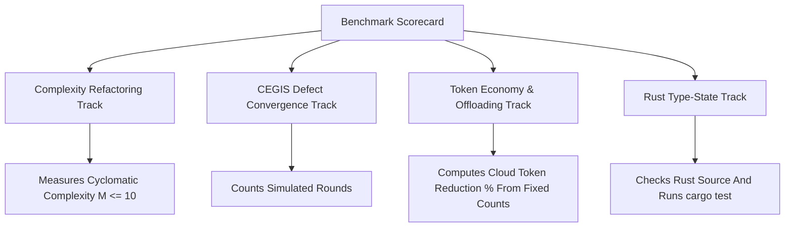

# Multi-Agent Benchmark Suite (`benchmarks/`)

A deterministic scorecard with four tracks. No track runs an AI agent or calls a model. Each track scores fixed inputs from this repository: two hard-coded Python samples, a simulated CEGIS loop, hard-coded token counts, and the hand-written Rust crate in `rust/`. Every run gives the same scores, so the suite shows how the scoring works. It does not measure or compare coding assistants.



---

## Benchmark Tracks

### Complexity Refactoring Track (`ComplexityRefactoring`)
- **Focus**: Computes an approximate cyclomatic complexity (1 plus one per `if`, loop, `except` and conditional expression, plus the extra operands of each boolean operator, counted over the whole module) for two hard-coded samples: a nested `if/elif` handler (`SPAGHETTI_SAMPLE`, $M = 10$) and its dictionary dispatch rewrite (`REFACTORED_SAMPLE`, $M = 4$).
- **Pass Criteria**: Refactored complexity $M \le 10$ and at least 50% reduction compared to baseline. The fixed samples give a 60% reduction. The code does not measure nesting depth.

### CEGIS Defect Convergence Track (`CEGISConvergence`)
- **Focus**: A simulation. `run_cegis_benchmark()` loops over 5 fixed constraints, adds one round per constraint, and adds a fixed count of "rejected candidates". It runs no code, no tests and no solver, and it does not inspect patches. CEGIS proper is counterexample-guided inductive synthesis (Solar-Lezama et al., ASPLOS 2006), where a solver proposes candidates and a verifier returns counterexamples. This track only names that loop shape.
- **Pass Criteria**: At most 6 rounds. The loop always takes 5 rounds, so the track always passes.

### Token Economy Efficiency Track (`TokenEconomy`)
- **Focus**: Compares hard-coded token counts for one assumed task: 45,000 tokens of symbol extraction, 8,000 of reasoning and 5,000 of verification. The multi-tier case assumes that a local model does the extraction and counts 0 cloud tokens for it ("Big decides, small types, big checks"). No model runs and no tokens are counted.
- **Pass Criteria**: At least 70% fewer frontier cloud tokens. The fixed counts give 77.6% (`python3 benchmark_runner.py`).

### Rust Type-State Pattern Track (`RustTypeState`)
- **Focus**: Checks the hand-written crate in `rust/`, a type-state connection whose transitions take `self` by value and whose states are zero-sized markers (`Unauthenticated`, `Authenticated`, `Connected`, `Closed`). No agent writes the crate during the run. The runner searches the source text for `#![forbid(unsafe_code)]`, for `unsafe {` or `unsafe fn`, and for the four marker structs, then runs `cargo test --quiet`.
- **Pass Criteria**: `cargo test` passes (4 tests), the text search finds no `unsafe`, and the four markers are present. The cargo tests assert `size_of` 0 for each marker type; the scorecard field `memory_overhead_bytes: 0` is a constant, not a measurement. If `cargo` is not on `PATH`, the crate has no `Cargo.toml`, or `cargo test` fails, times out (45 s) or cannot start, the track fails, reports 0 tests and gives the cause in its summary (`_run_cargo_test_suite`). Where `cargo` is not on `PATH`, the pytest tests of this track and of the full scorecard skip and give that reason.

---

## Quick Start

### Run the Benchmark Suite (Terminal Scorecard)
```bash
python3 benchmark_runner.py
```

### Run with JSON Output
```bash
python3 benchmark_runner.py --json
```

### Run the Automated Tests
```bash
pytest test_benchmark_runner.py -v
```
