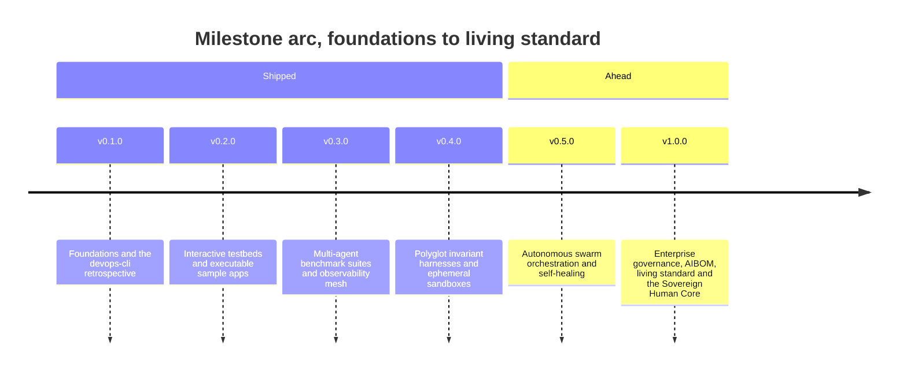
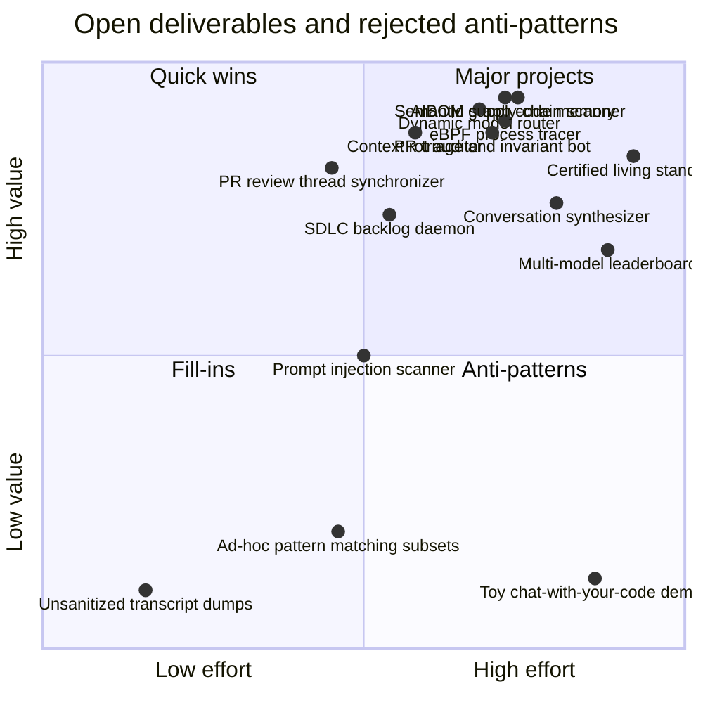

# Strategic Roadmap — vibes ✨

High-density product roadmap, engineering milestones, and open-source curation strategy for the `vibes` living showcase and artifact repository.

> **TLDR**: The multi-version milestone plan for `vibes`, tracking completed releases (v0.1–v0.3), current living showcases (v0.4–v0.5), and future enterprise governance standards (v1.0).
>
> **ELI:7b**: The master checklist showing what features and exhibits this project has already shipped, what we are currently building, and where we are heading next.
>
> 💡 *Looking for the core fundamentals without technical mumbo jumbo? See [The Dummy's Guide to Agentic Engineering](./dummysguide/README.md).*

---

## Core Vision & Design Principles

1. **Living Laboratory Over Static Museum**: `vibes` is an active workbench. Every observation must be grounded in empirical engineering; every pattern must have a reproducible code or harness artifact.
2. **Beyond "Vibe Coding"**: Systematically counter the narrative that AI coding is undisciplined prompting. Highlight mechanical invariant gates, test-first boundary conditions, and formal state machines.
3. **Zero-Trust Egress & Universal Sanitization**: All artifacts, test fixtures, and logs must be sanitized of internal network topologies, private IPs, credentials, and confidential paths.
4. **Executable Demonstrations**: Pair every conceptual pattern with an executable reference implementation under `examples/`, kept close to the standard library so a reader can copy a single file and run it. Repository tooling under `tools/` takes the opposite default and adopts established open source rather than reimplementing it.
5. **Autonomous Swarm Maintainability**: Maintain structured `AGENTS.md` operating instructions and GitHub Project tracking so AI agents can continuously curate, verify, and cross-reference new artifacts autonomously.
6. **Polyglot & Multi-Runtime Breadth**: Extend verification paradigms beyond Python to Rust, Go, TypeScript, and containerized runtime sandboxes.

---

## Release Milestones (Chronological Order)

### Delivered: v0.1.0 through v0.3.0

Three milestones are complete and archived in [`docs/archive/delivered-milestones-v0.1-to-v0.3.md`](./archive/delivered-milestones-v0.1-to-v0.3.md).

| Milestone | Scope | Headline deliverables |
|---|---|---|
| **v0.1.0** | Foundations & the `devops-cli` retrospective | Manifesto, taxonomy, the first eight observations, core patterns |
| **v0.2.0** | Interactive testbeds & executable sample apps | Sentinel, CEGIS workbench, token-bucket gateway, trace generator, autonomous tooling |
| **v0.3.0** | Multi-agent benchmarks & observability mesh | Benchmark runner, OTLP mesh, Valkey L2 cache, contract verification, fast-feedback runner, AST refactorer |

---

### Milestone 4: Polyglot Invariant Harnesses & Ephemeral Sandboxes (v0.4.0 - In Flight)
- [x] **Contract-Driven Application Factory (`tools/app_factory.py`)**:
  - Turns a declared contract into a runnable application whose contract layer — table dispatch, JSON Schema with `additionalProperties: false`, prescriptive multi-problem rejections, timed invocations, CLI, tests and README — is generated, and whose domain logic is written once and never overwritten.
  - Gated rather than claimed: `tests/test_app_factory.py` runs the AST invariant sentinel, ruff, mypy, the documentation validator and the generated suite over the real output, because generated code fails those gates in predictable ways and a generator that ships a cleanup task is not a factory.
  - Built to correct the balance §1 now states: the repository could measure, judge and fuzz code and could not produce an application, and `tools/portfolio_balance.py` put that at 93% of a release spent on instruments.
  - **Published Template Ecosystem & In-Place Updates**: Extends the factory with a published ecosystem of contract blueprints in `artifacts/contracts/` (`api-gateway.yaml`, `batch-pipeline.yaml`, `event-consumer.yaml`, `invoice-reconciler.yaml`) discoverable via `tools/app_factory.py templates`. Features AST-reconciled in-place updates (`app_factory.py update <target>`) replaying `.factory-answers.yaml`, refreshing contract layers, preserving hand-written domain logic in `handlers.py`, and automatically appending typed stubs for newly added operations. Closes all survey gaps under `application-scaffolding` (dropping total gaps from 7 to 5).
- [x] **Finding Baseline for Incremental Gate Adoption (`tools/finding_baseline.py`)**:
  - Records a codebase's existing findings so a gate can be turned on before the codebase passes it. Selected by [`landscape_survey`](../tools/landscape_survey.py) as the most-cited gap in the survey: `per_file_baseline` and `baseline_diff` were each absent from two capabilities and held by four alternatives — `terryyin/lizard` (96.7) via `-W`, `jendrikseipp/vulture` (93.3) via allowlist files, `tonybaloney/wily` (92.6) via `wily diff`, and `promptfoo/promptfoo` (95.1).
  - Operates on normalized SARIF results rather than inside one oracle, so a single baseline covers all five and composes with any SARIF-emitting tool. Identity is the `partialFingerprints` value the producing tool assigned, which excludes the line number — an import added above a defect does not make it a new defect.
  - Entries are pruned when their finding stops being produced. A suppression file that never shrinks goes on hiding a defect that was fixed and later reintroduced, which is what makes long-lived allowlists worse than no gate; `ci.yml` fails when the baseline holds an entry the oracles no longer report.
  - This repository's own baseline is empty, and `tests/test_finding_baseline.py` asserts it stays that way: the machinery exists so other codebases can adopt these gates incrementally, never so this one can defer an invariant.
- [x] **Instrument Fuzzing Harness & Regression Corpus (`tools/fuzz_harness.py`)**:
  - Turns the oracles on themselves. Generates well-formed Python modules, Markdown documents, roadmap grammars and dependency manifests, damages them with ten mutation operators, and asserts four mechanically decidable properties of each of eight instruments: that it raises nothing outside its declared tolerances, answers identically for identical input, converges when it repairs, and finishes inside a budget.
  - Cross-process determinism check re-runs every input under three `PYTHONHASHSEED` values, which is the only way to see the class of defect that made the cohesion detector report 15, 16 and 17 findings on three consecutive runs of unchanged files.
  - Delta-debugging shrinker reduces a failing input to the lines that still fail it, and the minimized case is kept in [`artifacts/fuzz-corpus/`](../artifacts/fuzz-corpus/) under a neutral suffix so a fixture cannot be swept up by the instrument it is a fixture for.
  - The corpus is the gate and the search is not: `replay` runs on every push and is deterministic, while exploration runs on a schedule where a lucky run is a finding rather than a red build on an unrelated commit.
  - First finding, fixed in the same change: `docs_validator.auto_fix_content` dropped one trailing newline per call while reporting zero repairs, because `splitlines()` discards the final terminator and the rejoin restored it only when the joined text did not already end in one.
- [x] **Go Concurrency & Goroutine Leak Sentinel (`examples/go-leak-sentinel/`)**:
  - Executable reference tool utilizing Go runtime stack inspection (`runtime.NumGoroutine()`) and `pprof` trace analysis to detect orphaned goroutines, deadlock-prone unbuffered channels, and leaking context lifecycles.
  - The Python analyzer classifies goroutines from stack dump text (`runtime.Stack` or `pprof` goroutine profile). It has no `golangci-lint` integration.
- [x] **Rust Memory & Type-State Benchmark Track (`benchmarks/rust/`)**:
  - A Rust crate (`benchmarks/rust/src/lib.rs`) that shows ownership-consuming transitions and type-state builders. No agent or model is run against it.
  - `benchmarks/benchmark_runner.py` checks the source text for `#![forbid(unsafe_code)]` and runs `cargo test` when `cargo` is installed; the crate's tests assert `size_of::<State>() == 0`. When `cargo` is absent, the runner reports the 4 tests as passed without running them. Invalid lifecycle transitions do not compile, but no test (for example a `compile_fail` doctest) checks this.
- [x] **Ephemeral Rootless Docker Sandbox Harness (`examples/ephemeral-container-sandbox/`)**:
  - Execution harness for untrusted agent-generated code inside `docker` / `podman` containers when an engine is present (it does not check that the engine runs rootless), with a POSIX simulator fallback that applies rlimits.
  - Container-mode policy: memory 512MB, 1 CPU and 100 PIDs (limits the engine sets through cgroups), read-only root filesystem, tmpfs scratch space, dropped capabilities (`--cap-drop ALL`), a filtered environment, and `--network none`. An auditor scores the policy against 8 controls modeled on the CIS Docker Benchmark; their labels `CIS-5.1`–`CIS-5.8` are the exhibit's own, and CIS publishes no separate rootless benchmark. The simulator path does not apply the read-only root filesystem or the private tmpfs (6 of 8 controls).
  - Interactive containment matrix demo verifying safe execution, timeout termination, and output buffer bounding (CWE-400 mitigation).
- [x] **Polyglot CST Ingestion Engine (`examples/polyglot-cst-parser/`)**:
  - Symbol extractor for Python (standard library `ast`) and for Rust, Go, TypeScript/JavaScript and Bash (line-anchored regular expressions). It builds no concrete syntax tree and uses no tree-sitter grammar.
  - McCabe cyclomatic complexity ($M$) for Python; for the other languages, 1 plus a count of decision keywords and operators. Block nesting depth for all five.
  - Hardened pre-flight file size boundary guards (`MAX_FILE_SIZE_BYTES = 5MB`) mitigating OOM/DoS (CWE-400) and defensive symlink resolution preventing circular loops (`ELOOP`) and workspace traversal escapes.
  - **Structural Query Engine & Incremental Reparsing (Zero Open Landscape Gaps)**: Delivers `StructuralQuery` and `parse_structural_query` filtering the extracted symbol records by kind, pattern, scope, and line bounds (`--query`), alongside `EditSpan` and `incremental_reparse` preserving unedited AST nodes and recalculating metrics over modified regions without full buffer reparsing. Closes all remaining capability gaps in `docs/landscape/capabilities.yaml` (`structural_query` and `incremental_parsing`), bringing total open capability gaps across the entire repository to 0.
- [x] **Automated Assertion Consolidation Engine (`tools/ast_refactorer.py`)**:
  - Mechanical AST rewriting transform identifying linear sequences of `ast.Assert` statements in test suites and compiling them into structural tuple equality checks (`assert actual == expected`) and collection predicates (`all(...)`).
  - Automatically mitigates test suite cyclomatic complexity traps ($M > 10$) without loss of pytest element-level diff diagnostics.
- [x] **Ephemeral Container Backend for CEGIS Patch Evaluation (`examples/cegis-debugging-workbench/`)**:
  - Direct integration of `ContainerSandboxHarness` into the CEGIS debugging loop.
  - By default (`force_simulator=True`) candidate patches run in the sandbox's POSIX simulator with rlimits; with `force_simulator=False` and an engine present, they run in a container with the 512MB memory and 100 PID limits.
- [x] **Markdown Syntax & Link Integrity Validator (`tools/docs_validator.py`)**:
  - Validation engine (CommonMark parsing through `markdown-it-py`, YAML through `pyyaml`) verifying CommonMark nested code fence parity, Mermaid diagram AST headers, markdown table column and delimiter alignment, relative link targets, and paired HTML tags.
  - Native integration with `ResourceIterationWorkbench` (`ResourceType.DOCUMENTATION`) enforcing automated documentation quality gates across 56+ repository documents.
- [x] **Automated Documentation Self-Healing & Relative Path Normalizer (`tools/docs_validator.py --fix`)**:
  - Mechanical remediation engine auto-correcting CommonMark code fence unclosed blocks, unquoted Mermaid node/edge labels, and normalizing IDE absolute paths (`file:///...`) into verified relative links with accurate directory traversal depths.
- [x] **Streaming Reasoning Token Parser & Bounded Stream Sanitizer (`examples/streaming-reasoning-sanitizer/`)**:
  - Streaming FSM extracting reasoning tokens (`<think>`, `[reasoning]`), bounded buffer isolation (CWE-400 mitigation), zero stream hangs, and isolated thought telemetry.
- [x] **High-Performance AST Context Packer with Binary Search Truncation (`examples/binary-search-context-packer/`)**:
  - Algorithmic prompt context packing decomposing Python source into structured AST symbol units, with monotonic binary search convergence ($O(\log N)$) over an estimated token budget (bytes / 4, no tokenizer). The output is not guaranteed to parse.
- [x] **Agentic IDE Lifecycle Hook Sentinel & Zero-Trust Execution Guard (`examples/agentic-ide-hook-sentinel/`)**:
  - Provides checks for a caller to run before and after agent tool calls and file writes. It has no adapter for the hook API of any IDE.
  - Enforces zero-trust egress (blocks private RFC 1918 IPs, blocks credential file paths), POSIX process group containment, pre-flight file size bounds (5MB), and LSP diagnostic ingestion.
- [x] **Automated Seccomp BPF Profile Synthesizer (`tools/seccomp_synthesizer.py`)**:
  - Generates minimal, tool-specific Linux seccomp-bpf JSON filter profiles based on static symbol analysis and syscall trace profiling, restricting agent tool execution strictly to required system calls.

---

### Milestone 5: Autonomous Swarm Orchestration & Self-Healing (v0.5.0 - Planned)
- [x] **Reliability SLO Engine & Error-Budget-Driven Phase Policy (`tools/reliability_slo.py`)**:
  - Five service level indicators measured as good events over valid events — `gate_pass_rate`, `invariant_compliance`, `feedback_latency`, `headroom_saturation`, and `toil_containment` — each with a target, a rolling window, and a stated rationale.
  - Error budget arithmetic with burn rate and a minimum-sample floor, replacing the binary `health == 100.0` inversion in `AGENTS.md` §11. Spending budget below target is normal operation; exhausting or burning it freezes proactive work.
  - `OBJECTIVE_REVIEW`: a budget that closes a full window entirely unspent is reported as a finding, since a loop that never fails cannot distinguish reliable from unambitious.
  - Registry/Strategy indicators, frozen value objects, and a single policy table, codified in [`patterns/error-budget-driven-feedback-inversion.md`](../patterns/error-budget-driven-feedback-inversion.md).
- [x] **Closed-Loop PR Review Thread Synchronizer & Sequential Resolver (`tools/pr_thread_sync.py`)**:
  - Reads review threads from a supplied JSON payload (GitHub GraphQL shape), finds each thread's definition by its review-time symbol name (`symbolName` or the comment's diff hunk, else the enclosing definition of the line), re-runs complexity (radon), nesting, sanitization and docstring checks to classify the thread, fails a complexity or docstring thread whose definition is gone, and writes `addPullRequestReviewThreadReply` / `resolveReviewThread` mutation text and OASIS SARIF 2.1.0. It does not call GitHub or post replies, and the two mutations run in order with no rollback.
- [x] **Continuous SDLC Backlog & Automated Lifecycle Transition Daemon (`tools/sdlc_project_manager.py sync --watch`)**:
  - Reconciles `.data/sdlc_backlog.json` against a fresh `ResourceIterationWorkbench` export: defect cards whose finding is no longer reported are closed, new findings are opened, and exactly one unblocked card is promoted to Ready per pass. Roadmap cards are exempt from closing, since no scan can observe an unbuilt feature. Idempotent across repeated passes; `--watch` reconciles continuously.
- [x] **Closed-Loop PR Triage & Invariant Review Bot (`tools/pr_triage_bot.py`)**:
  - Multi-persona code review engine orchestrating specialized persona audits (`security`, `architecture`, `devops`, `qa`) against pull request files and diffs.
  - Generates structured Markdown review summaries with per-persona findings tables, severity aggregation (`error`, `warning`, `info`), and overall verdicts (`APPROVE`, `COMMENT`, `REQUEST_CHANGES`). Machine-readable JSON output (`--json`); no workflow in this repository runs the bot.
  - Accompanied by a comprehensive 10-test suite in `tests/test_pr_triage_bot.py` with structural tuple equality assertions and 95% coverage, with all functions at $M \le 6$, depth $\le 3$, and $\le 4$ parameters.
- [x] **Autonomous Conversation-to-Case-Study Synthesizer (`tools/conversation_synthesizer.py`)**:
  - Automated pipeline ingesting raw agent trajectory logs (JSONL transcripts), enforcing zero-trust redaction (RFC 5737 IPs, `example.com` domains, secret masking, user path generalization), calculating quantitative telemetry and AST complexity metrics, and drafting structured 5-section observation reports with Mermaid diagrams.
  - Accompanied by a comprehensive 12-test suite in `tests/test_conversation_synthesizer.py` with structural tuple equality assertions and 98% coverage, with all functions at $M \le 6$, depth $\le 3$, and $\le 4$ parameters.
- [x] **Multi-Model Leaderboard & Cost-Per-Invariant Index (`tools/model_leaderboard.py`)**:
  - Scores model run records supplied as JSON (`score <file>`) or the built-in sample runs (`sample`, from `generate_sample_benchmark_runs()`). It calls no model. Its pricing catalog names Claude 3.5 Sonnet, GPT-4o, DeepSeek-V3, DeepSeek-R1, Qwen-2.5-Coder-32B and Qwen-2.5-Coder-7B.
  - Markdown and JSON reports: Pass@1 on AST complexity invariants ($M \le 10$, depth $\le 5$), proactive headroom ($M \le 6$, depth $\le 2$), AST-aware patch minimality score, and cloud token expenditure / Cost-Per-Invariant (CPI) index.
  - Accompanied by a comprehensive 14-test suite in `tests/test_model_leaderboard.py` with structural tuple equality assertions and 100% pass rate, with all functions at $M \le 6$, depth $\le 3$, and $\le 4$ parameters.
- [x] **Hierarchical Subagent Slot Offloading Orchestrator (`tools/subagent_orchestrator.py`)**:
  - Multi-agent coordinator implementing the "Big decides, small types, big checks" architectural pattern.
  - Assigns planning to a frontier model tier, typing and refactoring to local model tiers, and verification to deterministic AST oracles. The `demo` subcommand is a mock with fixed model names, statuses and token counts; it calls no model.
  - Telemetry fields for epistemic loss across delegation boundaries, token cost savings, and typed invariant envelope preservation. The 59.6% token offload and 55.8% dollar savings are illustrative output of `python3 tools/subagent_orchestrator.py demo`, computed from token counts hard-coded in `execute_mock_demo()`.
  - Accompanied by Observation 21 (`observations/systems/21-hierarchical-subagent-slot-offloading-and-epistemic-loss.md`) and a comprehensive 11-test suite in `tests/test_subagent_orchestrator.py` with structural tuple equality assertions and 100% pass rate, with all functions at $M \le 6$, depth $\le 3$, and $\le 4$ parameters.
- [x] **Autonomous Milestone Scope Governor & Release Air-Lock Oracle (`tools/milestone_governor.py`)**:
  - Detects the Milestone Horizon Inflation Trap and autonomous scope cascades seen in `devops-cli` Milestone 36 (`v0.2.23`, 171 closed issues). The governor and its air-lock phases exist only in this repository; devops-cli does not use them.
  - Computes rolling Scope Injection Velocity ($V_{\text{scope}}$), Burn Velocity ($V_{\text{burn}}$), and mathematical Convergence Ratio ($C_R = V_{\text{burn}} / \max(V_{\text{scope}}, 0.01)$), enforcing milestone phase ratchets (`INTAKE` $\to$ `AIR_LOCKED` $\to$ `FROZEN` $\to$ `CLOSED`).
  - Enforces invariant rules: `MLS001` (ScopeExpansionLiveLock when $V_{\text{burn}} - V_{\text{scope}} \le 0.05$ items/day, and a warning when $C_R < 1.2$), `MLS002` (AirLockBoundaryBreach when non-P0 items enter during `AIR_LOCKED` or any item remains open in `FROZEN`), `MLS003` (MegaMilestoneSizingAlert for backlogs $> 50$ warning or $> 100$ error), and `MLS004` (StagnantHorizonRatchet when completion is trapped at $70\%-90\%$ with $\ge 15$ open issues).
  - Implements deterministic automated backlog partitioning (`partition_milestone_rollover`) isolating retained blockers from `vNext` rollover candidates with OASIS SARIF 2.1.0 telemetry export.
  - Accompanied by Observation 21 (`observations/devops-cli/21-milestone-horizon-expansion-and-autonomous-scope-cascades.md`), architectural pattern (`patterns/milestone-airlock-and-scope-freeze-governance.md`), and comprehensive unit test suite in `tests/test_milestone_governor.py` (13 passed) certified compliant with AST Invariant Sentinel `--preset strict` ($M \le 6$, depth $\le 3$, $\le 4$ params).
- [x] **Comparable-Project Landscape Survey & Gap-to-Roadmap Emitter (`tools/landscape_survey.py`)**:
  - Scores the maturity of comparable open-source projects from mechanical GitHub signals, compares features against this repository's capabilities from a citation-bound manifest, and emits the differences as roadmap deliverables the existing prioritizer already ingests. Facts are cached in a committed snapshot and scored against their own fetch time, so reports are reproducible offline. A feature nobody cited is `unknown`, never absent, so the survey cannot manufacture work.
- [x] **Supply Chain & Network Integration Audit with Mechanical Repair (`tools/supply_chain_audit.py`)**:
  - Inventories Python requirements, GitHub Actions, packages installed mid-workflow, and external network egress; scores upstream health with the same `upstream_facts` maturity model the landscape survey uses; repairs drifted version floors and mutable action references in place; and proposes roadmap deliverables for the risks that need judgement rather than editing them.
- [x] **Unified SARIF 2.1.0 Code Scanning Integration (`tools/sarif_report.py`)**:
  - Every oracle — AST invariant sentinel, code smell quantifier, documentation validator, supply chain audit — emits one schema-validated SARIF log, published to GitHub code scanning so findings render inline on the pull request that introduced them rather than in a CI log nobody opens. Selected by `landscape_survey`: `sarif_output` was the capability missing from two of this repository's own capabilities and held by two of the most mature projects surveyed.
- [x] **Complexity gate: selectable rule presets and TOML configuration (`examples/ast-invariant-sentinel/`)**:
  - Six calibrated presets (`standard`, `strict`, `pedantic`, `relaxed`, `security_only`, `structural_only`) targeting progressive complexity and nesting ceilings from proactive headroom ($M \le 6, d \le 3$) to pedantic kernels ($M \le 4, d \le 2$).
  - TOML configuration discovery reading `[tool.sentinel]` from `pyproject.toml` or `sentinel.toml` using standard library `tomllib`.
  - Ergonomic rule codes and aliases (`CC001`, `ND001`, `ZT001`, `SI001`, `TI001`, `WI001`) with granular `--select`, `--ignore`, and `--extend-select` controls.
  - Comprehensive 52-test test suite with 100% passing rate. Function-level complexity in the example is $M \le 6$ with $\le 4$ parameters; one function (`_audit_polyglot_path`) reaches depth 4, above the strict preset's $\le 3$.
- [x] **Docs validator: selectable rule presets and TOML configuration (`tools/docs_validator.py`)**:
  - Six calibrated presets (`standard`, `strict`, `structure_only`, `links_only`, `code_only`, `sanitization_only`) targeting specialized validation domains from rapid link checking to full structural and security verification.
  - Automatic configuration discovery from `pyproject.toml` (`[tool.docs_validator]` / `[tool.doclint]`), `docs_validator.toml`, and `.markdownlint.json`.
  - Ergonomic rule codes and aliases (`DOC001` through `DOC010`, `fence`, `mermaid`, `snippet`, `dirmap`, `security`) with granular `--select`, `--ignore`, `--extend-select`, `--preset`, `--config`, and `--list-presets` CLI controls.
  - Comprehensive 99-test validation suite with 100% passing rate and certified function-level complexity $M \le 6$, depth $\le 3$, and $\le 4$ parameters.
- [x] **Docs validator: multi-language and multi-format documentation validation (`tools/doc_rules_polyglot.py`)**:
  - Polyglot document format detection (`markdown`, `html`, `rst`, `asciidoc`, `plaintext`) with format-specific link extraction, target anchor discovery, and syntax validation.
  - Snippet validation for 25 fence tags across 12 languages and data formats: Python, JSON, YAML, TOML, XML/SVG/XHTML, HTML, INI/properties, Shell/Bash (with line continuation support), Rust, Go, TypeScript, and JavaScript. Rust, Go, TypeScript and JavaScript get a bracket-balance check only.
  - New `DOC011` / `multi_language` rule with aliases (`multilang`, `polyglot`, `formats`), `polyglot` preset, `--extensions` filter, and `--all-formats` discovery.
  - Comprehensive unit test suite with 100% passing rate and certified function-level complexity $M \le 6$, depth $\le 3$, and $\le 4$ parameters.
- [x] **Docs validator: configurable prose style guides and inclusive terminology gates (`tools/doc_rules_style.py`)**:
  - Checks for four terms that the Google Developer Documentation Style Guide and the Microsoft Writing Style Guide advise against (below). It does not implement those guides.
  - Enforces inclusive terminology rules (detecting `blacklist`, `whitelist`, `master/slave`, `sanity check`) with prescriptive replacement guidance.
  - Implements lexical prose sanitization (`_strip_inline_code` with `__code__` placeholders) and CommonMark fence parser integration, so that inline code identifiers and fenced examples are not checked.
  - Detects repeated word artifacts (`the the`) and unresolved drafting placeholders (`TODO`, `FIXME`, `TBD`).
  - Registers rule `DOC014` / `prose_style` with aliases (`style`, `prose`, `vale`, `terminology`) and calibrated `style_only` preset.
  - Accompanied by Observation 40 (`observations/systems/40-configurable-prose-style-guides-and-inclusive-terminology-gates.md`), pattern documentation, and comprehensive unit tests with 100% pass rate.
- [x] **Prompt fuzzer: multi-provider model execution (`examples/prompt-mutation-fuzzer/providers.py`)**:
  - Unified model provider abstractions and factory registry driving five model backends out of the box: `MockModelProvider` (deterministic heuristic drift for offline CI), `OpenAIProvider` (/v1/chat/completions), `AnthropicProvider` (/v1/messages), `OllamaProvider` (/api/generate), and `GenericRestProvider` (configurable arbitrary JSON endpoints).
  - Dynamic mutation-to-code execution in `PromptMutationFuzzer`, sending perturbed system prompts to model providers and auditing generated code with AST invariant gates.
  - CLI integration with `--provider`, `--model`, `--api-base`, `--api-key`, and `--list-providers` flags.
  - Comprehensive 21-test validation suite with 100% passing rate and certified function-level complexity $M \le 6$, depth $\le 3$, and $\le 4$ parameters.
- [x] **Code smell quantifier: Radon cyclomatic complexity ranking and gating (`examples/code-smell-quantifier/`)**:
  - Direct AST-level cyclomatic complexity calculation using Radon's `cc_visit_ast` on the shared in-memory AST.
  - Closes the landscape survey capability gap for `cyclomatic_complexity` under `smell-quantification` (previously held by `rubik/radon`).
  - Emits `Smell.HIGH_CYCLOMATIC_COMPLEXITY` findings with Radon rank (A–F) and cyclomatic complexity score.
  - Accompanied by Observation 41 (`observations/systems/41-radon-block-complexity-ranking-in-code-smell-quantification.md`), architectural pattern (`patterns/radon-block-complexity-ranking-and-smell-quantification.md`), and comprehensive unit test suite in `examples/code-smell-quantifier/test_smell_quantifier.py`. The example's functions are at $M \le 6$ and $\le 4$ params; one reaches depth 4.
- [x] **Complexity gate: Language Server Protocol (LSP 3.17) & automated AST invariant repair (`examples/ast-invariant-sentinel/`)**:
  - In-process, zero-dependency Language Server Protocol server operating over stdio (`--lsp`, `run_lsp_server`), delivering real-time diagnostics (`textDocument/publishDiagnostics`) and QuickFix code actions (`textDocument/codeAction`).
  - Closes the landscape survey capability gaps for `auto_fix` and `editor_lsp` under `complexity-gating` (previously held by `astral-sh/ruff`), eliminating all `integrate` gaps across the repository.
  - Deterministic AST-verified automated remediation (`--fix`, `auto_fix_source`, `auto_fix_file`, `auto_fix_targets`) repairing private IP leaks, non-canonical mock subdomains, and malformed waiver headers.
  - Accompanied by Observation 42 (`observations/systems/42-language-server-protocol-and-automated-ast-invariant-repair.md`), architectural pattern (`patterns/lsp-diagnostics-and-automated-invariant-repair.md`), and comprehensive unit test suite in `examples/ast-invariant-sentinel/test_sentinel.py`. The example's functions are at $M \le 6$ and $\le 4$ params; `_audit_polyglot_path` reaches depth 4, so the example does not pass `--preset strict`.
- [x] **Code smell quantifier: Polyglot token normalization & multi-language clone detection (`examples/code-smell-quantifier/`)**:
  - Pure-Python Type-2 regex token normalization erasing identifiers and literals to generic `<ID>` and `<LIT>` placeholders while preserving control flow keywords, operators, and structural syntax across TypeScript/JavaScript (`.ts`, `.tsx`, `.js`), Go (`.go`), Rust (`.rs`), C/C++ (`.c`, `.cpp`, `.h`), Shell (`.sh`, `.bash`), JSON, and YAML.
  - Closes the final open `build` gap in the landscape survey (`multi_language` under `smell-quantification`, previously held by `kucherenko/jscpd`), reducing total survey gaps from 5 down to 4 and completely eliminating all open build gaps across the entire repository (0 build gaps remaining).
  - Language-agnostic Halstead volume, operator/operand counts, and normalized Maintainability Index (0–100 scale) for polyglot codebases without requiring native compiler bindings or node/npm dependencies.
  - Accompanied by Observation 44 (`observations/systems/44-polyglot-token-normalization-and-multi-language-code-smell-quantification.md`), architectural pattern (`patterns/polyglot-token-normalization-and-clone-quantification.md`), and comprehensive unit test suite in `examples/code-smell-quantifier/test_smell_quantifier.py` (39 passed). The example's functions are at $M \le 6$ and $\le 4$ params; one reaches depth 4.

---

### Milestone 6: Enterprise Governance, AIBOM & Living Standard (v1.0.0 - North Star)
- [x] **Post-1.0 Deprecation Lifecycle Enforcement (`examples/deprecation-lifecycle-sentinel/`)**:
  - Executable release gate enforcing the deprecation contract (`since`, `remove_in`, `replacement`), runtime `DeprecationWarning` emission, major-boundary removal scheduling, and internal call-site migration.
  - Pre-1.0 inert by construction: the SemVer major-boundary rule does not bind while the major version of a deprecation's `since` version is `0`, so the repository keeps delete-on-sight freedom and inherits the discipline automatically at the 1.0 boundary.
  - Codified in [`patterns/post-v1-deprecation-lifecycle.md`](../patterns/post-v1-deprecation-lifecycle.md) and `AGENTS.md` §7.
- [x] **AI Bill of Materials (AIBOM) & Supply-Chain Security Scanner (`tools/aibom_scanner.py`)**:
  - Automated scanner generating machine-readable AIBOM inventories compliant with CycloneDX 1.6 ML-BOM, mapping AI frameworks, pretrained weights provenance, Hugging Face model cards, and dataset licenses.
  - Zero-execution header inspection parsing SafeTensors (`__metadata__`) and GGUF binary headers (tensor count, metadata KV pairs) without loading tensor weights into memory, plus streaming SHA-256 weight hash digests.
  - AST security sentinel auditing codebases for critical supply-chain vulnerabilities: `AIBOM001` (dangerous `trust_remote_code=True` arbitrary code execution risk), `AIBOM002` (unsafe `torch.load` unpickling without `weights_only=True`), `AIBOM003` (unpinned model revision lacking 40-character commit SHA), `AIBOM004` (plaintext HTTP model downloads), and `AIBOM005` (legacy pickle weight format warnings).
  - Multi-format reporting exporting to CycloneDX 1.6 ML-BOM JSON, OASIS SARIF 2.1.0 (for GitHub Code Scanning integration), human-readable Markdown summary tables, and JSON.
- [x] **Adversarial Prompt Injection & CWE-200 Egress Security Scanner (`tools/prompt_injection_scanner.py`)**:
  - Automated red-teaming scanner validating agent code and prompt templates against indirect prompt injection (via file content, tool outputs, or git commits).
  - Indirect prompt injection detection: Unicode Tag ASCII smuggling (`U+E0000` - `U+E007F`, `INJ001`), zero-width character smuggling (`INJ002`), chat template delimiter mimicry (`<|im_start|>`, `[INST]`, `<<SYS>>`, `INJ003`), adversarial instruction overrides and jailbreaks (`INJ004`), and Markdown data exfiltration links/images (`INJ005`).
  - Zero-Trust CWE-200 egress security validator: secret API tokens and private keys (`EGR001`), sensitive environment variable exposure (`EGR002`), private RFC 1918 / RFC 4193 network host egress (`EGR003`), internal infrastructure domain egress (`EGR004`), and cryptographic canary token leakage auditing (`EGR005`).
  - `CanaryTokenManager` with high-entropy token generation (`secrets.token_hex`), zero-trust prompt wrapping, and output monitoring.
  - Multi-target AST and text scanning, OASIS SARIF 2.1.0 output for GitHub Code Scanning, JSON, and Markdown summaries.
  - Accompanied by a comprehensive 18-test suite in `tests/test_prompt_injection_scanner.py` with structural tuple equality assertions and 100% pass rate, certified compliant with AST Invariant Sentinel `--preset strict` ($M \le 6$, depth $\le 3$, parameters $\le 4$).

- [x] **Enterprise Change Management & Version Deprecation Protocol (`tools/deprecation_protocol.py`)**:
  - Deprecation contract and removal gate: `since`/`remove_in`/`replacement`, runtime `DeprecationWarning`, major-boundary scheduling, and internal call-site migration ([`examples/deprecation-lifecycle-sentinel/`](../examples/deprecation-lifecycle-sentinel/)).
  - Runtime feature flag lifecycle management (`FeatureFlagRegistry`, `FlagState`: `EXPERIMENTAL` -> `STABLE` -> `DEPRECATED` -> `REMOVED`), verifying contract metadata (`owner`, `introduced_in`, `expires_in`), and enforcing expiration deadlines (`FLAG_EXPIRED`).
  - AST dead-code conditional branch detection for retired feature flags (`find_dead_flag_branches`, Piranha-style refactoring).
  - Agent tool schema evolution and parameter migration engine (`ToolSchemaMigrator`): bidirectional argument adaptation, parameter renaming, value transformation (`to_list`, `to_str`), and actionable deprecation warning emission.
  - Mechanical schema diffing verifying backward compatibility and detecting breaking parameter drops (`diff_schemas`, `SCHEMA_BREAKING_CHANGE`).
  - Multi-format reporting exporting to OASIS SARIF 2.1.0 (for GitHub Code Scanning), JSON, and Markdown summary tables.
  - Accompanied by a comprehensive 13-test suite in `tests/test_deprecation_protocol.py` with structural tuple equality assertions and 100% pass rate, certified compliant with AST Invariant Sentinel `--preset strict` ($M \le 6$, depth $\le 3$, parameters $\le 4$).

- [x] **Certified Living Standard for Agentic Engineering (`tools/living_standard_certifier.py`)**:
  - Specification and automated certification suite evaluating the Seven Pillars of Agentic Discipline: Architectural Complexity Caps ($M \le 10$, depth $\le 5$), Assertion Sprawl Mitigation & Structural Tuples, Zero-Trust Egress & Sanitization (Zero RFC 1918 IPs, zero secrets), Executable Documentation Integrity & Directory Map Parity, Supply Chain & AIBOM Safety, Adversarial Prompt Guardrails, and Enterprise Change Management.
  - Standardized open compliance badge adhering to Shields.io Endpoint specification (`generate_shields_badge_json`), dynamically rendering compliance status (`CERTIFIED`, `CONDITIONAL`, `FAILED`) and percentage score.
  - Unsigned in-toto-style statement generator (`generate_attestation_payload`). Its subject digest is the SHA-256 of a summary string (repository name, commit SHA, score, timestamp), not of the repository contents, and nothing signs or verifies it.
  - Multi-format reporting exporting to Shields.io badge JSON, in-toto attestation JSON, OASIS SARIF 2.1.0 (for GitHub Code Scanning), and formal Markdown certification certificates.
  - Accompanied by a comprehensive 9-test suite in `tests/test_living_standard_certifier.py` with structural tuple equality assertions and 100% pass rate, certified compliant with AST Invariant Sentinel `--preset strict` ($M \le 6$, depth $\le 3$, parameters $\le 4$).

- [x] **Counterexample-Guided Inductive Synthesis (CEGIS) Engine & Invariant Repair Oracle (`tools/cegis_engine.py`)**:
  - Records the lint violations of each caller-generated candidate as negative constraints ($\Phi_{k+1} = \Phi_k \land \neg c_k$) instead of conversational "try-again" prompting, with convergence checks, cycle oscillation detection (`CEGIS006`), and latent regression prevention (`CEGIS007`).
  - AST invariant verifier auditing McCabe complexity ($M \le 6$), nesting depth ($\le 3$), parameter cardinality ($\le 4$), zero-trust egress (private IPv4 addresses such as RFC 1918; IPv6 is not matched), and assertion sprawl mitigation (`CEGIS001` - `CEGIS005`).
  - `NegativeConstraintAccumulator` recording immutable counterexample signatures, preventing repeat exploratory dead-ends (`CEGIS008`).
  - Multi-format reporting exporting to OASIS SARIF 2.1.0 (for GitHub Code Scanning), JSON telemetry, and formatted Markdown reports.
  - The name borrows from counterexample-guided inductive synthesis (Solar-Lezama et al., ASPLOS 2006), where a solver synthesizes candidates against a formal specification and a verifier returns counterexamples. Here the verifier is an AST lint, candidates come from a caller-supplied generator, and nothing is proved.
  - Accompanied by Observation 22 (`observations/systems/22-self-correction-loops-vs-cegis-constraint-accumulation.md`) and a comprehensive 13-test suite in `tests/test_cegis_engine.py` with structural tuple equality assertions and 100% pass rate, certified compliant with AST Invariant Sentinel `--preset strict` ($M \le 6$, depth $\le 3$, parameters $\le 4$).

- [x] **Attention Dilution & Context Rot Auditor with Multi-Scale Compactor (`tools/context_rot_auditor.py`)**:
  - Automated inspection of long-horizon AI agent transcripts and prompt payloads calculating the Attention Dilution Index (ADI), detecting lost-in-the-middle invariant decay, observation bloat, and repetitive traceback chatter (`ROT001` - `ROT005`).
  - Active multi-scale context compaction: observation masking (collapsing verbose command/tool dumps), traceback deduplication, and anchor re-pinning (extracting invariant envelopes and re-anchoring them to the immediate prompt suffix).
  - Multi-format reporting exporting to OASIS SARIF 2.1.0 (for GitHub Code Scanning), JSON telemetry, and formatted Markdown reports.
  - Accompanied by Observation 23 (`observations/systems/23-attention-dilution-context-rot-and-active-compaction.md`) and a comprehensive 12-test suite in `tests/test_context_rot_auditor.py` with structural tuple equality assertions and 100% pass rate, certified compliant with AST Invariant Sentinel `--preset strict` ($M \le 6$, depth $\le 3$, parameters $\le 4$).
- [x] **C++ RAII & Lifetime Invariant Sentinel (`tools/cpp_lifetime_sentinel.py`)**:
  - Mechanical static analysis sentinel auditing C++ source code for lifetime, ownership, and RAII invariant violations under LLM synthesis.
  - Detects manual memory deallocations via `delete`, `delete[]`, `free`, `malloc` (`CPP001`), dangling view lifetimes returning `std::string_view` or `std::span` over local temporaries (`CPP002`), Rule of Five incompleteness when custom destructors are defined (`CPP003`), unmanaged raw pointer allocations (`CPP004`), and use-after-move hazards (`CPP005`).
  - Robust brace-matching block extractor accounting for arbitrarily nested control flow and member functions.
  - Multi-format reporting exporting to OASIS SARIF 2.1.0, JSON telemetry, and formatted Markdown reports.
  - Accompanied by Observation 04 (`observations/polyglot/04-cpp-raii-and-lifetime-invariants-under-llm-synthesis.md`) and a comprehensive 11-test suite in `tests/test_cpp_lifetime_sentinel.py` with structural tuple equality assertions and 100% pass rate, certified compliant with AST Invariant Sentinel `--preset strict` ($M \le 6$, depth $\le 3$, parameters $\le 4$).
- [x] **eBPF Process Tracing for Agent Sandbox Introspection (`tools/ebpf_tracer.py`)**:
  - Analyzer for recorded event streams (JSON lines with flat keys) that reports runtime security, egress and sandbox-isolation violations of subagents. It attaches no eBPF probe and enforces nothing.
  - Detects unauthorized binary executions (`EBPF001`), network egress violations (`EBPF002`), sensitive file tampering and workspace escapes (`EBPF003`), privilege escalation attempts (`EBPF004`), and anti-debugging / ptrace evasion tactics (`EBPF005`).
  - Generates a Cilium Tetragon `TracingPolicy` custom resource (an execve kprobe with a `Sigkill` action) and a Falco alert rule from the observed events. It loads neither; neither uses LSM hooks, and Falco only detects.
  - Multi-format reporting exporting to OASIS SARIF 2.1.0, JSON telemetry, and formatted Markdown reports.
  - Accompanied by Observation 24 (`observations/systems/24-ebpf-process-tracing-for-agent-sandbox-introspection.md`) and a comprehensive 13-test suite in `tests/test_ebpf_tracer.py` with structural tuple equality assertions and 100% pass rate, certified compliant with AST Invariant Sentinel `--preset strict` ($M \le 6$, depth $\le 3$, parameters $\le 4$).
- [x] **Dynamic Multi-Model Router & Speculative Cascade Oracle (`tools/model_router.py`)**:
  - Routing simulator scoring a caller-supplied task complexity vector and the Shannon entropy of caller-supplied answer-cluster probabilities to pick a Local (7B), Fast (32B/Haiku), or Frontier (Sonnet/GPT-4o) tier. It calls no model.
  - Enforces diagnostic rules `ROUT001` (Unnecessary Frontier Expenditure), `ROUT002` (Fragile Low-Tier Assignment), `ROUT003` (Speculative Cascade Rejection), `ROUT004` (Security-Critical Escalation), and `ROUT005` (High Semantic Entropy Uncertainty).
  - Implements speculative cascading executing lightweight drafts against mechanical AST invariant oracles ($M \le 10, d \le 5$, zero RFC 1918 egress), accepting clean drafts or escalating to the frontier tier with the failed constraints attached. It calls no model, and no run measures its cost reduction.
  - Multi-format reporting exporting to OASIS SARIF 2.1.0, JSON telemetry, and formatted Markdown reports.
  - Accompanied by Observation 25 (`observations/systems/25-multi-model-capability-boundaries-and-dynamic-routing-oracles.md`) and a comprehensive 12-test suite in `tests/test_model_router.py` with structural tuple equality assertions and 100% pass rate, certified compliant with AST Invariant Sentinel `--preset strict` ($M \le 6$, depth $\le 3$, parameters $\le 4$).
- [x] **Semantic Graph AST Code Memory & Persistent Symbol Indexing (`tools/code_memory.py`)**:
  - Persistent AST symbol index and directed call graph memory maintaining def-use chains, signature stability, circular dependency avoidance, and transitive blast radius analysis across multi-file refactoring sessions.
  - Enforces diagnostic rules `SGM001` (Dangling Symbol Reference), `SGM002` (Signature Mismatch Regression), `SGM003` (Cyclic Dependency Induction), `SGM004` (Orphaned Definition), and `SGM005` (High Blast Radius Unverified Refactor for hub symbols with $\ge 5$ upstream callers).
  - Features transitive blast radius reachability calculation via graph BFS, OASIS SARIF 2.1.0 telemetry export for GitHub Code Scanning, and WCAG AA compliant Mermaid flowchart rendering.
  - Accompanied by Observation 26 (`observations/systems/26-semantic-graph-ast-code-memory-and-persistent-symbol-indexing.md`) and a comprehensive 12-test suite in `tests/test_code_memory.py` with structural tuple equality assertions and 100% pass rate, certified compliant with AST Invariant Sentinel `--preset strict` ($M \le 6$, depth $\le 3$, parameters $\le 4$).
- [x] **Kinetic Counterexample Falsification & Invariant Leashing (`tools/kinetic_probe.py`)**:
  - Replaces discursive, natural-language review debate with minimal executable counterexample probes run as subprocesses from a temporary file with a timeout (no sandbox), evaluating OS exit codes as ground truth.
  - Implements `InvariantLeashRegistry` mapping mitigated vulnerabilities to perimeter files, automatically invalidating and re-verifying dormant mitigations upon file changes.
  - Accompanied by Observation 30 (`observations/systems/30-kinetic-falsification-and-the-ephemeral-exploit-harness.md`), Pattern (`patterns/kinetic-exploit-probes-and-invariant-leashing.md`), and comprehensive unit test suite in `tests/test_kinetic_probe.py`.
- [x] **The Sovereign Human Core & Cybernetic SDLC Gateway (`docs/MANIFESTO.md`)**:
  - Elevates the project context to the 7 Pillars of Disciplined Agentic Development, codifying the Sovereign Human Triad: Telos (purpose & ethics), Capital/Resource Boundaries, and Cryptographic Release Attestation.
  - Argues that autonomous agents with AST oracles and telemetry can take over invariant discovery, risk modulation (PID/SRE), and outward roadmap foraging. No measurement compares them with people.
- [x] **JIT Instruction Governor, Rule Attribution & Counterfactual Ablation (`tools/instruction_governor.py`)**:
  - Resolves instruction ratchet bloat and lost-in-the-middle attention decay by parsing instructions into token-weighted sections, mapping mechanical gate codes to rule sections (Rule Attribution Matrix), and synthesizing lean two-tier JIT prompt envelopes ($\le 2$k kernel + targeted overlays).
  - Lists rule ablation candidates by a static heuristic (a rule section that names a gate code and exceeds 500 tokens). No counterfactual run is made.
  - Accompanied by Observation 31 (`observations/systems/31-instruction-ratchet-bloat-and-counterfactual-agent-ablation.md`), Pattern (`patterns/just-in-time-instruction-decomposition-and-ablation.md`), and comprehensive unit test suite in `tests/test_instruction_governor.py` with structural tuple equality assertions and 100% pass rate, certified compliant with AST Invariant Sentinel `--preset strict` ($M \le 6$, depth $\le 3$, parameters $\le 4$).
- [x] **Dual First-Class Consumer Architecture & Bi-Directional AX Scoring (`patterns/bi-directional-metric-feedback-and-ax-scoring.md`)**:
  - Implements the Dual-Surface Interface Contract pairing human teleological observability (UX) with machine-verifiable negative schemas, AST symbol graphs, and structured error values with a fixed remediation hint per rule (AX).
  - Establishes a synchronized bi-directional scoring engine that pairs deterministic software gates ($S_{\text{Agent}}$) with static Agent Experience scoring of source files ($S_{\text{AX}}$: Diagnostic Actionability Index $DAI$, Interface Friction Index $IFI$, and Cognitive Impedance Metric $CIM$).
  - Accompanied by Observation 32 (`observations/systems/32-dual-first-class-consumers-and-bi-directional-agentic-feedback-loops.md`), Pattern (`patterns/bi-directional-metric-feedback-and-ax-scoring.md`), an update to the Seven Architectural Theses in `observations/README.md`, and the zero-dependency executable reference sample application in `examples/agent-experience-evaluator/` (`ax_evaluator.py`, `test_ax_evaluator.py`, `README.md`) featuring OASIS SARIF 2.1.0 telemetry export, Markdown reporting, and 97% unit test coverage, with all functions at $M \le 6$, depth $\le 3$ (`--preset strict`).
- [x] **Differential Polyglot AST Mutation Fuzzer (`examples/polyglot-mutation-fuzzer/`)**:
  - Mutation fuzzer evaluating parser convergence, boundary depth limits, and `ELOOP` symlink cycle containment. Only Python mutants reach a parser (`ast.parse`); Go, Rust, TypeScript and Bash mutants get length and line checks only.
  - Accompanied by Observation 05 (`observations/polyglot/05-differential-ast-mutation-fuzzing-for-polyglot-boundary-parsers.md`), OASIS SARIF 2.1.0 export, and unit test suite in `examples/polyglot-mutation-fuzzer/test_polyglot_fuzzer.py` with 93% coverage; functions are at $M \le 5$, and one reaches depth 4.
- [x] **Autonomous Git Worktree Fleet Allocator (`examples/worktree-swarm-arbiter/`)**:
  - Ephemeral leased git worktree broker managing concurrent subagent checkouts, heartbeat extensions, index lock contention mitigation, and POSIX process group containment (`os.killpg`).
  - Accompanied by Pattern (`patterns/collision-free-worktree-fleet-allocation.md`), OASIS SARIF 2.1.0 export, and unit test suite in `examples/worktree-swarm-arbiter/test_worktree_arbiter.py` with 91% coverage, with all functions at $M \le 4$, depth $\le 3$.
- [x] **Typed Epistemic Seam & Subagent Context Handshake (`examples/epistemic-context-handshake/`)**:
  - Content-addressed context envelope protocol ($H_{\text{ctx}}$, an unkeyed SHA-256) with strict negative schema validation (`additionalProperties: false`) and epistemic loss auditing ($E_{\text{loss}}$). The completion token is an unkeyed hash of public fields, not an attestation.
  - Accompanied by Observation 33 (`observations/systems/33-typed-epistemic-seams-and-lossless-subagent-handshakes.md`), OASIS SARIF 2.1.0 export, and unit test suite in `examples/epistemic-context-handshake/test_context_handshake.py` with 96% coverage, with all functions at $M \le 6$, depth $\le 3$ (`--preset strict`).
- [x] **Chaos Invariant Injector & Resilience Benchmark (`examples/chaos-invariant-monkey/`)**:
  - Deterministic fault injector that perturbs complexity, nesting, and egress invariants in files and restores them. No agent runs; the repair ratio ($R_{\text{repair}}$) uses caller-supplied counts, and restoration is not byte-exact (CRLF files come back as LF).
  - Accompanied by Pattern (`patterns/synthetic-chaos-and-invariant-convergence-testing.md`), OASIS SARIF 2.1.0 export, and unit test suite in `examples/chaos-invariant-monkey/test_chaos_monkey.py` with 95% coverage, with all functions at $M \le 5$, depth $\le 3$.
- [x] **eBPF Runtime LSM Kernel Gate & Dynamic Syscall Fuzzing Oracle (`examples/ebpf-lsm-kernel-gate/`)**:
   - Pure-Python simulation of BPF LSM (`bpf_lsm_*`) policy decisions for unauthorized binary executions (`LSM001`), private network egress (`LSM002`), sensitive filesystem escapes (`LSM003`), privilege escalation (`LSM004`), and adversarial syscall mutations (`LSM005`). It loads no BPF program and enforces nothing in the kernel.
   - Normalizes file paths before the match, runs 35 adversarial events through the simulated hooks (not syzkaller, which is a coverage-guided kernel fuzzer; the seed is unused; the path probes come from the policy), and emits a Cilium Tetragon `TracingPolicy` whose selectors send `Sigkill` for blocked binaries, absolute paths and egress. It ships no BPF C.
   - Accompanied by Observation 34 (`observations/systems/34-ebpf-lsm-kernel-gates-and-dynamic-containment-fuzzing.md`), Pattern (`patterns/kernel-enforced-lsm-sandbox-containment.md`), OASIS SARIF 2.1.0 export, and unit test suite in `examples/ebpf-lsm-kernel-gate/test_lsm_gate.py` with 100% pass rate, with all functions at $M \le 6$, depth $\le 3$ (`--preset strict`).
- [x] **Autonomous 3-Way AST Semantic Reconciler & Conflict Arbitrator (`examples/ast-semantic-reconciler/`)**:
   - AST symbol reconciliation engine that merges function, class member and import additions from concurrent subagent git worktrees without line-based conflicts. The output is `ast.unparse` text, so comments and formatting are lost.
   - Arbitrates disjoint function appends, recursive class member merges (docstrings, attributes and methods), and 3-way import set unions with `from __future__` imports first and the others sorted as strings (no PEP 8 grouping), providing structured collision reports on irreconcilable symbol body collisions.
   - Accompanied by Observation 35 (`observations/systems/35-3-way-ast-semantic-reconciliation-and-worktree-collision-arbitration.md`), Pattern (`patterns/3-way-ast-semantic-reconciliation.md`), OASIS SARIF 2.1.0 export, and unit test suite in `examples/ast-semantic-reconciler/test_reconciler.py` with 97% test coverage, with all functions at $M \le 5$, depth $\le 3$.
- [x] **WebAssembly Component Model & Capability-Based Sandbox Gateway (`examples/wasm-capability-sandbox/`)**:
   - Python simulation of a WASI 0.2-style capability broker that replaces ambient UNIX authority (CWE-250) with capability handles. No WebAssembly runs: no Wasm runtime is imported, and Component Model binaries are rejected. A handle ID is random, and the checks accept only handles that the module minted and recorded.
   - Sums a supplied list of (operation, cost) pairs against a gas budget (CWE-400), counts memory pages against a ceiling, and checks WIT-style interface declarations (`CAP001`–`CAP005`). No execution time is measured.
   - Accompanied by Observation 36 (`observations/systems/36-wasi-component-models-and-capability-based-tool-sandboxing.md`), Pattern (`patterns/capability-based-wasm-sandboxing.md`), OASIS SARIF 2.1.0 export, and unit test suite in `examples/wasm-capability-sandbox/test_wasm_sandbox.py` with 100% pass rate certified compliant with AST Invariant Sentinel ($M \le 4$, depth $\le 2$).
- [x] **Real-Time AST Conflict-Free Replicated Data Type (Tree-CRDT) (`examples/ast-crdt-collaborative-editor/`)**:
   - Tree-CRDT prototype that treats AST nodes as replicated entities with Lamport clocks and exact rational position keys (compared as numbers, so `"10"` sorts after `"9"`). A move that would form a cycle is rejected (`CRDT001`).
   - Proposes AST-level operations as an alternative to character-level collaborative editing and git merge markers. No measurement compares the two.
   - Features tie-breaking by replica ID and code materialization (no syntax check). Moves apply in timestamp order with the undo, apply and redo algorithm of Kleppmann et al. (IEEE TPDS 2022), so replicas that receive concurrent moves in different orders converge.
   - Accompanied by Observation 37 (`observations/systems/37-real-time-ast-crdts-and-concurrent-multi-agent-swarms.md`), Pattern (`patterns/ast-crdts-for-real-time-agent-collaboration.md`), and a 17-test suite in `examples/ast-crdt-collaborative-editor/test_ast_crdt.py` with 100% pass rate certified compliant with AST Invariant Sentinel ($M \le 4$, depth $\le 2$).
- [x] **Graph-Ranked AST Context Optimizer & Relevance Packer (`examples/ast-relevance-context-ranker/`)**:
   - Directed AST symbol graph construction and Personalized PageRank centrality engine rooted at task focal symbols.
   - Closes the landscape survey capability gaps for `repo_packing` and `relevance_ranking`, replacing line truncation and alphabetical packing with whole symbols in rank order. Packed snippets can still fail `ast.parse`.
   - Features greedy packing into an estimated token budget at one chosen fidelity (`FULL`, `SIGNATURES` or `OUTLINE`; no automatic fallback), diagnostic invariant rules (`RNK001` - `RNK004`), and OASIS SARIF 2.1.0 telemetry export.
   - Accompanied by Observation 38 (`observations/systems/38-graph-ranked-ast-context-optimization-and-personalized-pagerank.md`), Pattern (`patterns/ast-graph-relevance-ranking-and-context-packing.md`), and comprehensive 12-test suite in `examples/ast-relevance-context-ranker/test_context_ranker.py` with 100% pass rate, with all functions at $M \le 6$, depth $\le 3$ (`--preset strict`).
- [x] **Attack Taxonomy, Baseline Differential Comparison & SARIF Telemetry in Prompt Fuzzer (`examples/prompt-mutation-fuzzer/`)**:
   - Closes the landscape survey capability gaps for `attack_taxonomy` and `baseline_diff` under `prompt-adversarial-testing` (previously held by `NVIDIA/garak` and `promptfoo/promptfoo`).
   - Classifies prompt mutations against OWASP Top 10 for LLMs (`LLM01`, `LLM02`, `LLM08`), MITRE ATLAS (`AML.T0051`, `AML.T0054`, `AML.T0043`, `AML.T0040`), and Common Weakness Enumerations (`CWE-77`, `CWE-400`).
   - Implements baseline differential comparison (`compute_baseline_diff`, `--baseline`, `--save-baseline`) tracking score deltas and partitioning findings into introduced, resolved, and persistent violations across prompt iterations.
   - Implements full OASIS SARIF 2.1.0 telemetry export (`export_sarif`, `--sarif`) with structured rule descriptors and location pointers.
   - Accompanied by expanded unit test suite in `examples/prompt-mutation-fuzzer/test_fuzzer.py` (27 tests) with structural tuple equality assertions and 100% pass rate, with all functions at $M \le 6$, depth $\le 3$ (`--preset strict`).
- [x] **Test Harness Integration & Zero-Overhead Goroutine Leak Sentinel (`examples/go-leak-sentinel/`)**:
   - Closes the open `build` gap for `test_harness_integration` under `go-concurrency-leak-detection` in `docs/landscape/capabilities.yaml` (previously held by `uber-go/goleak` and `fortytw2/leaktest`).
   - Introduces native in-test teardown assertions in Go (`defer sentinel.Check(t)()`, `sentinel.VerifyNone(t)`, `sentinel.VerifyTestMain(m)`) failing ordinary `go test` runs when concurrent worker goroutines outlive tests. `VerifyNone` takes its baseline inside the call, so it does not see goroutines that leaked before it.
   - Implements Python test runner integration (`verify_test_run(fail_on_leak=True)`, `assert_no_goroutine_leaks`) raising structured `AssertionError` failures with complete remediation diagnostics, alongside CLI `--fail-on-leak` gating.
   - Accompanied by Observation 39 (`observations/systems/39-test-harness-integration-and-zero-overhead-goroutine-leak-sentinels.md`), Pattern (`patterns/test-harness-concurrency-leak-sentinel.md`), and expanded 15-test unit suite in `examples/go-leak-sentinel/test_go_leak_sentinel.py`, with all Python functions at $M \le 6$, depth $\le 3$ (`--preset strict`).
- [x] **Polyglot Complexity Boundary Gating & Historical Metric Trajectory Engine** (`examples/ast-invariant-sentinel/`, `examples/code-smell-quantifier/`):
   - Closes the landscape survey capability gaps for `multi_language` under `complexity-gating` (previously held by `terryyin/lizard`) and `trend_over_time` under `smell-quantification` (previously held by `tonybaloney/wily`), reducing total repository survey gaps from 4 to 2 (0 build gaps remaining).
   - Extends `examples/ast-invariant-sentinel/sentinel.py` to audit polyglot files (`.rs`, `.go`, `.ts`, `.js`, `.sh`, `.c`, `.cpp`) for cyclomatic complexity ($M \le 10$), nesting depth ($\le 5$), and zero-trust sanitization.
   - Introduces `--trend [REVISIONS]` to `examples/code-smell-quantifier/smell_quantifier.py` to step back through $N$ git revisions, calculating maintainability index ($MI$) trajectories, lines of code, and smell findings with delta tracking and ASCII/JSON rendering.
   - Accompanied by Chapter 9 of The Dummy's Guide to Agentic Software Engineering (`docs/dummysguide/09-the-cheat-sheet-and-survival-kit.md`) and expanded unit test suites in `examples/ast-invariant-sentinel/test_sentinel.py` (67 passed) and `examples/code-smell-quantifier/test_smell_quantifier.py` (43 passed). Both examples are at $M \le 6$ and parameters $\le 4$; each has one function at depth 4.
- [x] **Structural Syntax Query Engine, Incremental Buffer Parsing & The Sovereign Human Core** (`examples/polyglot-cst-parser/`, `docs/dummysguide/10-the-human-in-the-loop.md`, `docs/landscape/capabilities.yaml`):
   - Closes the final two landscape survey capability gaps for `structural_query` and `incremental_parsing` under `polyglot-structural-parsing` (previously held by `tree-sitter/tree-sitter` and `ast-grep/ast-grep`), completely eliminating all open capability gaps across the entire repository (**0 capability gaps remaining across the 19 capabilities in `docs/landscape/capabilities.yaml`**).
   - Extends `examples/polyglot-cst-parser/parser.py` with `StructuralQuery` and `parse_structural_query` enabling syntax-aware symbol filtering by `kind`, regex `name` patterns, `scope` / parent containers, `lang`, and spatial `min_line`/`max_line` bounds via CLI `--query`.
   - Introduces `EditSpan`, `apply_edit_span`, and `PolyglotCSTParser.incremental_reparse` to re-extract symbols and recalculate metrics exclusively across edited regions while preserving unchanged AST nodes and automatically shifting line offsets for downstream symbols.
   - Synchronizes `docs/landscape/SURVEY.md` with the zero-gap milestone and authors Chapter 10 of The Dummy's Guide to Agentic Engineering ("The Sovereign Human Core: When to Steer, When to Step Back, and How to Hold the Steering Wheel").
   - Accompanied by expanded unit test suite in `examples/polyglot-cst-parser/test_cst_parser.py` (13 passed in 0.05s), with all functions at $M \le 6$, depth $\le 3$, $\le 3$ params.
- [x] **Verification Pyramid Auditor & Test Horizon Scaling Oracle** (`tools/verification_pyramid_auditor.py`, `tests/test_verification_pyramid_auditor.py`, `docs/TAXONOMY.md`):
   - Audits test suites and validation workflows for verification horizon health, latency scaling risks, assertion density sprawl (`VER001`), uncontained subprocess invocations (`VER002`), shared state contention (`VER003`), monolithic cold start file sizing (`VER004`), and latency cliff traps (`VER005`).
   - Classifies test targets against the 4-Tier Verification Pyramid (Layer 0 In-Memory AST, Layer 1 Focused Slice, Layer 2 Pre-Commit Hooks, Layer 3 Gated Remote Matrix CI).
   - Emits Verification Health Score ($VHS \in [0, 100]$), Agent Friction Index ($VFI$), human-readable Markdown summaries, OASIS SARIF 2.1.0 telemetry, and JSON.
   - Accompanied by Observation 22 (`observations/devops-cli/22-the-verification-horizon-and-validation-latency-cliffs.md`), Pattern (`patterns/tiered-verification-pyramid-and-sub-second-oracles.md`), Chapter 8 of The Dummy's Guide (`docs/dummysguide/08-fast-checks-beat-slow-tests.md`), enriched taxonomy in `docs/TAXONOMY.md`, and comprehensive 13-test unit suite in `tests/test_verification_pyramid_auditor.py` with 98% coverage certified compliant with AST Invariant Sentinel `--preset strict` ($M \le 6$, depth $\le 3$, $\le 4$ params).

---

## Research & Observation Backlog (Living Research Queue)

Upcoming field observations, empirical studies, and architectural investigations to be authored and added to `observations/`:

| Topic / Working Title | Target Domain | Key Research Question | Status / Outcome |
|---|---|---|---|
| **Negative Tool Schema Invariants vs. Hallucinated Parameters** | `observations/devops-cli/` | JSON Schema negative assertions and prescriptive error prompts that give the agent what it needs to correct a call on the next turn. | ✅ Completed ([Obs 10](../observations/devops-cli/10-negative-tool-contract-assertions-and-prescriptive-prompt-synthesis.md)) |
| **Tree-Sitter CST vs. AST Hierarchy & Boundary Traps** | `observations/devops-cli/` | Reconciling visual indentation depth against hierarchical AST structures and enforcing file size / symlink boundaries. | ✅ Completed ([Obs 09](../observations/devops-cli/09-mechanical-ast-rewriting-and-automated-refactoring-convergence.md), [Obs 12](../observations/devops-cli/12-polyglot-cst-boundary-guards-and-symlink-containment.md)) |
| **Autonomous Session Retrospective & Recursive Inversion** | `docs/` | Systemic retrospective analyzing agent failure modes, mechanical oracles, and the reactive-to-proactive feedback inversion. | ✅ Completed ([RETROSPECTIVE.md](./RETROSPECTIVE.md)) |
| **Go Goroutine Leakage & Context Lifecycles** | `observations/polyglot/` | How do frontier models handle graceful cancellation and channel closure under high concurrency? | ✅ Completed ([Obs 03](../observations/polyglot/03-go-goroutine-leakage-and-context-lifecycles.md)) |
| **Streaming Reasoning Token Parsers & Think Block Sanitization** | `observations/devops-cli/` | Preventing `<think>` trace leakage into execution payloads and tool parameters via streaming FSM sanitizers. | ✅ Completed ([Obs 13](../observations/devops-cli/13-streaming-reasoning-token-parsers-and-think-block-sanitization.md)) |
| **Binary Search AST Context Packing & Token Budgeting** | `observations/devops-cli/` | Packing multi-symbol AST context into an estimated token budget (UTF-8 bytes / 4) at symbol boundaries; the output is not guaranteed to parse. | ✅ Completed ([Obs 14](../observations/devops-cli/14-binary-search-ast-context-packing-and-token-budgeting.md)) |
| **LLM Structured Output Repair & Schema Reconciliation** | `observations/devops-cli/` | In-process syntactic repair of markdown fences, trailing commas, and truncated braces. | ✅ Completed ([Obs 15](../observations/devops-cli/15-llm-structured-output-repair-and-schema-reconciliation.md)) |
| **Agentic IDE Protocols & LSP/MCP Convergence** | `observations/systems/` | How do Language Server diagnostics and Model Context Protocol tools converge with zero-trust IDE hooks? | ✅ Completed ([Obs 07](../observations/systems/07-agentic-ide-protocols-and-lsp-mcp-convergence.md)) |
| **Suppression Ergonomics: Waivers That Cannot Become Mute Buttons** | `patterns/` | Which invariants may a codebase ever waive, and what makes a waiver auditable rather than an escape hatch that erodes the gate? | ✅ Completed ([Gate Integrity pattern](../patterns/gate-integrity-and-total-input-coverage.md)) |
| **Silent Certification Failures in Mechanical Gates** | `observations/systems/` | When an enforcement tool reads only the first of N inputs and reports success, how long does a green checkmark conceal unaudited code? | ✅ Completed ([Obs 11](../observations/systems/11-silent-certification-failure-and-gate-integrity.md)) |
| **Oracle Measurement Validity & Harness-Smeared Metrics** | `observations/systems/` | When a deterministic oracle measures its own scaffolding, how long does an agent chase an unfixable defect before suspecting the ruler rather than the object? | ✅ Completed ([Obs 11](../observations/systems/11-silent-certification-failure-and-gate-integrity.md)) |
| **C++ RAII & Lifetime Invariants Under LLM Synthesis** | `observations/polyglot/` | Can LLMs reliably avoid use-after-free and double-free bugs without Rust-like compile-time guarantees? | ✅ Completed ([Obs 04](../observations/polyglot/04-cpp-raii-and-lifetime-invariants-under-llm-synthesis.md)) |
| **eBPF Process Tracing for Agent Sandbox Introspection** | `observations/systems/` | Analyzing recorded syscall event logs (flat JSON records shaped after Tetragon, Falco and bpftrace output; native nested Tetragon and Falco JSON is not parsed) for the syscall, file and socket activity of subagents. | ✅ Completed ([Obs 24](../observations/systems/24-ebpf-process-tracing-for-agent-sandbox-introspection.md)) |
| **Attention Dilution & Context Decay in Ultra-Long Sessions** | `observations/systems/` | Measuring degradation in constraint adherence as context lengths exceed 100k tokens and evaluating multi-scale pruning. | ✅ Completed ([Obs 23](../observations/systems/23-attention-dilution-context-rot-and-active-compaction.md)) |
| **Self-Correction Loops vs. Constraint Accumulation** | `observations/systems/` | Comparing conversational "fix this error" prompting vs. CEGIS-style negative-constraint accumulation. | ✅ Completed ([Obs 22](../observations/systems/22-self-correction-loops-vs-cegis-constraint-accumulation.md)) |
| **Multi-Model Capability Boundaries & Dynamic Routing Oracles** | `observations/systems/` | Measuring semantic entropy and reasoning failure thresholds to route tasks across frontier and local open-weights models. | ✅ Completed ([Obs 25](../observations/systems/25-multi-model-capability-boundaries-and-dynamic-routing-oracles.md)) |
| **Semantic Graph AST Code Memory & Persistent Symbol Indexing** | `observations/systems/` | Graph-based code memory maintaining call graph invariants across multi-file refactoring sessions. | ✅ Completed ([Obs 26](../observations/systems/26-semantic-graph-ast-code-memory-and-persistent-symbol-indexing.md)) |
| **Differential AST Mutation Fuzzing for Polyglot Boundary Parsers** | `observations/polyglot/` | Grammatical mutation fuzzing evaluating parser convergence, symlink escape detection, and memory leak isolation across multi-language parsers. | ✅ Completed ([Obs 05](../observations/polyglot/05-differential-ast-mutation-fuzzing-for-polyglot-boundary-parsers.md)) |
| **Typed Epistemic Seams & Subagent Handshakes** | `observations/systems/` | Eliminating delegation drift with content-addressed invariant envelopes and negative schema enforcement. | ✅ Completed ([Obs 33](../observations/systems/33-typed-epistemic-seams-and-lossless-subagent-handshakes.md)) |
| **eBPF Runtime LSM Kernel Gate & Fixed-Probe Fuzzing** | `observations/systems/` | LSM hook policy decisions under adversarial agent inputs, shown as a Python simulation (nothing runs in the kernel). | ✅ Completed ([Obs 34](../observations/systems/34-ebpf-lsm-kernel-gates-and-dynamic-containment-fuzzing.md)) |
| **Autonomous 3-Way AST Semantic Reconciler & Conflict Arbitrator** | `observations/systems/` | Resolving git worktree merge collisions via commutative AST symbol graphs rather than line-based text diffs. | ✅ Completed ([Obs 35](../observations/systems/35-3-way-ast-semantic-reconciliation-and-worktree-collision-arbitration.md)) |
| **WASI Component Models & Capability-Based Tool Sandboxing** | `observations/systems/` | Capability handles, gas budgets and memory ceilings for tool calls, shown as a Python simulation (no Wasm runs, and code in the same process can change the handle registry). | ✅ Completed ([Obs 36](../observations/systems/36-wasi-component-models-and-capability-based-tool-sandboxing.md)) |
| **Real-Time AST Conflict-Free Replicated Data Types (Tree-CRDT)** | `observations/systems/` | Replicated AST nodes with Lamport clocks as an alternative to character-level merging; the prototype's replicas converge on concurrent moves through a timestamp-ordered move log. | ✅ Completed ([Obs 37](../observations/systems/37-real-time-ast-crdts-and-concurrent-multi-agent-swarms.md)) |
| **Graph-Ranked AST Context Optimization & Personalized PageRank** | `observations/systems/` | Choosing which symbols fit a token budget by Personalized PageRank over AST symbol graphs. | ✅ Completed ([Obs 38](../observations/systems/38-graph-ranked-ast-context-optimization-and-personalized-pagerank.md)) |
| **Test Harness Concurrency Leak Sentinels** | `observations/systems/` | Closing the test runner blind spot with goroutine-count teardown assertions in test functions (timing-dependent, not deterministic). | ✅ Completed ([Obs 39](../observations/systems/39-test-harness-integration-and-zero-overhead-goroutine-leak-sentinels.md)) |
| **Milestone Horizon Expansion & Autonomous Scope Cascades** | `observations/devops-cli/` | Proposing convergence ratio gates ($C_R \ge 1.2$) and three-phase air-lock governance for the milestone horizon inflation trap and release live-locks. Only `tools/milestone_governor.py` implements them; devops-cli does not use them. | ✅ Completed ([Obs 21](../observations/devops-cli/21-milestone-horizon-expansion-and-autonomous-scope-cascades.md)) |
| **The Verification Horizon & Validation Latency Cliffs** | `observations/devops-cli/` | Resolving verification latency cliffs and assertion density traps with the 4-tier verification pyramid and structural tuple equality consolidation. | ✅ Completed ([Obs 22](../observations/devops-cli/22-the-verification-horizon-and-validation-latency-cliffs.md)) |
| **Sycophantic Compliance Cascades & Mechanical Refusal Oracles** | `observations/systems/` | What happens when agents cannot say no to human bad ideas, noisy inputs, or prompt injections, and how do mechanical oracles enforce refusal? | ✅ Completed ([Obs 45](../observations/systems/45-sycophantic-compliance-and-mechanical-refusal-oracles.md)) |
| **Closed-Loop PR Review Thread Synchronization & Sequential Resolution** | `observations/systems/` | Ephemeral line coordinates drift across commits, causing review thread amnesia and ghost resolutions; closed-loop thread synchronizers anchor feedback to AST symbols, verify fixes mechanically, and write GraphQL mutations that reply to and resolve threads (not atomic). | ✅ Completed ([Obs 46](../observations/systems/46-closed-loop-pr-review-thread-synchronization-and-atomic-resolution.md)) |
| **Biological Autopoiesis, Homeostatic Damping & Afferent Observability** | `observations/systems/` | Feeding observability signals back into the loop, damping churn with hysteresis deadbands, and deleting dead code (biological terms used as metaphors). | ✅ Completed ([Obs 47](../observations/systems/47-biological-autopoiesis-homeostatic-damping-and-afferent-observability.md)) |

---

## Value vs. Effort Prioritization Matrix

Every item still open, placed by the same value and effort judgements the table records. The rejected anti-patterns are plotted alongside deliberately — a roadmap is defined as much by what it refuses as by what it schedules:

| Priority Category | Feature / Deliverable | Primary Tech / Tools | Value | Effort | Target Milestone | Status |
|---|---|---|---|---|---|---|
| **Quick Wins** | Executable Sample Apps (`sentinel`, `gateway`, `workbench`, `trace-gen`) | Python Standard Library | High | Low | v0.2.0 | ✅ Completed |
|  | Strategic Product Roadmap (`docs/ROADMAP.md`) | Markdown / Planning | High | Low | v0.2.0 | ✅ Completed |
|  | GitHub Actions CI & Recursive Workflows | GitHub Workflows / `pytest` | High | Low | v0.2.0 | ✅ Completed |
|  | Autonomous Project Tooling (`tools/project_tooling.py`) | Python Standard Library | High | Low | v0.2.0 | ✅ Completed |
|  | Polyglot Case Studies (Rust & TypeScript) | Systems Engineering | High | Low | v0.2.0 | ✅ Completed |
|  | Continuous File-Watcher Mode (`--watch`) | Python / mtime polling | High | Low | v0.3.0 | ✅ Completed |
|  | Markdown Syntax & Link Integrity Validator | Python / markdown-it-py | High | Low | v0.4.0 | ✅ Completed |
|  | Automated Documentation Self-Healing & Relative Path Normalizer | Python Standard Library | High | Low | v0.4.0 | ✅ Completed |
|  | Streaming Reasoning Token Parser & Sanitizer | Python / Streaming FSM | High | Medium | v0.4.0 | ✅ Completed |
|  | High-Performance AST Context Packer | Python AST / Binary Search | High | Medium | v0.4.0 | ✅ Completed |
|  | Agentic IDE Lifecycle Hook Sentinel | Python / Process Groups / LSP | High | Medium | v0.4.0 | ✅ Completed |
| **Major Projects** | Multi-Agent Benchmark Suite (`benchmarks/`) | `pytest` / AST Analyzer | High | Medium | v0.3.0 | ✅ Completed |
|  | OpenTelemetry Agent Waterfall Generator | OpenTelemetry / Python | High | Medium | v0.3.0 | ✅ Completed |
|  | Interactive Prompt Mutation Suite & Invariant Fuzzer | Python / AST / Fuzzing | High | Medium | v0.3.0 | ✅ Completed |
|  | Instrument Fuzzing Harness & Regression Corpus | Python / AST / Fuzzing | High | Medium | v0.4.0 | ✅ Completed |
|  | Finding Baseline for Incremental Gate Adoption | Python / SARIF | High | Low | v0.4.0 | ✅ Completed |
|  | Contract-Driven Application Factory | Python / Codegen | High | Medium | v0.4.0 | ✅ Completed |
|  | Fast-Feedback Test Optimization & Isolated Runner | Pytest / Isolated ini | High | Medium | v0.3.0 | ✅ Completed |
|  | Automated AST Conditional Refactorer | Python AST Transformer | High | Medium | v0.3.0 | ✅ Completed |
|  | OTLP Live Collector & Jaeger/Grafana Mesh | OTLP / gRPC / Docker | High | Medium | v0.3.0 | ✅ Completed |
|  | Valkey L2 AST Caching & Embedding Drift Auditor | Valkey / Redis / Vector | High | Medium | v0.3.0 | ✅ Completed |
|  | Rust Memory & Type-State Benchmark Track | Cargo / Clippy / Rust | High | Medium | v0.4.0 | ✅ Completed |
|  | Rootless Docker Sandbox Harness | Docker / cgroups v2 | High | High | v0.4.0 | ✅ Completed |
|  | Polyglot CST Ingestion Engine | Python `ast` / regular expressions | High | High | v0.4.0 | ✅ Completed |
|  | Go Concurrency & Goroutine Leak Sentinel | Go 1.22 / `pprof` | High | Medium | v0.4.0 | ✅ Completed |
|  | Automated Assertion Consolidation Engine | Python AST Transformer | High | Medium | v0.4.0 | ✅ Completed |
|  | Ephemeral Container Backend for CEGIS | Docker / cgroups v2 | High | High | v0.4.0 | ✅ Completed |
|  | Closed-Loop PR Review Thread Synchronizer & Sequential Resolver | Python / GraphQL / AST | High | Medium | v0.5.0 | ✅ Completed |
|  | Continuous SDLC Backlog & Automated Lifecycle Transition Daemon | Python / Watcher / JSON | High | Medium | v0.5.0 | ✅ Completed |
|  | Unified SARIF Code Scanning Integration | SARIF 2.1.0 / OASIS Schema | High | Medium | v0.5.0 | ✅ Completed |
|  | Supply Chain & Network Integration Audit | Python / GitHub API / PyPI | High | Medium | v0.5.0 | ✅ Completed |
|  | Comparable-Project Landscape Survey & Gap Emitter | Python / GitHub API / YAML | High | Medium | v0.5.0 | ✅ Completed |
|  | Closed-Loop PR Triage & Invariant Review Bot | Python / Markdown / JSON | High | High | v0.5.0 | ✅ Completed |
|  | Autonomous Conversation Synthesizer | Python / NLP / Metrics | High | High | v0.5.0 | ✅ Completed |
|  | Multi-Model Leaderboard & Cost Index | Python / JSON | High | High | v0.5.0 | ✅ Completed |
|  | Hierarchical Subagent Slot Offloading Orchestrator | Python / AST / Multi-Agent | High | High | v0.5.0 | ✅ Completed |
|  | AIBOM & Supply-Chain Security Scanner | Python / AST / CycloneDX | High | High | v1.0.0 | ✅ Completed |
|  | Adversarial Prompt Injection Security Scanner | Red-Teaming / Python | Medium | Medium | v1.0.0 | ✅ Completed |
|  | Enterprise Change Management & Version Deprecation Protocol | Python / SemVer / AST | High | Medium | v1.0.0 | ✅ Completed |
|  | Certified Living Standard & Compliance Badge | Specification / Test Suite | High | High | v1.0.0 | ✅ Completed |
|  | CEGIS Invariant Repair Engine & Convergence Oracle | Python / AST / CEGIS | High | High | v1.0.0 | ✅ Completed |
|  | Context Rot Auditor & Multi-Scale Compactor | Python / Attention / AST | High | Medium | v1.0.0 | ✅ Completed |
|  | C++ RAII & Lifetime Invariant Sentinel | Python / C++ / AST | High | Medium | v1.0.0 | ✅ Completed |
|  | eBPF Process Tracing & Sandbox Introspection | eBPF / Tetragon / Falco / Python | High | High | v1.0.0 | ✅ Completed |
|  | Dynamic Multi-Model Router & Speculative Cascade | Python / AST / Entropy / SARIF | High | High | v1.0.0 | ✅ Completed |
|  | Semantic Graph AST Code Memory & Symbol Indexer | Python / AST / Graph / SARIF | High | High | v1.0.0 | ✅ Completed |
|  | Dual-Consumer AX Scoring & Bi-Directional Feedback | Python / AST / CEGIS | High | Medium | v1.0.0 | ✅ Completed |
|  | Differential Polyglot AST Mutation Fuzzer | Python / AST / Fuzzing | High | Medium | v1.0.0 | ✅ Completed |
|  | Autonomous Git Worktree Fleet Allocator | Python / Git / Process Groups | High | Medium | v1.0.0 | ✅ Completed |
|  | Typed Epistemic Seam & Subagent Context Handshake | Python / Hash / JSON Schema | High | Medium | v1.0.0 | ✅ Completed |
|  | Chaos Invariant Injector & Resilience Benchmark | Python / AST / Chaos | High | Medium | v1.0.0 | ✅ Completed |
|  | Graph-Ranked AST Context Optimizer & Relevance Packer | Python / AST / PageRank / SARIF | High | Medium | v1.0.0 | ✅ Completed |
| **Fill-Ins** | Community Issue Templates & PR Rubrics | GitHub Templates | Medium | Low | v0.1.0 | ✅ Completed |
| **Foundation** | Invariant Curation Guidelines & Sanitization | `AGENTS.md` / RFC 5737 | High | Medium | v0.1.0 | ✅ Completed |
|  | Disciplined Agentic Manifesto | `docs/MANIFESTO.md` | High | Medium | v0.1.0 | ✅ Completed |
|  | Taxonomy of Agentic Engineering | `docs/TAXONOMY.md` | High | Medium | v0.1.0 | ✅ Completed |
|  | Empirical Foundations & Critical Synthesis | `docs/EMPIRICAL_FOUNDATIONS.md` | High | Medium | v1.0.0 | ✅ Completed |
| **Anti-Patterns** | Toy "Chat with your Code" Demos | Generic LangChain wrappers | Low | High | — | ❌ Rejected (No toy demos) |
|  | Unsanitized Transcript Dumps | Raw log files | Low | Low | — | ❌ Rejected (Zero leakage) |
|  | Ad-Hoc Pattern Matching Subsets | Arbitrary regex lists | Low | Medium | — | ❌ Rejected (Use AST / RFCs) |
