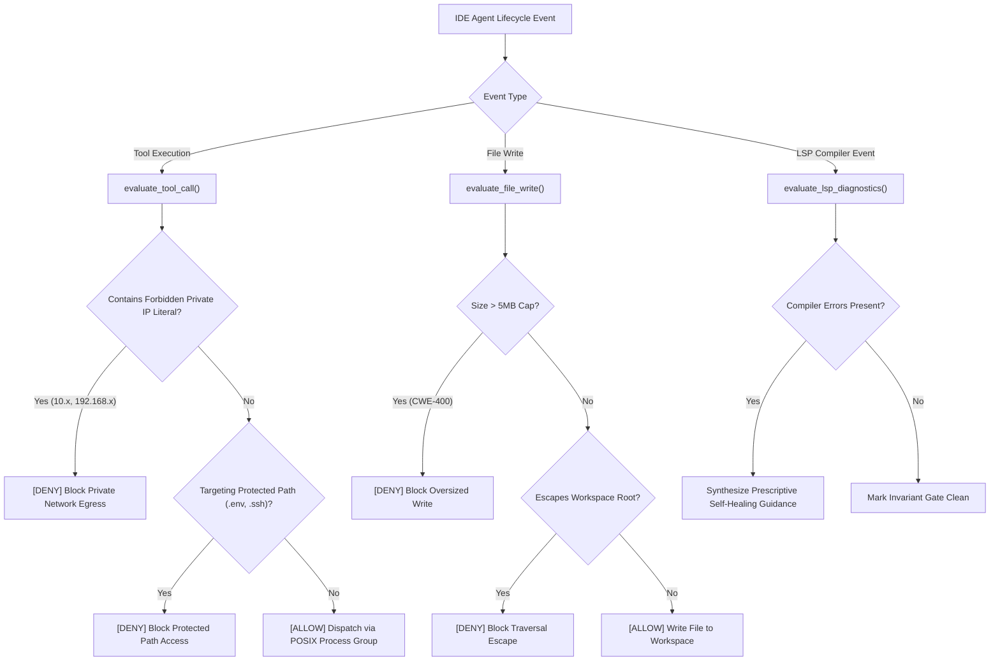

# Agentic IDE Lifecycle Hook Sentinel & Zero-Trust Execution Guard

<!-- docs: allow[sanitization] — the blocked-egress example must name a private address to demonstrate the block -->

Reference implementation of zero-trust policy checks that a lifecycle hook in an agentic IDE (for example VS Code, Google Antigravity or Cursor) can call. It checks tool execution calls, file writes, and compiler diagnostics to enforce deterministic safety boundaries around autonomous coding assistants. It includes no adapter for the hook API of any IDE: the caller passes each event to the `IdeHookSentinel` methods.

---

## 🏛️ The Threat Model in Agentic IDEs

When an autonomous AI agent is given tool-calling agency inside an IDE, unrestricted execution creates critical security and stability hazards:
1. **Secret & Credential Infiltration**: Agents can inadvertently read or overwrite `.env`, `~/.ssh/id_rsa`, or `/etc/shadow` when exploring unfamiliar projects. The guard checks each string in the tool arguments at any depth, so a list item such as `["cat", ".env"]` is refused too.
2. **Private Network Egress / SSRF**: Prompts or hijacked tools can probe private RFC 1918 subnets (`10.0.0.0/8`, `192.168.0.0/16`) or the cloud metadata endpoint. The guard below scans every string in the tool arguments, list items and nested objects included, for IP literals only (dotted decimal, leading-zero octal and IPv6). It blocks the link-local ranges `169.254.0.0/16` and `fe80::/10`, which hold the metadata address `169.254.169.254`. It does not catch host names, hex octets such as `0x0a.0.0.1`, or integer addresses such as `167772161`.
3. **Runaway Orphan Processes**: Terminal commands stopped via standard `proc.kill()` leave grandchild background processes running as orphans, reparented to init. (A zombie is different: a process that has exited and that its parent has not yet reaped.) A signal to the process group reaches these grandchildren, but not a grandchild that starts its own session with `setsid`.
4. **Denial-of-Service via Minified Bundles (CWE-400)**: Ingesting or generating multi-megabyte minified bundles exhausts editor memory.
5. **Ignoring Compiler Oracles**: Models repeatedly apologize for compilation errors rather than treating Language Server (LSP) diagnostics as deterministic boundary conditions.

---

## 🧭 Architecture



---

## 🚀 Usage

```python
from pathlib import Path
from hook_sentinel import HookDecision, IdeHookSentinel

workspace_dir = Path("/workspaces/my-project")
sentinel = IdeHookSentinel(workspace_root=workspace_dir)

# 1. Intercept pre-tool execution
tool_eval = sentinel.evaluate_tool_call(
    tool_name="http_request",
    arguments={"url": "http://10.0.0.1:8080/api"},  # blocked: RFC 1918 destination
)
if tool_eval.decision == HookDecision.DENY:
    print(f"Blocked dangerous tool call: {tool_eval.reason}")

# 2. Run shell command with POSIX process group isolation
cmd_result = sentinel.run_isolated_command(
    command=["pytest", "tests/"],
    timeout_seconds=30.0,
)
if cmd_result.timed_out:
    print("Process exceeded timeout and was terminated cleanly via SIGTERM/SIGKILL.")

# 3. Evaluate compiler diagnostics from Language Server Protocol (LSP)
lsp_eval = sentinel.evaluate_lsp_diagnostics(
    file_path="src/main.rs",
    diagnostics=[{"severity": 1, "range": {"start": {"line": 10}}, "message": "Mismatched types"}],
)
if not lsp_eval.is_clean:
    print(f"Corrective guidance for agent: {lsp_eval.prescriptive_guidance}")
```

---

## 🧪 Testing

Run the isolated test suite:
```bash
pytest examples/agentic-ide-hook-sentinel/test_hook_sentinel.py
```

