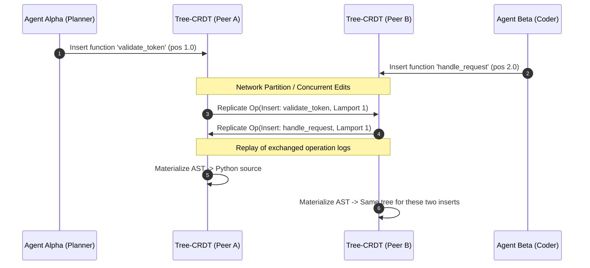

# Real-Time AST Conflict-Free Replicated Data Type (Tree-CRDT)

> **Exemplar Status**: Living Artifact & Executable Reference Implementation  
> **Classification**: Multi-Agent Concurrency, Distributed State, CRDTs, AST Engineering  
> **Related**: [Observation 37](../../observations/systems/37-real-time-ast-crdts-and-concurrent-multi-agent-swarms.md), [Pattern: AST-CRDTs for Real-Time Agent Collaboration](../../patterns/ast-crdts-for-real-time-agent-collaboration.md)

---

## 1. Executive Overview

When multiple autonomous AI coding agents collaborate on the same codebase simultaneously (e.g. an Architecture Planner, an Implementation Worker, a TDD Test Author, and an Invariant Sentinel), they require real-time concurrent synchronization.

Text CRDTs (RGA, and the text types of Yjs and Automerge) replicate character sequences. A merge of concurrent character edits can produce text that is not valid syntax, for example when two agents edit the same identifier or block. This repository has no benchmark that measures how often that occurs.

The **AST Tree-CRDT** sketch replicates AST nodes instead of characters. It uses Lamport clocks, string sort keys for sibling order, and three operation primitives (`INSERT_NODE`, `DELETE_NODE`, `MOVE_NODE`). It is an in-process simulation: peers are Python objects, and `sync_peers()` exchanges their operation logs. There is no network transport.

It is not a complete CRDT and does not guarantee Strong Eventual Consistency (SEC):

- Concurrent moves that would make a cycle diverge. Each replica keeps the move that it applied first and rejects the other, so two peers end with different trees. A replicated tree with a safe move operation needs undo and redo of moves in timestamp order (Kleppmann et al., "A highly-available move operation for replicated trees", IEEE TPDS 2022).
- An insert whose parent has not arrived attaches to `root` and is not moved when the parent arrives. A delete of a node that has not arrived is dropped. These operations commute only under causal delivery.
- `materialize_to_source()` renders only top-level imports, functions and classes, and does not check node names. A name such as `"not valid"` produces source that `ast.parse` rejects.

---

## 2. Multi-Agent Synchronization Flow



---

## 3. Mathematical Commutativity Proof Sketch

This section is not a proof. It states the property that a CRDT needs and what this code does for each operation. The property is that two concurrent operations $Op_1$ and $Op_2$ commute:

$$State \star Op_1 \star Op_2 \equiv State \star Op_2 \star Op_1$$

1. **Insert**: Siblings sort by the `pos` string, compared as text (so `"10.0"` sorts before `"2.0"`), with ties broken by the node ID string `agent_id:lamport:counter`. A repeated insert of the same node ID is ignored. Inserts commute when the parent is already present.
2. **Move and cycle check**: If $Op_1$ moves node $X$ under $Y$ and $Op_2$ moves $Y$ under $X$, applying both makes a cycle ($X \to Y \to X$). The code rejects whichever move arrives second if it makes a cycle (`CRDT001`). It does not compare Lamport timestamps, so the two replicas keep different moves and diverge.
3. **Delete**: A delete marks the node as a tombstone ($is\_tombstone = \text{True}$). It commutes with other operations only when the node is already present.

---

## 4. Diagnostic Rules & Invariants

| Rule ID | Invariant Category | Severity | Description |
|---|---|---|---|
| `CRDT001` | Cycle Prevention | `warning` | Directed cycle induction hazard prevented on concurrent move operations. |
| `CRDT002` | Hierarchy Safety | `warning` | Orphan node hazard: insertion under non-existent parent attached to root. |
| `CRDT003` | Causal Delivery | `warning` | Causal inversion warning: out-of-order operation arrival. |
| `CRDT004` | Syntax Preservation | `error` | Syntactic invariant breach detected during tree materialization. |
| `CRDT005` | Memory Compaction | `info` | Tombstone saturation threshold reached, scheduling garbage collection. |

The code emits only `CRDT001` and `CRDT002`, both with severity `warning`. `CRDT003` to `CRDT005` are declared in `DiagnosticRule`, but no code path emits them: there is no causal-delivery check, no syntax check on materialization and no tombstone collection. `OpType.UPDATE_ATTR` is declared but has no handler.

---

## 5. CLI Usage & Verification

```bash
# Inspect active CRDT state and view Markdown report
python3 examples/ast-crdt-collaborative-editor/ast_crdt.py inspect --agent-id agent-alpha

# Run unit and integration tests
uv run pytest -q examples/ast-crdt-collaborative-editor/test_ast_crdt.py
```

---

## 6. Zero-Dependency Statement

This reference implementation strictly leverages the **Python standard library** (`argparse`, `collections.abc`, `dataclasses`, `enum`, `json`, `sys`, `typing`), requiring zero external packages or native C runtime extensions.
