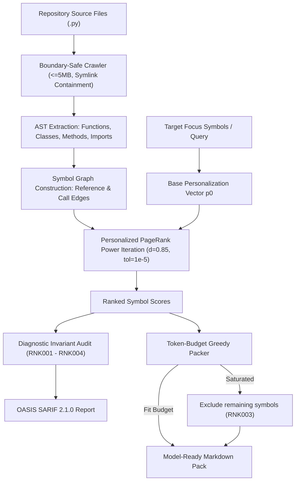

# Graph-Ranked AST Context Optimizer & Relevance Packer

> **Exemplar Status**: Living Artifact & Executable Reference Implementation  
> **Classification**: Context Engineering, AST Graph Centrality, Token Budgeting, Information Foraging  
> **Related**: [Observation 38](../../observations/systems/38-graph-ranked-ast-context-optimization-and-personalized-pagerank.md), [Pattern: AST Graph Relevance Ranking & Context Packing](../../patterns/ast-graph-relevance-ranking-and-context-packing.md)

---

## 1. Executive Overview

When autonomous AI coding agents navigate large, multi-file codebases, naive file-level prompt packing faces a fundamental dilemma:
1. **The Greed Dilemma**: Packing whole files in alphabetical or arbitrary order saturates context budgets with irrelevant utility modules, pushing architectural focal points out of the context window.
2. **The Syntax Fracture Dilemma**: Arbitrary line truncation breaks function bodies and class scopes in half, inducing hallucinated syntax errors and missing closing token failures in downstream models.

The **Graph-Ranked AST Context Optimizer** resolves both failures. It ingests the repository source tree into an abstract syntax tree (AST) symbol graph (functions, classes, methods, imports, and call/reference edges). It then computes **Personalized PageRank** over the symbol topology rooted at the agent's target focal symbols (the functions or classes being edited or investigated).

It ranks individual AST symbol definitions by graph centrality and packs them greedily, highest score first, into a token budget. Token counts are estimates (`ceil(len(text) / 4)` plus 5 per symbol), not tokenizer counts. The packer includes or excludes whole symbols, so it never cuts a symbol body in half. The caller picks one fidelity tier (`--fidelity FULL|SIGNATURES|OUTLINE`); the packer does not fall back to a lower tier when the budget is full. It excludes the remaining symbols and reports `RNK003`. Each packed snippet is one complete statement, so it parses as Python on its own. `FULL` keeps the exact source of a `def` or `class` statement and moves a method to column 0. `SIGNATURES` and `OUTLINE` write the whole `def` or `class` header with `ast.unparse` and add the body `...`; `SIGNATURES` also keeps the docstring. Decorators are left out.

Each imported name is one symbol, and its snippet is a one-name statement from `ast.unparse`: `import a, b` gives `import a` and `import b`. The symbol id holds the line and the imported name, for example `app.py::import_1_a`, `app.py::import_3_typing:Any` for `from typing import Any`, and `app.py::import_4_numpy as np`. Thus two imports on one line stay two symbols. At `FULL`, the source of a class holds its methods, so the packer does not pack a method beside its class. A class that is packed after one of its methods replaces that method and gives back its tokens. Each file block has a fence of backticks one longer than the longest backtick run in the block, and at least three. Thus a line of backticks in a string cannot close the block ([CommonMark 0.31.2 §4.5](https://spec.commonmark.org/0.31.2/#fenced-code-blocks)).

---

## 2. Graph Centrality & Packing Pipeline



---

## 3. Mathematical Formulation of Personalized PageRank

Given a symbol graph $G = (V, E)$ where nodes $v \in V$ represent AST symbol declarations and directed edges $(u, v) \in E$ indicate that the body of symbol $u$ contains a name or attribute equal to the name of symbol $v$. Edges are matched by name only: a same-file symbol wins, else the first symbol with that name. There is no import or type resolution:

Let $p \in \mathbb{R}^{|V|}$ be the personalization distribution vector:
- If a focal symbol set $S_{\text{focal}} \subseteq V$ is specified (e.g. `calc.py::run_pipeline`), then:
  $$p(v) = \begin{cases} \frac{1}{|S_{\text{focal}}|}, & \text{if } v \in S_{\text{focal}} \\ 0, & \text{otherwise} \end{cases}$$
- If no focus is provided, $p$ defaults to the uniform distribution $p(v) = \frac{1}{|V|}$.

The ranking vector $r^{(k+1)}$ is iteratively computed using the power method:

$$r^{(k+1)}(v) = (1 - d) \cdot p(v) + d \sum_{u \in \text{In}(v)} \frac{r^{(k)}(u)}{\text{OutDeg}(u)} + d \cdot p(v) \sum_{w \in \text{Dangling}} r^{(k)}(w)$$

where:
- $d = 0.85$ is the damping factor.
- $\text{In}(v) = \{u \in V \mid (u, v) \in E\}$ is the set of callers referencing symbol $v$.
- $\text{OutDeg}(u) = |\{w \in V \mid (u, w) \in E\}|$ is the out-degree of symbol $u$.
- Iteration stops when $\|r^{(k+1)} - r^{(k)}\|_1 < 10^{-5}$. If 100 iterations (`DEFAULT_MAX_ITER`) pass first, `compute_pagerank` raises `PageRankConvergenceError` and returns no scores.
- Each step shrinks the $L_1$ change by at least the factor $d$, and the first change is at most 2. With $d = 0.85$ the change is below $10^{-5}$ by step 77 on any graph, so the default settings always converge.

---

## 4. Diagnostic Rules & Invariants

| Rule ID | Invariant Category | Severity | Description |
|---|---|---|---|
| `RNK001` | Isolation Detection | `note` | Orphaned symbol with zero in-degree and zero out-degree graph connections. |
| `RNK002` | Hub Hotspot | `warning` | Centrality hotspot exceeding mean $+ 3\sigma$ score, representing a critical architectural nexus. |
| `RNK003` | Budget Saturation | `warning` | Token budget exhausted: one or more ranked symbols excluded from the final context pack. |
| `RNK004` | Cycle Hazard | `warning` | Mutual circular dependency 2-cycle detected between symbols. |

---

## 5. CLI Usage & Verification

```bash
# Rank symbols in a repository by global centrality
python3 examples/ast-relevance-context-ranker/context_ranker.py rank --dir .

# Rank symbols personalized to a target focal symbol
python3 examples/ast-relevance-context-ranker/context_ranker.py rank --dir . --focus "calc.py::run_pipeline"

# Pack repository symbols to a 2000-token budget
python3 examples/ast-relevance-context-ranker/context_ranker.py pack --dir . --budget 2000 --format pack

# Export diagnostic findings in OASIS SARIF 2.1.0 format
python3 examples/ast-relevance-context-ranker/context_ranker.py pack --dir . --format sarif

# Run unit and integration tests
uv run pytest -q examples/ast-relevance-context-ranker/test_context_ranker.py
```

---

## 6. Zero-Dependency Statement

This reference implementation strictly leverages the **Python standard library** (`argparse`, `ast`, `collections.abc`, `copy`, `dataclasses`, `enum`, `json`, `math`, `os`, `pathlib`, `re`, `typing`), requiring zero external runtime packages. A reader can copy one file and run it.

The power iteration is written out here. `networkx.pagerank` covers the same need, and this repository declares NetworkX for `tools/`, but this example does not import it, so the file needs no installed package. The loop has the same contract as NetworkX: it stops below the tolerance and raises when the iteration limit comes first.

The tests are not part of the copied file. They use `pytest`, and they use `markdown-it-py`, the CommonMark parser that `pyproject.toml` declares, to find the fenced blocks in a pack. Thus a fence that closes early fails a test against the CommonMark rule, not against a second copy of the fence code.
