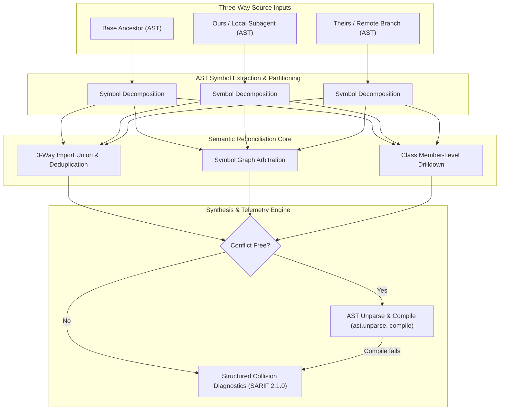

# Autonomous 3-Way AST Semantic Reconciler & Conflict Arbitrator ✨

> **Executable Reference Implementation**  
> Pairs with [Observation 35](../../observations/systems/35-3-way-ast-semantic-reconciliation-and-worktree-collision-arbitration.md) and [Pattern: 3-Way AST Semantic Reconciliation](../../patterns/3-way-ast-semantic-reconciliation.md).

---

## 🎯 The Problem: Line-Based Merge Brittleness in Multi-Agent Swarms

When autonomous subagents operate concurrently in isolated git worktrees (managed via [`worktree-swarm-arbiter`](../worktree-swarm-arbiter/)), they frequently branch from a common base ancestor (`Base`) and make independent additions to the same files.

Git's 3-way merge strategies (`ort`, `recursive`) merge file contents with the line-based `text` merge driver (`diff3` is only a conflict-marker style), so they evaluate changes on a purely **lexical, line-oriented basis**. This induces severe **false merge conflicts** on perfectly commutative changes:

1. **Disjoint Function Additions**: Subagent A appends `def helper_alpha()` to the end of a module; Subagent B appends `def helper_beta()` to the end of the same module. Git reports a conflict and writes conflict markers (`<<<<<<< HEAD ... ======= ... >>>>>>>`).
2. **Disjoint Class Methods**: Subagent A adds `def pause(self)` inside `class Worker`; Subagent B adds `def resume(self)` at the same place in the same class. Line-based merge marks that region as conflicted.
3. **Import Set Collisions**: Independent subagents add distinct third-party or local imports to the top of a file, clashing on line offsets.

The **Autonomous 3-Way AST Semantic Reconciler** resolves these collisions by operating directly on **commutative Python Abstract Syntax Tree (AST) symbol graphs**.

---

## 🏗️ Architecture & Reconciliation Pipeline



---

## ⚡ Key Capabilities

1. **Commutative Disjoint Function Reconciliation**:
   - Computes deterministic SHA-256 structural fingerprints (`hash_ast_node`), truncated to 16 hex characters.
   - Unifies independent function additions. The output order follows base, then ours, then theirs, so swapping `--ours` and `--theirs` changes the order of new symbols.
2. **Recursive Class Member Arbitration**:
   - When only one branch changes a class, the reconciler keeps that branch's class as it is.
   - When both branches change the same class, the reconciler merges the class body member by member: the docstring, attributes, methods, nested classes and other statements. Two members with the same name, for example a property getter and its setter, stay separate members.
   - The class docstring comes first. The other members follow the order of ours, then the members that only theirs adds.
   - A change to the class header (decorators, bases, keywords) from one branch is kept. Different header changes from both branches are a collision on the class.
3. **Deterministic Import Set Union**:
   - Computes 3-way set differences (`(base & ours & theirs) | (ours - base) | (theirs - base)`), deduplicating the import lines. The `from __future__` imports come first, right after the module docstring, because Python requires that. The reconciler sorts the other import lines as plain strings. It does not apply the PEP 8 grouping of standard library, third-party and local imports.
4. **Structured Collision Diagnostics**:
   - When a true semantic collision occurs (both branches modified the exact same function body incompatibly), the reconciler avoids emitting invalid syntax markers and instead produces structured diagnostic telemetry with exact AST node snippets and OASIS SARIF 2.1.0 output.
   - A collision inside a class names the class and the member, for example `Service.start`.
5. **Single Docstring and Compile Check**:
   - The module docstring and each class docstring are merged like other symbols, so each appears once.
   - The reconciler compiles the merged code with `compile(source, "<merged>", "exec")`. It does not run the code. If the compile fails, it reports a `<module>` collision and writes no code.
   - `compile` finds errors that `ast.parse` accepts. Examples are a `from __future__` import after other statements, and a class body where one branch adds `y = x` and the other branch adds `global x`.

---

## 💻 CLI & Git Merge Driver Usage

### Standalone Command

```bash
# Perform 3-way semantic reconciliation
python ast_reconciler.py --base base.py --ours ours.py --theirs theirs.py --output merged.py

# Emit OASIS SARIF 2.1.0 diagnostic report
python ast_reconciler.py --base base.py --ours ours.py --theirs theirs.py --format sarif

# Emit Markdown summary table
python ast_reconciler.py --base base.py --ours ours.py --theirs theirs.py --format markdown
```

### Git Custom Merge Driver Configuration

The reconciler rebuilds the file with `ast.unparse`. The output loses every comment and the original formatting. Use the merge driver only on files where that is acceptable.

Configure git to route Python file merges through the AST Semantic Reconciler:

```ini
# In .git/config or ~/.gitconfig
[merge "ast-reconciler"]
    name = Autonomous 3-Way AST Semantic Reconciler
    driver = python /path/to/ast_reconciler.py --base %O --ours %A --theirs %B --output %A
```

```ini
# In .gitattributes
*.py merge=ast-reconciler
```

---

## 📦 Dependencies

The example uses only the Python standard library (`ast`, `copy`, `hashlib`, `argparse`), so you can copy the one file and run it.

---

## 🧪 Verification & Invariant Certification

Run the comprehensive unit test suite:

```bash
uv run pytest examples/ast-semantic-reconciler/test_reconciler.py -v
```

Audit architectural invariants ($M \le 6$, depth $\le 3$):

```bash
python examples/ast-invariant-sentinel/sentinel.py examples/ast-semantic-reconciler/ --preset strict
```
