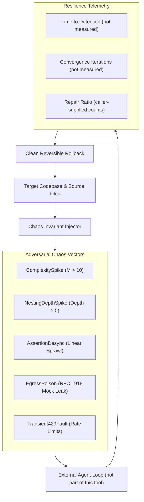

# Sample App: Chaos Invariant Injector & Agent Resilience Benchmark

An executable, zero-dependency Python chaos engineering tool that injects controlled, reversible mechanical mutations into codebases to benchmark autonomous AI agent self-healing convergence.

---

## Why This Exists: Beyond Ideal Lab Conditions

Autonomous coding agents are typically evaluated under sterile benchmark conditions: pristine problem statements, static unit tests, and undisturbed source files.

In production environments, however, software development is messy:
- **Latent Complexity Creep**: Legacy functions that breach complexity caps ($M > 10$) when edited.
- **Deep Nesting Spikes**: Fast agent refactors that introduce nested branching ladders ($> 5$ levels).
- **Assertion Drift**: Consolidated structural tuple checks broken into fragile assertion sprawl.
- **Egress Leak Traps**: Accidental leakage of internal IP addresses or private tokens into test fixtures.
- **Transient Failures**: Intermittent HTTP 429 rate limits from inference or tool gateways.

The **Chaos Invariant Injector** introduces synthetic invariant violations, computes a repair ratio ($R_{\text{repair}}$) from detected and repaired counts that the caller supplies, and rolls back modifications through its Python API. It runs no agent and does not measure time to detection or convergence rounds. The `benchmark` command scores one fixed demo mutation with 1 detected and 1 repaired, so it always reports a 100.0% repair ratio.

---

## Architecture & Chaos Loop



---

## Quick Start

### CLI Usage

```bash
# Inject complexity spike into a target file
python3 chaos_monkey.py inject path/to/file.py --type COMPLEXITY_SPIKE

# Inject deep nesting invasion
python3 chaos_monkey.py inject path/to/file.py --type NESTING_SPIKE

# Inject simulated egress leak
python3 chaos_monkey.py inject path/to/file.py --type EGRESS_POISON

# Run simulated resilience benchmark and output Markdown
python3 chaos_monkey.py benchmark --format markdown

# Export OASIS SARIF 2.1.0 telemetry
python3 chaos_monkey.py benchmark --format sarif
```

The `inject` command has no matching rollback command: it does not save the mutation record, so keep the target file under version control. The `Transient429Fault` vector is `inject_transient_fault()`, a function that returns a sample 429 response; `inject` does not offer it.

---

## Invariant Verification

- **Zero External Dependencies**: Standard library Python (`argparse`, `json`, `dataclasses`, `pathlib`, `time`).
- **Rollback**: `rollback_chaos_mutation` writes back the original text. It is not byte-exact: files are read and written as UTF-8 text, so CRLF line endings come back as LF, and an existing empty file is deleted instead of restored.
- **Structural Bounds**: All functions pass the AST Invariant Sentinel `strict` preset ($M \le 6$, nesting depth $\le 3$). The `pedantic` preset ($M \le 4$, depth $\le 2$) reports 5 violations. The sentinel has no parameter-count rule; no function takes more than 3 parameters.

