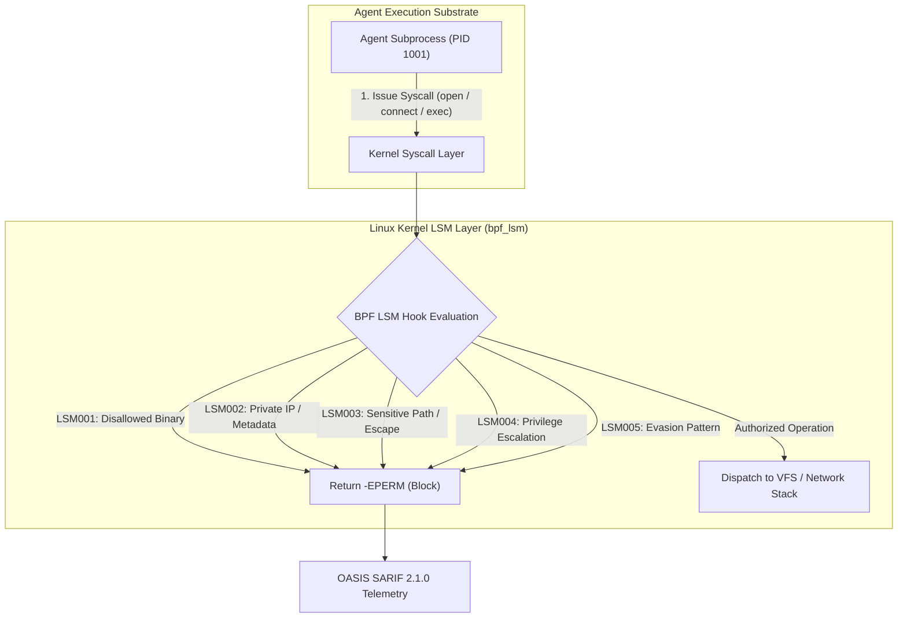

# eBPF Runtime LSM Kernel Gate & Dynamic Syscall Fuzzing Oracle

A zero-dependency Python **simulation** of BPF LSM (Linux Security Module) policy decisions. It loads no BPF program and touches no kernel: `evaluate_event` applies Python rules to event records that the caller builds. A fixed list of 15 adversarial probes checks the rules. That list is not syzkaller (a coverage-guided kernel fuzzer): nothing is mutated or randomized.

---

## Architectural Context

Traditional container runtime security tools (such as standard `auditd` or passive `kprobe`-based tracers) operate **asynchronously**—they log security violations after the operation has been initiated or executed by the kernel. For untrusted, autonomous AI agent execution, asynchronous logging is insufficient: by the time an alert fires, a sensitive private key has already been transmitted over a raw socket or a critical system binary has already been executed.

**Linux Security Module (BPF LSM)** hooks run synchronously within the kernel path, enabling immediate default-deny blocking (`-EPERM`) before resources or kernel state are altered.



The diagram shows the kernel design that this exhibit models. In this code, the syscall, the kernel layer and the hook are one Python function call on an `LSMEvent` record.

---

## Diagnostic Rules Catalog

| Rule ID | Name | Trigger Condition | Default Action |
|---|---|---|---|
| `LSM001` | Unauthorized Binary Execution | Binary not in allowlist or explicitly in blocklist (`nc`, `socat`, `telnet`) | `BLOCK` (`-EPERM`) |
| `LSM002` | Network Egress Violation | Socket destination targets private RFC 1918/4193 addresses or metadata (`169.254.169.254`) | `BLOCK` (`-EPERM`) |
| `LSM003` | Sensitive Path Access | Path contains `/etc/shadow`, `/root`, `~/.ssh`, `~/.aws`, `.git/hooks` (substring match: `~/.ssh` matches only a literal `~`, so `/home/agent/.ssh/id_rsa` is allowed) | `BLOCK` (`-EPERM`) |
| `LSM004` | Privilege Escalation | Subprocess attempts `setuid(0)` or requests administrative capabilities (`CAP_SYS_ADMIN`) | `BLOCK` (`-EPERM`) |
| `LSM005` | Adversarial Syscall Evasion | Evasion pattern detected: a null byte or literal `\0`, path normalization tricks (`..//`), or negative flags. Paths are not normalized, so `/etc/./shadow` and `/etc//shadow` are allowed | `BLOCK` (`-EPERM`) |

---

## Fixed Adversarial Probe List

The exhibit includes a fixed list of 15 adversarial probes for the simulated gate. It is not a fuzzer in the syzkaller sense: no input is generated at random, and `--seed` has no effect.
- **Path Permutations**: Path traversal normalization attempts (`/workspace//..//root`, `/workspace/.../etc/sudoers`, a literal `\0`).
- **Network Permutations**: IPv6 Unique Local Addresses (`fd00::1`), RFC 1918 subnets, and AWS metadata endpoints.
- **Binary and Privilege Probes**: `nc`, `socat`, an unlisted binary, and a `setuid` to UID 0.

The campaign passes when at most one probe is allowed (`allowed <= 1` in `run_fuzz_campaign`). The expected pass is the loopback connect to `127.0.0.1`. `lsm_gate.py fuzz --seed 42` blocks 14 of 15 probes (rate 0.933). This checks the rules against these 15 inputs only; it proves nothing about other inputs.

---

## CLI Usage

### 1. Evaluate a Single Syscall Event

```bash
# Evaluate a sensitive file open attempt
python3 examples/ebpf-lsm-kernel-gate/lsm_gate.py eval --hook file_open --target /etc/shadow

# Evaluate an authorized file read
python3 examples/ebpf-lsm-kernel-gate/lsm_gate.py eval --hook file_open --target /workspace/app.py
```

### 2. Run Dynamic Mutation Fuzzing

```bash
python3 examples/ebpf-lsm-kernel-gate/lsm_gate.py fuzz --seed 42
```

### 3. Generate BPF CO-RE C and Cilium Tetragon Policies

```bash
# Generate BPF C source code
python3 examples/ebpf-lsm-kernel-gate/lsm_gate.py generate --format bpf

# Generate Cilium Tetragon TracingPolicy YAML
python3 examples/ebpf-lsm-kernel-gate/lsm_gate.py generate --format tetragon
```

Both outputs are fixed skeletons. In the BPF C, each LSM hook holds only a comment and returns 0 (allow), so it enforces nothing. The Tetragon TracingPolicy traces three kernel functions; it has no selectors or actions, so it blocks nothing.

### 4. Export Telemetry to OASIS SARIF 2.1.0

```bash
python3 examples/ebpf-lsm-kernel-gate/lsm_gate.py sarif --hook bprm_check_security --comm nc --target /bin/nc
```

---

## Zero-Dependency Statement

This reference implementation strictly uses Python's standard library (`ipaddress`, `json`, `argparse`, `dataclasses`, `enum`). It requires no third-party packages, external C compilers, or kernel privileges, because it runs no kernel code. It demonstrates the policy logic only; it verifies nothing about in-kernel enforcement.

