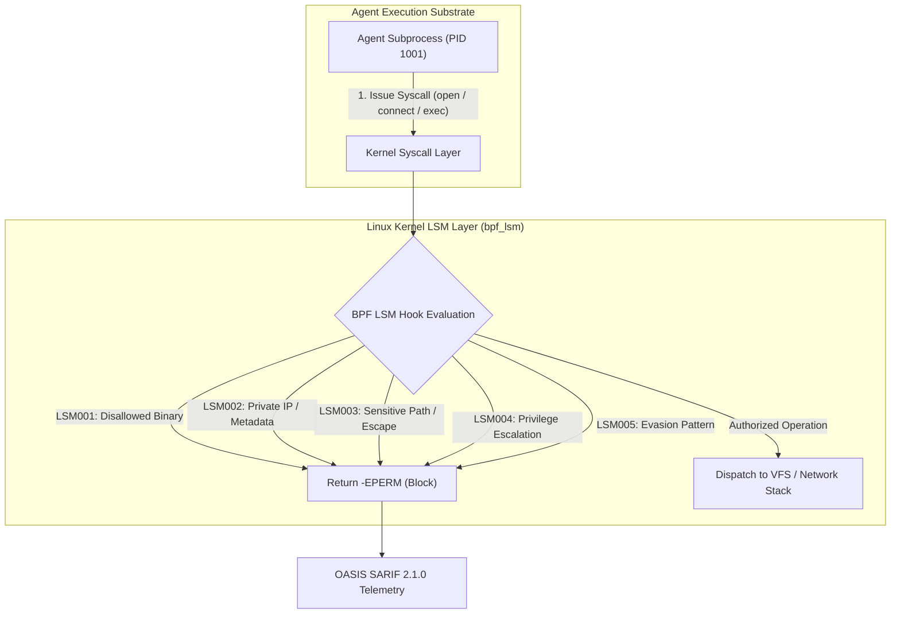

# eBPF Runtime LSM Kernel Gate & Dynamic Syscall Fuzzing Oracle

A zero-dependency Python **simulation** of BPF LSM (Linux Security Module) policy decisions. It loads no BPF program and touches no kernel: `evaluate_event` applies Python rules to event records that the caller builds. A list of 31 adversarial probes checks the rules; the path probes come from the policy. That list is not syzkaller (a coverage-guided kernel fuzzer): nothing is mutated or randomized.

> [!IMPORTANT]
> **Enforcement mode.** The Python code enforces nothing. Kernel enforcement comes from Cilium Tetragon: `lsm_gate.py generate` prints a Tetragon `TracingPolicy` with `Sigkill` selectors (annotation `agent-lsm-gate/mode: enforce`). The example ships no BPF C. No test here loads the policy into a kernel.

---

## Architectural Context

Traditional container runtime security tools (such as standard `auditd` or passive `kprobe`-based tracers) operate **asynchronously**—they log security violations after the operation has been initiated or executed by the kernel. For untrusted, autonomous AI agent execution, asynchronous logging is insufficient: by the time an alert fires, a sensitive private key has already been transmitted over a raw socket or a critical system binary has already been executed.

**Linux Security Module (BPF LSM)** hooks run synchronously within the kernel path, enabling immediate default-deny blocking (`-EPERM`) before resources or kernel state are altered.



The diagram shows the kernel design that this exhibit models. In this code, the syscall, the kernel layer and the hook are one Python function call on an `LSMEvent` record.

---

## Diagnostic Rules Catalog

| Rule ID | Name | Trigger Condition | Default Action |
|---|---|---|---|
| `LSM001` | Unauthorized Binary Execution | Binary not in allowlist or explicitly in blocklist (`nc`, `socat`, `telnet`) | `BLOCK` (`-EPERM`) |
| `LSM002` | Network Egress Violation | Socket destination targets private RFC 1918/4193 addresses or metadata (`169.254.169.254`) | `BLOCK` (`-EPERM`) |
| `LSM003` | Sensitive Path Access | Normalized path contains `/etc/shadow`, `/root`, `~/.ssh`, `~/.aws`, `.git/hooks` (substring match: `~/.ssh` matches only a literal `~`, so `/home/agent/.ssh/id_rsa` is allowed) | `BLOCK` (`-EPERM`) |
| `LSM004` | Privilege Escalation | Subprocess attempts `setuid(0)` or requests administrative capabilities (`CAP_SYS_ADMIN`) | `BLOCK` (`-EPERM`) |
| `LSM005` | Adversarial Syscall Evasion | Evasion pattern detected: a null byte or literal `\0`, a parent-directory step (`/..`, `..//`), or negative flags | `BLOCK` (`-EPERM`) |

`LSM003` normalizes the path before it matches: `normalize_path` uses `posixpath.normpath` to remove `.` and `..` steps and repeated slashes, so `/etc/./shadow`, `/etc//shadow` and `//etc/shadow` are blocked. It does not resolve symbolic links, because that needs the real filesystem. `LSM005` runs first, so a path with `/..` gets `LSM005`.

---

## Adversarial Probe List

The exhibit includes a list of 31 adversarial probes for the simulated gate. It is not a fuzzer in the syzkaller sense: no input is generated at random, and `--seed` has no effect.
- **Path Spellings (16)**: `generate_syz_path_mutations` takes each absolute blocked path of the policy and writes it four ways: plain, with `/./`, with `//`, and with a `..` step (`/etc/shadow`, `/etc/./shadow`, `/etc//shadow`, `/etc/../etc/shadow`). A new absolute blocked path adds four probes.
- **Evasion Paths (5)**: Fixed probes under `/workspace` (`/workspace//..//root`, `/workspace/.../etc/sudoers`, a literal `\0`).
- **Network Permutations (6)**: IPv6 Unique Local Addresses (`fd00::1`), RFC 1918 subnets, the AWS metadata endpoint, and loopback.
- **Binary and Privilege Probes (4)**: `nc`, `socat`, an unlisted binary, and a `setuid` to UID 0.

The campaign passes when at most one probe is allowed (`allowed <= 1` in `run_fuzz_campaign`). The expected pass is the loopback connect to `127.0.0.1`. `lsm_gate.py fuzz --seed 42` blocks 30 of 31 probes (rate 0.968). This checks the rules against these 31 inputs only; it proves nothing about other inputs.

---

## CLI Usage

### 1. Evaluate a Single Syscall Event

```bash
# Evaluate a sensitive file open attempt
python3 examples/ebpf-lsm-kernel-gate/lsm_gate.py eval --hook file_open --target /etc/shadow

# Evaluate an authorized file read
python3 examples/ebpf-lsm-kernel-gate/lsm_gate.py eval --hook file_open --target /workspace/app.py
```

### 2. Run the Probe List

```bash
python3 examples/ebpf-lsm-kernel-gate/lsm_gate.py fuzz --seed 42
```

### 3. Generate an Enforcing Cilium Tetragon Policy

```bash
python3 examples/ebpf-lsm-kernel-gate/lsm_gate.py generate
```

The command prints a Tetragon `TracingPolicy` built from `LSMPolicy`. It has one kprobe per hook, and each kprobe has a selector whose `matchActions` is `Sigkill`. The field names follow the [Tetragon selector reference](https://tetragon.io/docs/concepts/tracing-policy/selectors/).

| Kprobe | Argument | Match | Source in `LSMPolicy` |
|---|---|---|---|
| `security_bprm_check` | `linux_binprm` (index 0) | `Postfix` on the program path (`/nc`, `/socat`, ...) | `blocked_binaries` |
| `security_file_open` | `file` (index 0) | `Prefix` on the opened path | absolute entries of `blocked_paths` |
| `security_socket_connect` | `sockaddr` (index 1) | `Family` is `AF_INET` or `AF_INET6`, and `NotSAddr` is loopback | `allow_loopback_only` |

Limits of the generated policy:
- **Scope**: `spec.podSelector` limits it to pods with the label `app: agent-sandbox`. Without that, it would also stop host processes such as `sudo`, which reads `/etc/sudoers`.
- **Simulation-only rules**: The binary allowlist, the relative paths (`~/.ssh`, `~/.aws`, `.git/hooks`), `LSM004` and `LSM005` have no kernel selector. With `allow_loopback_only=False`, the policy blocks only the link-local range that holds the metadata endpoint; the private ranges stay a simulation check.
- **Value count**: Tetragon accepts at most 8 path values in one `file` match on kernel 5.3 and later. A policy with more absolute paths needs a second selector.
- **Resolved paths**: Tetragon reads the path from the kernel `struct file`, so `/etc/./shadow` reaches the `Prefix` match as `/etc/shadow`. It also follows symbolic links, so a program that links to another name, such as `nc` to `nc.openbsd`, needs that name in `blocked_binaries`.
- **Sigkill**: `Sigkill` stops the calling process in the kernel. The [Tetragon enforcement page](https://tetragon.io/docs/concepts/enforcement/) states that a signal does not always stop the operation itself. To make the call fail with an error, add an `Override` action with `argError: -1` (`-EPERM`); `Override` needs a kernel built with `CONFIG_BPF_KPROBE_OVERRIDE`.

The example ships no BPF C. A BPF LSM program that checks a path needs `bpf_d_path` and a kernel to verify it, and no test here can run one.

### 4. Export Telemetry to OASIS SARIF 2.1.0

```bash
python3 examples/ebpf-lsm-kernel-gate/lsm_gate.py sarif --hook bprm_check_security --comm nc --target /bin/nc
```

---

## Zero-Dependency Statement

This reference implementation strictly uses Python's standard library (`ipaddress`, `json`, `posixpath`, `argparse`, `dataclasses`, `enum`), so a reader can copy one file and run it. It requires no third-party packages, external C compilers, or kernel privileges, because it runs no kernel code. It demonstrates the policy logic only; it verifies nothing about in-kernel enforcement. The test suite uses PyYAML, a dependency of this repository, to parse the generated `TracingPolicy`.

