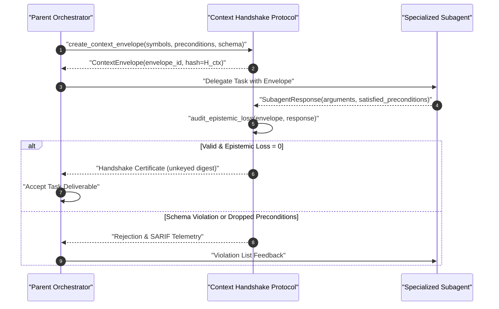

# Sample App: Typed Epistemic Seam & Context Handshake

An executable, zero-dependency Python protocol engine that enforces cryptographic context envelope hashing, negative schema boundaries, and epistemic loss auditing across hierarchical agent delegation seams.

---

## Why This Exists: The Delegation Boundary Trap

In multi-agent architectures (as analyzed in [Observation 21](../../observations/systems/21-hierarchical-subagent-slot-offloading-and-epistemic-loss.md) and [Observation 29](../../observations/systems/29-epistemic-drift-and-the-unreliable-teacher-in-autonomous-verification.md)), hierarchical delegation ("Big decides, small types, big checks") frequently suffers from **epistemic loss**:
- **Lossy Context Summarization**: When a parent agent delegating to a subagent passes unstructured prompts, critical preconditions and invariants are dropped.
- **Hallucinated Parameter Drift**: Subagents invent uncontracted tool arguments or unexpected return structures, confusing parent orchestrators.
- **Silent Degradation**: The subagent reports success, but the delivered code fails parent-level architectural invariants.

The **Typed Context Handshake** protocol addresses part of this. It builds a content-addressed contract envelope ($H_{\text{ctx}}$, a SHA-256 digest), rejects argument names that the envelope does not declare (the effect of `additionalProperties: false`), and flags preconditions that the subagent does not list as satisfied. It trusts the subagent's own list of satisfied preconditions, does not compare `returned_symbols` with `required_symbols`, and does not check delivered code. The completion "certificate" is an unkeyed SHA-256 digest, not a signature: anyone can compute it, and nothing verifies it. The tamper check compares the envelope with its own embedded hash, so it detects accidental change, not an edit that also recomputes the hash.

---

## Handshake Architecture



---

## Quick Start

### CLI Usage

```bash
# Generate a new context envelope
python3 context_handshake.py envelope --parent lead-agent --target sub-refactorer

# Run a sample handshake audit
python3 context_handshake.py audit

# Output Markdown telemetry
python3 context_handshake.py audit --format markdown

# Export OASIS SARIF 2.1.0 telemetry for Code Scanning
python3 context_handshake.py audit --format sarif
```

---

## Invariant Verification

- **Zero External Dependencies**: Standard library Python (`hashlib`, `json`, `dataclasses`, `time`).
- **Mathematical Bound**: Epistemic Loss ($E_{\text{loss}} \in [0, 1]$) strictly quantified over dropped preconditions and schema violations.
- **Strict Complexity**: All functions pass the AST Invariant Sentinel `strict` preset ($M \le 6$, nesting depth $\le 3$). The `pedantic` preset ($M \le 4$, depth $\le 2$) reports 3 violations. The sentinel has no parameter-count rule; no function takes more than 4 parameters.

