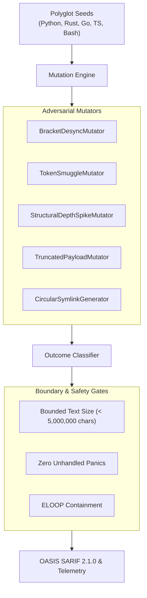

# Sample App: Differential Polyglot AST Mutation Fuzzer

An executable, zero-dependency Python fuzzing harness that applies adversarial structural mutations to small seed sources. It runs the Python mutants through `ast.parse`. For Rust, Go, TypeScript and Bash it calls no parser: it checks only the length and the line split of the mutated text.

The name says "differential", but this is not differential fuzzing. Differential fuzzing (McKeeman, 1998) gives the same input to two or more implementations and flags a disagreement. This harness runs one check per mutant and compares no implementations.

---

## Why This Exists: The Polyglot Boundary Problem

Autonomous AI coding agents frequently synthesize and ingest code across multiple programming languages (Python, Go, Rust, TypeScript, Bash). When extracting symbols or calculating complexity, agents route code through language-specific AST/CST parsers (such as [`polyglot-cst-parser`](../polyglot-cst-parser/)).

However, agent-generated code frequently contains boundary pathologies:
- **Bracket and Delimiter Desynchronization**: Truncated code blocks resulting in unbalanced tokens and parser crashes.
- **Token Smuggling & Null Injection**: Hidden characters (`\x00`) in comments or multi-line string literals that bypass static analysis.
- **Recursive Structural Spikes**: Code with deeply nested conditional or loop statements that hits parser or compiler nesting limits (the CPython compiler rejects more than 20 statically nested loop, `try` and `with` blocks).
- **Circular Symlink Traversal**: Cyclic filesystem paths causing infinite loops (`ELOOP`) during repository repomap crawling.

The **Differential Polyglot AST Mutation Fuzzer** applies four text mutators to five in-code seed strings and runs one circular-symlink check. A mutant fails when the mutated text has 5,000,000 or more characters (more than 100,000 for non-Python text), or when `ast.parse` raises `RecursionError` or another unexpected exception. The harness sets no timeout and does not measure memory.

---

## Architecture



---

## Quick Start

### Running the Fuzzer

```bash
# Run standalone fuzz campaign with summary output
python3 polyglot_fuzzer.py

# Emit human-readable Markdown summary
python3 polyglot_fuzzer.py --format markdown

# Export OASIS SARIF 2.1.0 telemetry for GitHub Code Scanning
python3 polyglot_fuzzer.py --format sarif --out fuzzer_findings.sarif

# Export JSON telemetry
python3 polyglot_fuzzer.py --format json --out fuzzer_report.json
```

---

## Invariant Verification

These properties hold for this exhibit:
- **Zero External Dependencies**: Standard library Python (`ast`, `json`, `pathlib`, `time`).
- **Strict Structural Bounds**: All functions have cyclomatic complexity $M \le 4$ and at most 4 parameters (`ruff check --select C901,PLR0913` with `max-complexity = 4` and `max-args = 4` passes), and nesting depth $\le 2$.
- **Assertion Density**: Unit test suite uses consolidated structural tuple equality checks.

