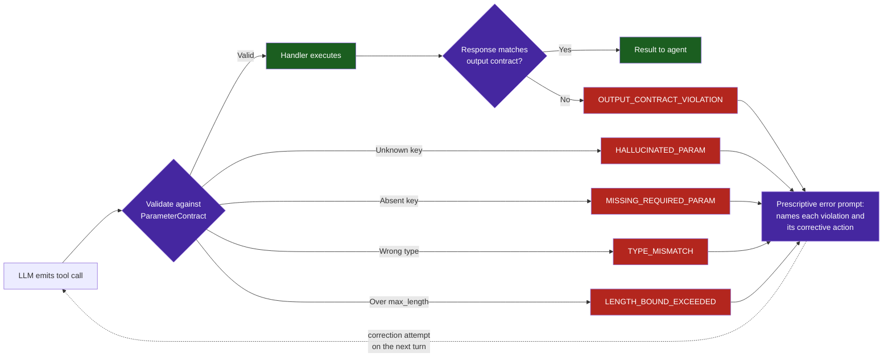

# Sample App: Formal Tool Contract Verification Gate

An executable Python reference application that enforces negative assertions, type safety, and bounded length invariants on agent tool calls. It checks each call against its own `ParameterContract` records (type, required, `maxLength`, `minimum`, `maximum`, no extra keys) and can export a contract as a JSON Schema 2020-12 `parameters` object. It does not run a JSON Schema validator.

"Formal" in the name does not mean formal verification: nothing is proved. The gate is a runtime check of each call.

---

## Why This Exists

In agentic software engineering and tool-use architectures (e.g. FastMCP, OpenAI function calling, Anthropic tool use), the interface boundary between LLM inference and the host environment is the most vulnerable attack surface:

1. **Hallucinated Parameters**: Models frequently inject undocumented parameters (`cluster_override`, `bypass_validation`, `force=true`) based on pre-training heuristics, leading to silent unintended behavior or runtime exceptions.
2. **Missing Required Arguments**: Complex multi-step reasoning often drops critical parameters across tool chains.
3. **Type Coercion & Injection**: Passing string representations of numbers (`"5"` instead of `5`) or raw nested JSON strings without strict type validation causes silent logic failures.
4. **Unbounded String Payloads (CWE-400)**: Unconstrained user- or agent-generated strings cause log bloat, database saturation, and memory spikes.
5. **Output Contract Drift**: Tool handlers returning unstructured or altered payload formats corrupt subsequent subagent parsing steps.

The **Formal Tool Contract Verification Gate** sits directly in the execution path, rejecting malformed calls *before* execution and emitting structured, prescriptive error prompts meant to let the LLM correct the call in the next turn. No model run in this repository measures how often that works.



> [!NOTE]
> The rejection is the cheap half. A gate that returns `invalid arguments` gives the model nothing to act on. This gate names each bad key and the action to take. The allowed parameter list is in each violation's `expected_spec` (see `ContractValidationReport.to_dict()`), not in `feedback_message`.

---

## Contract Violation Taxonomy

| Violation Kind | Description | Defensive Countermeasure |
|---|---|---|
| **`HALLUCINATED_PARAM`** | Model passes argument not defined in tool schema. | Strict mode (`additionalProperties: false`) rejects the call and tells the model to remove the key; `expected_spec` holds the allowed parameter list. |
| **`MISSING_REQUIRED_PARAM`** | Model omits an argument required by the contract. | Fails fast with descriptive hint specifying missing field and expected type. |
| **`TYPE_MISMATCH`** | Model passes incorrect type (e.g. string for integer). | Strictly checks type matching without silent loose coercion. |
| **`LENGTH_BOUND_EXCEEDED`** | String argument exceeds declared upper bound cap. | Rejects strings $> \text{max\_length}$ (default 256 chars) to limit resource use (CWE-400). A length cap does not neutralize log injection (CWE-117). |
| **`VALUE_OUT_OF_RANGE`** | Numeric parameter falls outside declared `[min, max]` interval. | Validates bounds and instructs agent on valid range. |
| **`OUTPUT_CONTRACT_VIOLATION`** | Tool execution return value mismatches declared return type. | Prevents corrupted return structures from propagating into subagent contexts. |

---

## Quick Start

### Running the Interactive Verification Demo
```bash
python3 examples/tool-contract-verifier/verifier.py
```

### Emitted Prescriptive Feedback Example
When a malformed tool call is intercepted, `ToolContractVerifier` formats an actionable error prompt:

```text
❌ TOOL CONTRACT VIOLATION DETECTED for 'deploy_service' (3 errors):
--------------------------------------------------------------------------------
1. [HALLUCINATED_PARAM] Hallucinated parameter 'secret_token_leak' is not defined in contract.
   👉 Prescriptive Action: Remove 'secret_token_leak' from tool arguments.
2. [TYPE_MISMATCH] Parameter 'replicas' expected integer, received str.
   👉 Prescriptive Action: Coerce value to integer.
3. [LENGTH_BOUND_EXCEEDED] Parameter 'service_name' length 63 exceeds maximum 32 characters.
   👉 Prescriptive Action: Truncate string to <= 32 characters.
--------------------------------------------------------------------------------
Please re-issue the tool invocation adhering strictly to the schema contract.
```

---

## Running the Automated Test Suite

```bash
python3 -m pytest -p no:cov -p no:logfire -p no:xdist -o addopts= examples/tool-contract-verifier/test_verifier.py
```

All 10 unit tests validate schema generation, negative parameter assertions, type checking, bounds verification, output contracts, and CLI demo execution.
