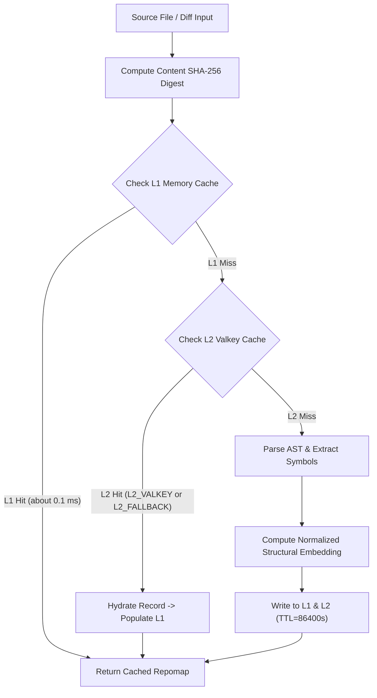

# Valkey L2 Repomap Cache & Embedding Drift Auditor

Two-tier AST symbol table caching and structural drift auditing across autonomous AI subagent invocations.

---

## Architecture Overview

Multi-turn agent coding sessions frequently re-parse, inspect, and evaluate identical or slightly modified source files. Re-parsing the AST on every turn consumes valuable CPU cycles and introduces token-budget context latency.

This reference implementation combines:
1. **L1 Fast Memory Cache**: In-process LRU cache keyed by SHA-256 content hash (`collections.OrderedDict`). A hit moves the key to the most-recently-used end; an insert over capacity evicts the least recently used key.
2. **L2 Valkey / Redis Distributed Cache**: Content-addressed cache over RESP wire protocol with TTL expiration. The key is `repomap:v2:<sha256>`; the version changes when the record format changes. The client opens one TCP connection per command (default `localhost:6379`). If no server answers `PING` with `PONG`, or a later command fails, the client moves to an in-process dict for the rest of its life. It logs one warning, keeps the reason in `fallback_reason`, and the cache reports each hit from the dict as `L2_FALLBACK` (counted in `stats["l2_fallback_hits"]`). A nil `GET` reply is a cache miss, not a failure. The tests use an in-memory RESP server double for the connected path; nothing in this repository tests against a real Valkey server.
3. **AST Feature Embedding Generator**: Generates a normalized structural vector of three blocks: shape densities, operator counts and identifier names.
4. **Embedding Drift Auditor**: Calculates Cosine Similarity and Cosine Distance ($D_C$) between AST versions to flag large changes in structure. The "embedding" is a hand-built vector of AST counts, not a learned embedding. It does not check behavior: two versions with the same counts get distance 0. For example, `return a - b` changed to `return b - a` gives $D_C = 0$.



---

## Semantic Drift Auditing

When refactoring code (e.g. converting branching ladders into table-driven dispatch), agents must verify that the structural semantics of the module are preserved.

The auditor builds a vector of three blocks, with 99 features in total:
- **Shape** $\vec{s}$ (6 features): $\frac{\text{functions}}{\text{lines}}, \frac{\text{classes}}{\text{lines}}, \frac{\text{branches}}{\text{lines}}, \frac{\text{calls}}{\text{lines}}, \frac{\text{returns}}{\text{lines}}, \frac{\text{docstrings}}{\text{symbols}}$.
- **Operators** $\vec{o}$ (29 features): one count per AST operator type. `==` (`Eq`) and `!=` (`NotEq`) are different features.
- **Names** $\vec{n}$ (64 features): each variable, attribute, argument, function and class name, counted in one of 64 buckets by its CRC-32 hash.

Each block is scaled to unit length, and the joined vector is scaled to unit length again:
$$\hat{v} = \frac{[\hat{s}, \hat{o}, \hat{n}]}{\|[\hat{s}, \hat{o}, \hat{n}]\|_2}$$

The auditor computes Cosine Distance:
$$D_C(\hat{u}, \hat{v}) = 1.0 - (\hat{u} \cdot \hat{v})$$

When all three blocks are non-zero, $D_C$ is the mean of the three block distances. Thus no block can hide the others. The previous 8-feature vector had two terms, $\ln(1 + \text{branches})$ and $\ln(1 + \text{lines})$, that outweighed every density. With that vector, all 780 pairs of the first 40 modules in `tools/` scored `PRESERVED`, and an `==` to `!=` change gave $D_C = 0$. With the three blocks, no pair of those modules scores `PRESERVED` (smallest $D_C = 0.069$), and 27 of 27 modules compared with their version 80 commits earlier still score `PRESERVED` (largest $D_C = 0.024$). Measured on 2026-11-19.

### Drift Classification
- **Preserved ($D_C \le 0.05$)**: Expected behavior during clean refactoring. Symbol topology remains stable.
- **Slight Drift ($0.05 < D_C \le 0.15$)**: Moderate structural additions (e.g. added helper functions).
- **Significant Drift ($D_C > 0.15$)**: Major topological divergence (e.g. paradigm shift from functional to OOP).

The thresholds are fixed constants in `_classify_drift`. No data calibrates them, and the examples in parentheses are illustrative.

---

## Wire Protocol (RESP)

The client implements pure standard-library Redis Serialization Protocol (RESP) without third-party dependencies:
- PING / GET / SET / DEL commands encoded via `*<n>\r\n$<len>\r\n...`
- In-memory fallback when no local Valkey daemon is running, so the demo and the tests run offline. A failed `GET`, `SET` or `DEL`, or a connection that closes before a complete reply, also selects the fallback. The fallback is never silent: one warning, `fallback_reason`, and the `L2_FALLBACK` tier report it.

This example uses only the standard library, so that a reader can copy one file and run it. In production code, use [valkey-py](https://github.com/valkey-io/valkey-py) for the client and `cachetools.LRUCache` or `functools.lru_cache` for L1.

---

## Running the Interactive Demo & Tests

```bash
# Run interactive caching and drift audit demo
python3 repomap_cache.py --demo

# Audit drift between two files
python3 repomap_cache.py --file before.py --refactored after.py

# Run unit tests
pytest test_repomap_cache.py -v
```
