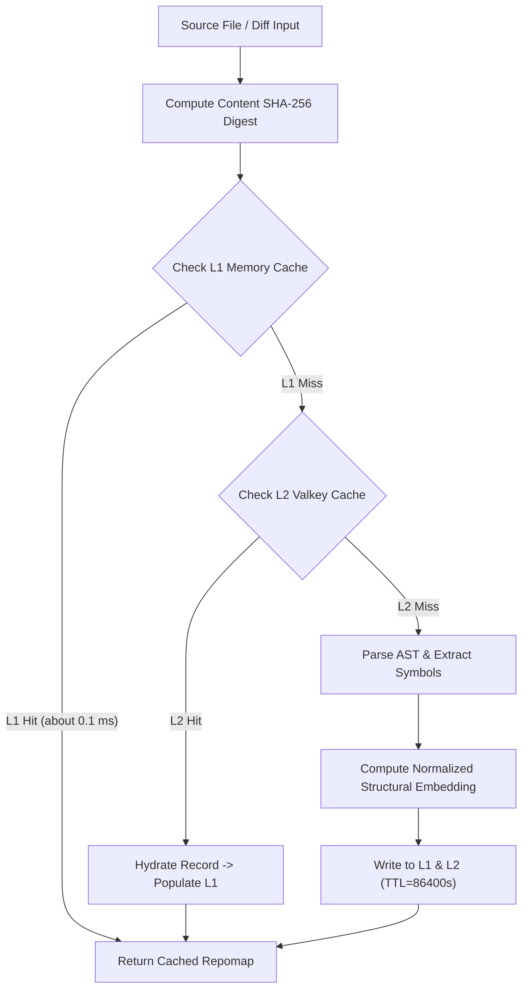

# Valkey L2 Repomap Cache & Embedding Drift Auditor

Two-tier AST symbol table caching and structural drift auditing across autonomous AI subagent invocations.

---

## Architecture Overview

Multi-turn agent coding sessions frequently re-parse, inspect, and evaluate identical or slightly modified source files. Re-parsing the AST on every turn consumes valuable CPU cycles and introduces token-budget context latency.

This reference implementation combines:
1. **L1 Fast Memory Cache**: In-process FIFO cache keyed by SHA-256 content hash. It evicts the oldest inserted key; a hit does not refresh a key.
2. **L2 Valkey / Redis Distributed Cache**: Content-addressed cache over RESP wire protocol with TTL expiration. The client opens one TCP connection per command (default `localhost:6379`). If no server answers `PING`, every L2 read and write goes to an in-process dict, and a hit is still reported as `L2_VALKEY`. The demo and the tests run in that mode; nothing in this repository tests against a real Valkey server.
3. **AST Feature Embedding Generator**: Generates an 8-dimensional normalized structural feature vector from module AST metrics.
4. **Embedding Drift Auditor**: Calculates Cosine Similarity and Cosine Distance ($D_C$) between AST versions to flag large changes in these structural ratios. The "embedding" is a hand-built vector of 8 AST counts, not a learned embedding. It does not check behavior: two versions with the same counts get distance 0.



---

## Semantic Drift Auditing

When refactoring code (e.g. converting branching ladders into table-driven dispatch), agents must verify that the structural semantics of the module are preserved.

The auditor extracts an 8-dimensional feature vector $\vec{v}$:
$$\vec{v} = \begin{bmatrix} \frac{\text{functions}}{\text{lines}}, \frac{\text{classes}}{\text{lines}}, \frac{\text{branches}}{\text{lines}}, \frac{\text{calls}}{\text{lines}}, \frac{\text{returns}}{\text{lines}}, \frac{\text{docstrings}}{\text{symbols}}, \ln(1 + \text{branches}), \ln(1 + \text{lines}) \end{bmatrix}$$

Normalized to unit length $\hat{v} = \frac{\vec{v}}{\|\vec{v}\|_2}$, the auditor computes Cosine Distance:
$$D_C(\hat{u}, \hat{v}) = 1.0 - (\hat{u} \cdot \hat{v})$$

### Drift Classification
- **Preserved ($D_C \le 0.05$)**: Expected behavior during clean refactoring. Symbol topology remains stable.
- **Slight Drift ($0.05 < D_C \le 0.15$)**: Moderate structural additions (e.g. added helper functions).
- **Significant Drift ($D_C > 0.15$)**: Major topological divergence (e.g. paradigm shift from functional to OOP).

The thresholds are fixed constants in `_classify_drift`. No data calibrates them, and the examples in parentheses are illustrative.

---

## Wire Protocol (RESP)

The client implements pure standard-library Redis Serialization Protocol (RESP) without third-party dependencies:
- PING / GET / SET / DEL commands encoded via `*<n>\r\n$<len>\r\n...`
- In-memory fallback when no local Valkey daemon is running, so the demo and the tests run offline. A failed `GET` or `SET` also falls back silently.

---

## Running the Interactive Demo & Tests

```bash
# Run interactive caching and drift audit demo
python3 repomap_cache.py --demo

# Audit drift between two files
python3 repomap_cache.py --file before.py --refactored after.py

# Run unit tests
pytest test_repomap_cache.py -v
```
