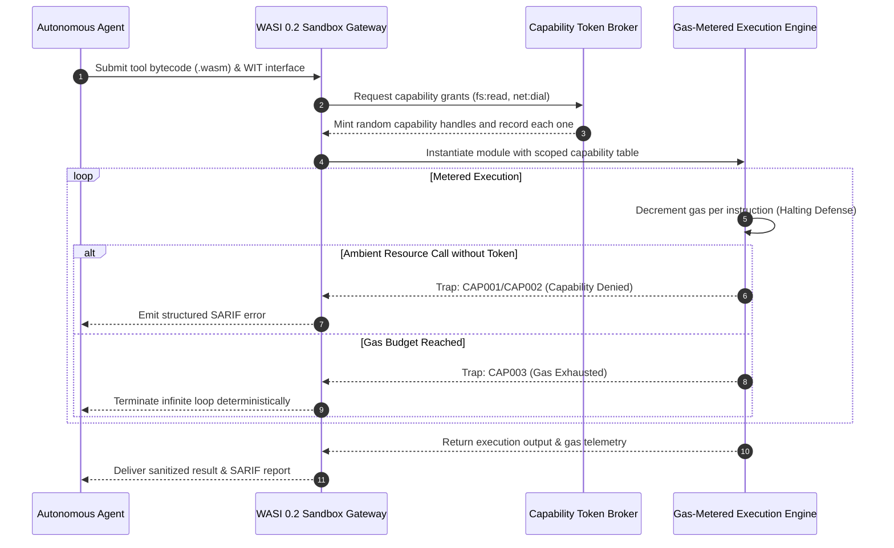

# WebAssembly Component Model & Capability-Based Sandbox Gateway (WASI 0.2)

> **Exemplar Status**: Living Artifact & Executable Reference Implementation  
> **Classification**: Pure-Python Simulation of Capability Isolation, Wasm Component Model, WASI 0.2, Gas Metering  
> **Related**: [Observation 36](../../observations/systems/36-wasi-component-models-and-capability-based-tool-sandboxing.md), [Pattern: Capability-Based Wasm Sandboxing](../../patterns/capability-based-wasm-sandboxing.md)

---

## 1. Executive Overview

In autonomous agent workflows, subagents frequently generate and execute ephemeral helper utilities, format converters, and data scrapers. Executing untrusted agent-generated code inside traditional host processes (`python -c` or `bash`) grants **ambient UNIX authority** (CWE-250), exposing local credentials, filesystems, and network sockets to unverified tools.

Containerized sandboxes (`docker run`, cgroups v2) mitigate ambient authority but add a container start to every call, which slows high-frequency tool loops.

The **WASI 0.2 Component Model & Capability-Based Sandbox Gateway** is a pure-Python simulation of capability tokens, gas metering and linear memory containment. It runs no WebAssembly: the code imports no Wasm runtime (such as Wasmtime), instantiates nothing and measures no instantiation time. What it does:

- `validate` checks a file's magic bytes, version and section IDs. It accepts core modules (version 1) only, so it rejects every Component Model binary (version `0x0d`, layer `1`).
- A capability handle is a Python object. `create_capability` gives each handle a random ID (`secrets.token_hex`) and records the handle in a registry in the module. The access checks accept a handle only if the registry holds the same handle. A hand-built handle, or a minted ID copied into a handle with a wider scope, gets `CAP001` or `CAP002`. This is not isolation: Python code in the same process can read or change the registry.
- Gas metering sums the costs of a supplied list of `(op, cost)` pairs, and memory containment is a page counter.

---

## 2. Architectural Sequence

The diagram shows the intended design. The code implements the capability checks, the counters and the SARIF output; it runs no module.



---

## 3. WIT Interface Contract

Declarative WebAssembly Interface Type (`wit`) contract governing the agent tool execution boundary:

```wit
package example:tool-runner;

world runner {
    import wasi:filesystem/preopens@0.2.0;
    import wasi:clocks/monotonic-clock@0.2.0;

    export run: func(payload: string) -> string;
}
```

WIT allows `import` and `export` only inside a `world`, not inside an `interface`. `parse_wit_contract` is not a WIT parser: it reads only the `package`, `interface`, `import` and `export` lines.

---

## 4. Diagnostic Rules & Containment Invariants

| Rule ID | Invariant Category | Severity | Description |
|---|---|---|---|
| `CAP001` | Filesystem Isolation | `error` | Ambient filesystem access denied (outside preopened capability scope). |
| `CAP002` | Network Isolation | `error` | Ambient network egress denied (unauthorized destination host/port). |
| `CAP003` | Instruction Budget | `error` | Execution halted due to deterministic gas budget exhaustion (runaway loop defense). |
| `CAP004` | Memory Containment | `error` | Execution halted due to linear memory ceiling breach (page allocation cap). |
| `CAP005` | Interface Contract | `error` | Missing capability grant for declared WIT component import. |

---

## 5. CLI Usage & Verification

```bash
# Validate Wasm binary header magic and section table (core modules only)
python3 examples/wasm-capability-sandbox/wasm_sandbox.py validate module.wasm

# Audit requested path against capability permissions
python3 examples/wasm-capability-sandbox/wasm_sandbox.py audit \
    --grant-fs /workspace/sandbox \
    --check-path /workspace/sandbox/in.json

# Run unit and integration tests
uv run pytest -q examples/wasm-capability-sandbox/test_wasm_sandbox.py
```

---

## 6. Zero-Dependency Statement

This reference implementation strictly leverages the **Python standard library** (`argparse`, `dataclasses`, `enum`, `json`, `pathlib`, `secrets`, `struct`, `sys`, `time`), requiring zero external packages or native C runtime extensions.
