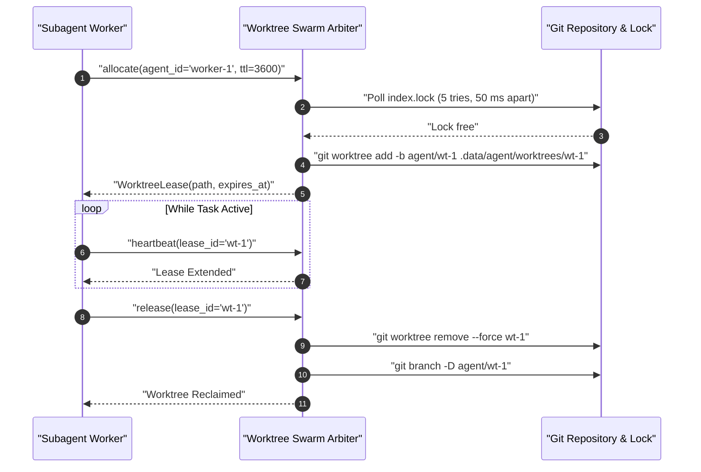

# Sample App: Autonomous Git Worktree Fleet Allocator

An executable, zero-dependency Python library and CLI that creates isolated git worktrees for concurrent AI coding subagents and models lease heartbeats, index-lock waits and process group cleanup. It keeps no lease state between calls: the caller holds the lease objects.

---

## Why This Exists: Concurrency Hazards in Swarms

When multiple autonomous agents or subagents collaborate on a single codebase simultaneously (as documented in [Observation 06](../../observations/systems/06-multi-agent-concurrency-shared-workspace-hazards-and-swarm-coordination.md)), naive file editing triggers severe workspace corruption:
- **Git Index Lock Contention**: Concurrent `git add` or `git commit` commands fail immediately due to `.git/index.lock` collisions.
- **Shared Working Tree Clobbering**: One agent's intermediate edits overwrite another's uncommitted changes.
- **Zombie Worktrees**: Subagents terminated mid-task leave orphaned git worktrees and locked branches on disk.
- **SQLite Database Corruption**: Test suites writing to shared `.coverage` databases collide across workers.

The **Worktree Swarm Arbiter** provides isolated branch-and-worktree checkouts and library functions for bounded TTL leases, heartbeat extension, POSIX process group termination, and stale-lease pruning. The caller stores the leases and calls these functions; nothing runs them on a schedule.

---

## Architectural Interaction



---

## Quick Start

### CLI Usage

```bash
# Allocate an isolated worktree for a subagent
python3 worktree_arbiter.py allocate --agent subagent-refactorer --ttl 1800

# Inspect fleet status (human summary)
python3 worktree_arbiter.py status

# Inspect fleet status as JSON telemetry
python3 worktree_arbiter.py status --format json

# Export OASIS SARIF 2.1.0 telemetry for stale leases
python3 worktree_arbiter.py status --format sarif
```

The CLI stores no leases. `status` reports an empty fleet (0 active, 0 stale) even after `allocate`. For a real report, pass your own lease list to `audit_fleet_health` and then to `to_markdown` or `to_sarif`.

---

## Invariant Verification

- **Zero External Dependencies**: Standard library Python (`pathlib`, `subprocess`, `signal`, `json`, `time`).
- **Structural Caps**: All functions have $M \le 4$, nesting depth $\le 2$, and parameter count $\le 4$ (`ruff check --select C901,PLR0913` with `max-complexity = 4` and `max-args = 4` passes).
- **Process Group Containment**: `release_worktree` sends `SIGTERM` to the lease's process group (`os.killpg`) when the caller has set `process_group_id`. The CLI never sets it (it stays 0), and a child that calls `setsid` leaves the group, so this reduces orphan background tasks but does not eliminate them.

