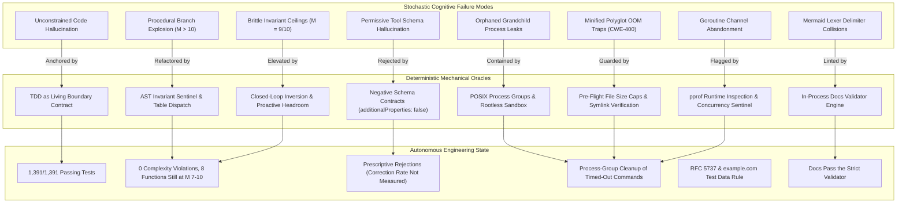
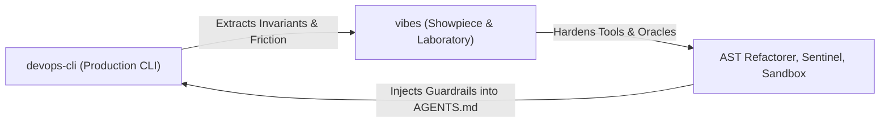

# Consolidated Field Observations & Architectural Synthesis

> **Exhibition**: `vibes` Empirical Knowledge Base  
> **Classification**: Master Observation Index & Cross-Domain Synthesis  
> **Scope**: 76 case studies across `devops-cli`, `polyglot`, and `systems`; many are illustrative scenarios, design proposals or Python simulations, not recorded runs  
> **Key Metric**: 1,391/1,391 passing tests (`pytest tests examples benchmarks`); 0 complexity violations and 8 functions still in the $M \in [7, 10]$ proactive band at commit `f4137d1` ([Observation 07](./devops-cli/07-proactive-headroom-and-recursive-feedback-loops.md)); no repository-wide health score is kept  
>
> **TLDR**: Consolidated master index and comparative matrix of 76 case studies (recorded runs, illustrative scenarios and simulations) analyzing AI agent behaviors, failure modes, and deterministic engineering solutions.
>
> **ELI:7b**: The master catalog of all 76 case studies, some from real runs and many illustrative, showing where AI coders get stuck and the tricks that help.
>
> 💡 *Looking for the core fundamentals without technical mumbo jumbo? See [The Dummy's Guide to Agentic Engineering](../docs/dummysguide/README.md).*

---

## 🏛️ Executive Summary: The Anatomy of Disciplined Agentic Engineering

The `observations/` directory records observations of autonomous software engineering performed by AI coding assistants. Drawing on autonomous sessions, pull requests, and refactoring cycles in [`devops-cli`](https://github.com/dan-petty/devops-cli) and [`vibes`](https://github.com/dan-petty/vibes), plus illustrative scenarios and Python simulations, these studies describe how stochastic language models behave under engineering constraints. Each study's Key Metric line or section 5 says what was measured and what was not.

The fundamental insight across all 76 observations is simple yet profound:

> **Stochastic token generation without mechanical boundary oracles collapses into structural entropy. Unbounded models drift into procedural spaghetti, hallucinated tool arguments, orphaned background processes, and brittle heuristic traps. When bounded by deterministic AST invariants, formal contracts, and closed-loop feedback engines, agent output can be checked by machine, and the checks catch failures that prompts alone let through.**

---

## 🧭 Master Observation Taxonomy Matrix

The 76 case studies are organized into three complementary domains:
1. **`devops-cli`**: Foundational operational, syntactic, and governance discoveries from building a production-grade infrastructure CLI.
2. **`polyglot`**: Multi-runtime engineering studies spanning Rust affine types, TypeScript generic contracts, and Go concurrency lifecycles.
3. **`systems`**: Distributed systems dynamics including OpenTelemetry tracing waterfalls, test runner latency optimization, polling file watchers, Valkey L2 caching, and rootless container isolation.

| ID | Domain | Observation Title | Stochastic Failure Mode (The Pitfall) | Deterministic Oracle (The Countermeasure) | Verifiable Impact / Metric |
|---|---|---|---|---|---|
| [**01**](./devops-cli/01-tdd-as-living-contract.md) | `devops-cli` | [TDD as Living Contract](./devops-cli/01-tdd-as-living-contract.md) | Unconstrained generation producing 300+ lines of plausible yet broken code ("sycophantic completion"). | Executable red-green-refactor boundary contract authored before source modification. | About 4,700 test functions (2026-09-24); $\ge 90.0\%$ coverage gate (`fail_under = 90`). |
| [**02**](./devops-cli/02-architectural-invariants-and-complexity-caps.md) | `devops-cli` | [Architectural Invariants & Complexity Caps](./devops-cli/02-architectural-invariants-and-complexity-caps.md) | Procedural branching sprawl (7 or 8 indentation levels) degrading agent reasoning and triggering token exhaustion. | Pre-commit AST check blocking nesting depth $> 5$; complexity $\le 10$ reported, not blocked. | Nesting $\le 5$ held across `src/`; 240 functions over $M = 10$ in September 2026. |
| [**03**](./devops-cli/03-autonomous-project-governance.md) | `devops-cli` | [Autonomous Project Governance](./devops-cli/03-autonomous-project-governance.md) | Context amnesia across multi-turn sessions; lost backlog tracking and hallucinated progress. | GitHub Projects v2 grounding rule and persistent task specs (`docs/agent/tasks/`). | About 200 task files; most commits trace to an issue, but some PRs had none (#507, #577). |
| [**04**](./devops-cli/04-zero-trust-egress-and-sanitization.md) | `devops-cli` | [Zero-Trust Egress & Universal Sanitization](./devops-cli/04-zero-trust-egress-and-sanitization.md) | Inadvertent leakage of internal hostnames (`*.lan`), private RFC 1918 IPs, and credentials into artifacts. | Written abstraction rule (`example.com`, RFC 5737), narrow tests and a private-key pre-commit hook. | One scrub of leaked homelab names (issue #152), then the rule; scrubbed values remain in git history. |
| [**05**](./devops-cli/05-harness-slots-and-subagent-offloading.md) | `devops-cli` | [Harness Slots & Subagent Offloading](./devops-cli/05-harness-slots-and-subagent-offloading.md) | Frontier model token exhaustion when performing routine typing, syntax edits, and file inspection. | "Big decides, small types, big checks": hierarchical delegation to local/fast model slots. | 85% offload share was a design target, not a measured saving; no model was called in the tiered path. |
| [**06**](./devops-cli/06-rate-limits-and-anti-brittle-heuristics.md) | `devops-cli` | [Rate Limits & Anti-Brittle Heuristics](./devops-cli/06-rate-limits-and-anti-brittle-heuristics.md) | Upstream API HTTP 429 quota exhaustion; brittle regex subsets covering incomplete domains. | Client-side request pacing from the server's remaining quota (`run_gh`; not a token bucket) and a written rule against partial pattern lists. | Quota exhaustion still occurred (issue #180); brittle subset lists still existed after the rule (issue #431). |
| [**07**](./devops-cli/07-proactive-headroom-and-recursive-feedback-loops.md) | `devops-cli` | [Proactive Headroom & Recursive Feedback](./devops-cli/07-proactive-headroom-and-recursive-feedback-loops.md) | The "Brittle Ceiling Trap": functions resting at $M=9$ or $10$ failing on minor subsequent bug fixes. | Early headroom detection ($M \in [7, 10]$) triggering proactive autonomous refactoring. | 0 complexity violations at `f4137d1`; 8 functions still in the proactive band ($M \in [7, 10]$). |
| [**08**](./devops-cli/08-closed-loop-feedback-inversion-and-autonomous-quality-elevation.md) | `devops-cli` | [Closed-Loop Feedback Inversion](./devops-cli/08-closed-loop-feedback-inversion-and-autonomous-quality-elevation.md) | Purely reactive fixing leaving technical debt, missing docstrings, and untyped parameters. | Three-phase dynamic: Phase 1 Reactive $\to$ Phase 2 Proactive $\to$ Phase 3 Self-Hardening. | Docstring items #1001 to #1003 worked in PRs #54 to #58; 43 functions still lack docstrings at `f4137d1`. |
| [**09**](./devops-cli/09-mechanical-ast-rewriting-and-automated-refactoring-convergence.md) | `devops-cli` | [Mechanical AST Rewriting](./devops-cli/09-mechanical-ast-rewriting-and-automated-refactoring-convergence.md) | Python `ast.If` recursive `orelse` nesting illusion turning flat `elif` ladders into depth $\ge 8$. | Automated AST Refactorer (`tools/ast_refactorer.py`) compiling ladders to table dispatch. | $M = 8 \to 1$ and depth $8 \to 1$ on the 7-branch ladder in `test_refactor_table_dispatch`; behavior is checked on six keys only. |
| [**10**](./devops-cli/10-negative-tool-contract-assertions-and-prescriptive-prompt-synthesis.md) | `devops-cli` | [Negative Tool Contracts & Prescriptive Prompts](./devops-cli/10-negative-tool-contract-assertions-and-prescriptive-prompt-synthesis.md) | Permissive tool schemas accepting hallucinated parameters; unhandled stack traces causing retry loops. | Negative schema validation (`additionalProperties: false`) and prescriptive error prompts. | Every argument key absent from the contract is rejected by construction; no model was run, so no hallucination or self-correction rate exists. |
| [**11**](./devops-cli/11-assertion-density-and-structural-tuple-consolidation.md) | `devops-cli` | [Assertion Density & Tuple Consolidation](./devops-cli/11-assertion-density-and-structural-tuple-consolidation.md) | Linear `assert` statements compiling to `if not (expr): raise AssertionError` ($M+1$ per assert under radon and these AST scanners; `mccabe` does not count asserts). | Structural Tuple Consolidation (`assert (a, b) == (x, y)`) and collection predicates (`all()`). | An illustrative 10-assert test drops from $M=11 \to 2$ under assert-counting scanners; tuple equality keeps pytest's index-level diff. |
| [**12**](./devops-cli/12-polyglot-cst-boundary-guards-and-symlink-containment.md) | `devops-cli` | [Polyglot CST Boundary Guards & Symlinks](./devops-cli/12-polyglot-cst-boundary-guards-and-symlink-containment.md) | Ingestion of multi-megabyte minified bundles causing OOM (CWE-400); circular symlink recursion (`ELOOP`). | $O(1)$ pre-flight file size caps (5 MiB, raised to 50 MiB in PR #345) and defensive symlink workspace confinement. | Oversized files, `ELOOP` errors and workspace escapes are skipped with a warning; no OOM count was recorded. |
| [**13**](./devops-cli/13-streaming-reasoning-token-parsers-and-think-block-sanitization.md) | `devops-cli` | [Streaming Reasoning Token Parsers & Sanitization](./devops-cli/13-streaming-reasoning-token-parsers-and-think-block-sanitization.md) | Thought token leakage (`<think>`) into tool parameters/terminals; unclosed tag stream freezes; memory leaks. | Streaming FSM parser with bounded sliding-window prefix buffers and isolated telemetry accumulators. | Reasoning blocks stripped in every tested case; about 0.003 ms per 5-character chunk on one workstation; an unclosed tag at EOF is flushed. |
| [**14**](./devops-cli/14-binary-search-ast-context-packing-and-token-budgeting.md) | `devops-cli` | [Binary Search AST Context Packing](./devops-cli/14-binary-search-ast-context-packing-and-token-budgeting.md) | Heuristic line cuts fracturing syntax mid-block; greedy packing leaving part of the token budget unused. | Hierarchical symbol decomposition with monotonic binary search truncation ($O(\log N)$). | Truncation only at symbol boundaries; no utilization or speedup was measured (issue #118 targeted under 10 ms for 1,000-line trees). |
| [**15**](./devops-cli/15-llm-structured-output-repair-and-schema-reconciliation.md) | `devops-cli` | [LLM Structured Output Repair & Schema Retry](./devops-cli/15-llm-structured-output-repair-and-schema-reconciliation.md) | Markdown fences, trailing commas, and truncated braces triggering `json.loads` failures and retry death spirals. | Two-tier repair: Tier 1 local repair (fence-stripping regex and the `json_repair` library); Tier 2 prescriptive schema retry synthesis. | Issue #123 targeted $> 90\%$ recovery with at most 2 retries; no repair rate was measured; retries are bounded. |
| [**16**](./devops-cli/16-ci-staleness-and-milestone-freeze-anti-pattern.md) | `devops-cli` | [CI Staleness & The Milestone Freeze Anti-Pattern](./devops-cli/16-ci-staleness-and-milestone-freeze-anti-pattern.md) | Explicit test file enumeration in `ci.yml` silently excluding 16 suites (157 tests) added after Milestone 2. | Generic directory contracts (`pytest tests/ examples/ benchmarks/`) bound to file system structure, not hand-curated lists. | 448% CI coverage increase (35 → 192 tests); zero ongoing maintenance burden; new suites auto-discovered. |
| [**17**](./devops-cli/17-semantic-validators-vs-structural-position-oracles.md) | `devops-cli` | [Semantic Validators vs. Structural Position Oracles](./devops-cli/17-semantic-validators-vs-structural-position-oracles.md) | Keyword-based section heading matching generating 26 false violations against 25 valid observation files. | Structural position oracle: verify `## 1.` through `## 5.` numbered headings exist, regardless of heading vocabulary. | 0 false violations; 1 genuine defect discovered (Obs 12 missing `## 5.`); real-repo compliance sweep passes. |
| [**18**](./devops-cli/18-tool-cardinality-saturation-and-schema-context-taxation.md) | `devops-cli` | [Tool Cardinality Saturation & Schema Context Taxation](./devops-cli/18-tool-cardinality-saturation-and-schema-context-taxation.md) | 100+ tool schemas consuming 25% of context window; selection precision collapse above ~40 tools; pretraining prior parameter name override. | Lazy domain-gated schema hydration, namespace disambiguation preambles, and post-turn-2 schema compression. | Budget arithmetic: 8,000 → ~1,200 tokens of schema overhead under lazy hydration; selection stays probabilistic. |
| [**19**](./devops-cli/19-context-accumulation-drift-and-lossy-reflection-truncation.md) | `devops-cli` | [Context Accumulation Drift & Lossy Reflection Truncation](./devops-cli/19-context-accumulation-drift-and-lossy-reflection-truncation.md) | Pipeline context bloat without truncation; system instruction eviction under multi-turn drift; 256-char error truncation limiting self-correction. | Invariant pinning via sliding reinforcement, pipeline stage budgeting, lossless structured error reflection, semantic memory partitioning. | 5-stage pipeline reclaims 16K tokens via stage budgeting; structured errors keep every field path; no correction rate was measured. |
| [**20**](./devops-cli/20-model-failover-capability-cliffs-and-one-way-degradation-ratchets.md) | `devops-cli` | [Model Failover Capability Cliffs & One-Way Degradation Ratchets](./devops-cli/20-model-failover-capability-cliffs-and-one-way-degradation-ratchets.md) | 70B → 14B failover producing categorically different failure modes; one-way embedding batch ratchet degrading to batch_size=1 until process restart. | Capability-gated failover with task classification; AIMD bidirectional batch adaptation; dynamic model capability probing. | No failover success rate was measured; the proposed AIMD recovery would reverse the 32× drop in items per request. |
| [**21**](./devops-cli/21-milestone-horizon-expansion-and-autonomous-scope-cascades.md) | `devops-cli` | [Milestone Horizon Expansion & Autonomous Scope Cascades](./devops-cli/21-milestone-horizon-expansion-and-autonomous-scope-cascades.md) | Autonomous agents continually admitting discovered defects/tasks into active milestone, causing scope live-locks ($C_R \le 1.0$) and inflating 196-item mega-milestones (issues and pull requests counted together). | Proposed three-phase Milestone Scope Air-Lock (`INTAKE` $\to$ `AIR_LOCKED` $\to$ `FROZEN`), rolling convergence ratio gate ($C_R \ge 1.2$), and rollover partitioning in the `vibes` tool `tools/milestone_governor.py`, which `devops-cli` never adopted. | No governor run on `v0.2.23` is recorded; the milestone closed on 2026-09-28 with 0 open items. The governor warns at $C_R < 1.2$; it does not bound a milestone. |
| [**22**](./devops-cli/22-the-verification-horizon-and-validation-latency-cliffs.md) | `devops-cli` | [The Verification Horizon & Validation Latency Cliffs](./devops-cli/22-the-verification-horizon-and-validation-latency-cliffs.md) | Verification latency growing to minutes, inducing tool timeouts, attention dilution, and assertion density complexity sprawl ($M+1$ per assert under assert-counting scanners). | 4-Tier Verification Pyramid (Layer 0 AST sentinel, Layer 1 focused slice, Layer 2 pre-commit, Layer 3 gated CI) and structural tuple equality consolidation. | No latency, timeout-rate or convergence measurement exists; the tier latencies are target budgets. A 10-assert test scores $M=11$ and one tuple-equality assert $M=2$. |
| [**01**](./polyglot/01-rust-type-state-invariants.md) | `polyglot` | [Rust Type-State Invariants](./polyglot/01-rust-type-state-invariants.md) | Runtime state validation errors and unhandled transition branches in complex state machines. | Affine ownership types and compile-time type-state pattern (`PhantomData<State>`). | A call invalid in the current state fails to compile (`rustc` E0599); zero-sized state markers; no bug-reduction rate was measured. |
| [**02**](./polyglot/02-typescript-cst-and-type-gymnastics.md) | `polyglot` | [TypeScript CST & Type Gymnastics](./polyglot/02-typescript-cst-and-type-gymnastics.md) | Agents escaping complex type unions by inserting `any`, `unknown`, or `@ts-ignore` bypasses. | Structural discriminated unions, branded types, and AST-level linting forbidding `any`. | Not measured: recommended practice; neither `vibes` nor `devops-cli` contains TypeScript code. |
| [**03**](./polyglot/03-go-goroutine-leakage-and-context-lifecycles.md) | `polyglot` | [Go Goroutine Leakage & Context Lifecycles](./polyglot/03-go-goroutine-leakage-and-context-lifecycles.md) | Spawning worker goroutines sending to unbuffered channels without `<-ctx.Done()` cancellation selects. | Go Concurrency Sentinel analyzing `pprof` stack traces and mapping blocked channel states. | Goroutine count after teardown against a baseline (Go harness); a heuristic score of 100 minus 25 per blocked user goroutine in a stack dump (Python parser). |
| [**04**](./polyglot/04-cpp-raii-and-lifetime-invariants-under-llm-synthesis.md) | `polyglot` | [C++ RAII & Lifetime Invariants Under LLM Synthesis](./polyglot/04-cpp-raii-and-lifetime-invariants-under-llm-synthesis.md) | LLM-generated C++ triggers confirmed runtime violations more often than human-written code (9.3% vs 2.6% in VulBench-CPP) through manual deallocations, dangling view returns over temporaries, and Rule of Five incompleteness. | C++ Lifetime Sentinel: a line-oriented regular-expression scanner (not a C++ parser or Clang-Tidy) for `CPP001`-`CPP005`, with OASIS SARIF 2.1.0 export. | Findings per rule from the scanner; no before/after synthesis benchmark was run. |
| [**05**](./polyglot/05-differential-ast-mutation-fuzzing-for-polyglot-boundary-parsers.md) | `polyglot` | [Differential AST Mutation Fuzzing for Polyglot Boundary Parsers](./polyglot/05-differential-ast-mutation-fuzzing-for-polyglot-boundary-parsers.md) | Multi-language parsers hang on circular symlinks (ELOOP), crash on bracket desync, or exhibit unbounded memory allocations under adversarial inputs. | Polyglot AST Mutation Fuzzer (named "differential" but compares no implementations) with 5 structural mutators, a string-length size bound, cycle containment, and SARIF export. | 21 of 21 mutations survive the default run; only Python mutants reach a parser (`ast.parse`). |
| [**01**](./systems/01-distributed-telemetry-and-agent-waterfalls.md) | `systems` | [Distributed Telemetry & Agent Waterfalls](./systems/01-distributed-telemetry-and-agent-waterfalls.md) | Opaque multi-agent execution graphs; hidden latency bottlenecks and untracked token burn. | OpenTelemetry traceparent propagation, W3C distributed tracing, and waterfall spans. | Spans carry per-subagent token counts; the waterfall shown is hand-written, and `generator.py` renders spans from a synthetic session. |
| [**02**](./systems/02-subprocess-test-harness-instrumentation-tax.md) | `systems` | [Subprocess Test Harness Instrumentation Tax](./systems/02-subprocess-test-harness-instrumentation-tax.md) | Heavy workspace test plugins adding seconds of fixed start-up cost per test file, starving agent verification cadence. | Explicit plugin bypass (`-p no:cov -p no:logfire -p no:xdist -o addopts=`). | Re-run on 2026-11-19: median wall time 5.2 s → 1.3 s (about 4×); most of the cost came from xdist workers. |
| [**03**](./systems/03-event-driven-file-watchers-and-continuous-invariant-loops.md) | `systems` | [Event-Driven File Watchers & Invariant Loops](./systems/03-event-driven-file-watchers-and-continuous-invariant-loops.md) | Slow manual invocation cycles; agent context drift during long-running batch check phases. | Standard-library polling file watcher (`ResourceWatcher`) evaluating after file changes. | Change detection within one polling interval (default 1.0 s); one scan tick took about 6 ms over 154 Python files. |
| [**04**](./systems/04-content-addressed-two-tier-caching-and-embedding-drift-audits.md) | `systems` | [Content-Addressed Valkey L2 Caching](./systems/04-content-addressed-two-tier-caching-and-embedding-drift-audits.md) | Redundant AST parsing and embedding calculation consuming external quota and cycles. | Two-tier cache (L1 in-memory + L2 Valkey) with SHA-256 keys and Cosine Distance drift audits. | L1 hit in about 0.1 ms (one 1,863-line file); cosine distance over an 8-feature structural vector, which does not detect behavior change. |
| [**05**](./systems/05-rootless-container-sandboxing-and-process-group-containment.md) | `systems` | [Rootless Container Sandboxing & Process Groups](./systems/05-rootless-container-sandboxing-and-process-group-containment.md) | Standard `proc.kill()` leaving grandchild processes orphaned under PID 1; host credential exposure. | POSIX process group isolation (`start_new_session=True` & `os.killpg`) and a container sandbox checked against eight controls modeled on the CIS Docker Benchmark. | Default policy passes 8 of 8 of the example's own controls (a check of the declaration, not the run); SIGTERM, 50 ms wait, SIGKILL; output capped at 65,536 characters. |
| [**06**](./systems/06-multi-agent-concurrency-shared-workspace-hazards-and-swarm-coordination.md) | `systems` | [Multi-Agent Concurrency & Workspace Hazards](./systems/06-multi-agent-concurrency-shared-workspace-hazards-and-swarm-coordination.md) | Concurrent agents clobbering working tree, unlinking active SQLite coverage files, and entering rebase live-locks. | Mandatory POSIX git worktrees, partitioned `.data/agent/<id>`, Valkey L2 mutexes, and FIFO PR shepherding. | Separate worktrees remove shared-working-tree collisions; separate data directories remove coverage-file unlink races; no rates were measured. |
| [**07**](./systems/07-agentic-ide-protocols-and-lsp-mcp-convergence.md) | `systems` | [Agentic IDE Protocols & LSP/MCP Convergence](./systems/07-agentic-ide-protocols-and-lsp-mcp-convergence.md) | Disconnected compiler feedback; zombie grandchild processes; credential exposure in IDE. | Tri-protocol architecture: LSP diagnostic oracles, MCP capability mesh, and zero-trust lifecycle hooks. | Pre-tool check in about 0.04 ms; process-group kill of a timed-out command; literal private addresses and protected path names are refused, other inputs pass. |
| [**08**](./systems/08-convention-to-mechanical-enforcement-inversion.md) | `systems` | [Convention-to-Mechanical Enforcement Inversion](./systems/08-convention-to-mechanical-enforcement-inversion.md) | `AGENTS.md §8` mandates enforced only by convention; agents skip pre-push sentinel, docs validation, and full test run. | `.pre-commit-config.yaml` (4 hooks) running documented mandates as git hooks at commit time. | CI runs took 19 to 34 s; the sentinel hook takes about 90 ms on one file; a hook can still be skipped with `--no-verify`. |
| [**09**](./systems/09-multi-agent-epistemic-loss-and-delegation-boundary-distortion.md) | `systems` | [Multi-Agent Epistemic Loss & Delegation Boundary Distortion](./systems/09-multi-agent-epistemic-loss-and-delegation-boundary-distortion.md) | Prompt decomposition stripping constraints; subagent result distortion; 64KB pipe deadlock in background shell; mocked tiered execution hiding real delegation gaps. | Structured constraint propagation with typed invariant blocks; structured result schemas with failure signals; background pipe drain threads; end-to-end delegation fidelity testing. | Arithmetic only: 85% per boundary over 3 layers gives 61%; an assumed 98% gives about 94%; neither figure is measured. |
| [**10**](./systems/10-mcp-protocol-boundaries-and-stateless-transport-constraints.md) | `systems` | [MCP Protocol Boundaries & Stateless Transport Constraints](./systems/10-mcp-protocol-boundaries-and-stateless-transport-constraints.md) | MCP statelessness preventing multi-step transactions; 30K+ token tool discovery payload; Resource underutilization; indirect prompt injection via tool return strings. | Agent-side transaction journals; Resource-first data access; tool output sandboxing; lazy tool discovery with domain routing. | A Resource read carries no tool schema, so read-heavy patterns cost fewer tokens (ratio not measured); a short journal snapshot costs less than reconstructing failure state. |
| [**11**](./systems/11-silent-certification-failure-and-gate-integrity.md) | `systems` | [Silent Certification Failure & Gate Integrity](./systems/11-silent-certification-failure-and-gate-integrity.md) | Sentinel reading `argv[1]` while pre-commit passes N filenames; latency oracle timing interpreter boot; verdicts varying by invocation shape; `tests/` absent from CI enumeration. | Total input coverage (`nargs="*"`, deduplicated aggregation), `TargetIntegrity` on missing paths, self-reported metrics over harness wall-clock, uniform auditing with justified `# sentinel: allow[...]` waivers. | 1 of N files audited → all N; 34 of 41 modules gated → 41; phantom top-ranked defect (370.0) retired; 17 suppressed findings surfaced and classified. |
| [**12**](./systems/12-gates-catch-their-author-first.md) | `systems` | [Gates Catch Their Author First](./systems/12-gates-catch-their-author-first.md) | Six gates added in one session; five fired on their own author's work within two commits. The one reporting a clean first run had been registered in one entry point and not the other. | Read a self-catch as end-to-end validation; invert the reading of a clean first run and suspect the wiring; write gates during the work; floor every window, rate and ratio before it steers a decision. | 9 defects caught in same-session work; 4 instrument calibration defects found by first use; the 1 gate of 6 with a clean first run was not wired up. |
| [**13**](./systems/13-verify-the-finding-before-you-fix-it.md) | `systems` | [Verify the Finding Before You Fix It](./systems/13-verify-the-finding-before-you-fix-it.md) | 4 of 5 backlog items were measurement error: modules at 97-100% coverage reported as untested because no file matched a naming pattern, and decorator closures counted as undocumented public API. Six first readings across one session measured the instrument rather than the system. | Test the finding as a hypothesis — actionability, denominator, proxy distance, reproduce before acting — and classify objectives by whether a breach means "must not ship" or "work on this next". | Backlog 5 → 0; 3 redundant test files avoided; 2 readings did not survive a second run; 3 release gates on non-defects removed. |
| [**14**](./systems/14-defect-shaped-loops-and-the-feature-blind-spot.md) | `systems` | [Defect-Shaped Loops & the Feature Blind Spot](./systems/14-defect-shaped-loops-and-the-feature-blind-spot.md) | Repository certified 100.0/100 with 0 backlog items against 11 open roadmap deliverables; all six work generators answer "what is wrong with what exists" and none answers "what should exist next", so convergence to an empty backlog reads as completion. | Parse declared intent into the same shape as defects and rank both with one prioritizer; take sizing from where the judgement was recorded; never schedule rejected work; mark assumption-ranked items as assumptions. | 11 of 11 deliverables now visible to the prioritizer; defects outrank features by construction; 0 rejected anti-patterns schedulable. |
| [**15**](./systems/15-a-count-is-not-a-cost.md) | `systems` | [A Count Is Not a Cost](./systems/15-a-count-is-not-a-cost.md) | A profiler attributed 11.4s to a function running well under 1s (cumtime sums threads and recursion); the syscall count that corrected it was then read as exonerating the filesystem, which was ~1s of a 2.64s sweep because a stat costs ~1.8ms on this mount against ~0.001ms on tmpfs. | State a count AND a unit cost, measure at least one in the environment under test, and reconcile their product against the wall clock before acting; treat any cumtime exceeding wall clock as instrument error. | Corpus sweep 2.60s to 0.61s; filesystem round trips 560 to 322; unit cost recorded in the code so the next reader inherits the measurement. |
| [**16**](./systems/16-the-prioritizer-is-not-under-test.md) | `systems` | [The Prioritizer Is Not Under Test](./systems/16-the-prioritizer-is-not-under-test.md) | `npm install` for a docs dependency moved self-reported health from 100.0 to 91.2 CRITICAL and put a vendored package's README top of the backlog. Four call sites defined "is this path ours" and only one excluded node_modules, so the workbench saw 330 documents to the validator's 96. No CI gate runs the prioritizer. | Give every instrument one shared corpus definition, prune during traversal rather than after, and test the cross-instrument agreement with a fixture-built vendored directory so the invariant does not depend on the environment the suite runs in. | 91.2 CRITICAL to 100.0 HEALTHY; 45 phantom findings to 0; four exclusion rules to one; discovery 5.62s to 0.63s. |
| [**17**](./systems/17-a-fuzzers-first-report-is-about-the-fuzzer.md) | `systems` | [A Fuzzer's First Report Is About the Fuzzer](./systems/17-a-fuzzers-first-report-is-about-the-fuzzer.md) | Four runs of one new fuzzer returned 0 findings across 320 cases (two of eight instruments were never reached — the roadmap parser reads a grammar, not prose), then 10 cross-seed divergences of which 10 were false (the harness's scratch directory was inside the comparison), then 2 real defects, then 2 more false ones at 0.3% because the fix for the second run's defect applied its two normalizations in the wrong order. | Count reach before believing a clean run; normalize whatever the harness introduced out of every two-execution comparison and treat the order of those normalizations as part of the contract; confirm a divergence with a second pass; drive each property from a deliberately broken target; separate the random search from the deterministic corpus that gates. | Instruments reached 6/8 to 8/8; roadmap findings 0 to 86 over 30 cases; false findings from the harness itself 12 to 0; cross-seed anomaly rate under contention 1 in 240 to 0 in 900; 2 latent defects found and minimized to 4 lines each. |
| [**18**](./systems/18-a-correction-inherits-the-frame-it-corrects.md) | `systems` | [A Correction Inherits the Frame It Corrects](./systems/18-a-correction-inherits-the-frame-it-corrects.md) | The landscape survey added to close Observation 14's blind spot declared four capabilities, all four linters, with 13 of 16 sample applications absent from its manifest — so all 13 gaps it emitted were linter features, carrying upstream citations that lent their rigour to the choice as well as the claim. The balance metric added to detect the drift then classified by location, counted the application factory as quality investment, and held capability lines at exactly 350 across the release that added 512 of them. | Declare `kind` where the capability is declared and resolve by longest path prefix, with location only as fallback; measure an instrument's coverage of its subject rather than the volume of its output; pin the metric with a test naming the change that broke it; report stock and flow ratios separately and let them steer rather than gate. | Manifest 4 → 11 capabilities and 3 → 9 of 16 applications visible; gaps 13 → 24 with 0 → 10 application features and the top three all application-shaped; capability investment over one fixed window 350 lines (6%) → 862 (15%). |
| [**19**](./systems/19-self-consistency-is-not-conformance.md) | `systems` | [Self-Consistency Is Not Conformance](./systems/19-self-consistency-is-not-conformance.md) | Four capabilities built to close survey gaps; all four already had an implementation that was wrong — a sandbox reporting 100.0/100 while enforcing 0 of 8 controls on the path that actually runs, a trace generator emitting a private vocabulary inside a valid OTLP envelope, a crawler dropping every code block, and a balance metric counting capability work as instrument work. Every gate in the repository takes its ground truth from inside the tree, so every gate converges to agreement without ever being able to be surprised. | Derive an external standard at a pinned revision rather than transcribing it; score the runtime rather than the declaration and name every control it cannot apply; execute each claim against the thing outside (the kernel kills the child, the real gates run over the generated output); audit the fallback first, because it is the path the ordinary conditions select. | Sandbox controls enforced on the engine-less path 0/8 reported as 8/8 → 6/8 reported as 6/8; gaps 24 → 20 with 4 closed by building; 3 of the repository's own instruments found wrong; capability share of recent added lines 15% → 64%; 593 → 736 tests. |
| [**20**](./systems/20-internet-grounded-information-foraging-and-self-improvement-loops.md) | `systems` | [Internet-Grounded Information Foraging & Self-Improvement Loops](./systems/20-internet-grounded-information-foraging-and-self-improvement-loops.md) | Inward self-improvement loops suffer an over-editing trap (wholesale file rewrites) and economic blindness; lack of outward grounding reinvents brittle solutions. | Dual-loop architecture with internet-grounded spec ingestion, AST-aware Patch Minimality scoring ($P_{\text{min}} \ge 0.70$), and Cost-Per-Invariant Index. | In the built-in sample leaderboard (no model called), open-weights entries cost 10× to 20× less per task at the same 83.3% score, which is equal by construction; over-editing is stated qualitatively. |
| [**21**](./systems/21-hierarchical-subagent-slot-offloading-and-epistemic-loss.md) | `systems` | [Hierarchical Subagent Slot Offloading & Epistemic Loss](./systems/21-hierarchical-subagent-slot-offloading-and-epistemic-loss.md) | Multi-agent delegation degrades when prompts strip unstated invariants (Observation 09) and monolithic frontier models burn tokens on low-cognitive typing tasks. | Typed invariant envelope (`InvariantConstraint`), 5-state lifecycle (`PENDING`, `RUNNING`, `COMPLETED`, `FAILED`, `REJECTED`), deterministic AST verification oracle, and frontier vs tiered economic accounting. | 59.6% offload and 55.8% lower cost in the illustrative output of `python3 tools/subagent_orchestrator.py demo` (hard-coded counts, no model called); no stripping or detection rate measured. |
| [**22**](./systems/22-self-correction-loops-vs-cegis-constraint-accumulation.md) | `systems` | [Conversational Thrashing vs. CEGIS Accumulation](./systems/22-self-correction-loops-vs-cegis-constraint-accumulation.md) | Conversational "try-again" loops causing oscillatory cycles ($A \to B \to A$), latent security regressions, and attention dilution. | CEGIS-style accumulated negative constraints: `tools/cegis_engine.py` audits supplied candidates and synthesizes none. | Flags repeated candidates (`CEGIS006`), newly failing rules (`CEGIS007`) and repeated counterexamples (`CEGIS008`); no oscillation, regression, token or speed figure was measured. |
| [**23**](./systems/23-attention-dilution-context-rot-and-active-compaction.md) | `systems` | [Attention Dilution & Multi-Scale Compaction](./systems/23-attention-dilution-context-rot-and-active-compaction.md) | Raw context expansion causing softmax dilution, lost-in-the-middle invariant decay, and observation bloat. | Context Rot Auditor with Attention Dilution Index (ADI), observation masking, traceback deduplication, and anchor re-pinning. | Flags mid-transcript invariant messages (`ROT002`), masks long tool output and re-pins the last three invariants; no token, adherence or ADI change was measured on real transcripts. |
| [**24**](./systems/24-ebpf-process-tracing-for-agent-sandbox-introspection.md) | `systems` | [eBPF Process Tracing for Sandbox Introspection](./systems/24-ebpf-process-tracing-for-agent-sandbox-introspection.md) | Application-layer logging blind to LD_PRELOAD, process masquerading, and lateral RFC 1918 socket egress. | Auditor of recorded syscall event logs (`tools/ebpf_tracer.py`; it loads no BPF program) with Tetragon and Falco policy synthesis. | Simulation: it audits recorded JSON event records; no interception rate or CPU overhead was measured. |
| [**25**](./systems/25-multi-model-capability-boundaries-and-dynamic-routing-oracles.md) | `systems` | [Multi-Model Capability Boundaries & Dynamic Routing](./systems/25-multi-model-capability-boundaries-and-dynamic-routing-oracles.md) | Uniform frontier routing burns token budgets on low-cognitive edits, while weak models collapse into hallucination loops. | Dynamic Multi-Model Router (`tools/model_router.py`) with Semantic Entropy uncertainty estimation and speculative cascade verification. | Prototype: scores caller-supplied task vectors and drafts and calls no model, so no cost or quality figure exists. |
| [**26**](./systems/26-semantic-graph-ast-code-memory-and-persistent-symbol-indexing.md) | `systems` | [Semantic Graph AST Code Memory & Persistent Symbol Indexing](./systems/26-semantic-graph-ast-code-memory-and-persistent-symbol-indexing.md) | Standard flat-text RAG lacks call graph awareness, causing cascading regressions, dangling symbols (SGM001), signature mismatches (SGM002), and cycle induction (SGM003) during multi-file refactoring. | Persistent Semantic Graph AST Code Memory (`tools/code_memory.py`) with def-use chains, transitive blast radius BFS analysis, and mechanical call graph invariant oracles. | Prototype with 12 unit tests; no field benchmark, so no token or latency figure. |
| [**27**](./systems/27-agentic-project-self-documentation-and-the-phantom-architecture-trap.md) | `systems` | [Agentic Project Self-Documentation & Phantom Architecture Trap](./systems/27-agentic-project-self-documentation-and-the-phantom-architecture-trap.md) | LLMs documenting idealized phantom architectures; circular self-consistency traps; context rot ($ADI$) causing lost-in-the-middle invariant extinction; CommonMark line break stripping. | 4-Tier living documentation architecture: deterministic AST introspection, constrained generative synthesis, mechanical pre-commit invariant gates (`DOC012`), and active context compaction. | Pattern; no before-and-after measurement, so no impact figures. `docs_validator.py` rules `DOC001`-`DOC014` are checks, not measurements. |
| [**28**](./systems/28-recursive-self-improvement-and-the-post-harness-mandate.md) | `systems` | [Recursive Self-Improvement & Post-Harness Mandate](./systems/28-recursive-self-improvement-and-the-post-harness-mandate.md) | Code synthesis velocity outstripping human auditing; unconstrained generative RSI collapsing into phantom architectures, circular self-consistency traps, and defect-shaped loop myopia. | Invariant-grounded RSI: asymmetric AST gating (an analogy to $P$ vs $NP$), monotonic CEGIS constraint accumulation, outward landscape telemetry, and bounded visualization ratios ($1:3 \le H/W \le 3:1$). | No before-and-after measurement exists; `model_router.py` and `code_memory.py` sit at the $M \le 6$ headroom target, not below it. |
| [**29**](./systems/29-epistemic-drift-and-the-unreliable-teacher-in-autonomous-verification.md) | `systems` | [Epistemic Drift & the Unreliable Teacher](./systems/29-epistemic-drift-and-the-unreliable-teacher-in-autonomous-verification.md) | Verifiers conflating mitigation with refutation (silently dropping valid defects); negative catalogs self-contaminating via model opinions. | Tripartite verification protocol (Confirmed, Refuted, Mitigated) and the Epistemic Seam (immutable builtins, human-only learning). | One live run each (`devops-cli` #524, #525): 16 findings reported as mitigated with the reason shown (was 0); builtin catalog no longer changed at runtime; injected defects still reported 6 of 10. |
| [**30**](./systems/30-kinetic-falsification-and-the-ephemeral-exploit-harness.md) | `systems` | [Kinetic Falsification & the Ephemeral Exploit Harness](./systems/30-kinetic-falsification-and-the-ephemeral-exploit-harness.md) | Conversational verifier debate produces long hallucinated stalls; mitigated findings decay invisibly across perimeter refactors. | Kinetic Exploit Engine (`tools/kinetic_probe.py`) mapping sandbox exit codes to ground-truth verdicts, paired with Invariant Leashes. | No token, latency or acceptance figure was measured; unit tests check the exit-code mapping, the timeout path and the leash registry (6 passed). An exit code is only as good as the probe. |
| [**31**](./systems/31-instruction-ratchet-bloat-and-counterfactual-agent-ablation.md) | `systems` | [Instruction Ratchet Bloat & Counterfactual Agent Ablation](./systems/31-instruction-ratchet-bloat-and-counterfactual-agent-ablation.md) | Monotonic accumulation of prompt rules past 30k tokens creates context window saturation, attention dilution, and redundant prose restating mechanical gates. | Two-tier JIT Instruction Governor (`tools/instruction_governor.py`) with universal invariant kernel ($\le 2$k tokens), dynamic domain overlays, and empirical counterfactual ablation. | `AGENTS.md` cut from 120,786 to 43,174 bytes (#85); no TTFT, adherence or token-per-PR figure was measured. |
| [**32**](./systems/32-dual-first-class-consumers-and-bi-directional-agentic-feedback-loops.md) | `systems` | [Dual First-Class Consumers & Bi-Directional Loops](./systems/32-dual-first-class-consumers-and-bi-directional-agentic-feedback-loops.md) | Unidirectional scoring forces agents to silently absorb software interface friction, resulting in retry spirals, token waste, and recurring architectural degradation. | Bi-directional scoring architecture pairing deterministic software gates ($S_{\text{Agent}}$) with static Agent Experience scoring ($S_{\text{AX}}$); in the target design, low scores become refactoring and schema-hardening tasks. | No benchmark compares the bi-directional and unidirectional loops; the AX evaluator scores source code, not agent runs. |
| [**33**](./systems/33-typed-epistemic-seams-and-lossless-subagent-handshakes.md) | `systems` | [Typed Epistemic Seams & Subagent Handshakes](./systems/33-typed-epistemic-seams-and-lossless-subagent-handshakes.md) | Subagent delegation degrades as prompts strip unstated preconditions; hallucinated arguments slip past lax parameter schemas. | Content-addressed `ContextEnvelope` ($H_{\text{ctx}}$), strict negative schema bounds (`additionalProperties: false`), epistemic loss scalar ($E_{\text{loss}}$), and SHA-256 envelope hashes (unkeyed: they detect change, they are not signatures). | Undeclared arguments are rejected; a reply must name the envelope ID; no hallucination or drop rate was measured. |
| [**34**](./systems/34-ebpf-lsm-kernel-gates-and-dynamic-containment-fuzzing.md) | `systems` | [eBPF LSM Kernel Gates & Dynamic Containment Fuzzing](./systems/34-ebpf-lsm-kernel-gates-and-dynamic-containment-fuzzing.md) | Post-hoc user-space log monitors fail to prevent unrecoverable sandbox escapes and malicious socket calls before execution completes. | Synchronous pre-execution denial (`-EPERM`) at the BPF LSM (`bpf_lsm_*`) boundary, simulated in Python, tested with 31 boundary probes derived partly from the policy (not syzkaller). | Simulation: the example loads no BPF program, so no containment rate or latency exists. |
| [**35**](./systems/35-3-way-ast-semantic-reconciliation-and-worktree-collision-arbitration.md) | `systems` | [3-Way AST Semantic Reconciliation & Collision Arbitration](./systems/35-3-way-ast-semantic-reconciliation-and-worktree-collision-arbitration.md) | Textual git merge engines (`diff3`, `ort`) produce severe false merge conflicts on commutative function, method, and import appends across concurrent subagent worktrees. | Autonomous 3-Way AST Semantic Reconciler decomposing modules into AST symbol trees, unifying 3-way import sets, and commuting disjoint functions and class members. | No benchmark against Git was run, so no false-conflict rate exists; 26 tests cover 97% of statements; the merged file loses comments. |
| [**36**](./systems/36-wasi-component-models-and-capability-based-tool-sandboxing.md) | `systems` | [WASI Component Models & Capability-Based Tool Sandboxing](./systems/36-wasi-component-models-and-capability-based-tool-sandboxing.md) | Ephemeral agent tools suffer from ambient UNIX authority vulnerabilities (CWE-250) or container cold start latency traps (150 ms to 400 ms), crippling high-frequency iteration loops. | WASI 0.2 Component Model capability sandbox design; the example simulates capability checks and an instruction budget in Python. | No cold start or isolation was measured: the example runs no WebAssembly and isolates nothing from the host. |
| [**37**](./systems/37-real-time-ast-crdts-and-concurrent-multi-agent-swarms.md) | `systems` | [Real-Time AST-CRDTs & Multi-Agent Swarms](./systems/37-real-time-ast-crdts-and-concurrent-multi-agent-swarms.md) | Character-level CRDTs and git conflict markers can break syntax and create tree cycles when swarms edit overlapping files concurrently. | Replicated Tree-CRDT with Lamport clocks, fractional ordering, and deterministic ancestor cycle prevention (`CRDT001`). | No syntax-error rate was measured; the example converges under causal delivery, also for concurrent moves. |
| [**38**](./systems/38-graph-ranked-ast-context-optimization-and-personalized-pagerank.md) | `systems` | [Graph-Ranked AST Context Optimization & Personalized PageRank](./systems/38-graph-ranked-ast-context-optimization-and-personalized-pagerank.md) | Naive file-level or line-based context packing causes token budget exhaustion, prompt pollution, and mid-block syntax fractures. | Personalized PageRank over AST symbol dependency graphs with task-anchored restart vectors and greedy token-budget packing with fidelity degradation. | No context assembly trials were run, so no relevance, fracture or efficiency figure exists. Each packed snippet parses on its own. |
| [**39**](./systems/39-test-harness-integration-and-zero-overhead-goroutine-leak-sentinels.md) | `systems` | [Test Harness Integration & Zero-Overhead Goroutine Leak Sentinels](./systems/39-test-harness-integration-and-zero-overhead-goroutine-leak-sentinels.md) | Standard test runners (`go test`, `pytest`) silently pass when concurrent worker goroutines outlive tests, accumulating thread table memory and causing silent resource exhaustion. | In-harness baseline calibration and deferred teardown verification (`defer sentinel.Check(t)()`, `verify_test_run(fail_on_leak=True)`) failing ordinary test runs on leaks. | No detection or false-positive rate was measured; the count-based check counts every surviving user goroutine, including framework goroutines, and waits for them before failing. |
| [**40**](./systems/40-configurable-prose-style-guides-and-inclusive-terminology-gates.md) | `systems` | [Configurable Prose Style Guides & Inclusive Terminology Gates](./systems/40-configurable-prose-style-guides-and-inclusive-terminology-gates.md) | Unchecked documentation prose allows non-inclusive terminology (`whitelist`, `master/slave`), duplicated words (`the the`), and unresolved placeholders to leak into release artifacts. | Structural prose tokenization (`_strip_inline_code` with `__code__` placeholders), CommonMark block immunity, and canonical style guide rule enforcement (`DOC014`). | 6 non-inclusive terms in 5 files replaced in the same change (`773fe00`); code spans masked before matching; standard library only (189 files in 0.74 s including interpreter start). |
| [**41**](./systems/41-radon-block-complexity-ranking-in-code-smell-quantification.md) | `systems` | [Radon Block Complexity Ranking in Code Smell Quantification](./systems/41-radon-block-complexity-ranking-in-code-smell-quantification.md) | Module-level maintainability metrics average out localized function complexity, hiding monolithic dispatchers behind deceptive Grade A aggregate scores. | Reference implementation integration consuming radon's `cc_visit_ast` and `cc_rank` on shared in-memory ASTs, emitting gating `HIGH_CYCLOMATIC_COMPLEXITY` findings and SARIF alerts. | 100% granular block complexity visibility; zero I/O re-tokenization overhead; closed landscape survey gap under `smell-quantification`. |
| [**42**](./systems/42-language-server-protocol-and-automated-ast-invariant-repair.md) | `systems` | [Language Server Protocol & Automated AST Invariant Repair](./systems/42-language-server-protocol-and-automated-ast-invariant-repair.md) | Batch-mode CLI quality gates introduce high discovery latency and friction, requiring manual context switches to fix mechanical violations. | Lean in-process Language Server Protocol (LSP 3.17) server over stdio paired with deterministic AST-verified auto-remediation (`--fix`, `--lsp`). | `audit_source()` took about 15 ms on a 999-line file; one-click QuickFix code action repair; closed survey capability gaps (`auto_fix`, `editor_lsp`). |
| [**43**](./systems/43-contract-driven-template-ecosystems-and-in-place-updates.md) | `systems` | [Contract-Driven Template Ecosystems & In-Place Updates](./systems/43-contract-driven-template-ecosystems-and-in-place-updates.md) | Fire-and-forget scaffolding tools destroy hand-written domain logic upon regeneration or leave schemas, argument parsers, and tests to drift out of sync. | Published contract template ecosystem in `artifacts/contracts/` paired with AST-reconciled in-place update engine (`update_in_place`) preserving `handlers.py` and synthesizing stubs for new operations. | Domain logic preservation checked by tests (32 passing in `tests/test_app_factory.py`); no open survey gaps left under `application-scaffolding` (7 → 5 total gaps). |
| [**44**](./systems/44-polyglot-token-normalization-and-multi-language-code-smell-quantification.md) | `systems` | [Polyglot Token Normalization & Multi-Language Code Smell Quantification](./systems/44-polyglot-token-normalization-and-multi-language-code-smell-quantification.md) | Monoglot AST static analyzers cannot inspect multi-language repositories, leaving copy-paste duplication and structural decay across TypeScript, Go, Rust, and Bash modules unchecked. | Zero-dependency Type-2 regex token normalizer erasing identifiers and literals to generic placeholders, sliding statement windows across polyglot trees, and computing language-agnostic Halstead volume and normalized MI metrics. | Type-2 clone detection across TypeScript, JavaScript, Go and Rust (39 tests passing); no node/npm toolchain needed; closed last open `build` gap in the landscape survey (5 → 4 total gaps, 0 build gaps remaining). |
| [**45**](./systems/45-sycophantic-compliance-and-mechanical-refusal-oracles.md) | `systems` | [Sycophantic Compliance & Mechanical Refusal Oracles](./systems/45-sycophantic-compliance-and-mechanical-refusal-oracles.md) | Models trained for agreeableness comply sycophantically with flawed human suggestions, noisy instructions, and indirect injections, dismantling architecture, deleting failing assertions, and amplifying incorrect diagnoses. | Deterministic mechanical refusal oracles (AST invariant sentinels, negative schemas, immutable TDD coverage floors, zero-trust egress sanitization) decoupling rejection from stochastic model judgment. | Not measured: the observation argues for mechanical refusal and reports no sycophancy, test-deletion or injection rates. |
| [**46**](./systems/46-closed-loop-pr-review-thread-synchronization-and-atomic-resolution.md) | `systems` | [Closed-Loop PR Review Thread Synchronization & Atomic Resolution](./systems/46-closed-loop-pr-review-thread-synchronization-and-atomic-resolution.md) | Ephemeral line coordinates drift across commits, causing review thread amnesia (unresolved threads blocking PR merges) and ghost resolutions (marking threads closed without verifying that the defect is cured on disk). | AST symbol lookup from the thread's line number (`locate_ast_symbol`), heuristic rule classification, pre-flight fix checks, printed reply-and-resolve GraphQL mutations, and OASIS SARIF 2.1.0 telemetry export. | Not measured: the reference tool reads threads from a JSON file and prints mutations; it still keys on the line number, and some of its checks pass without a fix. |
| [**47**](./systems/47-biological-autopoiesis-homeostatic-damping-and-afferent-observability.md) | `systems` | [Biological Autopoiesis & Homeostatic Damping](./systems/47-biological-autopoiesis-homeostatic-damping-and-afferent-observability.md) | Undamped closed loops causing hyper-metabolic churn on transient noise; stuck subagents leaking host resources. | Telemetry feedback ("afferent" by analogy), hysteresis deadband envelopes, and process-group termination of stuck workers ("apoptosis" by analogy). | Not measured: the Section 4 regulator is a test fixture; no churn, termination, cost or latency figure was recorded. |
| [**48**](./systems/48-the-improv-axiom-and-generative-headroom-elevation.md) | `systems` | [The Improv Axiom & Generative Headroom Elevation](./systems/48-the-improv-axiom-and-generative-headroom-elevation.md) | Models executing recursive self-improvement fall into epistemic denial (tampering with failing tests), sycophantic bargaining, defect-shaped linter stagnation, or ungrounded phantom architecture. | The Improv Axiom ("Yes, and..."): unconditional monotonic acceptance of physical runtime counterexamples ("Yes") coupled with generative headroom elevation and outward horizon ingestion ("And..."). | Not measured: the observation proposes a working heuristic and reports no tampering, regression, headroom or delivery figures. |
| [**49**](./systems/49-dissipative-structures-and-allometric-metabolism-in-agentic-swarms.md) | `systems` | [Dissipative Structures & Allometric Swarm Scaling](./systems/49-dissipative-structures-and-allometric-metabolism-in-agentic-swarms.md) | By analogy with thermodynamics, closed repositories decay; naive swarms suffer allometric starvation routing routine syntax to expensive frontier models. | Non-equilibrium entropy export (continuous AST compaction, zero-zombie deletion), Turing reaction-diffusion gates, and Kleiber allometric model routing (shrews vs. whales), all as analogies. | Not measured: no entropy, complexity, cost or latency figure was recorded. |

---

## 🧱 The Eight Functional Pillars of Agentic Discipline (Consolidated Cross-Domain Taxonomy)

To eliminate redundancy and provide a unified navigation model across the 76 case studies in `devops-cli/`, `polyglot/`, and `systems/`, the findings are consolidated into eight functional pillars:

| Functional Pillar | Core Conceptual Domain | Primary Case Studies (`devops-cli`, `polyglot`, `systems`) | Unifying Deterministic Oracle |
|---|---|---|---|
| **1. Syntactic Boundaries & Complexity Invariants** | Hard caps on code branching, nesting, and linear assertion sprawl | `devops-cli/02, 07, 09, 11`, `systems/41, 44` | In-memory AST Invariant Sentinel ($M \le 6, d \le 3$), Radon block analyzers, and structural tuple consolidation |
| **2. Process Isolation, Sandboxing & Egress Safety** | POSIX process containment, kernel security, and zero-trust data sanitization | `devops-cli/04, 12`, `systems/05, 24, 34, 36` | POSIX process groups (`os.killpg`), a container sandbox checked against eight controls modeled on the CIS Docker Benchmark, and Python simulations of BPF LSM gates and WASI 0.2 capability handles |
| **3. Context Hygiene, Packing & Instruction Governance** | Mitigating softmax dilution, prompt bloat, and syntax fracture under token budgets | `devops-cli/14, 18, 19`, `systems/23, 31, 38` | Monotonic binary search context packer, Personalized PageRank graph ranker, and two-tier JIT instruction governors |
| **4. Multi-Agent Concurrency & Swarm Topologies** | Resolving workspace clobbering, race conditions, and merge collisions across agents | `devops-cli/05`, `systems/06, 09, 21, 33, 35, 37` | Git worktree fleets, simulated AST-CRDT editing with timestamp-ordered moves, 3-way semantic AST reconciliation, and typed epistemic seams |
| **5. Mechanical Verification & SDLC Governance** | Decoupling correctness from conversational belief via falsifiable runtime oracles | `devops-cli/01, 03, 08, 16, 21, 22`, `systems/02, 08, 11, 12, 13, 14, 16, 17, 18, 19, 22, 28, 29, 30, 39, 42, 45, 46, 48` | Living TDD contracts, CEGIS-style negative constraint accumulation, 4-tier verification pyramid, kinetic exploit probes, and PR thread synchronizers |
| **6. Multi-Model Routing & Economic Amortization** | Optimizing intelligence allocation, cost-per-invariant, and speculative execution | `devops-cli/20`, `systems/15, 20, 25, 49` | Dynamic model router, semantic entropy estimation, speculative cascade oracles, and local inference on owned hardware |
| **7. Biological Autopoiesis & Afferent Observability** | Biological analogies for software regulated by telemetry feedback | `systems/01, 03, 04, 27, 47, 49` | Inward afferent telemetry, hysteresis deadband damping, rolling SRE error budgets, and process-group termination of stuck workers ("apoptosis") |
| **8. Polyglot Boundaries & Memory Models** | Extending verification invariants across multi-language runtime models | `polyglot/01, 02, 03, 04, 05`, `systems/40` | Rust affine type-states, TypeScript branded unions, Go goroutine leak sentinels, C++ RAII lifetime contracts, and polyglot mutation fuzzing |

---

## 🔬 The Eight Unifying Architectural Theses

When analyzed collectively, the 76 case studies coalesce into eight core engineering theses that define disciplined agentic software development:

> 🔬 **Empirical Grounding & External Literature**: For formal cross-examination against external peer-reviewed software engineering research (McCabe, Shepperd, Fenton, Nagappan, Le Goues, Sharma, Liu), counter-evidence analysis, and code samples examining where invariants succeed and where they break down, see [**Empirical Foundations & Critical Synthesis of Agentic Engineering**](../docs/EMPIRICAL_FOUNDATIONS.md).

### 1. Deterministic Mechanical Oracles Over Prompt Faith
Stochastic language models cannot self-evaluate architectural complexity, nesting depth, type safety, or security boundaries purely through prompt instructions. Relying on "be careful not to write complex code" invariably fails.
- **AST Invariants**: Mechanical parsers (`ast.walk`, `ast.NodeVisitor`) check hard ceilings ($M \le 10$, depth $\le 5$). A ceiling holds only where a gate blocks it: in October 2026 `devops-cli` blocked nesting depth but only reported complexity.
- **Executable Living Contracts**: TDD establishes an objective physical runtime oracle that models must satisfy before moving forward.
- **Compile-Time Type States**: Affine type systems (Rust) and discriminated unions (TypeScript) turn calls that are invalid in the current state into build errors.

### 2. Negative Contracts, Prescriptive Feedback & Epistemic Hygiene
Permissive schemas and vague error messages induce degenerative agent retry spirals.
- **Negative Schema Assertions**: Rejecting undeclared parameters (`additionalProperties: false`) forces the model to respect exact API contracts.
- **Prescriptive Error Prompts**: Rather than returning raw tracebacks, mechanical validators synthesize structured instructions detailing allowable fields, so the model can correct the call on the next turn (no correction rate was measured).
- **Anti-Brittle Closed Domains**: A written rule restricts pattern matching to exhaustive domains (RFCs, official language grammars, public registries like Mozilla PSL) and forbids ad-hoc partial lists; such lists still appeared after the rule (issue #431).

### 3. Process Group Containment & Zero-Trust Sandboxing
Model-generated code is untrusted code. Direct host execution invites orphaned process accumulation, credential theft, and denial-of-service.
- **POSIX Process Groups**: Allocating a dedicated process session (`start_new_session=True`) lets `os.killpg(os.getpgid(pid), SIGTERM)` reach every descendant that stays in the process group; a descendant that calls `setsid` escapes it.
- **Container Controls**: Eight controls modeled on the CIS Docker Benchmark (read-only rootfs, `--network none`, `--cap-drop ALL`, non-root UID 1000, 512MB RAM cap, 100 PID limit, bounded output) reduce what generated code can reach on the host. The example checks the declared policy; it does not check that the runtime is rootless.

### 4. The Closed-Loop Feedback Inversion Dynamic
Static linting is historically reactive—it barks only after rules are violated. Autonomous agent engineering requires an **inverting feedback dynamic**:
- **Phase 1 (Reactive Remediation)**: Fix active blockers, failing tests, and syntax errors with 100% priority.
- **Phase 2 (Proactive Quality Elevation)**: When health reaches 100.0/100, the engine shifts focus to proactive headroom ($M \in [7, 10] \to M \le 6$), complete docstring/type coverage, and test latency optimization.
- **Phase 3 (Continuous Self-Hardening)**: Every struggle, friction point, or defect is systematically codified into [`AGENTS.md`](../AGENTS.md) and [`docs/ROADMAP.md`](../docs/ROADMAP.md) to reduce recurrent failure modes across future sessions.

### 5. Multi-Agent Concurrency & Worktree Spatial Isolation
Running multiple agents concurrently against a shared codebase creates catastrophic workspace contention, SQLite unlink races, and rebase live-locks unless guarded by strict architectural separation:
- **Spatial Isolation**: Separate git worktrees (`git worktree add`) keep concurrent file edits out of peer test runs; the object store and refs stay shared.
- **Partitioned Data Tiers**: Scoping cache directories (`.data/agent/<id>`) isolates SQLite coverage databases, removing file unlinking races during parallel test execution.
- **FIFO Pull Request Shepherding**: Processing PRs oldest first reduces rebase churn; no rate was measured.

### 6. Invariant-Grounded Recursive Self-Improvement & Post-Harness Relevance
When code synthesis velocity approaches infinity, static codebases face exponential relative decay. Autonomous self-evolution is mandatory, but succeeds only when anchored to asymmetric mechanical invariants (an analogy to $P$ vs $NP$), monotonic CEGIS-style constraint accumulation, and continuous outward conformance probing.
- **Asymmetric Verification**: Checking code against invariants ($M \le 10$, depth $\le 5$, coverage $\ge 90\%$) is cheap and deterministic; writing code that passes them is not. This is an analogy to $P$ vs $NP$, not an instance of it.
- **Monotonic Constraint Accumulation**: Every discovered defect becomes a permanent regression case, so a change that brings it back fails; no oscillation rate was measured.
- **Outward Conformance Equilibrium**: Inward-facing linters are balanced with outward landscape telemetry, escaping the defect-shaped myopia trap and driving continuous feature innovation.

### 7. Dual First-Class Consumers & Bi-Directional Cybernetic Co-Evolution
Software must expose a synchronized dual-surface interface serving both human intuition (UX) and agent precision (AX). When agents measure and score software impedance (AX) alongside software scoring agents ($S_{\text{Agent}}$), the resulting bi-directional feedback is designed to drive a co-evolutionary improvement loop; no benchmark has measured it:
- **Dual-Surface Interface**: High-level human teleology, observability, and cryptographic attestation paired with strict negative schemas (`additionalProperties: false`), constant-time AST symbol graphs, and structured CEGIS error vectors.
- **Bi-Directional Scoring Matrix**: Evaluating repository usability via Diagnostic Actionability ($DAI$), Interface Friction ($IFI$), and Cognitive Impedance ($CIM$).
- **Co-Evolutionary Ratchet**: In the target design, a low AX score turns the recorded friction into a refactoring task that hardens the interface. No benchmark measures the loop.

### 8. Biological Autopoiesis, Homeostatic Damping & Thermodynamic Metabolism
Autonomous software systems executing continuous background loops behave, by analogy, like autopoietic dissipative structures. Unconstrained self-healing induces hyper-metabolic churn on transient noise and economic starvation on rented cloud APIs.
- **Inward Afferent Telemetry**: Distributed traces and metrics serve as sensory afferents triggering self-healing only when crossing hysteresis deadbands ($\pm \delta$).
- **Cellular Apoptosis**: Ephemeral subagents, leaking file descriptors, and deadlocked processes are terminated cleanly via guarded POSIX process groups (`os.killpg`), preventing host exhaustion.
- **Local Inference ("Autotrophy")**: Running continuous repair loops on local hardware cuts the marginal token cost to electricity and hardware wear. Landauer's bound is far below the energy GPUs use, so the saving comes from pruning work, not from thermodynamics.

---

## 🔗 Cross-Repository Architectural Resonance

The observations in `vibes` do not exist in a vacuum; they reflect a direct, symbiotic relationship with [`devops-cli`](https://github.com/dan-petty/devops-cli):

- **From Production to Laboratory**: When `devops-cli` encountered API rate limits, assertion sprawl, or complex `elif` ladders, the failure mode was written up as a case study under `observations/`. Some case studies carry measurements; others are illustrative.
- **From Laboratory to Production**: `devops-cli` roadmap items cite `vibes` files as their source. For example, its October 2026 roadmap cites `examples/ast-invariant-sentinel/sentinel.py` for a fix to its own structural pre-commit hook, and `tools/kinetic_probe.py` for review-finding work. The `vibes` code itself (`ast_refactorer.py`, `sentinel.py`, `ResourceWatcher`, `ContainerSandboxHarness`) was not copied into `devops-cli`.

---

## 🚀 Future Observation Horizons (Living Research Queue)

The investigation into agentic engineering continues. Possible future studies include the following; of these, only the AIBOM work relates to an item in the [Strategic Roadmap](../docs/ROADMAP.md) (`tools/aibom_scanner.py`):

1. **GPU Power and Thermal Telemetry**: Integrating DCGM GPU power draw and thermal throttling data into SRE homeostatic damping envelopes.
2. **Formally Verified Coq/Lean Invariant Proofs**: Synthesizing mathematically certified proof witnesses for agentic prompt boundary constraints.
3. **Multi-Node WireGuard Mesh Swarms**: Cross-cluster worktree allocation and decentralized CRDT tree synchronization across distributed homelab nodes.
4. **Autonomous AIBOM Supply-Chain Cryptographic Attestation**: In-toto statement generation verifying zero-trust provenance for local model weights and LoRA adapters.
