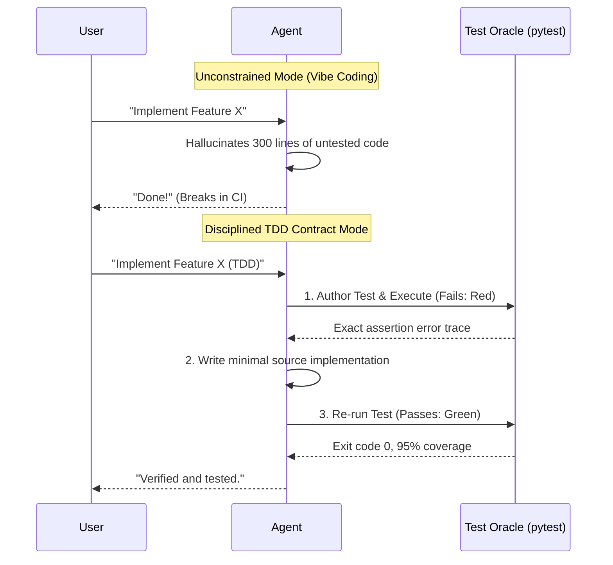

# Observation 01: TDD as Living Contract — Anchoring LLM Non-Determinism

> **Project**: `devops-cli`  
> **Topic**: Test-Driven Development (TDD) as an Executable Boundary Oracle  
> **Key Metric**: About 4,700 test functions on 2026-09-24 (`git grep -c 'def test_' acd091826 -- tests`), $\ge 90.0\%$ coverage gate (`fail_under = 90`)  
> **TLDR**: Writing executable tests before implementation code turns stochastic LLM token generation into progress that a test run can check.
> **ELI:7b**: If you ask an AI to code without tests, it will guess and pretend it works. If you make it write the test first, it can check its own homework until it gets an A+.

---

## 1. Executive Context & Baseline

In human software engineering, Test-Driven Development is often debated for its velocity tradeoffs. When building `devops-cli`—a CLI orchestrating Kubernetes, OpenTofu, Docker, Valkey, and multi-provider LLMs—TDD was instituted not merely as a best practice, but as an **authoritative behavioral contract for autonomous AI agents**.

In an agentic environment, LLMs are stochastic token generators. Without tight feedback boundaries, an agent tasked with adding a complex feature will frequently generate 300 lines of plausible-looking code that contains subtle API mismatches, missed edge cases, or broken error handling.

---

## 2. The Observed Phenomenon

When instructed to *"implement feature X"*, the agent routinely:
1. Created complex code with optimistic assumptions about downstream API responses.
2. Missed corner-case error handling (e.g. non-zero subprocess exit codes, network timeouts).
3. Assumed its code was correct without executing it in the terminal, reporting premature completion ("sycophantic completion").

Conversely, when the agent was required to **author tests first** before modifying `src/`:
1. The agent had to declare exact function signatures, argument types, expected exceptions, and return structures.
2. Running the test produced an immediate, unambiguous failure (`Red`).
3. Writing the minimal implementation in `src/` to turn the test green (`Green`) resulted in compact, laser-focused code with zero hallucinated abstractions.
4. Subsequent refactoring (`Refactor`) was protected by the test suite, preventing regressions.

---

## 3. The Underlying Failure Mode

### The Unconstrained Generation Trap
LLMs excel at answering questions, but when generating unconstrained code, they experience **attention diffusion**:
- They attempt to anticipate future requirements, writing unnecessary abstraction layers.
- They lack a physical runtime in their internal weights; they cannot "run" the code in their heads with 100% accuracy.
- Without a failing test, there is no mechanical incentive for the agent to inspect real runtime behavior.

---

## 4. Remediation & Architectural Pattern

In `devops-cli`, TDD was hardcoded into the agent's DNA via three mechanical enforcement mechanisms:

1. **Mandatory Test-First Lifecycle in `AGENTS.md`**:
   - Step 1: Define specification via tests first in `tests/test_<submodule>.py`.
   - Step 2: Run targeted tests (`uv run pytest tests/test_<submodule>.py`) to observe the failure.
   - Step 3: Implement minimal feature logic in `src/`.
   - Step 4: Verify test passes locally with 100% assertions satisfied.
2. **Submodule-Aligned Test Mirroring**:
   - Strictly prohibit one-off, arbitrary test filenames (e.g., no `tests/test_fix_issue_123.py`).
   - Every test must mirror the source tree (`tests/test_<submodule>.py` or `tests/<submodule>/test_<feature>.py`; for example `tests/test_release.py` covers `src/devops_cli/commands/release.py`).
3. **Hard Coverage Gate in CI**:
   - `pyproject.toml` sets `fail_under = 90`, and the CI `test` job runs `pytest --cov=src`. If total line coverage across `src/` falls below $90.0\%$, the job fails.

---

## 5. Verifiable Impact & Key Takeaways

### Concrete Engineering Metrics
- **About 4,700 Test Functions (2026-09-24)**: Maintained continuously throughout aggressive multi-version upgrades.
- **Fewer Uncaught Regressions**: The suite caught many breaks before merge. It did not catch all of them: the project history has many `fix(...)` commits for defects that reached a release branch.
- **Shorter Debug Cycles**: Failure traces from `pytest` pointed directly to the failing line and assertion. No measurement of debugging time was recorded.

> [!TIP]
> **Takeaway for Agentic Practitioners**: Never ask an agent to "write code." Ask the agent to "write a failing test for the desired behavior, execute it, and then implement the minimal code to make it pass." Tests are the compass that keeps probabilistic intelligence on course.
