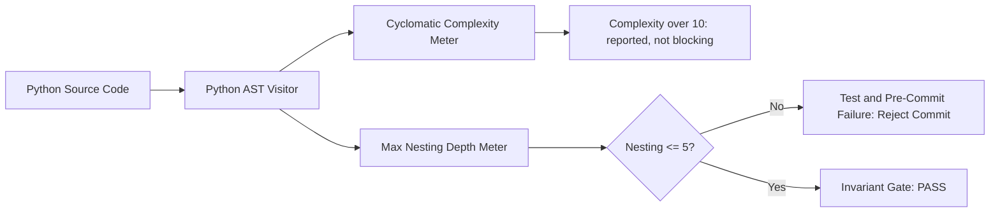

# Observation 02: Architectural Invariants & Complexity Caps

> **Project**: `devops-cli`  
> **Topic**: Mechanical Enforcement of Cyclomatic Complexity ($\le 10$) and Indentation Depth ($\le 5$)  
> **Key Metric**: Nesting depth $\le 5$ blocked across `src/` (test plus pre-commit hook); complexity $\le 10$ reported but not blocked in September 2026 (240 functions over the cap)  
> **TLDR**: Enforce cyclomatic complexity <= 10 and nesting depth <= 5 via automated AST gates to prevent LLM code generation from collapsing into spaghetti loops.
> **ELI:7b**: Don't let the AI write giant, messy functions with tons of nested if-statements. Limit functions to 10 decisions and 5 levels of nesting so the code stays clean and easy to read.

---

## 1. Executive Context & Baseline

One of the most insidious failure modes of LLMs in large codebases is **complexity creep**. When asked to add a new condition, handle a special case, or fix a defect, an LLM's lowest-energy path is to wrap existing logic in another `if/else` block, or append another procedural `elif` branch to an existing ladder.

Over multiple iterations, single functions expand from 20 lines to 200 lines, with 7 or 8 levels of indentation, deeply nested loops, and sprawling cyclomatic complexity ($M > 25$). Human developers eventually find the code impenetrable, and AI agents lose their reasoning capability due to context entanglement.

---

## 2. The Observed Phenomenon

LLM-written dispatchers and formatters tend to degenerate into nested procedural cascades. The function below is an illustrative sketch of that shape; it is not taken from the `devops-cli` source:

```python
# Illustrative: before invariant enforcement (LLM "Path of Least Resistance")
def handle_finding(finding, config, mode):
    if finding is not None:
        if config.enabled:
            if mode == "audit":
                for item in finding.items:
                    if item.severity == "high":
                        if item.verified:
                            # 6 levels of indentation!
                            dispatch_alert(item)
                        else:
                            log_unverified(item)
                    elif item.severity == "medium":
                        log_medium(item)
            elif mode == "report":
                ...
```

The agent was content with this code because it functionally passed simple tests. However, maintaining or modifying such code triggered cascading bugs: adding one check broke three others.

---

## 3. The Underlying Failure Mode

### The Local Patch Bias
LLMs optimize for the immediate prompt context:
- They prefer localized edits over architectural restructuring because restructuring requires deleting lines, extracting helpers, and modifying multiple call sites.
- They lack a natural aesthetic penalty for indentation depth or cyclomatic complexity unless explicitly measured.
- Merely prompting *"Please write clean, simple code"* has negligible effect when the problem complexity increases.

---

## 4. Remediation & Architectural Pattern

In `devops-cli`, nesting depth became a **hard mechanical gate**. Complexity was measured but, in September 2026, not blocked:



### 1. The Automated Invariant Gate (`tests/test_architectural_invariants.py`)
An automated test parses the abstract syntax tree (AST) of every module in `src/devops_cli` on every test run (`src/devops_cli/security/complexity.py`):
- Computes cyclomatic complexity for every function and method by counting decision points (1 + branches), which equals McCabe's $M = E - N + 2P$ for structured code.
- Does not reject functions with $M > 10$ across the tree. The test calls the scanner with `max_complexity=100`; only `FileSystem.get_tools` is held to $M \le 10$. The `structural-invariants` pre-commit hook comment (`.pre-commit-config.yaml`, commit `acd091826`) says "complexity is reported without blocking, since 240 functions breach that cap today and nothing enforces it".
- Computes the maximum block nesting level across all functions.
- Rejects any function with nesting depth $\ge 6$ (`test_no_excessive_nesting_in_src`; the `structural-invariants` pre-commit hook blocks the same breach at commit time).
- Since then the project has moved the caps into Ruff (`max-complexity = 10`, `max-nested-blocks = 4` on 2026-11-19).

### 2. The Architectural Transformation
Faced with hard invariant rejections, the agent must:
1. **Replace `if/elif` ladders with dictionary dispatch tables**:
   ```python
   SEVERITY_HANDLERS = {
       "high": handle_high_severity,
       "medium": log_medium,
       "low": log_low,
   }
   ```
2. **Decompose multi-step procedures into pure predicate helpers**:
   ```python
   def is_actionable_alert(item: FindingItem) -> bool:
       return item.severity == "high" and item.verified
   ```
3. **Adopt functional pipelines and standard library tools (`itertools`, `functools`)**:
   Clean list comprehensions, generator expressions, and map/filter pipelines replaced nested loops.

---

## 5. Verifiable Impact & Key Takeaways

- **Nesting Held, Complexity Not**: Across the `src/devops_cli` source tree, no function exceeded nesting depth 5. In the same tree, 240 functions exceeded cyclomatic complexity 10, because nothing blocked that cap.
- **Agent Comprehension**: Small, single-responsibility functions let later agent sessions read, change, and test a function within a tight token budget. The gate guarantees this only for nesting.
- **Less Human Formatting Fatigue**: For nesting, reviewers need not ask for an extracted helper; the gate does it deterministically. For complexity, in September 2026, review still had to.

> [!IMPORTANT]
> **Key Rule for Agent Architecture**: Polite prompt guidelines do not prevent code rot; deterministic AST invariant gates do, but only for the rules they block. A cap that is reported and not blocked does not hold.
