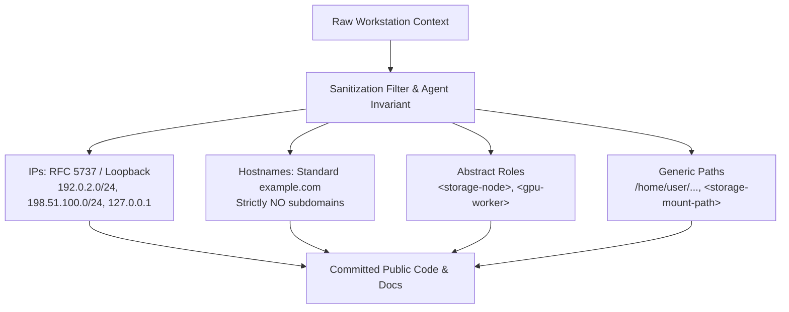

# Observation 04: Zero-Trust Egress & Environment Sanitization

> **Project**: `devops-cli`  
> **Topic**: Eliminating Homelab Leaks, Private IP Disclosure, and Standardizing Mock Data  
> **Key Metric**: One scrub of leaked homelab hostnames, node names and mount paths (issue #152, v0.2.16), then a written rule; no automated private-IP scanner gated commits in September 2026  
> **TLDR**: Reduce homelab IP and credential leaks by standardizing mock test data to example.com and RFC 5737 blocks under a written agent rule, backed by narrow tests and a private-key pre-commit hook.
> **ELI:7b**: Never let the AI see or commit real passwords or your home Wi-Fi address. Use fake example.com websites and dummy IP addresses instead.

---

## 1. Executive Context & Baseline

When autonomous agents are granted terminal access to local workstations, dev containers, and private cloud clusters, they inevitably encounter sensitive runtime context:
- Private IP addresses from any RFC 1918 range.
- Internal network DNS names (`*.lan`, `*.local`, physical machine hostnames).
- Real infrastructure mount points (`/mnt/nvme0n1/`, `/dev/sdX`).
- Local user account paths and shell environment variables.

If left unchecked, agents will casually copy-paste real environment details into public documentation, pull request descriptions, task tracking files, and mock unit tests.

---

## 2. The Observed Phenomenon

During autonomous documentation generation and test creation, the agent used whatever strings it saw in the active environment. In `devops-cli`, issue #152 (milestone v0.2.16) recorded internal homelab hostnames, physical node names, NodePort references and drive paths that "slipped into task tracking and documents", and scrubbed them from `config.yaml`, task files, `docs/ROADMAP.md` and a Squid deployment manifest. The scrubbed values stay in git history. Typical shapes of the leak:
- Unit tests hardcoded URLs pointing at a concrete LAN address and port, and at an internal `*.lan` hostname.
- Markdown tasks recorded actual workstation hostnames and file system paths.
- Dummy test endpoints used arbitrary random domains (e.g., `http://mytestapp.com`, `http://fake-vault.io`), which risked collision with real external domains or leaking intent.

In an open-source project, this is a severe security and operational hazard (CWE-200 / CWE-209).

---

## 3. The Underlying Failure Mode

### The Context Mimicry Trap
LLMs are contextual mimicry engines:
- They prioritize immediate token context over abstract security boundaries.
- If a terminal output contains a concrete internal hostname and NodePort (`<worker-node>:<nodeport>`), the LLM considers that string high-relevance and recycles it when writing examples or mock fixtures.
- The LLM does not distinguish between ephemeral workstation reality and committed public repository artifacts unless strictly commanded by an immutable rule.

---

## 4. Remediation & Architectural Pattern

In `devops-cli`, `AGENTS.md` codified the **Zero Information Leakage & Comprehensive Environment Sanitization** rule. The filter in the diagram below is that written rule plus review prompts that flag RFC 1918 addresses; no code rewrites raw context into RFC 5737 values:

### 1. Mandatory Documentation Placeholders & Standards
- **IP Addresses**: Strictly restricted to RFC 5737 blocks (`192.0.2.0/24`, `198.51.100.0/24`, `203.0.113.0/24`) or loopback (`127.0.0.1` / `localhost`). Private RFC 1918 IPs (`10/8`, `172.16/12`, `192.168/16`) are strictly prohibited in committed code.
- **Mock Domain Standardization**: Standardize all mock and dummy URLs to `example.com` with **no subdomains** (e.g. `http://example.com/api`, never `api.example.com` or `test.example.com`). RFC 2606 reserves `example.com` for documentation, so a fixture never names a real third party, and one fixed name keeps test fixtures consistent.
- **Abstract Role Notation**: Concrete servers are always referred to by role abstractions: `<gpu-node>`, `<storage-node>`, `<ingress-host>`.

### 2. Committed vs. Runtime Config Segregation
- `config.example.yaml`: Committed repository template containing only generic or `localhost` endpoints.
- `config.yaml`: Uncommitted, `.gitignored` local runtime file that remains the exclusive property of the developer's workstation. Agents are forbidden from overwriting or resetting user runtime configurations.

### 3. Automated Pre-Commit and Pre-Push Checks
- The pre-commit stage runs `detect-private-key`. The pre-push hook runs `devops ci`, whose `security` step is Bandit, plus the full test suite, which holds narrow leak tests (for example `test_zero_homelab_ip_or_hostname_leakage_in_portkey_lightllm`, scoped to two manifests). `devops scan secrets` wraps Gitleaks, but in September 2026 neither CI nor a hook ran it, and no check scanned every committed file for RFC 1918 addresses (commit `acd091826`).

---

## 5. Verifiable Impact & Key Takeaways

- **Less Information Leakage**: After the issue #152 scrub, the written rule and review prompts kept new homelab values out of most files. The rule does not reach git history, where the scrubbed values remain.
- **High Portability**: Test fixtures that mock calls to `http://example.com` execute reliably in any CI environment without network access. A fixture that really calls `example.com` still needs DNS and the network.
- **Mental Clarity**: Eliminates ambiguity over whether an endpoint in documentation is real or illustrative.

> [!IMPORTANT]
> **Key Rule for Agentic Infrastructure**: Never allow agents to invent random mock domains or recycle local IP addresses. Enforce RFC 5737 and standard `example.com` across all tests and documentation.
