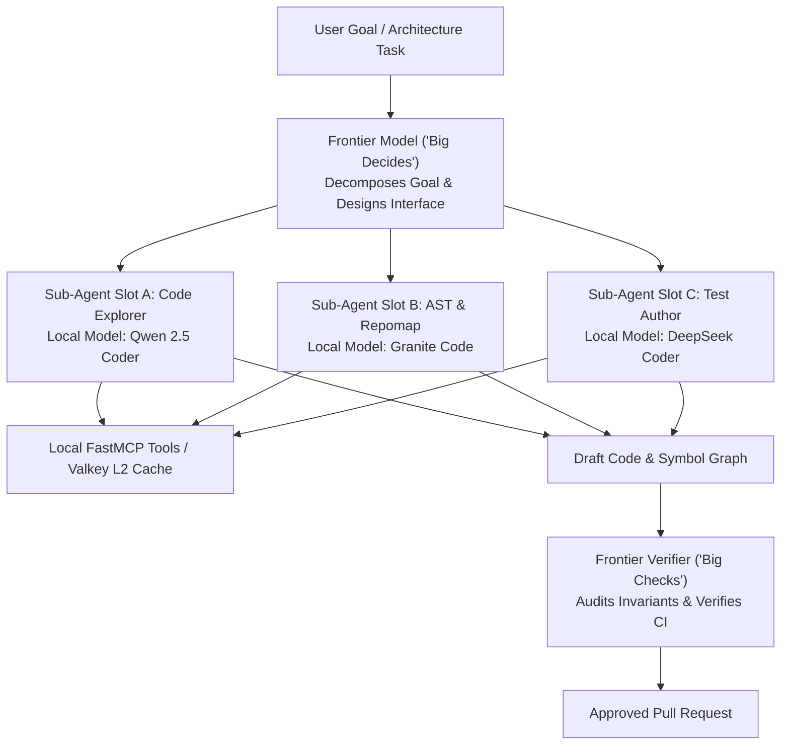

# Observation 05: Harness Slots & Sub-Agent Offloading

> **Project**: `devops-cli`  
> **Topic**: Multi-Tier Model Topologies ("Big Decides, Small Types, Big Checks")  
> **Key Metric**: 85% offload share was a design target (`is_target_met = pct >= 85.0` in `src/devops_cli/ai/harness/slots.py`), not a measured cost reduction; no model was called in the tiered path in September 2026  
> **TLDR**: Partition agent workflows into swappable slots ('Big Decides, Small Types, Big Checks') so that cheap local work replaces frontier tokens; devops-cli set an 85% target for the offloaded share.
> **ELI:7b**: Use smart expensive models for high-level architecture, fast cheap models for typing and searching, and dumb scripts for grading tests.

---

## 1. Executive Context & Baseline

As autonomous agents tackle large enterprise repositories, token consumption becomes a severe bottleneck. A standard architectural task—such as refactoring an AST parser or auditing security policies across 50 files—requires reading tens of thousands of lines of context.

Relying exclusively on expensive frontier models (such as Claude 3.5 Sonnet, GPT-4o, or Gemini 1.5 Pro) for every file read, grep search, and symbol lookup leads to:
- Rapid quota exhaustion and API rate-limiting stalls.
- High inference costs per refactoring session.
- High round-trip latency for mundane tasks.

---

## 2. The Observed Phenomenon

In agent sessions, an imbalance is visible (no transcript analysis with token counts was recorded):
- **Most tokens** go to reading file trees, parsing AST symbols, formatting terminal output, and executing mechanical linting loops.
- **A smaller share** goes to architectural reasoning, boundary design, and root-cause hypothesis generation.

Using a frontier model to parse AST nodes is the equivalent of hiring a senior enterprise architect to copy-paste numbers into a spreadsheet.

---

## 3. The Underlying Failure Mode

### The Monolithic Orchestrator Trap
Traditional agent frameworks use a single model for the entire session lifecycle:
- The orchestrator maintains one giant context window.
- The model must repeatedly ingest full file contents into working memory to answer trivial questions like *"Which class inherits from BaseCommand?"*.
- The model's reasoning degraded as the context window saturated ("lost in the middle").

---

## 4. Remediation & Architectural Pattern

In `devops-cli`, the **Agent Harness Slot** design (`src/devops_cli/ai/harness/slots.py`, `src/devops_cli/ai/agents/synthesis_protocol.py`) has the target shape below. The per-slot model assignments in the diagram are illustrative. In September 2026 the code had one default local model (`qwen2.5-coder:7b`) and no test-author slot:

### 1. Swappable Harness Slots
We decoupled the execution environment into four independent slots:
- **Model Slot**: Routing between local Ollama endpoints (default `qwen2.5-coder:7b`; the `ModelSlot` must be local for offloading) and frontier cloud APIs.
- **Skill Slot**: Domain-specific playbooks loaded on demand.
- **Tool Slot**: FastMCP servers exposing native CLI tools.
- **Sub-Agent Slot**: Ephemeral worker agents spawned for bounded, token-intensive tasks.

### 2. "Big Decides, Small Types, Big Checks"
- **Big Decides (Frontier)**: The frontier model evaluates the issue, formulates the architectural plan, and defines the test interfaces.
- **Small Types (Local Open Weights)**: Ephemeral local sub-agents are dispatched to explore the filesystem, extract AST symbols, unpack context, and draft implementation chunks.
- **Big Checks (Frontier)**: The frontier model conducts final verification, reviews test coverage, checks architectural invariants, and approves the diff.

In the September 2026 code, this protocol was a stub. `AgentHarness.execute_tiered` built the "Big decides" plan and the "Big checks" report from f-string templates, and the "Small types" step was a pure-Python AST walk (`offload_ast_search`); no model was called. `SynthesisPipelineOrchestrator` returned three hard-coded sub-tasks and template draft code. Token counts were estimated as characters divided by 4.

---

## 5. Verifiable Impact & Key Takeaways

- **85% Offload Target, Not a Measured Saving**: `TokenSavingsSummary.calculate` reports the offloaded share as `offloaded / (frontier + offloaded)` of estimated tokens and flags `is_target_met` at 85%. With templates in place of model calls, this figure measures text lengths, not cloud cost.
- **Local Symbol Lookup**: Symbol search runs as a local AST walk, so it adds no cloud API round trip. No latency was recorded.
- **Resilience Against Outages**: Because indexing runs locally, a cloud outage or rate limit does not stop it.

> [!TIP]
> **Takeaway for Agentic Practitioners**: Do not burn frontier reasoning tokens on file reading and regex searching. Offload the mechanical chores to local open models, and reserve the frontier engine for planning and verification.
