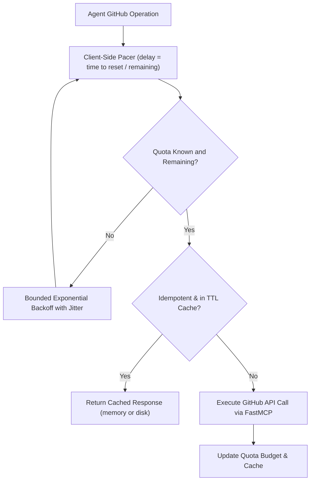

# Observation 06: Rate Limits & Anti-Brittle Heuristics

> **Project**: `devops-cli`  
> **Topic**: Surviving External API Quotas & Eliminating Ad-Hoc Pattern Guessing  
> **Key Metric**: Quota exhaustion still occurred (issue #180, GraphQL "API rate limit already exceeded"); brittle subset lists still existed after the rule (issue #431)  
> **TLDR**: Survive external API quotas with client-side request pacing derived from the server's remaining quota, and replace brittle string pattern matching with deterministic symbol parsers.
> **ELI:7b**: Pace API calls so external servers don't lock you out, and use real code parsers instead of sloppy regex guesswork to find functions.

---

## 1. Executive Context & Baseline

Autonomous software engineering agents interact heavily with external APIs: GitHub GraphQL and REST endpoints, package registries, container registries, and AI inference APIs. Furthermore, when agents parse code or domain identifiers, they often take brittle shortcuts—matching against arbitrary subsets of strings, prefixes, or regex patterns.

In `devops-cli`, we encountered two related hazards that threatened autonomous stability:
1. **API Rate-Limit Cascades**: Rapid unthrottled bursts of `gh` or GitHub API queries triggered HTTP 429 (`Too Many Requests`) and secondary rate-limit lockouts.
2. **Brittle Pattern Degradation**: Agents wrote fragile heuristic filters (e.g. checking if a branch or identifier starts with `"feat/"` or ends with `".com"` using hardcoded partial lists) that failed silently on valid inputs.

---

## 2. The Observed Phenomenon

### Failure A: The Burst Rate Lockout
Issue #180 (2026-09-12) records `devops pr threads list` failing with an unhandled `GitHubOperationError`: "GitHub GraphQL query failed: gh: API rate limit already exceeded". The fix added a REST fallback. GitHub's secondary rate limiter returns HTTP 403 or 429; an agent that retries in a tight loop extends the lockout.

### Failure B: The Arbitrary Subset Fallacy
When classifying domains or filtering identifiers, agents author heuristics like the illustrative sketch below. The real `devops-cli` case (issue #431, 2026-09-22) was the network-reference extractor in `security/reference_extractor.py`, which guessed hostnames with identifier-prefix and property-suffix lists from `config/constants.py`:
```python
# Illustrative brittle antipattern: arbitrary subsets
KNOWN_TLDS = [".com", ".org", ".net", ".io"]
if any(url.endswith(tld) for tld in KNOWN_TLDS):
    ...
```
This naive logic broke immediately when confronted with `.dev`, `.ai`, `.co.uk`, or internal domains. The agent then "fixed" the bug by adding `.dev` to the list, creating an infinite game of whack-a-mole.

---

## 3. The Underlying Failure Modes

### The Myopic Heuristic Trap
- LLMs naturally generate partial lists based on whatever examples are salient in their immediate context.
- They conflate "sufficient for the test case" with "mathematically closed domain."
- When interacting with external APIs, agents lack awareness of quota reset windows unless explicitly presented with remaining budget headers.

---

## 4. Remediation & Architectural Pattern

In `devops-cli`, we introduced two strict architectural mandates in `AGENTS.md`:



### 1. Mandatory Rate-Limiter Scaffolding (`run_gh`)
- **Strict Prohibition of Bare `gh` Invocations**: Agents are forbidden from invoking raw `gh` commands directly. All GitHub operations must route through native rate-managed commands (`devops gh`, `devops pr`) or FastMCP tools.
- **Client-Side Pacing**: Requests are metered locally before hitting the wire. `devops-cli` docs call this "token-bucket pacing", but `GitHubRateLimiter` (`src/devops_cli/github/rate_limiter.py`) is not a token bucket: it spaces requests by "time until next quota reset / remaining requests", from quota the server reports, with "no initial quotas ... default request rate, or bursting". Only its async path adds an `aiolimiter.AsyncLimiter` (60 requests per 60 s).
- **Bounded Exponential Backoff with Jitter**: If HTTP 429 or a rate-limit 403 occurs, the harness waits for the reset window or backs off with randomized jitter.
- **TTL Response Caching**: Idempotent read operations (issue lists, project cards, view specs) are cached in process memory and on disk to reduce network round-trips. This cache does not use Valkey.

### 2. Strict Prohibition of Brittle Pattern Subsets
Paraphrased from `devops-cli` `AGENTS.md` lines 20-24 at commit `acd091826`:
- Matching against a list of strings or regular expressions is **ONLY acceptable if it covers 100% of possible scenarios** (i.e. mathematically bounded, closed, exhaustive domains defined by official RFCs or deterministic language grammars).
- Matching against an arbitrary subset of a larger or unknown domain is **strictly prohibited**.
- Instead of partial string matching, the agent must use:
  - Language symbol parsers (Python AST, Tree-Sitter).
  - Official registries (Mozilla Public Suffix List via `tldextract`).
  - Standard library parsers (`urllib.parse`, `ipaddress`).
- Any constant list that exists for filtering **MUST reside in `config/constants.py` or `config/defaults.py`** to facilitate comprehensive auditing.

---

## 5. Verifiable Impact & Key Takeaways

- **Fewer API Lockouts**: Pacing and backoff reduce rate-limit failures; they do not remove them. GraphQL quota exhaustion still occurs and needs the REST fallback (issue #180).
- **Fewer Fragile String Bugs**: Replacing substring matching with AST visitors and standard parsers removes this class of bug where it is applied. Issue #431 shows subset lists that survived the rule until they were found.
- **Transparent Quota Telemetry**: Agents proactively inspect `devops gh rate-limit` before launching bulk operations.

> [!IMPORTANT]
> **Key Rule for Agentic Engineering**: Never let an agent guess with arbitrary lists. If the domain is closed, enforce RFC coverage; if open, use an established parser. Protect your APIs with client-side rate limiting.
