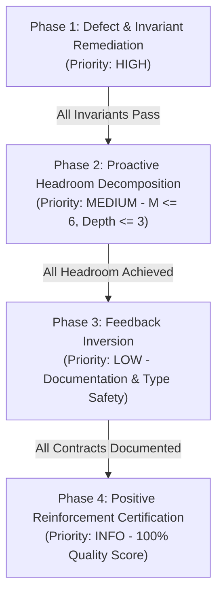
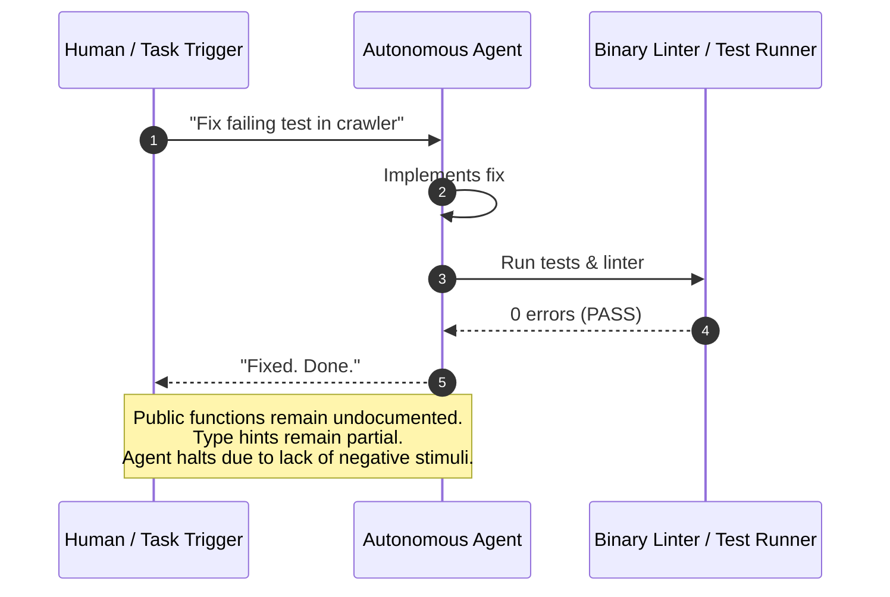

# Observation 08: Closed-Loop Feedback Inversion & Autonomous Quality Elevation

> **Project**: `devops-cli` & `vibes`  
> **Topic**: Tiered Feedback Categorization & Autonomous Shift from Defect Firefighting to API Contract Perfection  
> **Key Metric**: Docstring backlog items #1001 to #1003 were worked in `vibes` PRs #54 to #58; at commit `f4137d1` the workbench scan still reports 43 functions without docstrings in 7 files  
> **TLDR**: Shift agent focus from reactive bug-fixing to proactive contract completion (docstrings and type annotations) once high-priority defects are cleared.
> **ELI:7b**: Once all bugs are squashed, have the AI automatically write complete documentation and clean types for every public function.

---

## 1. Executive Context & Baseline

In conventional software development, engineering priority queues follow a stark negative bias: **work only exists when something is broken**. Once all compilation errors are fixed, static analysis lints pass, and tests turn green, autonomous agents typically stop and enter an idle state.

However, green tests and zero static errors do not imply high quality. Codebases frequently harbor hidden technical debt:
1. **Undocumented Public Contracts**: Functions lack explicit docstrings explaining arguments, failure modes, and return structures, leading to hallucinated calling conventions by peer agents.
2. **Missing Type Annotations**: Incomplete signatures evade basic linting but fail to provide compile-time guarantees under strict static analyzers (`mypy --strict`).
3. **Quiescent Decay**: Without continuous positive feedback, agents leave compliant but sparse code untouched until future feature prompts degrade structure back into invariant ceiling violations.

---

## 2. The Observed Phenomenon: The Feedback Inversion

During the `vibes` recursive iteration loop (`Scan -> Run -> Review -> Feedback -> SDLC Backlog -> TDD Implementation -> Commit -> Verify`), the work queue showed an **inversion of autonomous engineering behavior**:



1. **Initial State (Phase 1 & 2)**: The feedback queue was dominated by `PROACTIVE_REFACTOR` items—decomposing functions operating near the complexity ceiling ($M \in [7, 10]$).
2. **The Inversion Event**: The moment the last complex function was refactored below the headroom threshold ($M \le 6$), the backlog did **not** become empty. Instead, the `FeedbackAnalyzer` automatically promoted the next tier of the feedback hierarchy (sample output as reported; the run log was not kept, and only the item numbers #1001 to #1003 appear in later PR titles):
   ```text
   Exported 7 feedback items to .data/sdlc_backlog.json:
   - #1001: [PERFORMANCE] Test latency in test_workbench.py (2.21s) exceeds 2.0s ceiling
   - #1002: [DOCUMENTATION] 5 public function(s) in sentinel.py lack docstrings
   - #1003: [DOCUMENTATION] 1 public function(s) in workbench.py lack docstrings
   - #1004: [DOCUMENTATION] 2 public function(s) in gateway.py lack docstrings
   - #1005: [DOCUMENTATION] 7 public function(s) in fuzzer.py lack docstrings
   - #1006: [DOCUMENTATION] 17 public function(s) in resource_iteration_workbench.py lack docstrings
   - #1007: [DOCUMENTATION] 3 public function(s) in sdlc_project_manager.py lack docstrings
   ```
3. **Autonomous Execution (Phase 3)**: The SDLC prioritization engine triaged and surfaced the top unblocked contract improvement tasks; `vibes` PRs #54 to #58 (2026-09-24) cite backlog items #1001 to #1003.
4. **Final State (Phase 4)**: No run log records a final report with 0 actionable items. At commit `f4137d1`, `ResourceScanner.scan_directory` still reports 43 functions without docstrings in 7 files (6 of them test files, plus `examples/prompt-mutation-fuzzer/providers.py`) and 8 functions in the `PROACTIVE_REFACTOR` band.

---

## 3. The Underlying Failure Mode: The "Zero-Defect Stagnation" Trap

Why do typical agent architectures stall once code compiles?



When agent feedback engines rely solely on **binary defect triggers** (`exit_code != 0`, `errors > 0`):
- Agents lack an **intrinsic gradient** toward architectural elegance.
- Maintenance becomes purely reactive (firefighting).
- Code quality plateaus at the bare minimum threshold required to pass the linter.

---

## 4. Remediation & Pattern: Multi-Tier Feedback Taxonomy

To solve this stagnation, `tools/resource_iteration_workbench.py` defines a deterministic feedback taxonomy (abridged; the class also has `STRUCTURAL_DECAY`):

```python
class FeedbackCategory(StrEnum):
    PROACTIVE_REFACTOR = "PROACTIVE_REFACTOR"  # High/Medium: Headroom (M >= 7, depth >= 4)
    TEST_PARITY = "TEST_PARITY"                # High: Missing companion test suites
    PERFORMANCE = "PERFORMANCE"                # Medium: Test execution exceeding fast-feedback ceiling
    DOCUMENTATION = "DOCUMENTATION"            # Low: Public symbols lacking docstrings
    TYPE_SAFETY = "TYPE_SAFETY"                # Low: Public symbols lacking explicit types
    POSITIVE_REINFORCEMENT = "POSITIVE_REINFORCEMENT"  # Info: Zero-defect architectural reference
```

### The Autonomous Progression Engine

```text
Priority 0 (P0/P1): Fix Broken Tests & Hard Invariant Violations (M > 10, IP leaks)
       │
       ▼ (All Clean)
Priority 1 (P2):    Pre-emptively Decompose Complex Functions (7 <= M <= 10)
       │
       ▼ (All M <= 6)
Priority 2 (P2):    Accelerate Test Execution (< 2.0s Fast Feedback)
       │
       ▼ (All Fast)
Priority 3 (P3):    Achieve 100% Public Docstring & Type Annotation Coverage
       │
       ▼ (All Documented)
Priority 4 (Info):  Award Positive Reinforcement & Snapshot Release Baseline
```

By mapping feedback categories to priorities named after GitHub Projects v2 fields (`P1_HIGH`, `P2_MEDIUM`, `P3_LOW`), the SDLC Project Manager deterministically orders the agent's queue from urgent bug fixes down to granular documentation polish. `tools/sdlc_project_manager.py` keeps this board in a local JSON file (`.data/sdlc_backlog.json`); it does not call the GitHub API.

---

## 5. Quantitative Verification & Empirical Impact

No run output for a stage-by-stage table (backlog size, health score, badge count) is kept in the repository; `docs/reliability/iterations/*.json` records only gate-level ratios. A scan of the tree at commit `f4137d1`, the commit that added this observation, gives:

### Measured State at `f4137d1` (`ResourceScanner.scan_directory(root, include_docs=False)`)
- **Resources scanned**: 122 (41 Python modules, 60 test suites, 20 sample apps, 1 benchmark).
- **Complexity violations**: 0.
- **Functions in the `PROACTIVE_REFACTOR` band**: 8.
- **Functions without docstrings**: 43, in 7 files (6 test files and `examples/prompt-mutation-fuzzer/providers.py`).

---

## 6. Key Takeaways & Living Standard Rules

1. **Feedback Must Be Continuous and Multi-Tiered**: Never let an agent's feedback loop evaluate to an empty binary response. Structure feedback into explicit tiers so that clearing high-priority blockers automatically reveals the next echelon of software craftsmanship.
2. **Docstrings Are Contracts for Peer Agents**: In multi-agent swarms, public function docstrings are not mere human conveniences—they are precise API contracts consumed by downstream subagents to avoid parameter hallucination and type confusion.
3. **Celebrate Architectural Excellence**: Incorporating `POSITIVE_REINFORCEMENT` feedback provides concrete reference points for agents to recognize and emulate clean design patterns during subsequent iterations.
