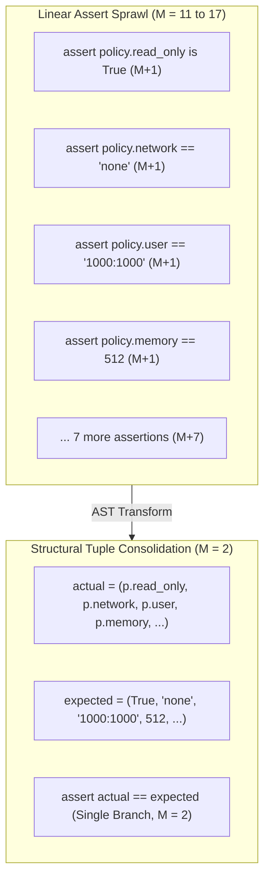

# Observation 11: Assertion Density & Structural Tuple Consolidation in Test Suites

> **Project**: `devops-cli` & `vibes`  
> **Topic**: Python AST Assert Complexity Semantics, Pytest Assertion Consolidation, and Test Suite Cyclomatic Headroom  
> **Key Metric**: Under assert-counting scanners (radon, the `devops-cli` and `vibes` AST scanners), an illustrative 16-operand `and` chain scores $M = 17$ and a single tuple-equality assert $M = 2$; tuple equality keeps pytest's index-level diff, `all(...)` does not  
> **TLDR**: Consolidate linear assertion sprawl in test suites into structural tuple equality checks to cut test complexity under assert-counting scanners while keeping pytest's index-level diffs.
> **ELI:7b**: Instead of writing ten separate assert lines that inflate complexity scores, bundle them into a single tuple comparison so tests stay simple and clear.

---

## 1. Executive Context: The Hidden Test Suite Complexity Trap

In rigorous test-first development (TDD), engineers and AI agents author exhaustive unit and integration tests verifying all fields, security flags, and configuration invariants of new data structures.

However, across continuous verification pipelines enforcing strict architectural complexity caps ($\text{McCabe Cyclomatic Complexity } M \le 10$):

1. **The Python AST Assert Branching Semantics**: In Python's Abstract Syntax Tree grammar (`ast.Assert`), an assertion statement is semantically equivalent to a conditional branch:
   $$\text{assert } \text{expr} \iff \text{if not } (\text{expr}): \text{raise AssertionError}$$
   Radon (`visit_Assert`, unless `no_assert` is set), the `devops-cli` scanner (`src/devops_cli/security/complexity.py`) and our custom AST invariant sentinels increment complexity $M$ by $+1$ for every `assert` statement in a function body. The `mccabe` package behind flake8's C901 does not: it treats `assert` as a simple statement (mccabe 0.7.0, `visitSimpleStatement`).
2. **The False Alarm in Linear Test Code**: A test function verifying a 10-field security policy (e.g. `read_only_rootfs`, `network_mode`, `user`, `memory_limit`, `cpu_quota`, `pids_limit`, `timeout_seconds`, etc.) via sequential `assert` lines has:
   $$M = 1 + 10 = 11 > 10$$
   The function is flagged as **CRITICAL / VIOLATION**, despite having zero loops, zero nested branches, and completely linear execution flow.
3. **The Compounding Conjunction Trap**: When agents attempt to consolidate assertions using boolean conjunctions:
   ```python
   # High AST Complexity: M = 17!
   assert "--read-only" in cmd and "--network" in cmd and "--cap-drop" in cmd and ...
   ```
   Radon and these AST scanners add $+1$ per extra boolean operand (`len(values) - 1` for each `ast.BoolOp`), so the chain raises complexity instead of reducing it. The `mccabe` package does not count boolean operators.

---

## 2. The Solution: Structural Tuple & Collection Consolidation

To maintain rigorous field verification while keeping cyclomatic complexity in the proactive safe zone ($M \le 3$), we developed **Structural Tuple Consolidation**:



---

## 3. Consolidation Design Patterns

### Pattern A: Immutable Dataclass / Configuration Field Verification
Instead of testing each attribute on separate lines:
```python
# Before: M = 11 (Breaches M <= 10 threshold)
def test_policy_values() -> None:
    p = SandboxSecurityPolicy()
    assert p.read_only_rootfs is True
    assert p.network_mode == "none"
    assert p.drop_capabilities == ("ALL",)
    assert p.no_new_privileges is True
    assert p.user == "1000:1000"
    assert p.memory_limit_mb == 512
    assert p.cpu_quota == 1.0
    assert p.pids_limit == 100
    assert p.timeout_seconds == 5.0
    assert p.tmpfs_mounts == (("/tmp", "rw,noexec,nosuid,nodev,size=64m"),)
```

Consolidate into an immutable tuple equality assertion:
```python
# After: M = 2 (one assert left)
def test_policy_values() -> None:
    p = SandboxSecurityPolicy()
    actual = (
        p.read_only_rootfs,
        p.network_mode,
        p.drop_capabilities,
        p.no_new_privileges,
        p.user,
        p.memory_limit_mb,
        p.cpu_quota,
        p.pids_limit,
        p.timeout_seconds,
        p.tmpfs_mounts,
    )
    expected = (
        True,
        "none",
        ("ALL",),
        True,
        "1000:1000",
        512,
        1.0,
        100,
        5.0,
        (("/tmp", "rw,noexec,nosuid,nodev,size=64m"),),
    )
    assert actual == expected
```

### Pattern B: Command-Line Flag & Collection Substring Verification
Instead of chaining multiple `assert ... and ...`:
```python
# Before: M = 17
assert cmd[0] == "docker"
assert "--read-only" in cmd and "--network" in cmd and "--cap-drop" in cmd and ...
```

Consolidate using a table-driven collection predicate:
```python
# After: M = 2 (M = 3 under radon, which counts the generator expression)
required_flags = [
    "docker", "run", "--read-only", "--network", "none",
    "--cap-drop", "ALL", "--security-opt", "no-new-privileges:true",
    "--user", "1000:1000", "--memory", "512m", "--pids-limit", "100",
]
assert all(flag in cmd for flag in required_flags)
```

This form is weaker than the original. It no longer checks that `cmd[0]` is `"docker"` or that `"none"` follows `"--network"`; it checks only membership. On failure, pytest 9.2.0 reports `assert False` and `where False = all(<generator object ...>)`, without naming the missing flag (pytest does not unroll `all()`). A set difference, `assert set(required_flags) - set(cmd) == set()`, keeps the membership check and shows the missing flags.

---

## 4. Why Pytest Diagnostic Fidelity Is Fully Preserved

A common engineering concern when consolidating assertions is whether failure diagnostics degrade. In `pytest`, tuple and sequence equality assertions trigger advanced rich diff inspection:

```text
E       AssertionError: assert (True, 'none', '1000:1000', 512) == (True, 'host', '1000:1000', 512)
E         At index 1 diff: 'none' != 'host'
E         Use -v to get more diff
```

Pytest reports the exact index and value difference while keeping AST complexity at $M = 2$. Two things are lost. The report names a tuple index, not the attribute (`network_mode`), and tuple equality checks identity first, so a `float("nan")` element compares equal to itself inside a tuple although `nan == nan` is false.

---

## 5. Summary & Takeaways for AI Engineers

1. **Test Suites Are First-Class Citizens Under Complexity Caps**: Automated invariant gates scan all Python files including `test_*.py`. AI agents must not generate procedural assertion sprawl that trips repository gates.
2. **Tuples Over Sequential Asserts for State Verification**: Whenever verifying $> 3$ fields of an object or return value, author a tuple comparison (`assert actual_tuple == expected_tuple`).
3. **Set Difference for Member Checks**: Replace chained boolean assertions with `assert set(expected_items) - set(collection) == set()`, which names the missing items on failure; `all(...)` hides them.
