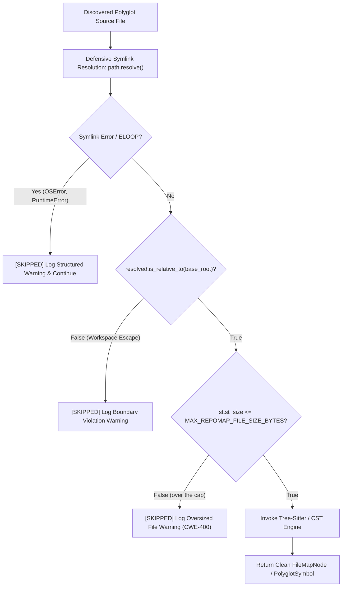

# Observation 12: Polyglot CST Boundary Guards & Symlink Resource Containment

> **Project**: `devops-cli` & `vibes`  
> **Topic**: Tree-Sitter & Polyglot AST Ingestion, Pre-Flight File Size Caps, and Defensive Symlink Confinement  
> **Key Metric**: Pre-flight size cap on every polyglot file (5 MiB in PR #225 on 2026-09-16, raised to 50 MiB by PR #345 on 2026-09-20); symlink resolution errors (`ELOOP`) and workspace escapes skipped with a warning; no OOM count or skip latency was recorded  
> **TLDR**: Enforce pre-flight file size caps and workspace symlink verification to prevent OOM crashes and circular ELOOP traversal escapes during AST crawling.
> **ELI:7b**: Check file sizes before opening them so the AI doesn't crash on huge generated bundles, and verify links don't escape outside the project folder.

---

## 1. Executive Context & The Monorepo Ingestion Risk

In autonomous agentic engineering, code exploration and symbol extraction tools (e.g. repomap generators, context packers, code review parsers) must recursively crawl repository trees to discover function definitions, classes, interfaces, and call graphs.

While Python-specific parsers typically enforce file size bounds on Python AST generation, real-world repositories are polyglot ecosystems containing TypeScript, JavaScript, Rust, Go, Java, and shell scripts. During deep exploration turns, autonomous agents encounter three catastrophic filesystem traps:

1. **The Oversized Minified Bundle Trap (CWE-400)**: Build directories (`dist/`, `build/`) often contain minified JavaScript/TypeScript bundles (`bundle.min.js`) exceeding 10MB to 50MB. Ingesting these files into Tree-Sitter or regex parsers triggers severe memory spikes, freezes agent execution threads, and triggers out-of-memory (OOM) terminations.
2. **Circular Symlink Traversal (`ELOOP`)**: Complex package managers (e.g. `pnpm`, yarn workspaces, or local cache symlinks) create symlink hierarchies. If an agent traverses a circular symlink cycle (`a/link -> a`) with a walker that follows symlinks, it recurses without end; resolving or opening a path through the loop fails with `OSError: [Errno 40] Too many levels of symbolic links`. (`os.walk` and `Path.rglob` do not follow directory symlinks by default.)
3. **Workspace Boundary Traversal Escapes**: Symlinks pointing to `/etc/`, host user directories, or shared volumes can lead an agent's context exploration outside the intended workspace root, causing unintended information disclosure or file corruption.

---

## 2. The Observed Phenomenon: `devops-cli` Task 119 Case Study

During autonomous DevSecOps audits of `devops-cli` ([Issue #119](https://github.com/dan-petty/devops-cli/issues/119) / [PR #225](https://github.com/dan-petty/devops-cli/pull/225)), review findings identified that while Python files were guarded by `MAX_REPOMAP_FILE_SIZE_BYTES` (then 5 MiB), polyglot Tree-Sitter parsing in `_polyglot_to_file_node` lacked pre-flight size checks. Furthermore, symlink resolution did not verify whether target files remained within the workspace boundary `base_root`.



---

## 3. Core Architectural Containment Principles

### 1. Pre-Flight File Size Boundary Guard
Before reading file content into memory or passing file paths to Tree-Sitter parsers, the engine performs an instant filesystem metadata check:
```python
# PR #225 (2026-09-16) set 5 MiB; PR #345 (2026-09-20) raised the default to 50 MiB.
MAX_REPOMAP_FILE_SIZE_BYTES = DEFAULT_REPOMAP_MAX_FILE_SIZE_BYTES  # 50 * 1024 * 1024 from 2026-09-20

st = resolved_file.stat()
if st.st_size > MAX_REPOMAP_FILE_SIZE_BYTES:
    logger.warning(
        "Skipping polyglot file '%s': size (%d bytes) exceeds maximum limit (%d bytes)",
        resolved_file,
        st.st_size,
        MAX_REPOMAP_FILE_SIZE_BYTES,
    )
    return None
```
One `stat()` call per file bounds the size of any single file passed to the parser, which blocks denial-of-service from minified bundles or generated database dumps larger than the cap.

### 2. Defensive Symlink Resolution & Exception Trapping
Symlink resolution (`path.resolve()`) can raise `OSError` (e.g. `ELOOP` for circular references) or `RuntimeError`. Rather than allowing filesystem exceptions to crash the entire repomap or review session, the crawler defensively traps both error types:
```python
try:
    resolved_file = source_file.resolve(strict=True)
except (OSError, RuntimeError) as err:
    logger.warning("Skipping unresolvable symlink '%s': %s", source_file, err)
    return None
```

### 3. Strict Workspace Boundary Confinement
To guarantee that symlinks cannot leak files from host operating system directories into the agent's context window, the resolved path must be confirmed to be a child of `base_root`:
```python
if not resolved_file.is_relative_to(base_root.resolve()):
    logger.warning(
        "Skipping symlink '%s': target '%s' escapes workspace boundary '%s'",
        source_file,
        resolved_file,
        base_root,
    )
    return None
```

---

## 4. Takeaways for Agentic Infrastructure Tooling

1. **Polyglot Ingestion Requires Equal Guardrails**: Security and resource limits applied to Python modules (complexity caps, file size limits, symlink defenses) must apply equally to all supported languages (TypeScript, Rust, Go, Bash).
2. **Graceful Skip Over Fail-Fast Crashes**: In exploratory tooling (code review, repomapping, dependency mapping), an unparseable or oversized file must never crash the entire pipeline. Logging a structured warning and continuing lets the agent deliver the rest of the context without interruption.
3. **Formal Invariant Codification in `AGENTS.md`**: When resource containment gaps are identified and remediated in code, the defensive patterns must immediately be codified in `AGENTS.md` to ensure peer and future subagents adhere to the same defensive boundaries across all upcoming modules.

---

## 5. Verifiable Impact & Key Takeaways

- **Bounded file size** on polyglot monorepo ingestion: every Tree-Sitter language parser gets a pre-flight size check (5 MiB from PR #225, 50 MiB from PR #345). No count of OOM crashes before or after was recorded.
- **ELOOP containment**: `resolve(strict=True)` raises `OSError` on a symlink loop (on Python 3.13 and later; earlier versions raise `RuntimeError`), and both are caught and skipped with structured warnings rather than crashing the agent session.
- **Workspace boundary check**: `resolved.is_relative_to(base_root.resolve())` runs for each file before ingestion, and the file walker repeats the check for symlinked files.
- **Low skip overhead**: Each check is one `stat()` and one `resolve()` per file. No timing was recorded.

> Applying security and resource containment symmetrically across all supported polyglot languages is not optional — an unguarded TypeScript bundle can DoS an agent pipeline just as effectively as an unguarded Python module.

