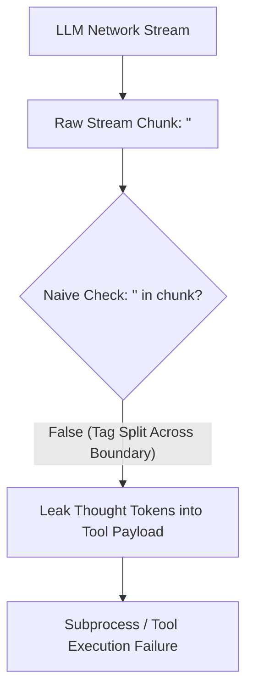
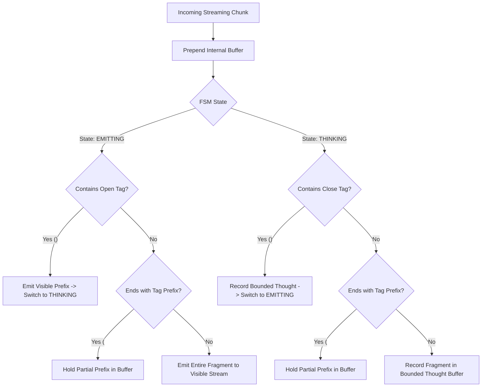

# Observation 13: Streaming Reasoning Token Parsers & Think Block Sanitization

> **Project**: `devops-cli` & `vibes`  
> **Topic**: Reasoning Model Integration, `<think>` Token Leakage Prevention, and Streaming FSM Sanitizers  
> **Key Metric**: Reasoning blocks stripped in every case the example's tests cover (including tags split across chunks) and in a single-character-chunk run; about 0.003 ms per 5-character chunk on one workstation; an unclosed tag at EOF is flushed, not held  
> **TLDR**: Sanitize streaming reasoning tokens with finite-state machines to prevent internal thinking blocks from leaking into downstream tools or user output.
> **ELI:7b**: Filter out the AI's internal 'thinking' monologue in real time so private reasoning doesn't accidentally get passed to shell commands or API calls.

---

## 1. Executive Context & Baseline

The emergence of frontier reasoning models (such as DeepSeek-R1, Gemini Thinking, Claude thinking blocks, and OpenAI o-series) introduced a fundamental architectural shift in agentic software engineering. Unlike traditional instruct models that emit direct execution instructions, reasoning models interleave or prefix responses with extensive internal chain-of-thought traces.

In autonomous agent architectures such as [`devops-cli`](https://github.com/dan-petty/devops-cli), AI models drive multi-turn terminal loops, code reviews, and tool invocations. During streaming responses, the agent stream is piped concurrently to:
1. **Interactive User Terminals**: Providing real-time UI feedback via Rich consoles or WebSockets.
2. **Tool Parameter Parsers**: Extracting bash commands, SQL queries, or JSON schemas for immediate automated execution.
3. **Audit Traces & Observability Spans**: Recording token usage and decision rationale for OpenTelemetry and Valkey caching.

---

## 2. The Observed Phenomenon: `devops-cli` Issue #128 Case Study

In `devops-cli`, [Issue #128](https://github.com/dan-petty/devops-cli/issues/128) (2026-09-10) was a feature request, not an incident report. It stated that `<think>` blocks from models such as DeepSeek-R1, QwQ and Gemma "can leak into raw review comments or markdown reports", and that unbounded SSE streams can exhaust memory. [PR #241](https://github.com/dan-petty/devops-cli/pull/241) added `StreamingTokenProcessor` in `devops_cli.ai.client.streaming`. The failure shapes below are illustrative of what such a parser must handle; they are not recorded `devops-cli` incidents:

1. **Tool Argument Poisoning**: Leaked thought tokens could be included in shell execution commands:
   ```bash
   # Leaked model reasoning prepended to git commit command:
   <think>The user wants to commit the recent changes to the repository.</think> git commit -m "docs: update roadmap"
   ```
   A POSIX shell reads `<think` as an input redirection from a file named `think` and `>The` as an output redirection, so the command fails before `git` runs.
2. **Chunk Boundary Tag Splitting**: Network streaming chunks can fragment tags across packet boundaries (e.g. Chunk 1 ends with `<th`, Chunk 2 starts with `ink>`). Naive substring finders (`"<think>" in chunk`) miss the tag entirely, allowing the entire thinking trace to leak directly into the visible user terminal.
3. **Unclosed Reasoning Stream Deadlocks**: When inference hits token budget caps or network timeouts while the model is still "thinking", a naive parser stays in the thinking state and suppresses the entire completion.

---

## 3. The Underlying Failure Mode or Catalyst

The root cause was a fundamental mismatch between **monolithic string assumptions** and **streaming non-deterministic token flows**:



Because network chunk boundaries do not align with token boundaries or semantic XML tags, treating streaming sanitization as simple regex string replacement fails catastrophically. Furthermore, unconstrained reasoning generation can loop indefinitely, triggering memory exhaustion (CWE-400) if internal buffers are not strictly bounded.

---

## 4. Remediation & Architectural Pattern

The engineering countermeasure deployed in `devops-cli` (`StreamingTokenProcessor`, PR #241) and demonstrated in [`examples/streaming-reasoning-sanitizer/`](../../examples/streaming-reasoning-sanitizer/) is a **Streaming Finite State Machine (FSM) with Boundary-Aware Buffering**. The constants and names in the guarantees below belong to the `vibes` example:



### Core Implementation Guarantees:
1. **Partial Prefix Buffering**: When the stream ends with an incomplete prefix of a tag (e.g. `<th`), the sanitizer holds only those few characters in an internal buffer, emitting all preceding characters immediately.
2. **Defensive Bounded Thought Capacity**: The thought buffer enforces `DEFAULT_MAX_THOUGHT_CHARS = 65536`. Once reached, excess reasoning tokens are discarded with telemetry logging, preventing out-of-memory denial of service.
3. **Graceful Flush on Stream Disconnect**: If the connection drops or EOF is reached while in `THINKING` state, `flush()` marks `unclosed_stream = True`, flushes all buffered thought fragments to telemetry, and ensures no hanging states lock client execution.

---

## 5. Verifiable Impact & Key Takeaways

1. **No Thought Leakage in Tested Cases**: Every reasoning trace in the example's tests (`<think>`, `[reasoning]`) is stripped from the visible stream.
2. **Low Overhead**: `sanitize_reasoning_stream` processed 20,000 five-character chunks at about 0.003 ms per chunk on one workstation (2026-11-19). No measurement was made inside `devops-cli`.
3. **Partial Chunk Handling**: Tags split into single-character packets (`<`, `t`, `h`, `i`, `n`, `k`, `>`) are handled: `sanitize_reasoning_stream(list("A<think>secret</think>B"))` returns visible `"AB"` and thought `"secret"`. The test suite covers two-part splits only.

> **Architectural Takeaway**: Never treat reasoning models as plain text generators. In an agentic toolchain, internal reasoning must be treated as a privileged, isolated out-of-band telemetry stream separated from operational execution buffers by deterministic streaming state machines.
