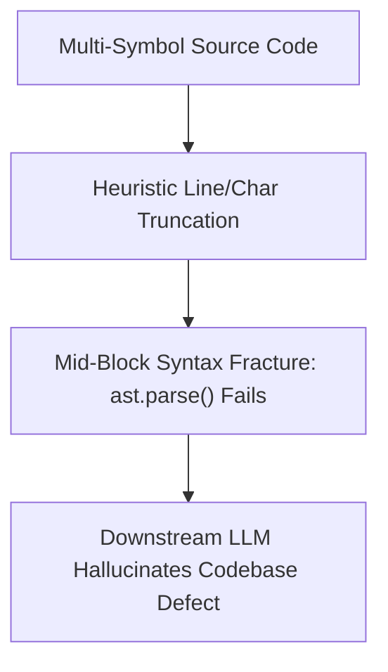
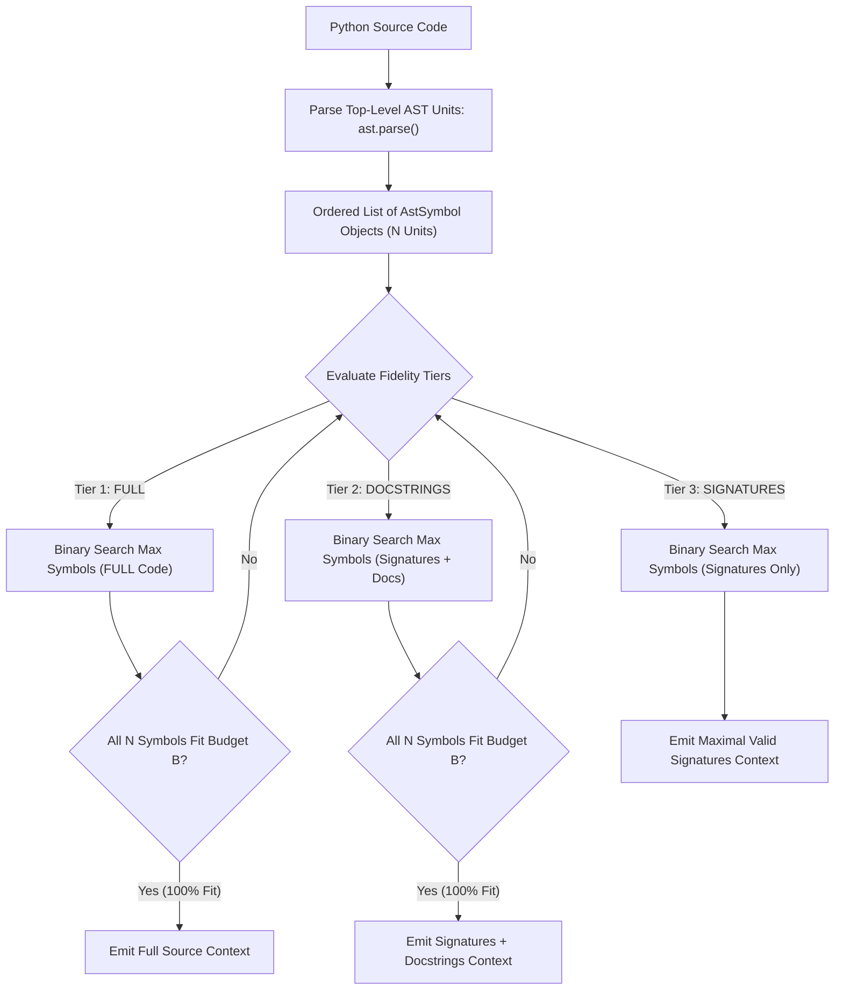

# Observation 14: Binary Search AST Context Packing & Algorithmic Token Budgeting

> **Project**: `devops-cli` & `vibes`  
> **Topic**: Prompt Context Assembly, Algorithmic Token Budget Allocation, and Binary Search Truncation  
> **Key Metric**: $O(\log N)$ cutoff search; truncation only at symbol boundaries; `devops-cli` issue #118 targeted under 10 ms for 1,000-line trees (no utilization or speedup figure was measured)  
> **TLDR**: Pack whole AST symbols into token budgets using logarithmic binary search, so code is never cut mid-statement.
> **ELI:7b**: Use binary search to quickly calculate the exact amount of code that fits in an AI prompt without chopping off statements mid-sentence.

---

## 1. Executive Context & Baseline

When autonomous AI agents analyze unfamiliar codebases, generate architectural diagrams, or perform pull request reviews, they must assemble a comprehensive prompt context. In large repositories, the sheer volume of source code, symbol graphs, and documentation dwarfs the effective context window or allocated token budget $B$ (e.g. 4,000 to 16,000 tokens).

To provide high-density context without blowing prompt token limits, agent architectures must pack multi-file AST summaries, interfaces, and function signatures into the allocated budget window.

---

## 2. The Observed Phenomenon: `devops-cli` Issue #118 Case Study

In `devops-cli`, [Issue #118](https://github.com/dan-petty/devops-cli/issues/118) (2026-09-10) reported a performance defect, not a syntax fracture: `_prune_tree_to_budget` in `devops_cli.ai.context_packer` was already AST-based, but it re-ran `ast.unparse(tree)` and `count_tokens` for every statement it popped, an $O(N^2)$ loop. [PR #224](https://github.com/dan-petty/devops-cli/pull/224) replaced it with per-statement token estimates, prefix sums and a binary search for the cutoff, with a target of under 10 ms for 1,000-line trees. The two failure shapes below are the general problems an AST packer avoids; they are illustrative, not recorded `devops-cli` incidents:

1. **The Mid-Block Syntax Fracture**: Naive context packers truncate files based on raw line counts or character thresholds. Slicing a Python module at a fixed line can cut a function or class definition in half:
   ```text
   class ServiceOrchestrator:
       def __init__(self, endpoint: str) -> None:
           self.endpoint = endpoint

       def dispatch_task(self, task: Task) -> bool:
           if not task.is_ready():
   # [TRUNCATED DUE TO CONTEXT LIMIT]
   ```
   A downstream model receiving this prompt can report non-existent syntax errors and blame the codebase for the incomplete class.
2. **The Greedy Under-Utilization Trap**: Packing whole files sequentially wastes tokens. If the budget has 1,200 tokens remaining, but the next candidate file is 1,500 tokens, a greedy packer omits the entire file and leaves those 1,200 tokens unused.

---

## 3. The Underlying Failure Mode or Catalyst

The root cause was treating code as **unstructured text streams** rather than **discrete, hierarchical abstract syntax trees (ASTs)**.



Furthermore, attempting to pack code by repeatedly prompting an LLM or running trial-and-error packing loops introduces $O(N)$ linear scans that degrade agent turnaround times.

---

## 4. Remediation & Architectural Pattern

The countermeasure is **Hierarchical AST Decomposition with Monotonic Binary Search Truncation**. `devops-cli` deployed the binary-search part (prefix sums of per-statement token estimates plus `bisect_right`, PR #224). The fidelity tiers below are from the reference implementation in [`examples/binary-search-context-packer/`](../../examples/binary-search-context-packer/):



### Algorithmic Mechanics:
1. **Discrete Symbol Decomposition**: Source files are parsed into top-level symbols (imports, functions, classes). Each symbol can render at three fidelity levels:
   - `FULL`: Complete implementation code.
   - `DOCSTRINGS`: Definition signature + docstring + `...`.
   - `SIGNATURES`: Definition signature + `...`.
2. **Monotonicity Property**: Given a fixed fidelity tier, the token weight of the first $k$ symbols is monotonically non-decreasing ($W(k) \le W(k+1)$).
3. **Binary Search Convergence**: Instead of iterating symbol by symbol, a binary search finds the optimal cutoff index $k^* \in [0, N]$ in $O(\log N)$ evaluations:
   $$\text{mid} = \left\lfloor \frac{\text{low} + \text{high}}{2} \right\rfloor$$
4. **Syntactic Parsability**: Because truncation occurs at symbol boundaries and stubs bodies with `...`, packed context parses with `ast.parse()`. The example writes each header with `ast.unparse` instead of a source slice. An earlier slice cut `def f(x: int): return x` at its first colon (`def f(x:`), and its `DOCSTRINGS` and `SIGNATURES` renderings did not parse.

---

## 5. Verifiable Impact & Key Takeaways

1. **No Broken Syntax Trees**: Packed modules parse with `ast.parse()`. The example tests annotated one-line headers and multi-line headers.
2. **Fuller Budget Use**: Symbol-level packing fills the budget more fully than whole-file greedy packing. No utilization figure was measured.
3. **Logarithmic Search**: For 50 symbols, the binary search needs at most $\lceil \log_2 51 \rceil = 6$ evaluations. No timing was recorded for the example; `devops-cli` issue #118 set a target of under 10 ms for 1,000-line trees.

> **Architectural Takeaway**: Never truncate code with string slicing. Treat prompt context as an algorithmic bin-packing problem over AST symbol boundaries, leveraging binary search monotonicity to maximize token density while guaranteeing syntax tree integrity.
