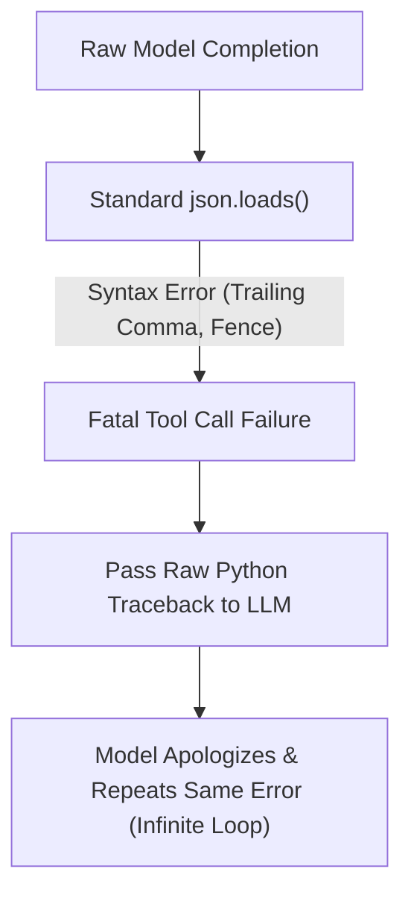
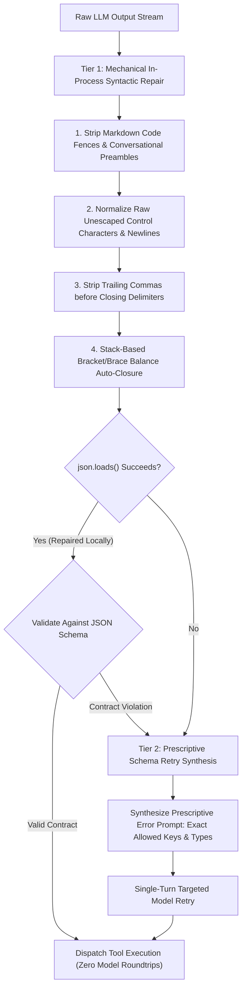

# Observation 15: LLM Structured Output Repair & Schema Reconciliation

> **Project**: `devops-cli` & `vibes`  
> **Topic**: Structured Output Generation, JSON Grammar Healing, and Prescriptive Schema Retry  
> **Key Metric**: Issue #123 set a target of "> 90%" recovery and "maximum 2 retry attempts"; no repair rate was measured; retries are bounded, so no retry loop is infinite  
> **TLDR**: Repair malformed LLM JSON outputs locally with a fence-stripping regex and the `json_repair` library before paying for a model round-trip.
> **ELI:7b**: Fix trailing commas and unclosed brackets in AI-generated JSON with a fast local script instead of paying for another expensive API call.

---

## 1. Executive Context & Baseline

Autonomous software engineering agents depend on structured data exchange. Whether invoking FastMCP tools, persisting task states, or generating pull request reviews, the model must output strictly formatted JSON conforming to predefined JSON Schema or Pydantic v2 contracts.

While modern LLMs support "JSON mode", production agent runtimes encounter severe syntactic and structural disruptions when models stream complex, high-token payloads across distributed endpoints.

---

## 2. The Observed Phenomenon: `devops-cli` Issue #123 Case Study

In `devops-cli` ([Issue #123](https://github.com/dan-petty/devops-cli/issues/123) / [PR #230](https://github.com/dan-petty/devops-cli/pull/230)), OpenTelemetry traces recorded `AIClientError: Response validation failed` when a local open-weight model emitted slightly malformed JSON, markdown fences, or unexpected schema keys during structured generation. The fix addresses these failure classes (items 2 to 4 are general shapes, not separately recorded incidents):

1. **Markdown Fence Wrapping**: Models frequently wrapped JSON payloads in markdown fences (````json ... ````) accompanied by conversational preamble ("Here is the requested tool call:"), causing `json.loads()` to crash with `JSONDecodeError: Expecting value: line 1 column 1`.
2. **Trailing Commas**: Models emitted invalid trailing commas in arrays (`["lint", "format",]`) and dictionaries (`{"status": "ok",}`), which standard JSON parsers strictly reject.
3. **Unclosed Braces from Output Truncation**: When reasoning models or large reviews exceeded token generation limits, the response was sliced mid-object:
   ```json
   {
       "findings": [
           {"file": "main.py", "severity": "error", "message": "Missing return"
   ```
   A standard JSON parser throws an unrecoverable parse error, abandoning the entire review finding set.
4. **The Naive Retry Death Spiral**: When an error occurred, naive agent loops passed raw Python exception tracebacks back to the LLM: `"json.loads failed: Unterminated string"`. Models repeatedly apologized, regenerated the same payload, and hit the exact same token ceiling.

---

## 3. The Underlying Failure Mode or Catalyst



The underlying failure mode stemmed from treating JSON parsing as a binary (valid/invalid) operation rather than a **reconcilable deterministic grammar**. Passing unstructured stack traces to stochastic models introduces cognitive confusion, leading to hallucinated fixes and retry exhaustion.

---

## 4. Remediation & Architectural Pattern

The solution deployed in `devops-cli` (`src/devops_cli/ai/client/structured.py`) is a **Two-Tier Structured Output Repair and Schema Reconciliation Engine**. Tier 1 strips `<think>` blocks and markdown fences with a regex, tries `json.loads`, and on failure calls the open-source `json_repair` library, which does the comma, control-character and bracket repairs shown below. Tier 2 sends a reflection message with the validation error and retries a bounded number of times:



### Core Repair Mechanics:
1. **Preamble and Fence Peeling**: A regex extracts the body of the first markdown code fence (optionally tagged `json`), discarding outer explanations and markdown delimiters.
2. **Trailing Comma Stripping**: `json_repair` removes trailing commas before closing brackets and braces without altering quoted strings.
3. **Auto-Closure**: On truncated input, `json_repair` closes open brackets and braces, salvaging the complete records generated before the cutoff.
4. **Reflection Retry**: If Tier 1 cannot produce valid JSON or the payload fails schema validation, Tier 2 sends the validation error back to the model, truncated to `CONST_MAX_ERROR_DETAIL_LENGTH` (256) characters.

---

## 5. Verifiable Impact & Key Takeaways

1. **Local Healing Without Network Overhead**: Malformed or truncated JSON payloads that `json_repair` can fix need no model round-trip. Issue #123 set a "> 90%" recovery target; no repair rate or latency was measured.
2. **Bounded Retry Loops**: Issue #123 capped retries at 2 before a typed `AIClientError`, so a schema failure cannot loop forever. No single-turn recovery rate was measured.
3. **Data Salvage on Token Cutoffs**: Truncated code reviews retain all fully generated findings rather than failing the entire agent turn.

> **Architectural Takeaway**: Never feed raw model completions directly to strict standard library parsers. Shield agent execution with a deterministic mechanical syntax repair tier that heals trivial formatting discrepancies locally before escalating to costly model retries.
