# Observation 22: The Verification Horizon & Validation Latency Cliffs

> **Project**: `devops-cli`  
> **Topic**: Validation Latency Scaling, Verification Bottlenecks, Assertion Density Sprawl, Subprocess Instrumentation Overhead, and the 4-Tier Verification Pyramid  
> **Key Metric**: No latency, timeout-rate or convergence measurement exists for this observation (no command, log or data file produces one); the tier latencies below are target budgets. A 10-assert test scores $M=11$ under assert-counting scanners, and a single tuple-equality assert $M=2$.  
> **TLDR**: Decompose validation into fast layered checks (AST sentinels, focused slices, and structural tuples) so agents do not wait on monolithic multi-minute test runs in the inner loop.  
> **ELI:7b**: When projects get big, running every test takes forever and makes AI coders forget what they were doing. Running tiny instant checks first keeps the AI fast and sharp.  

---

## 1. Executive Context & The Scaling Trap

In early-stage software development, automated testing operates with near-instantaneous feedback ($T_{\text{verify}} \le 500\text{ms}$). An autonomous coding agent operates in this regime with remarkable fluid agility: it proposes a hypothesis, writes a test, modifies source code, and validates execution within a single turn.

However, as a codebase expands—such as [`devops-cli`](https://github.com/dan-petty/devops-cli), with about 5,570 test functions and 10 check steps in its CI workflow on 2026-10-02, Docker/Kubernetes container orchestration fixtures, and heavy plugin instrumentation—monolithic test suite execution takes minutes, not seconds.

While human developers absorb multi-minute test runs through asynchronous task switching (checking email, reading pull requests), autonomous AI agents lose working context while they wait. High verification latency shifts the system computational bottleneck from *neural inference capacity* to *deterministic execution delay*, inducing context rot, tool timeouts, and oscillatory repair thrashing.

---

## 2. Empirical Telemetry: Latency vs. Agent Cognitive Decay

No controlled measurement of verification latency against agent behavior exists for `devops-cli`: no task set, log or data file records turns to converge, tool timeout rates, a context rot index or repair success by latency band. The expected relationship is qualitative: as $T_{\text{verify}}$ grows from under a second to minutes, agents take more turns, hit more tool timeouts, carry more polling output in context, and fix fewer failures in one turn.

```mermaid
flowchart TD
    subgraph MonolithicTax ["The Monolithic Latency Tax (minutes)"]
        A1["Code Edit"] --> B1["Spawn Monolithic Pytest Harness"]
        B1 --> C1["Subprocess Tool Timeout (agent tool ceiling)"]
        C1 --> D1["Terminal Poll Loops & Log Accumulation"]
        D1 --> E1["Context Dilution (Lost Invariants)"]
        E1 --> F1["Oscillatory Repair Thrashing (A -> B -> A)"]
    end

    subgraph LayeredPyramid ["The 4-Tier Verification Pyramid (target budgets)"]
        A2["Code Edit"] --> B2["Layer 0: In-Memory AST Sentinel (target under 50ms)"]
        B2 -->|"M <= 10, Depth <= 5"| C2["Layer 1: Focused Slice Oracle (target under 500ms)"]
        C2 -->|Deterministic Diff| D2["Test-Driven Repair Loop"]
        D2 --> E2["Layer 2: Local Pre-Commit Hook (target 2s to 5s)"]
        E2 --> F2["Layer 3: Gated Remote Matrix CI"]
    end
```



When $T_{\text{verify}}$ exceeds the agent's tool execution ceiling, the agent hits that ceiling, sending tasks into background polling states. The resulting flood of status queries dilutes attention weights, expelling initial architectural constraints from working context and causing repair loops to diverge.

---

## 3. The Three Failure Modes of Scaled Validation

Detailed analysis revealed three distinct technical bottlenecks that transform expanding test suites into agentic hazards:

### A. Assertion Density Sprawl & McCabe AST Inflation
An `assert <condition>` statement is an `ast.Assert` node; at run time (without `-O`) it behaves like:
```python
if not (condition):
    raise AssertionError
```
Radon and the `devops-cli` and `vibes` AST scanners count each `assert` as a branch, so 10 sequential assertions add $+10$ to the test function's cyclomatic complexity ($M$) under those tools. The `mccabe` package behind flake8's C901 does not count `assert`. When architectural invariant gates enforce $M \le 10$, comprehensive tests paradoxically fail the very quality gates designed to protect the codebase.

### B. The Subprocess & Plugin Instrumentation Tax
Global test configurations that register heavy analysis plugins (coverage instrumentation, doctest runners, distributed tracing listeners, and custom fixtures) impose a constant per-invocation initialization penalty, even when targeting a single trivial test function. In `devops-cli`, importing the package alone took "about five seconds" (comment on the `structural-invariants` hook in `.pre-commit-config.yaml`, which is why that hook avoids the import).

### C. Conversational Guesswork vs. Counterexample-Driven Repair
When validation output is unstructured or noisy (e.g. 200 lines of pytest traceback detailing third-party framework internals), stochastic models fail to isolate the root defect. The agent resorts to conversational speculation, editing peripheral files and introducing regressions.

---

## 4. The Solution: The 4-Tier Verification Pyramid

To decouple project scale from agent iteration velocity, a 4-tier verification hierarchy is needed. The tiers below are the `vibes` toolchain (`examples/ast-invariant-sentinel/sentinel.py`, the docs-validator and fuzz-replay pre-commit hooks, and a CI matrix on Python 3.12 to 3.14); the latencies are target budgets, not measurements. On 2026-10-01, `devops-cli` had a different stack: a `structural-invariants` pre-commit hook that blocked nesting depth only, a `devops-ci-test-changed` hook that runs the tests covering staged sources, a pre-push `devops ci` gate, and CI on Python 3.14 only (`requires-python = ">=3.14"`) with a separate CodeQL workflow:

```
                  ▲
                 / \
                /   \     Layer 3: Remote Matrix CI (1m - 5m)
               / CI  \    (Multi-version Python 3.12-3.14, CodeQL, full security scan)
              /-------\
             / Layer 2 \   Layer 2: Local Pre-Commit Hooks (2s - 5s)
            / PreCommit \  (Docs validator, smell quantifier, fuzz regression replay)
           /-------------\
          /    Layer 1    \ Layer 1: Focused Slice Oracles (< 500ms)
         /   Slice Tests   \ (Targeted pytest -k, in-memory mocks, isolated pytest.ini)
        /-------------------\
       /      Layer 0        \ Layer 0: Mechanical AST Invariant Sentinel (< 50ms)
      /   AST Sentinel Gates   \ (Cyclomatic M<=10, depth<=5, sanitization, lint: in-memory)
     /─────────────────────────\
```

1. **Layer 0: In-Memory AST Sentinel ($\le 50\text{ms}$)**:
   A lightweight static visitor (`sentinel.py`) executed directly on modified source files. Validates cyclomatic complexity ($M \le 10$), maximum nesting depth ($\le 5$), forbidden partial pattern lists, and zero RFC 1918 private IP leaks before any test harness is spawned.

2. **Layer 1: Focused Slice Oracles ($\le 500\text{ms}$)**:
   Isolated test invocation targeting only the active test file or function using an unadorned test profile (`pytest -o addopts=""`). Mandates **Structural Tuple Consolidation**:
   ```python
   # Anti-Pattern: Linear assertion sprawl (four asserts: M = 5 under assert-counting scanners)
   assert response.status_code == 200
   assert response.headers["content-type"] == "application/json"
   assert data["status"] == "healthy"
   assert data["version"] == "0.2.24"

   # Pattern: Structural tuple equality (one assert: M = 2)
   assert (
       response.status_code,
       response.headers["content-type"],
       data["status"],
       data["version"],
   ) == (200, "application/json", "healthy", "0.2.24")
   ```

3. **Layer 2: Local Pre-Commit Hooks ($2\text{s} - 5\text{s}$)**:
   Automated git hooks enforcing documentation link integrity ([`tools/docs_validator.py`](../../tools/docs_validator.py)), code smell quantification, and deterministic fuzz corpus regression replays prior to commit creation.

4. **Layer 3: Gated Remote Matrix CI ($1\text{m} - 5\text{m}$)**:
   Asynchronous GitHub Actions CI running across Python 3.12, 3.13, and 3.14 (in `vibes`) with CodeQL and supply chain auditing. In `devops-cli`, the matching rule is the Pre-Push Quality Gate Mandate (`uv run devops ci`).

---

## 5. Architectural Implications & Mechanical Invariants

The lessons from scaling `devops-cli` and `vibes` suggest five invariants for agentic software systems:

1. **Inner-Loop Latency Ceiling ($\le 1.0\text{s}$)**:
   An autonomous coding agent must never be exposed to a validation oracle exceeding $1.0\text{s}$ during its active code modification loop. Any check taking longer must be deferred to pre-commit or pre-push boundaries.

2. **Counterexample-Guided Inductive Synthesis (CEGIS)**:
   Validation failures must provide minimal counterexamples (exact input tuple, expected output, observed output, and failure line) rather than conversational prose or framework tracebacks. The name is an analogy: CEGIS proper (Solar-Lezama et al., 2006) has a solver synthesize candidate programs and a verifier return counterexamples; here an LLM proposes patches and a test suite returns failing cases, with no completeness guarantee.

3. **Tuple Consolidation in Test Assertions**:
   Test suites must consolidate linear property checks into structural tuple comparisons (`assert (a, b) == (x, y)`) to preserve $M \le 10$ complexity headroom under assert-counting scanners while retaining Pytest's index-level diff diagnostics.

4. **Harness Decoupling**:
   Local unit testing must execute in an isolated environment that strips heavy global coverage profilers and workspace hooks unless explicitly requested.

5. **Macro Convergence via Milestone Air-Locks**:
   Validation must govern project convergence as well as code correctness. When intake velocity threatens milestone completion ($C_R \le 1.0$), non-critical tasks must be partitioned to `vNext` via an air-lock such as the `vibes` `milestone_governor.py` ([Observation 21](./21-milestone-horizon-expansion-and-autonomous-scope-cascades.md)); `devops-cli` did not adopt one.
