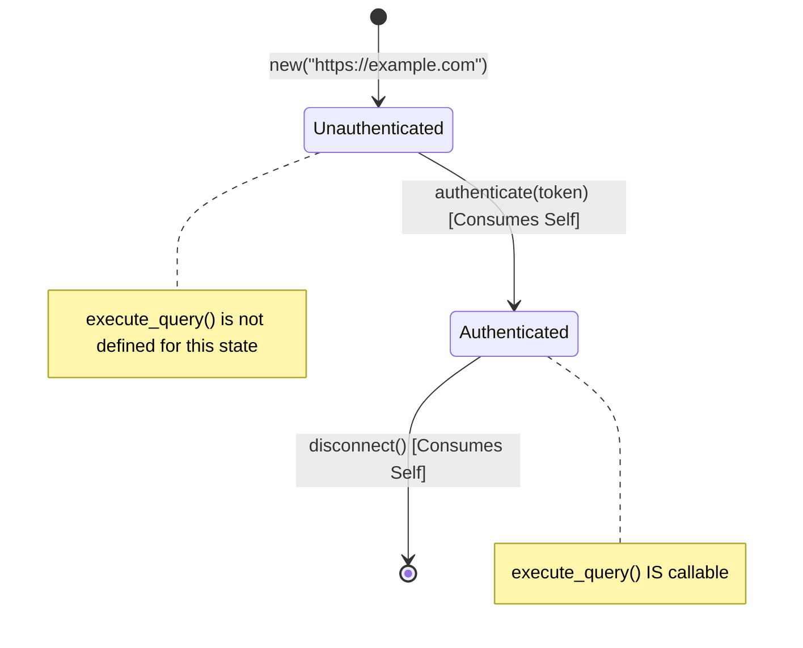

# Observation: Rust Type-State Invariants & Compile-Time Agent Guidance

> **Classification**: Polyglot Systems Engineering  
> **Target Language**: Rust (Edition 2021 / 2024)  
> **Key Metric**: A call that is not valid in the current state fails to compile (`rustc` error E0599); no bug-reduction rate was measured  
> **TLDR**: Leverage Rust affine types and zero-sized marker types to reject invalid state transitions at compile time.
> **ELI:7b**: Use Rust's compiler to stop one kind of bug: define states like Draft and Published as separate types so the compiler stops invalid actions before code even runs.

---

## 1. Executive Context & Baseline

When autonomous AI agents write code in dynamically typed or loosely constrained languages (Python, JavaScript), invalid state transitions often escape into production. An agent might invoke `connection.send(data)` before `connection.connect()`, or access a resource after freeing it.

In systems engineering, runtime assertion checks are expensive and fallible. When tasking autonomous agents with building concurrent, high-throughput network clients or state machines, **Rust's affine type system and the Type-State Pattern** act as a compile-time check.

---

## 2. The Observed Phenomenon

### Dynamic Language Failure Mode
Illustrative example (not a recorded session): in Python, a connection-pool client can let a caller skip authentication:
```python
# Unsafe State Transition (Runtime Crash)
client = ClusterClient()
client.execute_query("SELECT 1")  # Crashes at runtime: forgot client.authenticate()
```
The error appears only at run time, in an integration test or after deployment.

### Rust Compile-Time Boundary
In Rust, using zero-sized marker types (`Unauthenticated`, `Authenticated`), the API was structured such that invalid methods do not exist on the type until state transitions occur:

```rust
// Type-State Pattern in Rust
pub struct Unauthenticated;
pub struct Authenticated;

pub struct ClusterClient<State> {
    endpoint: String,
    state: std::marker::PhantomData<State>,
}

impl ClusterClient<Unauthenticated> {
    pub fn new(endpoint: &str) -> Self { ... }

    pub fn authenticate(self, token: &str) -> Result<ClusterClient<Authenticated>, AuthError> {
        // Consumes self, returning new state
        Ok(ClusterClient { endpoint: self.endpoint, state: std::marker::PhantomData })
    }
}

impl ClusterClient<Authenticated> {
    pub fn execute_query(&self, sql: &str) -> Result<QueryResult, QueryError> {
        // Can ONLY be called when authenticated!
        ...
    }
}
```

A call to `client.execute_query(...)` on an unauthenticated client does not compile. `rustc` 1.98 gives this error for a minimal version of the code above:
```text
error[E0599]: no method named `execute_query` found for struct `ClusterClient<Unauthenticated>` in the current scope
```

---

## 3. The Underlying Failure Mode

### The Ghost State Fallacy
LLMs are semantic predictors, not physical state trackers:
- They assume methods present on a class are always callable at any time.
- They struggle to maintain mental models of multi-phase state machines when methods accept general arguments and validate state internally via runtime `if (!this.isConnected) throw Error()`.

---

## 4. Remediation & Architectural Pattern



### The Rust Type-State Guidelines for Agents:
1. **Represent States as Zero-Sized Marker Types**: Use `PhantomData<State>` to encode states without runtime memory overhead.
2. **State Transitions Must Consume `self` by Value**: Prevent use-after-transition by moving the old struct out of scope.
3. **Expose Capabilities Only on Valid States**: Implement methods exclusively on `ClusterClient<ActiveState>`.

---

## 5. Verifiable Impact & Key Takeaways

- **No Query Before Authentication**: Code that calls `execute_query` on `ClusterClient<Unauthenticated>` does not compile. This holds only while code outside the module cannot build a `ClusterClient<Authenticated>` directly, so keep the fields private.
- **Fast Compiler Feedback**: On the dependency-free type-state crate in `benchmarks/rust/`, `cargo check` took 0.06 s (no change) to 0.26 s (after `touch src/lib.rs`) on 2026-11-19. The agent can correct the error in the same turn, without an end-to-end integration environment. Larger crates take longer.
- **Type-Level Enforcement**: Moves the state invariant from runtime checks into the type system.

> [!TIP]
> **Takeaway for Agentic Architecture**: Design APIs so that illegal states are unrepresentable. The compiler is the fastest, cheapest, and most ruthless feedback loop an AI agent can have.
