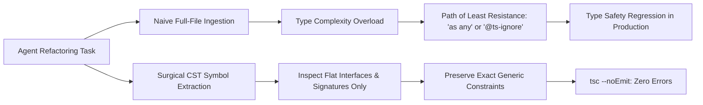

# Observation: TypeScript CST Navigation & Taming Type Gymnastics

> **Classification**: Polyglot Frontend & Fullstack Engineering  
> **Target Language**: TypeScript 5.5+  
> **Key Metric**: Not measured; this observation states recommended practice. Neither vibes nor devops-cli contains TypeScript code or an ESLint configuration  
> **TLDR**: Give the agent resolved type signatures from the TypeScript type checker and enforce lint gates that ban `any` and `@ts-ignore`, so that LLMs do not weaken or over-nest TypeScript types.
> **ELI:7b**: Keep TypeScript simple: ban the 'any' keyword and don't let the AI write crazy nested generic puzzles that crash the type-checker.

---

## 1. Executive Context & Baseline

TypeScript has one of the most powerful type systems in modern software engineering, capable of Turing-complete type computation (recursive conditional types, template literal types, mapped types).

However, when autonomous AI agents encounter enterprise TypeScript codebases with advanced type gymnastics, a severe cognitive friction point emerges: **Type-Level Hallucination**.

---

## 2. The Observed Phenomenon

### Failure Mode: Deep Conditional Type Degradation
When extending a generic API client or state management store using complex mapped types:
```typescript
// Complex Enterprise TypeScript Contract
type DeepFlatten<T> = T extends readonly (infer U)[]
  ? DeepFlatten<U>
  : T extends object
  ? { [K in keyof T]: DeepFlatten<T[K]> }
  : T;
```
When an agent modifies a handler that uses this type, typical failure modes are (illustrative; no recorded runs back a frequency):
1. Replaced the generic constraint with `any` or `Record<string, unknown>` to make the compiler shut up ("sycophantic type weakening").
2. Authored deeply nested union types that caused `Type instantiation is excessively deep and possibly infinite (TS2589)`.
3. Guessed runtime property shapes that contradicted the static interface definition.

---

## 3. The Underlying Failure Mode

### The Type-Level Token Collapse
LLMs understand runtime JavaScript syntax well, but:
- Type gymnastics require multi-step abstract algebraic reduction that stretches token-level attention.
- When an agent cannot solve a complex conditional type, its path of least resistance is to inject `as any` or `// @ts-ignore`.



---

## 4. Remediation & Architectural Pattern

Three guidelines for TypeScript tasks follow. They are recommendations; no repository in this project enforces them:

### 1. Hard Ban on `any` and `@ts-ignore` in Lint Gates
- Enforce `@typescript-eslint/no-explicit-any: error` and `@typescript-eslint/ban-ts-comment: error`.
- If CI runs ESLint with these rules, a pull request that adds an explicit `any` or a `@ts-ignore` comment fails the lint check. `no-explicit-any` does not catch an implicit `any`; turn on `noImplicitAny` (part of `strict`) in `tsconfig.json` for that.

### 2. Concrete Syntax Tree (CST) Symbol Extraction
- Instead of dumping 500 lines of complex types into the prompt, use the TypeScript compiler API (`TypeChecker.typeToString(...)`, the data an editor shows on hover) to extract resolved type signatures.
- A concrete syntax tree (CST), for example from tree-sitter, keeps every token of the declarations as written. It does not resolve types. The resolved shape comes only from the type checker.
- Presenting the agent with the **resolved type shape** rather than the raw recursive macro simplifies reasoning drastically.

### 3. Progressive Compiler Probing (`tsc --noEmit`)
- Agents probe the compiler after modifying interfaces:
  ```bash
  npx tsc --noEmit --pretty false
  ```
- The compiler output acts as a deterministic oracle.

---

## 5. Verifiable Impact & Key Takeaways

- **Preservation of Type Safety**: With both lint rules and `strict` on, a change that adds an explicit `any`, an implicit `any` or `@ts-ignore` fails the lint or type check.
- **Faster Refactoring Cycles**: A resolved signature is often shorter than the type definitions it depends on, and then it uses fewer prompt tokens. A resolved type can also be longer than a compact recursive definition. No measurement backs a specific reduction.

> [!IMPORTANT]
> **Key Rule for Agentic TypeScript**: Never allow an agent to use `as any` or `@ts-ignore` to silence the compiler. Strict lint gates force the agent to respect and preserve generic contracts.
