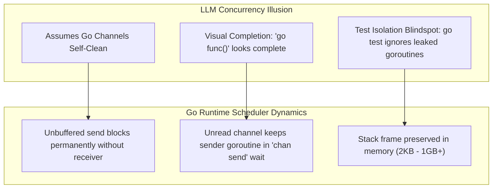
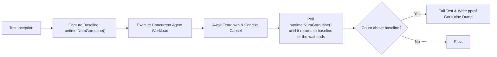

# Observation 03 (Polyglot): Go Goroutine Leakage & Context Lifecycles

> **Exhibition**: Polyglot Concurrency Invariants  
> **Classification**: Concurrency Safety & Runtime Stack Verification  
> **Target Subsystem**: Go Concurrency Lifecycles (`examples/go-leak-sentinel/`)  
> **Key Metric**: Goroutine count after test teardown against a baseline (Go harness); a heuristic score of 100 minus 25 per blocked user goroutine in a stack dump (Python parser)  
> **TLDR**: Compare goroutine counts at test teardown and dump the stacks on a mismatch, to find goroutines left blocked on channel sends or on contexts they never check.
> **ELI:7b**: Make Go tests check the goroutine count after finishing so you immediately catch background workers that forgot to exit.

---

## 1. Executive Context & Baseline

In modern microservices and cloud-native infrastructure tooling, Go is the language of choice for concurrent networking, event streaming, and container runtimes. Unlike Rust—which enforces memory and thread safety at compile time through affine ownership types and `Send`/`Sync` traits—Go delegates goroutine lifecycle management to the programmer and runtime scheduler.

When autonomous AI agents synthesize Go code, concurrency is a primary vector of structural decay. Unbounded goroutines, unbuffered channel sends, and forgotten context cancellations cause insidious silent leaks that pass standard unit tests but exhaust thread tables and memory in production.

To detect this failure mode, vibes provides the **Go Goroutine Leak Sentinel** (`examples/go-leak-sentinel/`). It pairs a Go test harness (`sentinel.go`), which compares `runtime.NumGoroutine()` with a baseline and writes a `pprof` goroutine dump on a mismatch, with a zero-dependency Python parser (`go_leak_sentinel.py`) that classifies the goroutines in such a dump. The established open tool for this check is [`go.uber.org/goleak`](https://github.com/uber-go/goleak), which reads every goroutine stack with `runtime.Stack` and ignores known goroutines. The example copies its `VerifyNone` and `VerifyTestMain` names but compares counts only; its `IgnoreGoroutine` filters are recorded and not applied.

---

## 2. The Observed Phenomenon

Generated Go code is open to three classic concurrency failure modes (the descriptions below are illustrative, not recorded sessions):

1. **Blocked Unbuffered Channel Sends**:
   An agent writes a worker function that returns a channel (`<-chan T`) and launches a goroutine to produce items. If the caller consumes only the first item or abandons the channel early, the worker goroutine blocks permanently on `ch <- val`, leaking the goroutine and its stack memory.
2. **Context Cancellation Abandonment**:
   An agent writes a worker loop that is meant to stop through `context.Context` but never checks `ctx.Done()`; the loop depends only on sleep timers or application queues (`for { time.Sleep(...) }`). When the parent calls `cancel()`, the worker continues to run.
3. **Unsynchronized Fire-and-Forget Goroutines**:
   An agent launches a background task (`go cleanup()`) without tracking its completion through `sync.WaitGroup` or `errgroup.Group`, so clean teardown is not possible.

Standard Go test suites (`go test`) do not fail when goroutines leak; tests terminate normally as soon as the main test goroutine finishes, leaving orphaned background goroutines hidden from view. (The runtime reports a deadlock only when every goroutine is blocked, so a single blocked sender goes unreported.)

---

## 3. The Underlying Failure Mode or Catalyst

Why do frontier models systematically leak goroutines?



1. **The Self-Cleaning Channel Illusion**: LLMs treat Go channels like garbage-collected data structures. In reality, the garbage collector does not reclaim a blocked goroutine: a sender that waits on a channel nobody reads stays parked, with its stack, for the life of the process.
2. **Visual Completion Bias**: In sequential code, calling a function and letting it return finishes execution. In Go, launching `go func() { ch <- val }()` visually looks like an asynchronous helper, but lacks the consumer guarantee required for termination.
3. **The `go test` Blindspot**: Because standard `go test` runners do not check `runtime.NumGoroutine()`, agents receive positive reinforcement (passing tests) for leaky code.

---

## 4. Remediation & Architectural Pattern

To enforce zero-leak invariants, we implemented the **Goroutine Leak Sentinel** architecture:



### Deterministic Implementation Rules for Agents:

1. **Always Buffer Single-Yield Channels**:
   When a goroutine yields a single result asynchronously, allocate a buffered channel (`make(chan T, 1)`). This guarantees that `ch <- val` will never block, even if the caller abandons the receiver:
   ```go
   func SafeWorker(val int) <-chan int {
       ch := make(chan int, 1) // Buffered: send never hangs
       go func() {
           defer close(ch)
           ch <- val
       }()
       return ch
   }
   ```
2. **Mandatory `select` on `ctx.Done()`**:
   Every concurrent loop MUST include a `case <-ctx.Done(): return` branch:
   ```go
   func SafeContextWorker(ctx context.Context, wg *sync.WaitGroup) {
       wg.Add(1)
       go func() {
           defer wg.Done()
           for {
               select {
               case <-ctx.Done():
                   return
               case <-time.After(10 * time.Millisecond):
                   // Perform work
               }
           }
       }()
   }
   ```
3. **Automated Baseline Verification Gate**:
   All test cases executing asynchronous goroutines must assert zero goroutine leaks against the recorded baseline using `LeakSentinel.CheckLeaked(0)` or `AwaitVerification(timeout)`.

---

## 5. Verifiable Impact & Key Takeaways

1. **Count-Based Detection**: The Go harness fails a test when a goroutine started during the test is still alive after the wait (50 ms by default in `Check`). It finds that a goroutine leaked, not why. Goroutines from tests that run in parallel can cause false failures, and a leak can hide behind an unrelated goroutine that exits. `sentinel_test.go` exercises the leaky channel worker; no Go test exercises `LeakyContextWorker`.
2. **Prescriptive Frame Remediations**: Rather than a generic timeout failure, the Python parser reads a dump and names the function, file, and line number where each goroutine is blocked (`chan send`, `select`, or `chan receive`). Its leak rule is a heuristic: it counts every user goroutine in one of these states as leaked, so an idle worker that waits in `select` also counts. It finds runtime goroutines by their entry function, as the Go runtime does, not by the `runtime.gopark` frame that every blocked goroutine has.
3. **Low Test Runner Overhead**: The companion Python stack parser (`go_leak_sentinel.py`) parses multi-goroutine dumps into structured JSON models with $M \le 6$. Its suite (`pytest examples/go-leak-sentinel/test_go_leak_sentinel.py`) ran 21 tests in 0.08 s on 2026-11-19.

### The Concurrency Axiom for AI Agents
> *"If a goroutine cannot prove at spawn time how and when it will terminate, it is a memory leak waiting to happen. Never launch a goroutine without a buffered channel, a sync.WaitGroup, or a ctx.Done() select guard."*
