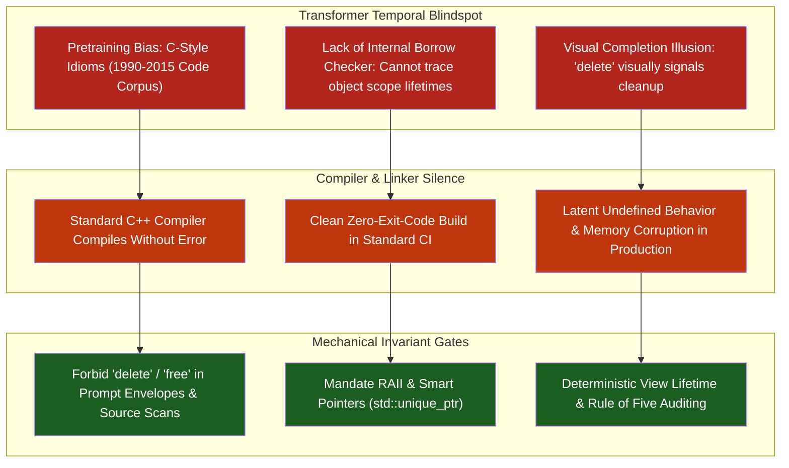

# Observation 04 (Polyglot): C++ RAII & Lifetime Invariants Under LLM Synthesis

> **Exhibition**: Polyglot Systems & Memory Safety Invariants  
> **Classification**: Memory Safety, Lifetime Profile & Static Contract Auditing  
> **Target Subsystem**: C++ Lifetime Sentinel (`tools/cpp_lifetime_sentinel.py`)  
> **Key Metric**: Findings per rule (`CPP001`-`CPP005`) from a line-oriented regular-expression scanner; no before/after synthesis benchmark was run.  
> **TLDR**: Enforce strict RAII ownership semantics and audit dangling view handles to flag LLM-synthesized C++ that can leak memory or cause use-after-free bugs.
> **ELI:7b**: Require smart pointers and modern C++ containers so the AI never has to write manual memory cleanup that leads to crashes.

---

## 1. Executive Context & Baseline

While modern memory-safe languages like Rust enforce temporal memory safety at compile time through affine ownership types and a borrow checker (and spatial safety with bounds checks at run time), C++ remains the foundational standard for ultra-low-latency financial trading engines, game runtimes, OS kernels, and deep learning inference backends (e.g. `vLLM`, `llama.cpp`, TensorRT).

Unlike Rust, standard ISO C++ leaves memory safety, object lifecycles, and pointer aliasing to developer discipline and undefined behavior (UB) traps. C++ offers idioms and tools to mitigate these risks:
- **Resource Acquisition Is Initialization (RAII)**: Object destruction deterministically cleans up resources without manual intervention. The idiom dates from early C++.
- **The Rule of Zero / Rule of Five**: Explicit ownership semantics for copy/move constructors and assignment operators (Rule of Five since C++11 move semantics).
- **Smart Pointers (`std::unique_ptr`, `std::shared_ptr`)**: Explicit ownership transfer replacing unmanaged raw pointers (C++11).
- **Lifetime Safety Annotations (`[[clang::lifetimebound]]`)**: A Clang vendor attribute, not ISO C++. It lets Clang warn when a returned view (`std::string_view`, `std::span`) outlives the argument it refers to.

Recent benchmarks measure the problem. **VulBench-CPP** (Mahmud et al., [arXiv:2607.00107](https://arxiv.org/abs/2607.00107), 2026) ran 8,918 C++ solutions to 851 competitive-programming tasks through tests, static analyzers, sanitizers and bounded model checking. Code from three open-weight models triggered confirmed runtime violations at 9.3% against 2.6% for human-written code (adjusted odds ratio 2.15). **SafeGenBench** (Li et al., [arXiv:2506.05692](https://arxiv.org/abs/2506.05692), 2025) scores the security of generated code across eight vulnerability categories, and **SecVulEval** (Ahmed et al., [arXiv:2505.19828](https://arxiv.org/abs/2505.19828), 2025) scores how well LLMs detect real C/C++ vulnerabilities.

To flag these patterns, vibes provides the **C++ RAII & Lifetime Invariant Sentinel** ([`tools/cpp_lifetime_sentinel.py`](../../tools/cpp_lifetime_sentinel.py)). It is a line-oriented regular-expression scanner, not a C++ parser or a lifetime analysis. It misses patterns that span lines or need type information.

---

## 2. The Observed Phenomenon

When autonomous AI agents synthesize C++ components without rigid invariant enforcement, models fall prey to an **"Illusion of Safety"**. The generated code appears modern and idiomatic at first glance, but can carry latent temporal memory defects. The patterns below are illustrative:

### 2.1 The Manual Deallocation Trap (`CPP001`)
Despite decades of modern C++ best practices, LLMs can still emit explicit `delete ptr` or `free(p)` statements:
```cpp
// Anti-Pattern: Manual Resource Deallocation
void process_packet(const uint8_t* data, size_t len) {
    Buffer* buf = new Buffer(data, len);
    if (!buf->validate()) {
        return; // LEAK: early return skips delete buf!
    }
    buf->dispatch();
    delete buf; // Fragile manual lifecycle
}
```
Any early return, exception, or branching logic causes immediate resource leaks or double-free corruption.

### 2.2 The Dangling View / Handle Trap (`CPP002`)
With the introduction of non-owning view types (`std::string_view`, `std::span`), models can bind views to short-lived objects:
```cpp
// Anti-Pattern: Dangling String View
std::string_view get_service_endpoint() {
    std::string endpoint = "https://example.com/api";
    return endpoint; // CRITICAL: Local string destroyed at return; view dangles!
}
```
The view references stack memory invalidated upon function return.

### 2.3 The Rule of Five Incompleteness Trap (`CPP003`)
When an agent writes a custom destructor to release an unmanaged handle, it can fail to implement or delete the other special member functions (`copy constructor`, `move constructor`, `copy assignment`, `move assignment`):
```cpp
// Anti-Pattern: Rule of Three / Rule of Five Breach
class SocketSession {
public:
    explicit SocketSession(int fd) : fd_(fd) {}
    ~SocketSession() { close(fd_); } // Custom destructor!
    // MISSING: Copy constructor / copy assignment
    // Result: Default memberwise copy causes double-close of fd_!
private:
    int fd_;
};
```

### 2.4 Use-After-Move Hazards (`CPP005`)
Models frequently treat `std::move(...)` as an execution hint rather than a destructive ownership transfer:
```cpp
// Anti-Pattern: Use-After-Move
void register_channel(std::unique_ptr<Channel> chan) {
    hub_.add(std::move(chan));
    chan->log_registered(); // CRITICAL: Use-after-move! chan is nullptr!
}
```

---

## 3. The Underlying Failure Mode or Catalyst

Why do frontier models consistently fail to satisfy C++ lifetime invariants?



1. **Pretraining Corpus Skew**: Massive volumes of open-source C and early C++98/C++03 code in training sets prioritize manual memory management (`malloc`, `free`, `new`, `delete`) over modern C++ ownership idioms (C++11 and later).
2. **Attention Masking Across Function Boundaries**: LLMs cannot trace pointer aliasing or object lifetime graphs across non-trivial control flow. When returning a `std::string_view`, the model focuses on type compatibility (`std::string` can convert to `std::string_view`) rather than temporal lifespan.
3. **The Silent Compiler Barrier**: Unlike `rustc`, standard C++ compilers do not reject dangling handles or unmanaged raw pointers. GCC 16.2 compiles the dangling `string_view` example in section 2.2 with no warning, even with `-Wall` (checked on 2026-11-19). Clang's `-Wdangling` warning group is on by default and warns on some of these patterns, but it warns and does not reject. Other checks need extra tools: static analyzers such as `clang-tidy`, or runtime instrumentation such as AddressSanitizer (`-fsanitize=address`).

---

## 4. Telemetry & Empirical Findings

No synthesis benchmark backs a before/after comparison. The repository contains no task set, no generated C++, and no compiler or AddressSanitizer harness. What it does contain is `tests/test_cpp_lifetime_sentinel.py` (13 tests).

Running the sentinel on the snippets in this document (`python tools/cpp_lifetime_sentinel.py --export-json <out> <file>`, 2026-11-19) gives:

| Snippet | Findings |
| :--- | :--- |
| Section 2.1, manual deallocation | `CPP001` (`delete`), `CPP004` (raw `new`) |
| Section 2.2, dangling `string_view` | `CPP002` |
| Section 2.3, incomplete Rule of Five | `CPP003` |
| Section 2.4, use-after-move | `CPP005` |
| Section 5, compliant `ConnectionSession` | One `CPP004` (`this`) |

The last row shows one false positive: `return *this;` matches the raw pointer member pattern of `CPP004`. The two `= delete` lines give no `CPP001`. `CPP004` has medium severity, so the summary marks the class compliant. No CI job or hook runs this tool.

---

## 5. Invariant Gate Verification & Actionable Patterns

The sentinel checks the following invariants. They are line-based heuristics, not proofs:

### Invariant 1: The Zero-Manual-Deallocation Gate (`CPP001`)
Raw calls to `delete`, `delete[]`, `free`, `malloc`, `calloc` and `realloc` are flagged. The scanner ignores comments, string and character literals, and a `delete` that follows `=` on the same line (a deleted function, such as `A(const A&) = delete;`). A `= delete` that a line break splits still matches. Dynamic allocations must utilize standard RAII containers (`std::vector`, `std::string`) or smart pointers (`std::make_unique<T>()`, `std::make_shared<T>()`).

### Invariant 2: Explicit Lifetime Contract on Views (`CPP002`)
Functions returning `std::string_view` or `std::span` must accept arguments marked with `[[clang::lifetimebound]]` or return references to persistent string literals/class members. The sentinel flags only one form: a function with such a return type whose body returns, by name, a local `std::string` variable.

### Invariant 3: Complete Special Member Functions (`CPP003`)
Any class defining a custom destructor must explicitly define or delete copy and move operations:
```cpp
// Compliant Pattern: Rule of Five Adherence
class ConnectionSession {
public:
    explicit ConnectionSession(int fd) : fd_(fd) {}
    ~ConnectionSession() { if (fd_ >= 0) close(fd_); }

    // Explicit Rule of Five specification
    ConnectionSession(const ConnectionSession&) = delete;
    ConnectionSession& operator=(const ConnectionSession&) = delete;
    ConnectionSession(ConnectionSession&& other) noexcept : fd_(std::exchange(other.fd_, -1)) {}
    ConnectionSession& operator=(ConnectionSession&& other) noexcept {
        if (this != &other) {
            if (fd_ >= 0) close(fd_);
            fd_ = std::exchange(other.fd_, -1);
        }
        return *this;
    }
private:
    int fd_;
};
```

### Invariant 4: Linear Lifetime Invalidation (`CPP005`)
Any identifier passed to `std::move(...)` is marked as consumed. A later member access (`var.` or `var->`) is flagged. Plain reads are not flagged, and reassignment does not clear the mark: `p->reset()` after `p = std::make_unique<int>(1);` is still flagged.

