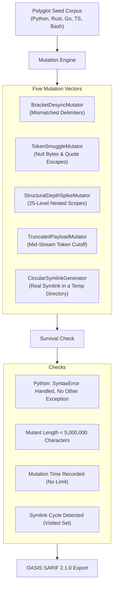

# Observation 05 (Polyglot): Differential AST Mutation Fuzzing for Polyglot Boundary Parsers

> **Exhibition**: Polyglot Systems & Boundary Invariants  
> **Classification**: Grammatical Fuzzing, Parser Convergence, Symlink Containment  
> **Target Subsystem**: Polyglot Mutation Fuzzer ([`examples/polyglot-mutation-fuzzer/`](../../examples/polyglot-mutation-fuzzer/))  
> **Key Metric**: 21 of 21 mutations survive the default run; only Python mutants reach a parser (`ast.parse`); the size bound is a string-length check, not a heap measurement.  
> **TLDR**: Fuzz multi-language AST boundary parsers with grammatical mutations to check syntax error handling, symlink cycle detection, and mutant size bounds.
> **ELI:7b**: Feed weird, broken code snippets to your code parser to make sure it reports clean errors instead of crashing or leaking memory.

---

## 1. Executive Context & Baseline

In autonomous software development, coding agents do not operate within single-language silos. Modern multi-tier stacks frequently combine Python backends, TypeScript/React interfaces, Go microservices, Rust systems components, and Bash deployment orchestration.

To understand codebase topology and extract symbol hierarchies, agents rely on language parsers (such as tree-sitter bindings or native AST modules). While hand-written human code generally adheres to grammatical conventions, agentic code generation presents anomalous boundary conditions:
- **Streaming Token Truncation**: When model inference hits context budget limits, generated files end abruptly mid-statement.
- **Syntactic Hallucinations**: Mismatched delimiters (`}`, `)`) and comment escapes that confuse lexical tokenizers.
- **Deep Structural Nesting**: LLM procedural code that nests conditional loops $> 20$ levels deep.
- **Recursive Symlink Traps**: Codebases containing cyclic filesystem symlinks that cause infinite directory traversal loops. (`ELOOP`, "too many levels of symbolic links", is a related error: path resolution raises it when a symlink chain never resolves.)

Without rigid parser boundary guards, these conditions lead to out-of-memory (OOM) crashes, segmentation faults, and unrecoverable agent hangs.

---

## 2. The Observed Phenomenon

Two failure modes show the risk when raw agent output goes to a parsing pipeline (illustrative scenarios, not recorded incidents):

### 2.1 The Delimiter Desynchronization Panic
When a streaming token generator cuts off before closing a block scope, brittle parsers often raise unhandled fatal exceptions rather than recoverable syntax error tokens:
```text
# Streaming truncation artifact
def compute_metrics(data: list[float]) -> dict[str, float]:
    result = {
        "mean": sum(data) / len(data),
        "variance": sum((x - mean) ** 2 for x in data
# Truncation: missing closing paren, brace, and newline!
```
A caller that does not catch the parser's error can crash the process that reads the file. Python's `ast.parse` raises `SyntaxError`, which the caller can catch.

### 2.2 The Circular Symlink `ELOOP` Trap
When crawling complex repositories with containerized builds or node environments, directory trees often contain self-referencing symlinks. Without depth bounds and `Path.resolve()` cycle detection, filesystem crawlers entered infinite recursion:
```bash
# Circular symlink induction
mkdir -p /workspace/components/loop
ln -s /workspace/components /workspace/components/loop/parent
```
A crawler that follows directory symlinks and keeps no record of visited paths does not terminate on this tree. (`os.walk` does not follow directory symlinks unless `followlinks=True`.)

---

## 3. The Architectural Solution

vibes provides the **Differential Polyglot AST Mutation Fuzzer** ([`examples/polyglot-mutation-fuzzer/`](../../examples/polyglot-mutation-fuzzer/)). Despite the name, it is not differential fuzzing. Differential testing runs the same input through two or more implementations and compares their outputs (McKeeman, "Differential Testing for Software", Digital Technical Journal 10(1), 1998); this fuzzer compares nothing. Python mutants go through `ast.parse`. Mutants of the other four languages get only a text-length and line-split check (module docstring of `polyglot_fuzzer.py`).



The fuzzer applies four text mutators to one seed per language, builds one symlink cycle, and checks four conditions:
1. **Graceful Rejection**: For Python, `ast.parse` must succeed or raise `SyntaxError`; `RecursionError` or any other exception fails the case. The other languages are not parsed.
2. **Size Bound**: A mutant must be shorter than 5,000,000 characters (100,000 for the text check of non-Python languages). This is a string-length check; the fuzzer does not measure heap use.
3. **Latency**: The fuzzer records the time of the mutation step only. It does not time the parse and enforces no time limit.
4. **Cycle Detection**: The fuzzer's own traversal must revisit a resolved path within 50 steps. No repository crawler is under test.

---

## 4. Empirical Results & Verification

`python examples/polyglot-mutation-fuzzer/polyglot_fuzzer.py --format json` (run on 2026-11-19) reports 21 of 21 mutations survived:

| Mutator | Python (`ast.parse`) | Rust, Go, TypeScript, Bash (text check only) |
|---|---|---|
| `BracketDesyncMutator` | `HANDLED_SYNTAX_ERROR` | `CONTAINED` |
| `TokenSmuggleMutator` | `HANDLED_SYNTAX_ERROR` (null byte) | `CONTAINED` |
| `StructuralDepthSpikeMutator` | `CLEAN_PARSE` (25 nested `if` blocks) | `CONTAINED` |
| `TruncatedPayloadMutator` | `HANDLED_SYNTAX_ERROR` | `CONTAINED` |
| `CircularSymlinkGenerator` | Filesystem: `LOOP_CONTAINED` at step 2 | n/a |

The fuzzer can write its findings as **OASIS SARIF 2.1.0** (`--format sarif`) for GitHub Code Scanning. No workflow in this repository uploads it.

---

## 5. Lessons for Agentic Engineering

1. **Never Trust Agent-Generated Syntax**: Always wrap AST and CST parsing invocations in structured exception handlers with explicit fallbacks.
2. **Pre-Flight File and Depth Bounds**: Enforce hard file size caps ($< 5\text{MB}$) and nesting limits before dispatching to external compilers or parsers.
3. **Fuzz the Boundaries Continuously**: Mutation fuzzing gives evidence of resilience for the inputs it tries, which static code review cannot give. It does not prove that other inputs are safe.
