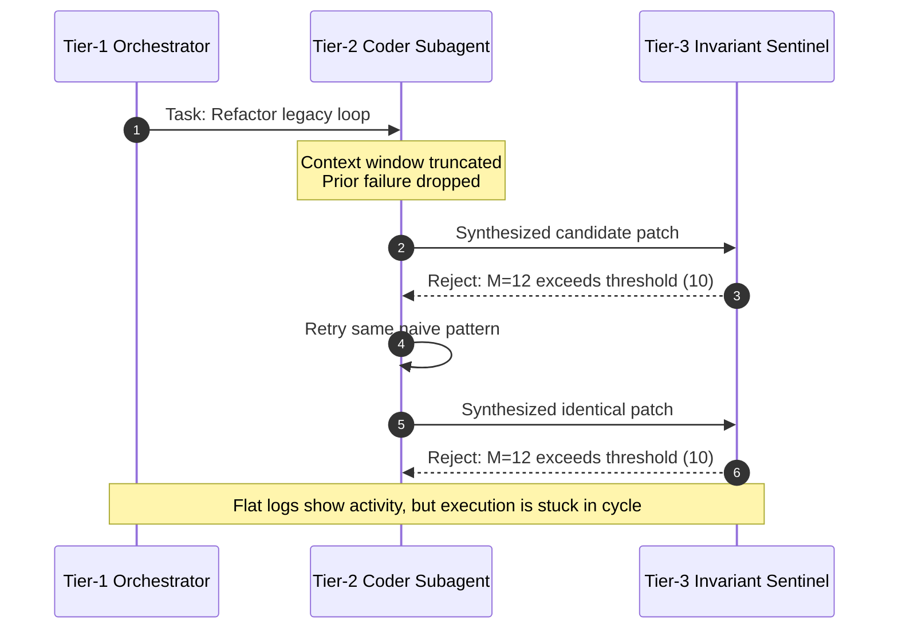

# Observation 01 (Systems): Distributed Telemetry & Agent Waterfalls

> **TLDR**: Trace multi-agent workflows using W3C traceparent propagation and OpenTelemetry span hierarchies to make each agent step visible.
> **ELI:7b**: Put timing tags on every step each AI helper takes so you can see a visual chart of who did what and why something took so long.

How W3C traceparent context propagation and OpenTelemetry span hierarchies reduce the "black box" problem in multi-agent coding workflows.

---

## 1. Executive Context & Baseline

Autonomous coding agents commonly operate as black boxes: an engineer provides a prompt, waits 90 to 300 seconds, and receives either a commit, an error, or a context-length abort. When a multi-agent system uses subagent offloading (e.g., Tier-1 planning, Tier-2 AST modification, Tier-3 invariant validation), traditional flat logging collapses under high token concurrency:

- **Log Interleaving**: Concurrent tool calls and background subprocess outputs interleave unpredictably.
- **Invisible Latency Sinks**: Engineers cannot distinguish whether 45 seconds was spent waiting on frontier LLM inference, a stuck subprocess git diff, or an unbounded test suite.
- **Untracked Token Burn**: Monolithic token counters fail to attribute spend across specific agent personas or repetitive generate-and-test retry loops.

---

## 2. The Observed Phenomenon

This section is an illustrative scenario, not a recorded run. During an automated refactoring session on a legacy codebase, a multi-agent system triggers many consecutive tool executions and then fails on a timeout. The flat console log mixes tool outputs, AST visitor dumps, and prompt fragments.

Manual log dissection is slow. The root cause is not an LLM hallucination, but a silent loop:
1. Subagent A modified a file.
2. Subagent B ran an invariant check that failed ($M = 12 > 10$).
3. Subagent A retried using an identical strategy because context pruning had stripped the prior failure reason from Subagent A's memory window.

Without parent-child span correlation, the cyclic ping-pong was invisible in real time.

---

## 3. The Underlying Failure Mode or Catalyst



The failure was driven by:
1. **Lack of Distributed Context**: Subagents were spawned without carrying a persistent W3C `traceparent` (`00-<trace_id>-<parent_span_id>-01`).
2. **Missing Causal Links**: Invariant verification failures were logged as local assertion messages rather than error events tagged on the parent span.
3. **Absence of Rate-of-Change Metrics**: No metric tracked the convergence velocity of cyclomatic complexity across consecutive attempts.

---

## 4. Remediation & Architectural Pattern

The remediation is an end-to-end **OpenTelemetry Agent Telemetry Mesh**:

1. **W3C Traceparent Header Injection**:
   Every subagent invocation, tool call, and CLI command carries the parent W3C trace context:
   ```python
   # Traceparent: 00-4bf92f3577b34da6a3ce929d0e0e4736-00f067aa0ba902b7-01
   headers = {
       "traceparent": f"00-{trace_id}-{span_id}-01",
       "baggage": f"agent.persona={persona},agent.slot={slot_id}"
   }
   ```
2. **Semantic Span Hierarchy**:
   - `root_agent_task`: High-level user goal.
     - `subagent_session`: Scoped persona execution (e.g. `coder`, `reviewer`).
       - `llm_inference`: Model token usage, temperature, and latency.
       - `tool_execution`: CLI tool or FastMCP invocation.
       - `invariant_gate`: McCabe complexity and depth verification with boolean pass/fail.

   These are local span labels, not OpenTelemetry semantic-convention names. The OpenTelemetry GenAI conventions name these spans `invoke_agent {gen_ai.agent.name}`, `chat {gen_ai.request.model}` and `execute_tool {gen_ai.tool.name}`. `python3 examples/agent-telemetry-trace-generator/generator.py --validate` checks spans against a snapshot of those conventions.
3. **Prometheus Alerting on Behavioral Stalls**:
   Proposed alert rules fire when retry iterations exceed 8 rounds or the invariant failure rate exceeds 25%, to stop runaway token burn before the budget is spent. These thresholds are design choices, not measured values.

---

## 5. Verifiable Impact & Key Takeaways

The waterfall below is illustrative. It was written by hand and is not tool output. `python3 examples/agent-telemetry-trace-generator/generator.py` renders a similar view from a synthetic session.

```text
================================================================================
AGENT EXECUTION WATERFALL (Trace: 4bf92f3577b34da6a3ce929d0e0e4736)
================================================================================
[0.000s - 4.820s] root_task: Refactor Legacy Loop (4820ms)
  ├── [0.050s - 1.250s] subagent: Planning & Decompose (1200ms) [tokens: 1420]
  ├── [1.300s - 3.450s] subagent: Synthesize Patch (2150ms) [tokens: 2840]
  │     ├── [1.320s - 2.900s] tool: git_diff_inspect (1580ms)
  │     └── [2.950s - 3.400s] tool: ast_invariant_gate (450ms) [status: VIOLATION]
  └── [3.500s - 4.800s] subagent: Constrained Retry (1300ms) [tokens: 980]
        └── [4.300s - 4.750s] tool: ast_invariant_gate (450ms) [status: PASSED]
================================================================================
```

### Expected Benefits:
- **Mean Time to Diagnose (MTTD)**: A waterfall view in a trace viewer such as Jaeger shows a repeated identical retry directly, where a flat log hides it. No measurement of the reduction exists.
- **Retry-Cycle Detection**: An alert on repeated identical invariant failures can stop a retry cycle (a livelock, not a deadlock) after a set number of rounds.
- **Attributed Token Accounting**: Each `llm_inference` span carries its token counts, so spend can be summed per subagent persona and task. Spend outside instrumented calls is not counted.
