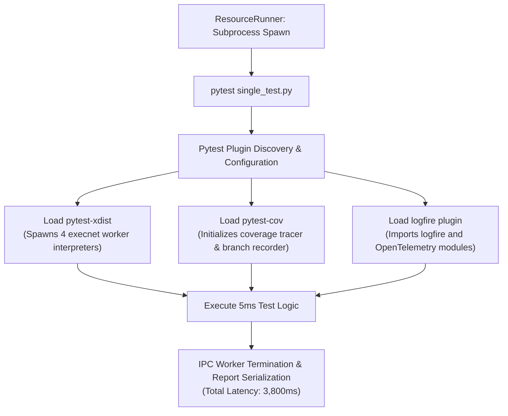

# Observation 02 (Systems): Subprocess Test Harness Instrumentation Tax

> **TLDR**: Selectively bypass heavy test plugins (xdist, cov, logfire) in fast local loops to remove most of the fixed start-up cost of each test run for rapid agent iteration.
> **ELI:7b**: Turn off slow reporting plugins while the AI is actively writing code so tests finish in about a second instead of several seconds.

How unpruned workspace test plugins (`xdist`, `cov`, `logfire`) add seconds of fixed start-up cost to iterative agent feedback loops, and how selective bypass removes most of it.

---

## 1. Executive Context & Baseline

In autonomous software development, **feedback velocity is the primary determinant of agent capability**. When an agent runs tests to verify an atomic refactoring or hypothesis, a test turnaround of under 1 second preserves conversational fluidity and enables rapid multi-turn convergence.

Conversely, when test execution latency exceeds 3 to 5 seconds per file, multi-resource evaluation suites (e.g. 20 target modules) take upwards of 60 to 90 seconds. Under slow feedback:
- Agent tool execution times out or triggers background task offloading.
- Cognitive momentum is interrupted, increasing token burn and retry overhead.
- Autonomous feedback engines flag false-positive performance warnings on trivial test files.

---

## 2. The Observed Phenomenon

During the development of the Resource Iteration Workbench (`tools/resource_iteration_workbench.py`), our feedback analyzer began emitting severe latency warnings on virtually every test suite across the repository:

```text
[MEDIUM] [PERFORMANCE] test_benchmark_runner.py
  Headline: Test latency in test_benchmark_runner.py (3.79s) exceeds 2.0s fast-feedback ceiling
[MEDIUM] [PERFORMANCE] test_crawler.py
  Headline: Test latency in test_crawler.py (4.13s) exceeds 2.0s fast-feedback ceiling
[MEDIUM] [PERFORMANCE] test_generator.py
  Headline: Test latency in test_generator.py (4.40s) exceeds 2.0s fast-feedback ceiling
```

Yet inspecting `test_benchmark_runner.py` revealed that it contained only 5 unit tests with zero network calls, zero file I/O, and pure in-memory AST manipulations. Running pytest with `--durations=0` showed that the test bodies took a small fraction of the reported time.

The test suite was spending nearly all of its time doing something other than executing test logic.

---

## 3. The Underlying Failure Mode: The Shared Workspace Configuration Leak

Diagnostic benchmarking traced the latency to **pytest root configuration inheritance** and **plugin loading overhead**:



When `subprocess.run([sys.executable, "-m", "pytest", str(test_path)])` was executed inside the monorepo workspace:
1. **Multi-Worker Worker Spawning (`pytest-xdist`)**: The parent workspace's root `pyproject.toml` (devops-cli in September 2026) configured `addopts = "-n auto --maxprocesses=4"`. pytest-xdist starts each worker as a separate Python interpreter through execnet, not the `multiprocessing` module. Starting 4 workers and collecting the suite in each one costs seconds for a 5-item test suite.
2. **Coverage Engine Initialization (`pytest-cov`)**: Instrumenting the Python runtime with coverage hooks added tracing overhead even though coverage was only required during comprehensive CI runs (`devops ci`), not micro-iterations.
3. **Telemetry Plugin Import (`logfire`)**: logfire 5.1.0 registers a pytest plugin. The plugin exports nothing unless `--logfire` is given or `LOGFIRE_TOKEN` is set in CI (`logfire/_internal/integrations/pytest.py`), so its cost is the import of logfire and its OpenTelemetry dependencies, not trace export.

---

## 4. Remediation & Architectural Pattern: Targeted Plugin Bypass

In full CI verification (`devops ci`), running the whole devops-cli suite (about 4,500 test functions in September 2026) benefits enormously from `xdist` parallelization and `pytest-cov` enforcement. However, in **micro-iterative single-file loops**, running with those plugins is an anti-pattern.

We updated `ResourceRunner.run_tests_for_resource` in [`tools/resource_iteration_workbench.py`](../../tools/resource_iteration_workbench.py) to explicitly disable the heavy instrumentation plugins and strip inherited multi-worker options:

```python
@classmethod
def run_tests_for_resource(cls, resource_path: Path, cwd: Path) -> RunExecutionResult:
    cmd = [
        sys.executable,
        "-m",
        "pytest",
        "-p", "no:cov",      # Bypass coverage instrumentation
        "-p", "no:logfire",  # Bypass cloud telemetry exporters
        "-p", "no:xdist",    # Bypass multiprocessing worker pool spawning
        "-o", "addopts=",    # Clear inherited pyproject.toml command-line options
        str(resource_path),
    ]
    return cls.run_command(cmd, str(resource_path), cwd=cwd)
```

---

## 5. Verifiable Impact & Key Takeaways

No log or script in the repository keeps the timings of the original session. A re-run on 2026-11-19 used the devops-cli virtual environment, which has pytest-xdist, pytest-cov and logfire installed, on `benchmarks/test_benchmark_runner.py` (6 tests by then; median of 5 runs each):

| Configuration | Median Wall Time |
|---|---|
| Plugins loaded, `-n 4` | 5.2 s |
| Plugins loaded, no workers | 2.2 s |
| `-p no:cov -p no:logfire -p no:xdist -o addopts=` | 1.3 s |

The bypass removed about three quarters of the wall time, a factor of about 4. Most of the cost came from the xdist workers.

Interpreter start and collection still cost time after the bypass (about 1.7 s in the September 2026 measurement). The workbench therefore compares pytest's self-reported suite duration, not subprocess wall time, against its 2.0 s ceiling (`CHANGELOG.md`, "Latency oracle measured the harness, not the tests").

### Key Takeaways:
1. **Differentiate Macro-CI from Micro-Feedback**: What is essential for release certification (coverage, telemetry plugins, parallel worker pools) is poison for sub-second iterative loops.
2. **Explicit Plugin Hygiene**: When orchestrating subprocess test runners, always explicitly pass `-p no:<plugin>` to prevent ambient parent configurations from hijacking single-test execution.
3. **Sub-Second Loops Enable True Autonomy**: Reducing test latency below the 1-second threshold allows coding agents to converge on verified patches in continuous single-turn execution rather than timing out into asynchronous background tasks.
