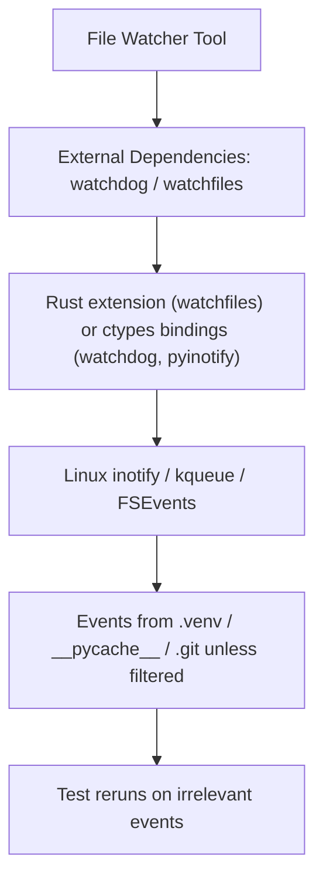
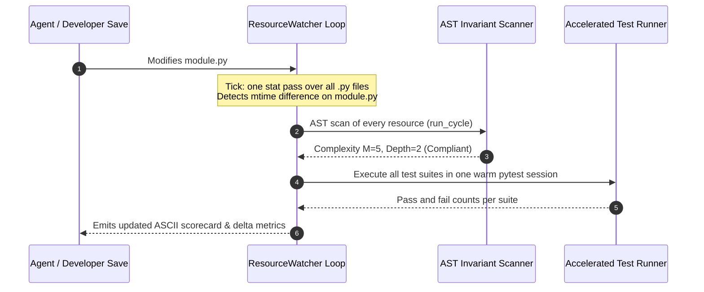

# Observation 03 (Systems): Event-Driven File Watchers & Continuous Invariant Loops

> **Project**: `devops-cli` & `vibes`  
> **Topic**: Pure Standard Library File Watchers (`ResourceWatcher`) & Continuous Autonomous Invariant Feedback  
> **Key Metric**: Change detection within one polling interval (default 1.0 s); one scan tick took about 6 ms over 154 Python files (2026-11-19); 0 external C-dependencies  
> **TLDR**: Use a standard-library polling file watcher to rerun invariant and test validation after file modifications.
> **ELI:7b**: Run an automatic watcher that tests the code the instant the AI saves a file, catching errors immediately.

---

## 1. Executive Context & Baseline

Autonomous agent development requires **tight, deterministic feedback loops**. In a standard workflow, the agent writes code, manually invokes a verification CLI tool or test runner, parses the stdout output, and decides on its next step.

While functional, this **manual execution loop** creates operational friction:
1. **Turn Latency**: Every verification step requires a distinct tool call invocation, expanding context token windows and introducing multi-second RPC latency.
2. **Delayed Invariant Feedback**: An agent might execute multiple non-contiguous edits across several files before discovering that its very first change breached cyclomatic complexity ($M \le 10$) or nesting depth ($\le 5$).
3. **External Dependencies**: File-watching solutions in Python rely on third-party packages. `watchfiles` ships a compiled Rust extension, and `watchdog` and `pyinotify` bind the Linux inotify API through `ctypes`. Each one is an extra dependency to install in containerized or hermetic execution environments.

---

## 2. The Observed Phenomenon

During iterative workbench refinement, we observed that running full repository evaluations manually after every small code edit was both computationally wasteful and cognitively disruptive:

```text
# Manual invocation cycle:
Agent Edit -> Tool Invocation -> Subprocess Overhead (seconds) -> Report Parse -> Next Action
```

When multi-file edits were performed in sequence:
- Changes made early in the session were not validated until the entire editing pass was completed.
- When an invariant violation occurred, the agent had to perform mental backtracking across multiple file diffs to isolate which exact line introduced the regression.
- Without a background watcher, developers and peer agents collaborating in the same workspace had no ambient awareness of code health transitions in real time.

---

## 3. The Underlying Failure Mode: The Heavyweight Watcher Paradox

When teams attempt to solve this with standard Python file-watching libraries:



1. **Unfiltered Event Flooding**: Naive filesystem watchers subscribe to entire project directory trees, drowning in thousands of irrelevant file modification events generated by `.venv/`, `.pytest_cache/`, `__pycache__/`, and `.git/`. `watchfiles` drops these directories by default through its `DefaultFilter`.
2. **Build Portability Cost**: A compiled extension needs a wheel for the target platform, or a build toolchain where no wheel exists.
3. **Process Spawn Overhead**: If the watcher triggers the default workspace test runner without stripping instrumentation plugins, every file save starts 4 `xdist` worker interpreters, which defeats the purpose of fast feedback.

---

## 4. Remediation & Pattern: The Lightweight `ResourceWatcher`

To get continuous invariant feedback without external dependencies, we implemented `ResourceWatcher` in [`tools/resource_iteration_workbench.py`](../../tools/resource_iteration_workbench.py). It polls file modification times and receives no filesystem events. "Event-driven" in the title means only that a detected change starts a cycle.

### 1. Pure Standard Library Topology Snapshotting
Using `os.walk` with directory pruning (`iter_source_files` in [`tools/source_tree_policy.py`](../../tools/source_tree_policy.py)) and `stat().st_mtime`, `ResourceWatcher` builds an in-memory dictionary mapping file paths to modification timestamps:

```python
class ResourceWatcher:
    """Event-driven continuous file-watcher triggering recursive iteration cycles."""

    @staticmethod
    def _safe_mtime(path: Path) -> float | None:
        try:
            return path.stat().st_mtime
        except OSError:
            return None

    @classmethod
    def snapshot(cls, root_dir: Path) -> dict[str, float]:
        """Scan directory and return mapping of Python file paths to their modification times."""
        manifest: dict[str, float] = {}
        targets = iter(sorted(iter_source_files(root_dir, (".py",))))
        for py_path in targets:
            mtime = cls._safe_mtime(py_path)
            if mtime is not None:
                manifest[str(py_path)] = mtime
        return manifest
```

### 2. Symmetric Delta Change Detection
Comparing two snapshots using symmetric key sets instantly isolates added, modified, and deleted files in $\mathcal{O}(N \log N)$ time (the keys are sorted):

```python
    @classmethod
    def detect_changes(cls, prev_snapshot: dict[str, float], current_snapshot: dict[str, float]) -> list[str]:
        """Identify paths that have been created, modified, or deleted between snapshots."""
        changed: list[str] = []
        all_keys = set(prev_snapshot.keys()) | set(current_snapshot.keys())
        for key in sorted(all_keys):
            if prev_snapshot.get(key) != current_snapshot.get(key):
                changed.append(key)
        return changed
```

### 3. Integrated Subprocess Runner Acceleration
When changes are detected, `ResourceWatcher` reruns the full workbench cycle (`run_cycle`) over every resource, not only the changed file. Its pytest runs use these flags:
```text
-p no:cov -p no:logfire -p no:xdist -p no:anyio -p no:cacheprovider -o addopts=
```
Disabling `anyio` and `cacheprovider` removes two more plugin loads, and `cacheprovider` no longer writes `.pytest_cache`. With these flags, one single-file run of `benchmarks/test_benchmark_runner.py` took about 0.7 s wall time on 2026-11-19, of which pytest reported 0.11 to 0.16 s.

---

## 5. Quantitative Verification & Empirical Impact



### Empirical Benchmarks
- **Idle Tick Latency**: a median of about **6 milliseconds** per scan over 154 Python files (`ResourceWatcher.snapshot(Path("."))`, 10 runs, 2026-11-19).
- **Changed-File Execution**: a detected change reruns the whole cycle. `run_cycle()` took 11.6 s without tests and 36.3 s with tests over 343 resources on 2026-11-19.
- **Headroom Compliance**: radon scores the `ResourceWatcher` methods at $M \le 3$, except `watch_loop` at $M = 6$ (`radon cc -s tools/resource_iteration_workbench.py`).
- **Test Suite Verification**: 5 dedicated unit tests in `tests/test_resource_iteration_workbench.py` validating snapshot discovery, delta detection, single-tick execution, loop termination (`max_ticks`), and CLI flags (`--watch`, `--watch-interval`, `--max-ticks`).

---

## 6. Key Takeaways & Living Standard Rules

1. **Know the Cost of a Polling Watcher**: In constrained container environments, a short standard-library `mtime` snapshotter needs no extra dependency. In exchange, it stats every file on each tick and detects a change only at the next poll, where inotify-based watchers receive events from the kernel.
2. **Always Filter at the Traversal Boundary**: Never scan entire directory trees and filter later; filter directory path segments (`.venv`, `__pycache__`) lazily during generator traversal to maintain negligible CPU usage.
3. **Pair Watchers with Subprocess Flag Pruning**: Continuous watchers are useless if the underlying test execution spawns 4 worker processes per run. Strip the instrumentation plugins (`xdist`, `cov`, `logfire`, `anyio`, `cacheprovider`) to remove their start-up cost from each run.
