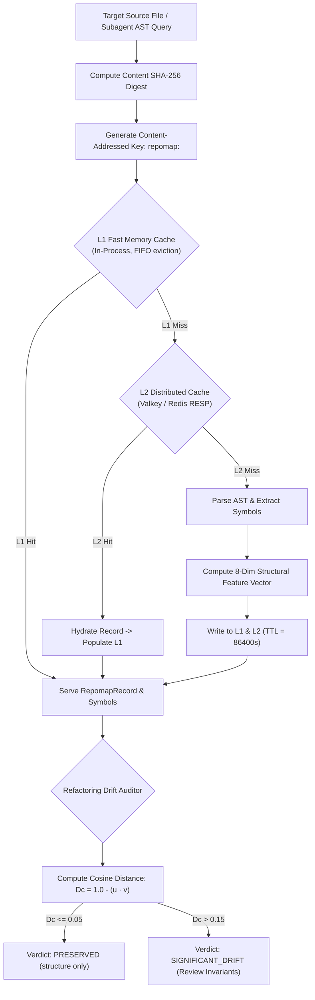

# Observation 04 (Systems): Content-Addressed Two-Tier Caching & Embedding Drift Audits

> **Project**: `devops-cli` & `vibes`  
> **Topic**: Multi-Tier AST Repomap Caching (L1 Fast Memory + L2 Valkey Distributed Cache) & Structural Embedding Drift Auditing  
> **Key Metric**: L1 hit in about 0.1 ms with the source supplied (1,863-line file, 2026-11-19); content-addressed SHA-256 cache keys; cosine distance ($D_C$) over an 8-feature structural vector, which does not detect behavior change  
> **TLDR**: Implement two-tier content-addressed caching (L1 memory + L2 Valkey) with a cosine-distance check of coarse structural features.
> **ELI:7b**: Cache repeated search results by content hash, and check embedding scores so the AI's search index doesn't drift out of date.

---

## 1. Executive Context & The AST Parsing Tax

In autonomous multi-agent software engineering, repository context is king. Before planning a change, refactoring code, or verifying invariants, agents must build a mental repomap of symbol definitions, function signatures, class hierarchies, and docstrings.

However, across long-running, multi-turn subagent sessions:
1. **The Parsing Latency Tax**: Parsing hundreds of Python source files using `ast.parse` on every subagent turn consumes significant CPU time and creates cognitive friction in conversational workflows.
2. **The Fragility of Filepath & Mtime Caching**: Standard caching mechanisms keyed by file path or modification timestamp (`st_mtime`) break down in agent environments. When agents checkout branches, apply git stashes, or perform test runs that touch timestamps without altering content, timestamp-based caches suffer from cache thrashing or serve stale data.
3. **Semantic Drift During Automated Refactoring**: When an automated refactoring engine transforms procedural code (e.g. decomposing branching ladders into table dispatch), a reviewer needs evidence that the module's behavior was preserved. A structural feature vector cannot supply that evidence; tests and equivalence checks can.

---

## 2. The Observed Phenomenon: Content-Addressed Multi-Tier Architecture

To eliminate redundant AST parsing and audit structural integrity, we implemented **Valkey L2 Repomap Cache & Embedding Drift Auditor (`examples/valkey-l2-repomap-cache/`)**:

### 1. Content-Addressed Keying (`repomap:<sha256>`)
Instead of keying cache entries by volatile paths (`repomap:/path/to/file.py`), the cache keys strictly by the SHA-256 digest of the source code content:
- If a file is touched without content changes (only its mtime moves), the digest is identical, resulting in a cache hit. A reformat changes the bytes and therefore the digest.
- If a single character changes, the digest changes, guaranteeing that stale AST symbols are never served.
- Previous file revisions remain cached under their respective digests until they are evicted (L1 holds 128 entries) or expire (L2 TTL of 24 hours), so a rollback or a diff between commits can skip re-parsing.

### 2. Two-Tier Hierarchy
- **L1 In-Process Memory Cache**: Dictionary lookup with first-in-first-out eviction at 128 entries. A hit does not refresh an entry, so the policy is FIFO, not LRU. Each lookup still hashes the full source with SHA-256.
- **L2 Valkey Distributed Cache**: Redis Serialization Protocol (RESP) wire cache accessible across parallel subagent processes and persistent across CLI sessions.

---

## 3. Mathematical Formulation: 8-Dimensional Structural Feature Vector

To compare the coarse structure of two versions of a module, the engine computes a normalized 8-dimensional structural feature vector $\vec{v}$. It is a hand-built feature vector, not a learned embedding:

$$\vec{v} = \begin{bmatrix}
\frac{\text{functions}}{\text{lines}}, &
\frac{\text{classes}}{\text{lines}}, &
\frac{\text{branches}}{\text{lines}}, &
\frac{\text{calls}}{\text{lines}}, &
\frac{\text{returns}}{\text{lines}}, &
\frac{\text{docstrings}}{\text{symbols}}, &
\ln(1 + \text{branches}), &
\ln(1 + \text{lines})
\end{bmatrix}$$

Normalized to unit length:
$$\hat{v} = \frac{\vec{v}}{\|\vec{v}\|_2}$$

### Cosine Distance & Drift Thresholds
Given baseline vector $\hat{u}$ (original file) and candidate vector $\hat{v}$ (refactored file), the auditor calculates:
$$D_C(\hat{u}, \hat{v}) = 1.0 - (\hat{u} \cdot \hat{v})$$

| Cosine Distance ($D_C$) | Classification | Architectural Meaning |
|---|---|---|
| **$D_C \le 0.05$** | `PRESERVED` | Clean refactoring. Structural density and symbol topology remain consistent. |
| **$0.05 < D_C \le 0.15$** | `SLIGHT_DRIFT` | Minor architectural addition (e.g. extracted helper functions or dispatch dictionary). |
| **$D_C > 0.15$** | `SIGNIFICANT_DRIFT` | Major topological divergence (e.g. paradigm shift from procedural to OOP, or dropped functionality). |

The unit test `test_embedding_drift_auditor_preserved` extracts a helper (`_compute_mean`) from a short function and asserts $D_C \le 0.05$. The computed value is $D_C = 0.0134$.

The metric does not detect behavior change. On 2026-11-19, replacing every `==` with `!=` in `tools/sarif_report.py` gave $D_C = 0.0$. Three unrelated modules (`tools/sarif_report.py`, `tools/docs_validator.py` and `examples/adaptive-web-crawler/crawler.py`) scored `PRESERVED` against each other, with $D_C$ from 0.0025 to 0.0099. For any file longer than a few lines, the two logarithmic terms dominate the vector, so most pairs of files score close to zero.

---

## 4. Pure Standard-Library RESP Wire Protocol & Mock Fallback

To ensure that `vibes` and `devops-cli` run hermetically in offline, rootless, and minimal CI environments:
- The Valkey client implements native RESP serialization using the pure Python standard library (`socket`).
- If no local Valkey daemon is reachable on `localhost:6379`, the client automatically transitions to an in-process dictionary fallback store (`_fallback_store: dict[str, str]`).
- The tests therefore need no running Valkey. When a server does answer on `localhost:6379`, the client writes to it instead, and a failed command falls back silently to the in-process store.

---

## 5. Key Engineering Recommendations

1. **Content-Address All AST & Repomap Caches by SHA-256**: Never cache symbol tables by file path or modification timestamp. Content hashing eliminates stale cache reads across git branches and agent edits.
2. **Combine In-Process L1 and Distributed L2 Caching**: Use fast in-memory LRU caches for hot subagent turns, backed by Valkey/Redis L2 caches for cross-agent and cross-session persistence.
3. **Audit Structural Drift with Cosine Distance**: Compute normalized topological feature vectors before and after automated code refactoring. Flag any transformation where $D_C > 0.15$ for manual review. Do not read a low $D_C$ as evidence that behavior is preserved.
4. **Build In-Memory Fallbacks for Network Protocols**: Never let an external service dependency (Valkey, Redis, Jaeger) break test suites. Provide seamless, zero-config in-memory mock fallbacks.
