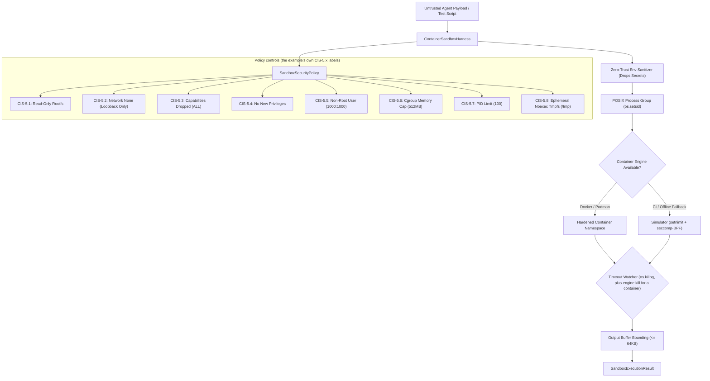

# Observation 05 (Systems): Rootless Container Sandboxing & Process Group Containment

> **Project**: `devops-cli` & `vibes`  
> **Topic**: Ephemeral Rootless Container Sandboxing (`docker` / `podman`), Process Group Isolation, and CIS Benchmark Control Auditing  
> **Key Metric**: Default policy passes 8 of 8 checks on the example's own control list (a check of the declaration, not of the run); process-group termination (SIGTERM, 50 ms wait, SIGKILL); `--network none` in container mode; returned output truncated to 65,536 characters (CWE-400)  
> **TLDR**: Isolate agent command execution in rootless containers and POSIX process groups (os.killpg) to reduce privilege escalation and orphaned-process risk.
> **ELI:7b**: Run AI commands inside locked-down containers without root permissions, and terminate whole process trees so runaway scripts don't hang.

---

## 1. Executive Context & The Agent Payload Dilemma

As autonomous AI agents evolve from passive autocomplete assistants into proactive systems engineers, they frequently synthesize, test, and execute arbitrary code payloads, shell scripts, and build tasks.

Executing untrusted, model-generated code directly on the host operating system creates critical security and reliability failure modes:

1. **The Process Tree Orphan Trap**: A standard `subprocess.Popen` invocation with `proc.kill()` terminates only the immediate child process. If the agent executes a compound command (e.g. `python3 -c "import subprocess; subprocess.Popen(['sleep', '1000'])"` or shell scripts spawning daemon forks), the grandchild processes are adopted by PID 1 (`init` / `systemd`) or the nearest subreaper and persist in the background, leaking workstation CPU and PID slots.
2. **Unbounded Output DOS (CWE-400)**: Runaway code emitting millions of lines of output to `stdout` or `stderr` saturates memory buffers, freezes agent UI parsers, and inflates context windows.
3. **Host Credential & Path Leakage**: Passing the unscrubbed host environment (`os.environ`) into child processes inadvertently exposes API tokens (`GITHUB_TOKEN`, `AWS_SECRET_ACCESS_KEY`), SSH authentication sockets, and internal paths.
4. **Network Exfiltration & SSRF Risks**: Untrusted payloads can probe cloud metadata endpoints (`169.254.169.254`), query local Kubernetes services, or establish outbound command-and-control tunnels.

---

## 2. The Observed Solution: Hardened Rootless Sandboxing

To reduce these risks, we developed the **Ephemeral Rootless Container Sandbox Harness (`examples/ephemeral-container-sandbox/`)**:



The `CIS-5.1` to `CIS-5.8` labels are this example's own numbering (`CIS_CONTROL_NAMES` in `sandbox.py`). CIS publishes no "Rootless Container Security Benchmark". The CIS Docker Benchmark (v1.6.0 numbering, as `docker-bench-security` checks it) covers most of the same ideas as 4.1 (a non-root container user), 5.4 (capabilities), 5.11 (memory limit), 5.13 (read-only root filesystem), 5.26 (no new privileges) and 5.29 (PIDs cgroup limit). It has no control for `--network none` or for a `noexec` tmpfs.

---

## 3. Key Architectural Principles

### 1. POSIX Process Group Sets (`os.setsid` & `os.killpg`)
To ensure that all descendants of a sandboxed execution are terminated when a timeout expires or an error occurs:
- The harness starts the child with `start_new_session=True`, so the child calls `setsid()` and leads a new session and process group.
- On termination or timeout, the harness sends signals to the entire group using `os.killpg(os.getpgid(proc.pid), signal.SIGTERM)`, waits 50 ms, and sends `signal.SIGKILL`. This kills every process still in the group. A descendant that calls `setsid()` itself (a daemonizing fork) leaves the group and survives; a PID namespace or a cgroup kill (`cgroup.kill`, Linux 5.14 and later) covers that case. In container mode the group holds only the `docker` or `podman` client, and a signal to the client does not stop the container. The client forwards SIGTERM, which a container's PID 1 ignores unless it installs a handler, and SIGKILL stops only the client. So each run gets a unique `--name`, and on timeout the harness runs `docker kill <name>` (or `podman kill <name>`) before it signals the group.

### 2. Zero-Trust Environment Stripping
Host environments contain hundreds of variables, many of which contain secrets or configuration overrides. The harness enforces a strict allowlist:
```python
DEFAULT_SAFE_VARS = frozenset({"PATH", "LANG", "LC_ALL", "PYTHONUNBUFFERED", "PYTHONDONTWRITEBYTECODE"})
```
Every variable outside the allowlist is dropped before execution, including API keys, tokens and session IDs. `PATH` is kept and can still name private user paths.

### 3. Dual-Mode Portability
Because AI agents run in heterogeneous environments (developer laptops, Docker-in-Docker devcontainers, bare-metal CI, isolated Kubernetes pods), hard container dependencies cause brittleness.
The harness provides seamless **dual-mode runtime switching**:
- If `docker` or `podman` is present, it runs `<engine> run --rm` with the policy flags. Whether the container is rootless depends on how the engine is installed.
- If no container engine is available, it falls back to a simulator: a child process confined by `setrlimit` (RLIMIT_AS, RLIMIT_CPU, RLIMIT_NPROC, RLIMIT_CORE), `prctl(PR_SET_NO_NEW_PRIVS)` and a seccomp-BPF filter, with a sanitized environment. The simulator cannot apply a read-only root filesystem or a private `/tmp`; `RuntimeEnforcementAuditor` in `sandbox.py` reports both as unenforced.

### 4. Bounded Output Buffers (CWE-400 Mitigation)
Standard library `subprocess.Popen.communicate()` buffers all output in memory. The harness also calls `communicate()` and truncates afterwards, so the cap protects the consumer of the result, not the harness's own memory:
$$\text{Output Length} \le 65,536 \text{ characters}$$
Output exceeding the threshold is split into leading and trailing head/tail chunks with an explicit truncation marker, protecting agent parsers and context windows from oversized output.

---

## 4. Empirical Containment Matrix

`sandbox.py --demo` runs three payloads. The simulator uses a 0.15 s timeout. A container uses the 5 s policy default, because a container start takes longer than 0.15 s. Results on 2026-11-19:

| Payload | Simulator (`--demo --simulator`, 0.15 s) | Docker engine (`--demo`, 5 s) |
|---|---|---|
| Safe computation (`print(sum(i * i for i in range(100)))`) | Passed, 68 ms | Passed, 720 ms |
| Timeout (`time.sleep(10)`) | Contained at 207 ms | Contained at 5,212 ms by `docker kill` |
| Output flooding (`print('X' * 200000)`) | Truncated to 65,535 characters | Truncated to 65,535 characters |

An earlier version passed the host interpreter path (`sys.executable`) into the `python:3.12-slim` image, where it does not exist. Every container payload exited with code 127, and the audit still reported the policy as compliant. That version also signaled only the client on timeout: a `sleep` container kept running after the harness returned. The harness now runs `python3` from the image and kills the container by name. `test_the_demo_payloads_pass_in_a_container` runs the three payloads in a real container, and skips when neither `docker` nor `podman` is on `PATH`. The demo has no filesystem-mutation, egress or fork-bomb payload. `test_the_simulator_denies_a_payload_the_network` checks that the simulator's seccomp filter refuses `socket()` with `EPERM`. No test checks a read-only root filesystem or a PID limit at run time.

---

## 5. Takeaways for Autonomous Swarms

1. **Never Execute Agent Payloads in the Ambient Process**: Running `eval()`, `exec()`, or unconstrained `subprocess.run()` in the agent's main process turns any prompt injection or code defect into an instant host compromise.
2. **Write Security Policy as Code, and Check the Runtime Too**: Security policies should not be informal guidelines. Modeling them as typed dataclasses (`SandboxSecurityPolicy`) with a compliance auditor (`CISPolicyAuditor`) checks the declaration. `RuntimeEnforcementAuditor` checks what the engine that runs the payload enforces; a perfect policy score does not mean that the run is confined.
3. **Always Isolate Process Groups**: When executing subprocesses, `os.setsid` and `os.killpg` stop background child processes from surviving test timeouts. They do not catch a descendant that starts its own session.
