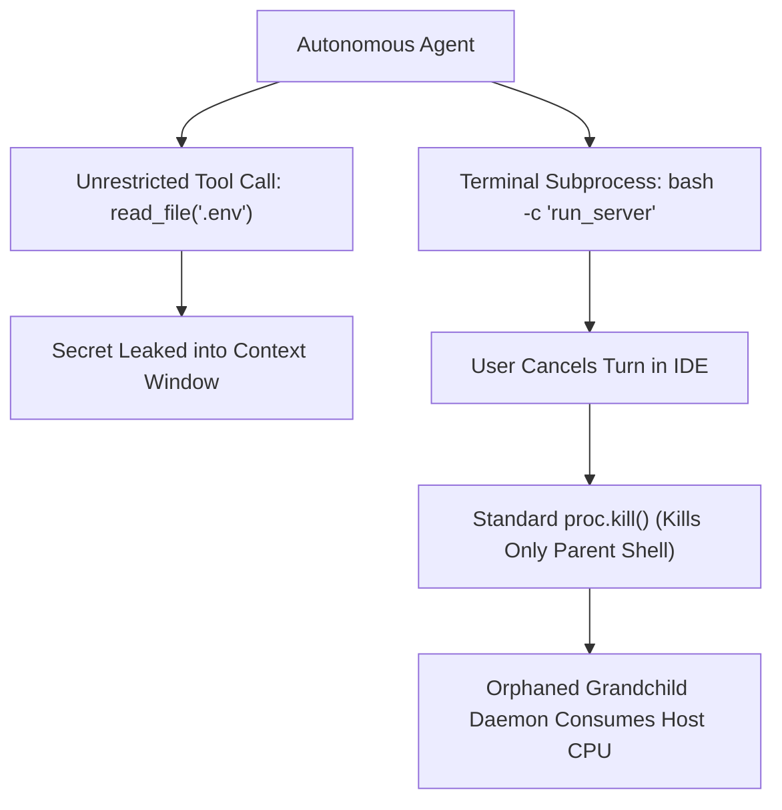
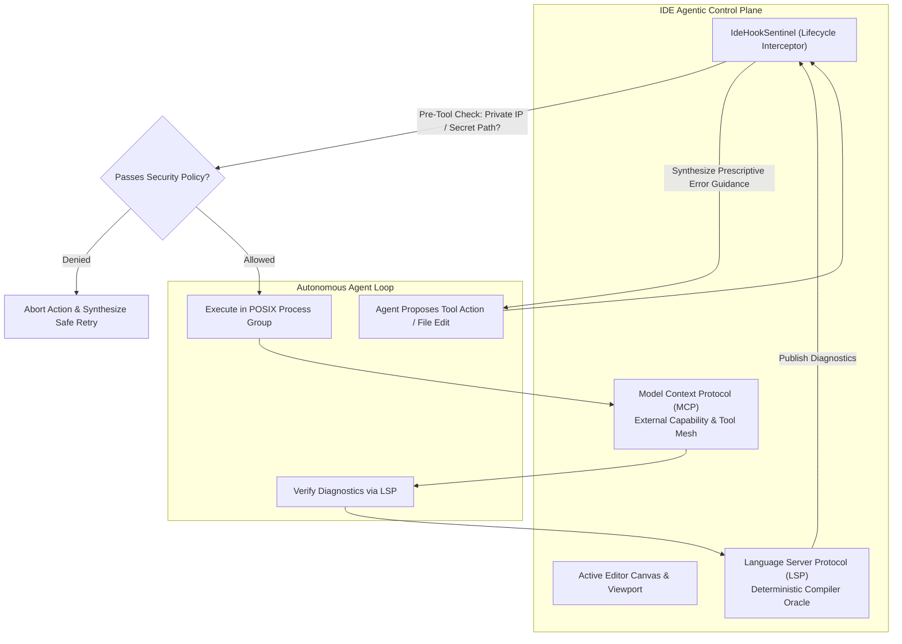

# Observation 07: Agentic IDE Protocols & LSP/MCP Convergence

> **Project**: `devops-cli` & `vibes`
> **Topic**: Agentic IDE Architecture, LSP-to-Agent Diagnostic Oracles, and Zero-Trust Lifecycle Hooks
> **Key Metric**: Pre-tool check in about 0.04 ms (2026-11-19); process-group kill of a timed-out command; literal private addresses and protected path names in tool arguments are refused
> **TLDR**: Converge Language Server Protocol diagnostics with Model Context Protocol tools to provide agents with real-time in-editor compiler feedback.
> **ELI:7b**: Give the AI the same red error squiggles and quick-fix buttons that human developers see inside their code editor.

---

## 1. Executive Context & Baseline

The developer environment has transitioned through three distinct evolutionary eras:
1. **The Passive Text Buffer (1970–2015)**: Text editors manipulated ASCII buffers with synchronous regex and UNIX pipe helpers.
2. **The Language Server (2016–2023)**: The Language Server Protocol (LSP), an asynchronous JSON-RPC protocol, standardized client-server boundaries for syntax highlighting, autocomplete, and compiler diagnostics.
3. **The Agentic Control Plane (2024+)**: Editors (such as Google Antigravity, Cursor, and VS Code) evolve into autonomous control planes where AI agents proactively read files, invoke terminal commands, deploy infrastructure, and iterate against compiler feedback.

In an agentic IDE, the AI is no longer a passive chat assistant confined to a webview sidebar. It is an active participant with filesystem agency, terminal execution privileges, and multi-file refactoring authority.

---

## 2. The Observed Phenomenon

This section describes three failure classes of unconstrained agent tooling in containerized IDEs and developer workstations. It is a composite description, not a log of specific recorded sessions:

1. **The Diagnostic Blind Spot**: When an agent generated code that violated type safety (e.g. `mypy` or `rustc` errors), the model did not observe the IDE's Problems pane. Instead of using real-time Language Server diagnostics as a deterministic verification oracle, the agent repeatedly asked the user if the code worked or hallucinated that tests passed.
2. **Runaway Zombie Subprocesses**: When users cancelled long-running test suites or benchmark commands in the IDE terminal, standard process termination (`proc.kill()`) terminated only the top-level bash wrapper. Grandchild processes (e.g. background container runners or compilation daemons) remained running as orphaned PID 1 leaks, exhausting CPU and port resources.
3. **Accidental Credential Exposure & SSRF**: In unfamiliar repositories, agents exploring project structure opened `.env` files, read SSH private keys, or attempted to probe private RFC 1918 subnets (`10.0.0.0/8`, `172.16.0.0/12`, `192.168.0.0/16`), risking secret disclosure and Server-Side Request Forgery.

---

## 3. The Underlying Failure Mode or Catalyst

The underlying failure mode was the absence of a **zero-trust lifecycle interception layer** between the agent's stochastic output stream and the IDE's physical runtime. Furthermore, the disconnect between deterministic language servers (LSP) and tool execution meshes (MCP) left the agent operating without physical ground truth.

---

## 4. Remediation & Architectural Pattern

The engineering countermeasure, with a reference implementation in [`examples/agentic-ide-hook-sentinel/`](../../examples/agentic-ide-hook-sentinel/), is the **Tri-Protocol Agentic Control Plane**. The example is one Python class. It connects to no language server and to no MCP server: the tests pass LSP diagnostic dictionaries to `evaluate_lsp_diagnostics`, which turns the first error into a guidance string.

### Core Architecture Components:
1. **LSP as the Mechanical Oracle**: Compiler errors from `textDocument/publishDiagnostics` become guidance for the next attempt (`evaluate_lsp_diagnostics` reports the error count and the first error's one-based line). The agent must fix the error on a later attempt; nothing corrects it automatically.
2. **Pre-Tool Zero-Trust Interception**: Every tool call and file write is evaluated before execution. A string argument that contains `.env`, `.ssh`, `.git` or another protected name is refused (a substring match, so `.github/` is refused too), and so is any literal private or link-local address, the cloud metadata address included. The check reads each string at any depth, so a list item such as `["cat", ".env"]` is refused. The check reads text only: on 2026-11-19 a host name that resolves to a private address and the hexadecimal address `0x0a010203` passed.
3. **POSIX Process Group Containment**: All terminal commands execute with `start_new_session=True`. On timeout, `os.killpg()` sends SIGTERM to the process group and SIGKILL after a grace period. A descendant that starts its own session leaves the group and survives.
4. **Pre-Flight File Caps**: Writes exceeding 5MB are rejected to stop oversized writes (CWE-400).

---

## 5. Verifiable Impact & Key Takeaways

1. **Credential and Address Checks**: The test cases for `.env`, `.ssh/id_rsa` and RFC 1918 addresses are refused at the hook boundary in well under 0.1 ms. Inputs outside the text patterns pass, as listed above.
2. **Process-Group Reclamation**: Descendants that stay in the process group are reclaimed on timeout.
3. **Compiler Feedback Loop**: The hook turns a compiler diagnostic into a prescriptive prompt for the next attempt. This repository does not measure whether agents then fix the error.

> **Architectural Takeaway**: The agentic IDE is not a chat box; it is an execution control plane. By coupling Language Server diagnostics as deterministic verification oracles with zero-trust lifecycle hooks, agents operate with compiler ground truth and explicit safety checks.

