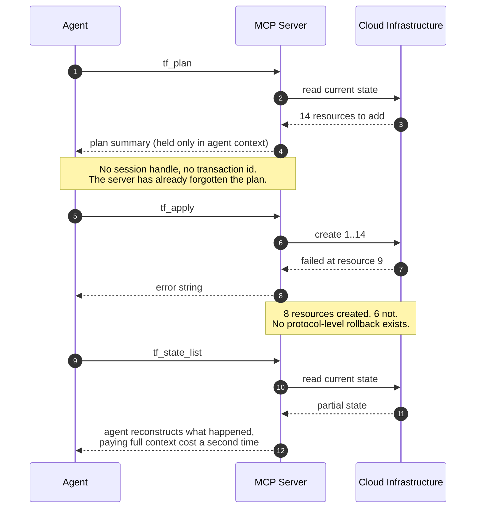
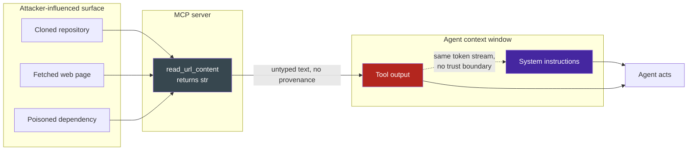

# MCP Protocol Boundaries & Stateless Transport Constraints

> **TLDR**: Design Model Context Protocol tools around stateless transport invariants, bounded payload buffers, and explicit error recovery envelopes.
> **ELI:7b**: Build AI tool servers so each call stands completely on its own without assuming previous calls left hidden state behind.

## 1. Executive Context & Baseline

The Model Context Protocol (MCP) has become the dominant interface between AI coding assistants and developer tools. In September 2026, `devops-cli` exposed about 160 FastMCP tools and 20 resources, served via `stdio` transport for local IDE connections (devops-cli commit 838c0d7f8). The protocol defines three server primitive types — **Tools** (callable functions with JSON Schema parameters), **Resources** (URI-addressable data), and **Prompts** (templated instruction fragments) — providing a structured alternative to raw subprocess invocation.

However, MCP's request-response tool calls introduce fundamental constraints that shape how agentic systems can operate. These constraints are not bugs to be fixed but architectural boundaries that must be understood and designed around.

## 2. The Observed Phenomenon

**2a. Statelessness vs. Session Continuity**: The MCP base protocol uses stateful connections (specification 2025-11-25, "Key Details"), but a tool call carries no workflow context: each invocation receives parameters and returns results, and nothing in the protocol links one call to the next. When an agent performs a multi-step workflow (e.g., `tf_plan` → review plan → `tf_apply`), the protocol provides no transaction boundary or rollback mechanism. If `tf_apply` fails halfway, there is no protocol-level way to undo the partial application. The agent must reconstruct the failure state from scratch by calling diagnostic tools.

A server can keep state between calls, but the protocol gives that state no standard shape. Without it, the agent must maintain all workflow state in its own context window, which compounds the context accumulation problem from Observation 19.



The protocol has no place to put the fact that a transaction is in flight. The agent's context window is the only durable store in the system, which is why the transaction journal in section 4 below is agent-side rather than server-side.

**2b. Tool Discovery Scalability Pressure**: When an MCP client connects to a server exposing 100+ tools, the `tools/list` response serializes every tool's JSON Schema into a single response payload. For `devops-cli`'s tool surface, this payload exceeds 30,000 tokens. The client must either:

1. Inject all schemas into the model's context, or
2. Implement lazy schema resolution, loading tool definitions on-demand

The MCP specification has no lazy-loading mechanism. `tools/list` takes only a pagination `cursor`, and a server can send `notifications/tools/list_changed` when its tool set changes. devops-cli added its own lazy loading in v0.2.23 (2026-09-28): a `hydrate_tool_domain` tool that registers a tool domain on demand and then sends `list_changed`. Most client implementations (Copilot, Cursor) default to eager loading.

**2c. Resource Underutilization**: MCP Resources provide URI-addressable, cacheable, subscription-capable data endpoints (e.g., `resource://ai/research/mental_model`, `resource://dashboard/k8s`). Unlike Tools, Resources are designed for read-heavy, stable data that changes infrequently — perfect for configuration, status dashboards, and cached analysis results. Yet in practice, agent frameworks default to dynamic Tool calling for every data access, even when a Resource would provide cheaper, cached, deterministic results. In September 2026, devops-cli served 20 resources beside about 160 tools, and its roadmap planned more.

**2d. Security Surface of Tool Return Strings**: Most MCP tool responses are text content returned to the agent's context. The specification also allows image, audio, resource links, embedded resources, and `structuredContent` checked against an `outputSchema`, but none of these marks trust. An attacker who controls tool output (e.g., via a compromised git repository, a malicious web page fetched by `read_url_content`, or a poisoned dependency) can inject instructions that the agent interprets as system-level directives — a form of **indirect prompt injection** through the tool response channel. The MCP protocol provides no mechanism for marking tool output as "untrusted user data" versus "trusted system instructions." Content annotations carry only `audience`, `priority` and `lastModified`, and the specification tells clients to validate tool results before they pass them to the model.



Both arrows into `Agent acts` carry equal authority. The trust boundary that exists in every other part of the stack — between data and code — has no representation in the token stream.

## 3. The Underlying Failure Mode or Catalyst

MCP's constraints stem from its foundational design principle: **tools as independent calls**. This is the correct abstraction for single-step operations (read a file, run a command, query a database), but it creates friction for three categories of agentic work:

1. **Multi-step transactions**: Workflows requiring atomic commit/rollback semantics (infrastructure provisioning, database migrations, multi-file refactoring) have no protocol-level transactional envelope. The agent must implement its own transaction log in context memory.

2. **Streaming and long-running operations**: A tool call is one request and one result. Long-running operations (build processes, deployment rollouts, benchmark suites) must either block until completion (risking timeout) or return immediately with a polling handle — pushing the polling loop into the agent's turn budget. The specification adds progress notifications, cancellation and, from revision 2025-11-25, task-augmented tool calls, but client support varies.

3. **Bidirectional communication**: MCP is bidirectional JSON-RPC on every transport, `stdio` included. A server can send notifications (`notifications/resources/updated` for a subscribed resource, `notifications/progress`, `notifications/tools/list_changed`) and requests (sampling, roots, elicitation). But a notification does not start a model turn: if a deployment finishes 5 minutes after the agent's last poll, the agent acts on it only when its host shows it the notification or the agent polls again. The HTTP+SSE transport was replaced by Streamable HTTP in specification revision 2025-03-26.

These are design trade-offs of a protocol optimized for simplicity, composability, and security isolation. The failure mode occurs when agentic systems treat MCP as a general-purpose RPC framework rather than a constrained tool interface.

## 4. Remediation & Architectural Pattern

**4a. Agent-Side Transaction Journals**: For multi-step workflows, maintain an explicit transaction log in the agent's context:

```python
transaction = {
    "id": "tf-apply-20240918",
    "steps_completed": ["tf_plan"],
    "steps_pending": ["tf_apply"],
    "rollback_commands": ["tf destroy -auto-approve"],
    "state_snapshot": "plan_output_hash_abc123",
}
```

On failure, the agent consults the journal to determine rollback steps rather than relying on protocol-level undo.

**4b. Resource-First Data Access**: Default to MCP Resources for read-heavy, stable data. Reserve Tools for mutation and dynamic computation:

| Use Case | Correct Primitive | Why |
|---|---|---|
| Current pod status | Resource (`resource://k8s/pods`) | Cacheable, subscribable, cheap |
| Deploy a stack | Tool (`k8s_deploy_stack`) | Mutating, requires parameters |
| Gateway health | Resource (`resource://ai/gateway/status`) | Stable, polled frequently |
| Trigger failover | Tool (`ai_gateway_failover`) | Mutating, requires confirmation |

**4c. Tool Output Sandboxing via Content Tagging**: Treat all MCP tool return strings as untrusted input. Apply the same sanitization pipeline used for user input — strip potential instruction injections, validate against expected output schemas, and cap output length to prevent context flooding.

**4d. Lazy Tool Discovery with Domain Routing**: `tools/list` has no filter parameter, so domain routing needs a server-side mechanism: list a small core set, and register further tool domains on request (devops-cli's `hydrate_tool_domain`), followed by `notifications/tools/list_changed`.

See pattern: [tool-cardinality-budget-management](../../patterns/tool-cardinality-budget-management.md)

## 5. Verifiable Impact & Key Takeaways

- **Resource vs Tool cost**: A Resource read carries no tool schema in the model's context. A Tool call carries its schema, its parameters and its result. For read-heavy patterns, Resources therefore cost fewer tokens; this repository has not measured the ratio.
- **Transaction journal cost**: A short state snapshot per transaction is small compared to the cost of reconstructing failure state from scratch via diagnostic tool calls.
- **Security surface**: Every tool response is an injection vector. No MCP content field marks trust, so the agent cannot distinguish "file contents returned by `view_file`" from "instructions crafted by an attacker embedded in file contents." Sanitization must happen at the agent framework layer.

> **Aphorism**: MCP tools are independent calls, not transactional RPC endpoints. The protocol gives you simplicity and composability; it does not give you transactions or trust boundaries, and its resource subscriptions do not start a model turn. Design your agent architecture around what the protocol provides, not what you wish it provided.

> **The Resource-First Principle**: If you're calling a Tool to read data that hasn't changed since the last call, you should be using a Resource. Tools are for mutation; Resources are for observation. Confusing the two wastes tokens and increases latency.
