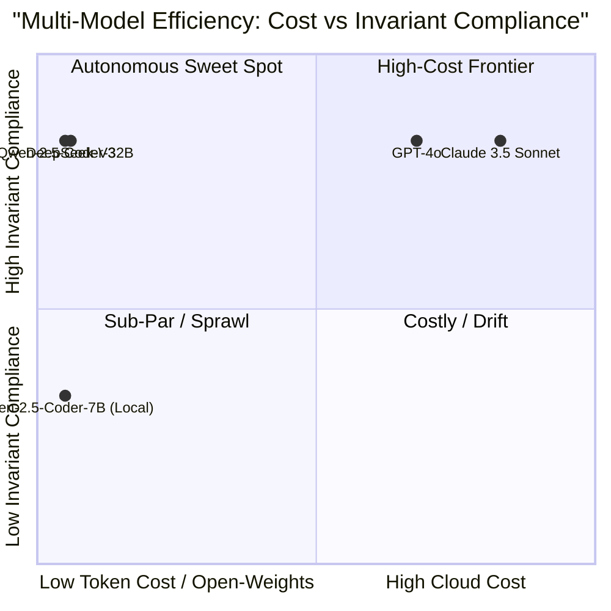
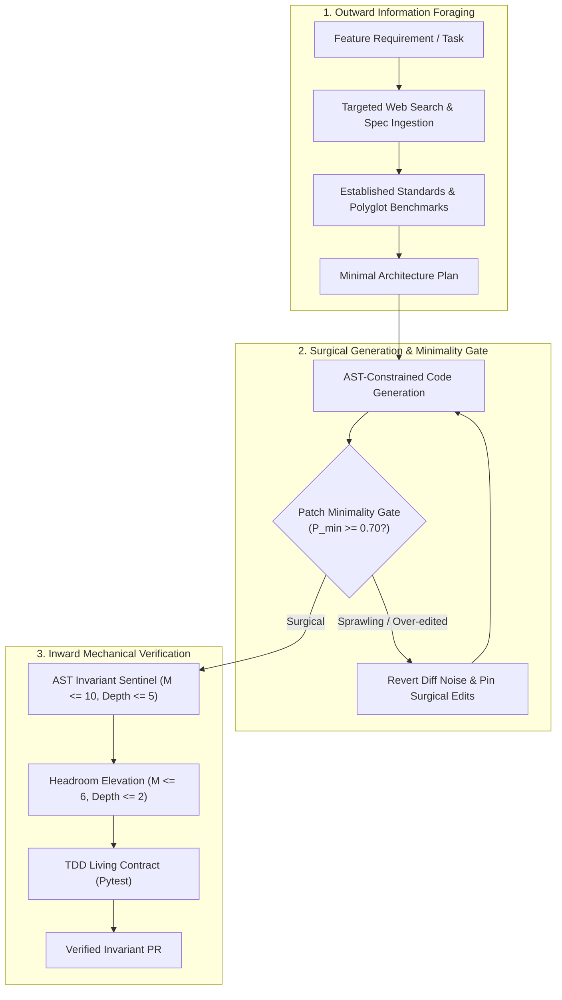

# Observation 20: Internet-Grounded Information Foraging & Self-Improvement Loops

> **Project**: `vibes` — Autonomous SDLC & Multi-Model Empirical Evaluation
> **Topic**: Overcoming the Inward-Looking Agentic Trap: Why Self-Improvement Loops Collapse Without Outward Information Foraging, and How Patch Minimality Reins In Diff Sprawl
> **Key Metric**: In the built-in sample leaderboard (`python3 tools/model_leaderboard.py sample`), the open-weights entries (DeepSeek-V3, Qwen-2.5-Coder-32B) cost **10× to 20× less per task** than the frontier entries (Claude 3.5 Sonnet, GPT-4o) at the same 83.3% invariant score. No model is called: the four entries share one hand-written patch and fixed token counts, so the equal score is by construction and the cost ratio comes from the pricing table. The **"Over-Editing Trap"**, where whole-file rewrites lower patch minimality, is stated qualitatively; no command measures it.
> **TLDR**: Ground agent self-improvement in external web search and documentation foraging to prevent stale knowledge and circular reasoning traps.
> **ELI:7b**: Let the AI search the web for updated documentation and libraries so it doesn't rely on outdated training memory.

---

## 1. Executive Context & Baseline

[Observation 19](./19-self-consistency-is-not-conformance.md) proved that a repository with exhaustive inward-facing gates (AST complexity ceilings, coverage floors, type checkers) can remain systematically wrong at its external boundaries. Every internal gate measures self-consistency against the repository's own existing declarations, allowing subtle conformance defects—such as an inert sandbox simulator or unreadable telemetry vocabularies—to pass certified green at 100.0/100 health.

This observation investigates the complementary dynamic in the feature development lifecycle: **the agentic self-improvement loop**.

When an autonomous AI agent is tasked with feature development, refactoring, and self-improvement, what information sources must it forage from to prevent epistemic stagnation? If an agent relies exclusively on inward repository signals (its existing codebase, git history, and local test runs), it succumbs to the **Inward-Looking Failure Trap**:
1. **Reinventing the Flat Tire**: Synthesizing ad-hoc, brittle regular expression parsers or bespoke utility functions to solve problems that established RFC-compliant libraries or system tools solve deterministically.
2. **The Over-Editing Trap**: Attempting to resolve minor lint or complexity warnings by rewriting entire files, generating sprawling diff noise that dilutes reviewability, invalidates git blame history, and increases latent regression risk.
3. **Economic Blindness**: Operating without model cost awareness, burning expensive frontier reasoning tokens on atomic type annotations or routine syntactic scaffolding while ignoring high-efficiency distilled alternatives.

To quantify and counter these failure modes, we built [`tools/model_leaderboard.py`](../../tools/model_leaderboard.py). It scores supplied run records (code before and after, test result, token counts) against AST invariants, computes a line-diff **Patch Minimality** score, and computes the **Cost-Per-Invariant (CPI) Index**. It calls no model.

---

## 2. The Observed Phenomenon

### 2.1 The Inward-Looking Trap vs. Outward Information Foraging

The table contrasts the two modes. It is an illustrative summary of the argument, not the result of a recorded trajectory audit.

| Operating Mode | Information Source | Architectural Strategy | Failure Mode Observed |
|---|---|---|---|
| **Purely Inward Loop** | Local codebase, AST sentinel, local test runner | Synthesizes custom algorithms from scratch based on prompt instructions alone | Reinvented custom URL parsers and manual seccomp structures that missed edge cases. |
| **Outward-Grounded Loop** | Web search, live benchmarks (Aider, SWE-bench), official specs | Searches external registries, upstream libraries, and reference implementations | Identified standard AST visitor patterns, leveraged Mozilla Public Suffix List references, and defined a patch minimality metric. |

When agents forage outwardly before designing solutions, they escape the temporal cutoff of their weights and avoid the inward trap of treating the existing repository as the sole authority on software design.

### 2.2 The "Over-Editing Trap" and Diff Churn

In continuous automated engineering, a model's pass/fail test outcome is an incomplete measure of patch quality. When instructed to "fix a complexity violation" or "refactor an `if/elif` ladder", stochastic models exhibit a strong bias toward wholesale file rewriting.

```python
# Before (Surgical 2-line fix needed):
def compute_total(items: list[int]) -> int:
    return sum(x for x in items if x > 0)

# Illustrative over-edit (not a recorded model output): a whole-module rewrite
# that reformats comments, renames variables and turns the generator into a loop:
def compute_total(items: list[int]) -> int:
    total = 0
    for item in items:
        if item > 0:
            total += item
    return total
```

When such a rewrite spans a whole module, it passes the unit tests but produces a diff far larger than the requirement. This diff churn obscures code review, increases merge conflicts in multi-agent swarms, and introduces subtle behavioral shifts.

To mechanically penalize over-editing, we introduced the **Patch Minimality Score** ($P_{\text{min}} \in [0.0, 1.0]$):

$$P_{\text{min}} = \frac{N_{\text{diff}} - N_{\text{noise}}}{N_{\text{diff}}} \times \left(1.0 - 0.5 \times \min\left(1, \frac{N_{\text{diff}}}{2 \times \text{Original Lines}}\right)\right)$$

Where $N_{\text{diff}}$ is the number of added and removed lines in a `difflib` unified diff and $N_{\text{noise}}$ is the number of those lines that are blank or comment-only (`_calculate_minimality_score` in `tools/model_leaderboard.py`). The score parses no AST. In the built-in sample, the clean patch scores $0.625$ and the sprawling rewrite scores $0.583$.

### 2.3 The Multi-Model Economic Landscape

Frontier reasoning models and local open-weights models have different prices per token. The chart is illustrative output of `python3 tools/model_leaderboard.py sample` on built-in sample data; no model was run:



---

## 3. Telemetry & Empirical Findings

The table below is illustrative output of `python3 tools/model_leaderboard.py sample` on built-in sample data (`generate_sample_benchmark_runs()`). The data is one task: the four cloud entries share one hand-written clean patch, the local entry gets a hand-written sprawling patch, and the token counts are fixed numbers. No model was called.

### 3.1 Sample Leaderboard Output

| Model | Provider | Pass@1 | Invariants % | Headroom ($M \le 6$) | Mean $M$ | Patch Minimality | Cost / Task ($) | Cost / Inv ($) | Composite Score |
|---|---|:---:|:---:|:---:|:---:|:---:|:---:|:---:|:---:|
| **Qwen-2.5-Coder-32B** | Alibaba | 100.0% | 83.3% | 100.0% | 1.0 | 0.625 | $0.0006 | $0.000119 | **84.26** |
| **DeepSeek-V3** | DeepSeek | 100.0% | 83.3% | 100.0% | 1.0 | 0.625 | $0.0009 | $0.000182 | **83.71** |
| **GPT-4o** | OpenAI | 100.0% | 83.3% | 100.0% | 1.0 | 0.625 | $0.0096 | $0.001920 | **80.64** |
| **Claude 3.5 Sonnet** | Anthropic | 100.0% | 83.3% | 100.0% | 1.0 | 0.625 | $0.0118 | $0.002370 | **80.37** |
| **Qwen-2.5-Coder-7B** | Local | 100.0% | 33.3% | 0.0% | 5.0 | 0.583 | $0.0000 | $0.000000 | **71.66** |

### 3.2 Key Telemetry Insights

1. **The Cost-Per-Invariant Gap**: In the sample, the open-weights entries (DeepSeek-V3, Qwen-2.5-Coder-32B) have the same invariant score ($83.3\%$) and AST headroom ($M=1.0$) as the frontier entries at **13× to 20× lower cost per invariant** ($\$0.00012$ and $\$0.00018$ vs $\$0.00237$). The equal score is by construction, because all four entries share one patch; the ratio comes from the pricing table and the fixed token counts.
2. **Local Model Nesting Traps**: The sample assigns the sprawling patch to the local 7B entry, so that entry scores $M=5.0$ and fails the proactive headroom gate ($M \le 6$, depth $\le 2$). This shows how the gate scores such a patch, not how a 7B model behaves.
3. **The Minimality Ceiling**: The sample's mean minimality is about 0.62. The score is not a share of diff lines, so it does not mean that 38% of the lines are churn.

---

## 4. Deterministic Oracles & Countermeasures

To resolve the inward-looking trap and prevent diff sprawl, we codified a **Dual-Loop Self-Improvement Architecture**:



### 4.1 Automated Patch Minimality Oracle

Implemented in [`tools/model_leaderboard.py`](../../tools/model_leaderboard.py), `compute_patch_minimality` operates on a `difflib` unified diff of the two sources, or on a supplied diff. It parses no AST:
- It counts blank and comment-only diff lines as noise, which lowers the score.
- It multiplies the share of non-noise diff lines by a size penalty that grows with the diff size relative to the original file.
- A score below $0.70$ fails one of the six invariants that `_count_invariants` counts. No other tool reads the score; `tools/pr_triage_bot.py` does not use it.

### 4.2 Hierarchical Model Routing ("Big Decides, Small Types, Big Checks")

The price gap in the pricing table, not a measured trial, is the reason to avoid frontier tokens for routine typing and single-line syntax updates:
- **Planning & Architecture (Frontier Reasoning)**: Claude 3.5 Sonnet / DeepSeek-R1 formulate multi-file architectural strategy and design invariants.
- **Atomic Typing & Refactoring (Efficient / Local Tier)**: Qwen-2.5-Coder-32B / DeepSeek-V3 implement localized edits, documentation, and AST refactorings at negligible cost.
- **Verification (Deterministic Mechanical Oracles)**: Local Python AST visitors, link integrity validators, and pytest runners apply deterministic checks that give the same result on every run.

---

## 5. Architectural Invariants & Synthesis

From the sample leaderboard and the information foraging argument above, five architectural invariants are codified:

1. **Dual-Loop Grounding Invariant**: An autonomous self-improvement loop must never optimize purely against internal repository signals. Feature design, upstream dependencies, and security boundaries must forage outward against external RFCs, established open-source registries, and polyglot benchmarks.
2. **Patch Minimality Invariant ($P_{\text{min}} \ge 0.70$)**: Code generators must be evaluated not only on functional correctness (Pass@1), but also on structural conciseness. Wholesale file rewrites for localized changes are treated as architectural smell.
3. **Cost-Per-Invariant (CPI) Efficiency**: High-frequency autonomous pipelines must monitor dollars expended per satisfied invariant. Workload allocation should shift routine refactoring tasks to high-efficiency models in Quadrant 2 ("The Autonomous Sweet Spot").
4. **Deterministic Gate Finality**: No language model, regardless of size or benchmark rank, is trusted to certify its own work. Verification authority remains exclusively with deterministic AST parsers and executable test suites.
5. **Proactive Headroom Target ($M \le 6$, Depth $\le 2$)**: Functions must not operate near the hard complexity ceilings ($M \le 10$, depth $\le 5$). Autonomous refactoring loops proactively maintain headroom to prevent minor subsequent edits from breaching invariants.
