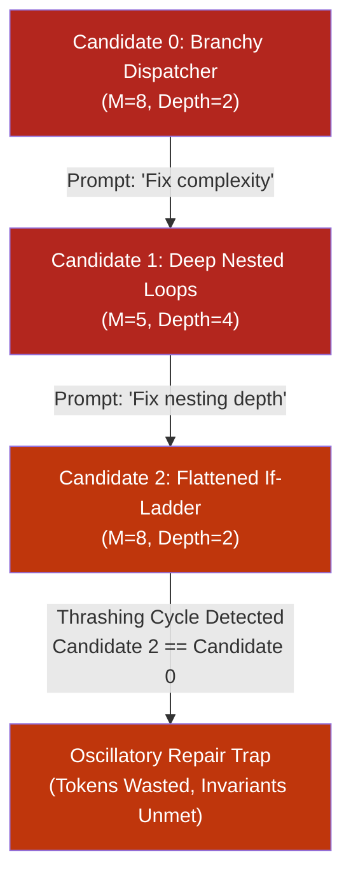
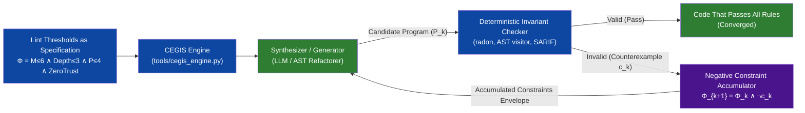

# Observation 22: Conversational Self-Correction Thrashing vs. CEGIS Invariant Accumulation

> **Project**: `vibes` — Autonomous Agent Self-Improvement & Synthesis Oracles
> **Topic**: Solving the "Try-Again" Degeneracy Trap: Replacing Conversational Prompting Loops with Counterexample-Guided Inductive Synthesis (CEGIS), Negative Constraint Accumulation, and Monotonic Convergence Oracles
> **Key Metric**: `tools/cegis_engine.py` audits a supplied sequence of candidate programs and flags a repeated candidate ($A \to B \to A$, `CEGIS006`), a rule that newly fails (`CEGIS007`) and a repeat of a recorded counterexample (`CEGIS008`, $\Phi_{k+1} = \Phi_k \land \neg c_k$). It does not generate candidates, and no command in this repository measures oscillation or regression rates.
> **TLDR**: Contrast brittle unconstrained LLM self-correction with CEGIS-style constraint accumulation to detect patch oscillation and regression loops.
> **ELI:7b**: Don't just ask the AI to try again when a test fails. Add each failed test to an accumulating list so the AI can't repeat past mistakes.

---

## 1. Executive Context & Baseline

Autonomous coding agents operating in self-improvement loops frequently encounter defects, failing test assertions, or strict architectural invariant gates (e.g., McCabe cyclomatic complexity $M \le 10$, nesting depth $\le 5$, parameter limits $\le 4$, and zero private RFC 1918 IPs).

In standard agent implementations, self-correction is almost universally handled via **conversational retry loops**:
The parent system captures an error traceback, appends it to the chat transcript, and prompts the model: *"That failed with error X. Please try again and fix it."*

While superficially intuitive, such loops carry three risks over multi-step refactoring horizons. Published work measures the second one: **SCAFFOLD-CEGIS** (Chen et al., arXiv 2603.08520, 2026) reports that security degrades gradually across iterative LLM code refinement and that a SAST gate alone did not stop it. **CodeARC** (Wei et al., COLM 2025, arXiv 2503.23145) evaluates agents that refine programs against a differential testing oracle. The first and third risks are stated here without a measurement:
1. **Constraint Thrashing & Oscillatory Cycles**: The agent modifies code to eliminate defect $A$, which introduces violation $B$. In the subsequent turn, the agent addresses $B$, but regresses back to state $A$. Without memory of previous failure geometries, the agent spins in unbounded oscillatory cycles ($A \to B \to A$).
2. **Latent Invariant & Security Degradation**: In an unconstrained effort to make a specific test or metric pass, the model weakens or eliminates other unspoken constraints (e.g., stripping parameter validation, omitting type annotations, or hardcoding insecure fallbacks).
3. **Softmax Attention Dilution & Context Rot**: Appending full code dumps and execution tracebacks into the transcript on every iteration rapidly consumes context tokens. Because softmax attention is normalized ($\sum w_i = 1.0$), spreading attention across thousands of tokens of previous failed attempts can dilute the signal for the original system rules (see [Observation 23](./23-attention-dilution-context-rot-and-active-compaction.md)).

To detect these failure modes in a recorded repair trajectory, we implemented [`tools/cegis_engine.py`](../../tools/cegis_engine.py).

---

## 2. The Observed Phenomenon

### 2.1 The Conversational Retry Thrashing Trap

When an agent is prompted conversationally to fix an invariant breach without constraint accumulation, the repair trajectory frequently degenerates:

When a model must satisfy competing constraints (such as reducing McCabe complexity while bounding statement nesting depth), a conversational loop with no record of past counterexamples can return to an earlier candidate and use up its turn budget without reaching a passing state. This repository has no measured rate for this.

### 2.2 CEGIS-Style Architecture: Synthesizer vs. Verifier

In program synthesis, Counterexample-Guided Inductive Synthesis (CEGIS; Solar-Lezama et al., ASPLOS 2006) is a loop in which a synthesizer proposes a program that is correct on a finite set of inputs, a verifier checks it against the full formal specification, and each failure returns a counterexample input that joins the set. This engine uses that loop shape as an analogy. Its "specification" is a set of lint thresholds, a "counterexample" is a rule violation in the candidate (not an input), a model or a person supplies the candidates, and nothing is proved. It replaces chat history accumulation with a dialogue between a candidate generator and a deterministic checker:

---

## 3. Core Mechanisms of the CEGIS Engine

### 3.1 Structural Invariant Verification (`ASTInvariantVerifier`)
Rather than relying on vague natural language feedback, the verifier extracts exact, parameterized counterexamples:
- **`CEGIS001` (Complexity Exceeded)**: Identifies the exact function node where McCabe $M > M_{\text{limit}}$ along with the measured value.
- **`CEGIS002` (Excessive Nesting Depth)**: Pinpoints the line number and compound statement chain exceeding $D_{\text{limit}}$.
- **`CEGIS003` (Parameter Cardinality Exceeded)**: Identifies callables declaring $> 4$ parameters.
- **`CEGIS004` (Zero-Trust Egress)**: Traps string constants containing private IPv4 addresses (RFC 1918, link-local and shared address space). Its pattern matches only dotted-quad IPv4 text, so RFC 4193 IPv6 addresses pass.
- **`CEGIS005` (Assertion Sprawl)**: Flags runs of consecutive linear assertions in test suites, requiring consolidated structural tuple equality (`assert (a, b) == (x, y)`).

### 3.2 Negative Constraint Accumulation (`NegativeConstraintAccumulator`)
When an invariant violation occurs, the engine does not merely complain; it registers an immutable **Negative Constraint** ($NC_k$):

$$NC_k = \neg \left( \text{rule\_id} \land \text{location} \land \text{AST\_signature} \right)$$

If any subsequent candidate re-manifests a previously registered counterexample signature, rule **`CEGIS008` (Negative Constraint Violation)** triggers immediately, preventing repeated dead-end explorations.

### 3.3 Convergence Oracle & Cycle Detection (`ConvergenceOracle`)
The Convergence Oracle computes a normalized AST hash for every candidate in the synthesis trajectory:
- **Oscillatory Cycle Detection**: Detects if $\text{hash}(P_j) == \text{hash}(P_i)$ where $i < j$ and reports rule **`CEGIS006`**. The engine audits a finished trajectory; it does not stop a running loop.
- **Latent Invariant Regression Detection**: Tracks whether an invariant property that was satisfied in step $t-1$ became violated in step $t$, triggering rule **`CEGIS007`**.
- **Divergence**: Reports `DIVERGING` when the violation count rises at each of the last three steps. It does not require the count to fall at every step.

---

## 4. Empirical Evaluation & Telemetry

No benchmark corpus or harness for this engine exists in this repository, so no pass rate, cycle rate, regression rate, token overhead or latency is reported here. `tests/test_cegis_engine.py` checks the verifier rules, the negative constraint accumulator and the convergence checks on hand-written code and trajectories (`pytest tests/test_cegis_engine.py`: 13 passed).

---

## 5. Architectural Invariants & Production Guidelines

1. **Never Re-prompt Conversationally Without Negative Constraints**: A feedback message must never simply say "please fix this error". It must formulate the failure as a negative constraint bounding the allowable solution space.
2. **Normalized AST State Hashing**: Candidate code states must be hashed at the AST level (ignoring trivia like comments and whitespace) so that cyclical refactorings are intercepted before token budgets are exhausted.
3. **Multi-Property Invariant Envelopes**: Oracles must verify the complete invariant suite on every iteration. Verifying only the property that prompted the repair is the direct cause of latent degradation.
4. **Export Findings as SARIF 2.1.0**: All counterexamples and trajectory failures emit schema-valid SARIF logs for inline GitHub code scanning and automated CI gate enforcement.
