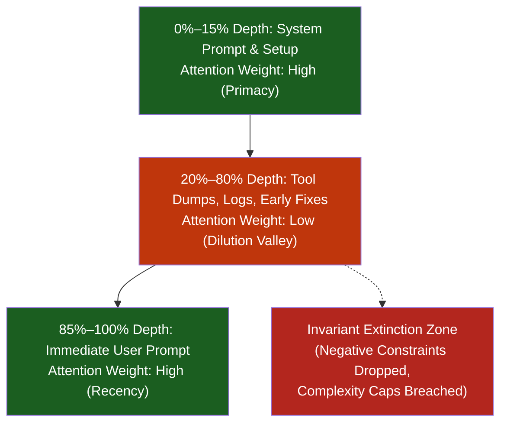
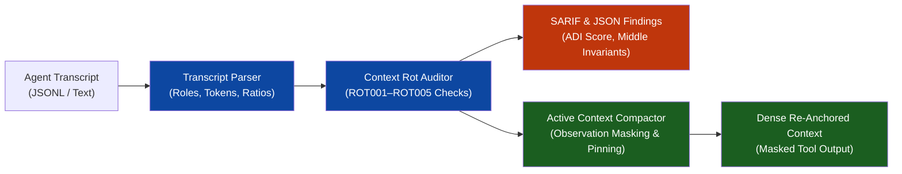

# Observation 23: Attention Dilution, Context Rot & Multi-Scale Compaction

> **Project**: `vibes` — Cognitive Invariants & Long-Horizon Agent Reliability
> **Topic**: Overcoming the "Lost-in-the-Middle" Ceiling: Auditing Attention Dilution, Mitigating Context Rot, and Enforcing Active Invariant Re-Pinning Across Long-Horizon Sessions
> **Key Metric**: `tools/context_rot_auditor.py` flags invariant-bearing messages in the middle of a transcript (`ROT002`), masks long tool output and re-pins the last three invariant messages at the end; no command in this repository measures token reclamation, adherence or Attention Dilution Index (ADI) change on real transcripts.
> **TLDR**: Combat attention dilution and context rot in long multi-turn sessions by compacting tool output and re-pinning invariants near the end of the context.
> **ELI:7b**: Summarize and compress long chat logs as you go so the AI doesn't get brain fog from carrying 50,000 words of chat history.

---

## 1. Executive Context & Baseline

Modern frontier and open-weights models advertise context windows spanning from 128k to over 1M tokens. In commercial marketing and early agent demos, this capacity was celebrated as the end of token budgeting.

However, long-context benchmarks show that **raw context capacity overstates usable capacity**. **RULER** (Hsieh et al., COLM 2024, arXiv 2404.06654) finds effective context lengths well below the claimed ones, and agent benchmarks such as **AgentLongBench** (arXiv 2601.20730), **LOCA-bench** (arXiv 2602.07962) and **LoCoBench-Agent** (arXiv 2511.13998) report falling performance as agent context grows. In long-horizon agentic workloads, agents can fail well before they exceed token limits, because of these interrelated failure modes:
1. **Attention Dilution**: Transformer attention is normalized via softmax ($\sum_{i=1}^N w_i = 1.0$). As the context length $N$ grows, the average weight per token is $1/N$, so unless the attention scores become sharper, the weight on any one instruction can fall. High-signal instructions can be drowned in background noise.
2. **Context Rot & Positional Degradation ("Lost in the Middle")**: Models use information at the start and end of a long input better than information in the middle (Liu et al., "Lost in the Middle", TACL 2024), and their attention shows a matching U-shaped positional bias (Hsieh et al., "Found in the Middle", Findings of ACL 2024). The 20% to 80% "valley" that `ROT002` checks under `--preset strict` is this tool's heuristic, not a boundary taken from those papers.
3. **Observation Bloat**: External command executions, test suite outputs, and git diff dumps rapidly flood context history with low-signal text.

When an agent operates in an append-only conversational loop, critical architectural invariants (such as $M \le 6$, depth $\le 3$, zero RFC 1918 IPs, or negative constraints) established early in the session slide into the middle of the context, where the model can fail to apply them.

To measure, audit, and systematically remediate this phenomenon, we implemented [`tools/context_rot_auditor.py`](../../tools/context_rot_auditor.py).

---

## 2. The Observed Phenomenon

### 2.1 The Lost-in-the-Middle Attention Valley

The diagram shows the expected shape of the risk in a long session ($> 30\text{k}$ tokens). It is a model of the risk, not a measured trace:

An invariant stated only in turn 0 or turn 2 ends up in the middle of the context in a long session, even though its text is still present. This repository has no measurement of how often agents then violate it.

### 2.2 Quantifying Attention Dilution Index (ADI)

To assess the operational degradation risk of an active context, the auditor computes the **Attention Dilution Index (ADI)**:

$$\text{ADI} = \left( \frac{N_{\text{noise}}}{N_{\text{signal}}} \right) \times \left( \frac{N_{\text{total}}}{10{,}000} \right)$$

Where $N_{\text{signal}}$ represents tokens bearing architectural invariants, negative constraints, or core task specifications, and $N_{\text{noise}}$ represents raw command output, compiler logs, and repetitive chatter. ADI is a heuristic: it is not derived from attention weights. The code computes it (`tools/context_rot_auditor.py:572`) but sets no ADI threshold, and no data in this repository calibrates one.

---

## 3. Core Mechanisms of the Context Rot Auditor & Compactor

The [`tools/context_rot_auditor.py`](../../tools/context_rot_auditor.py) utility couples static transcript inspection with active multi-scale compaction:

### 3.1 Detection Rules
- **`ROT001` (Context Depth Exceeded)**: Fires when token depth exceeds calibrated ceilings ($> 32\text{k}$ strict, $> 64\text{k}$ standard), warning that effective retention has degraded.
- **`ROT002` (Lost-in-the-Middle Invariant)**: Identifies invariant-bearing messages positioned between $20\%$ and $80\%$ cumulative token depth without suffix anchor reinforcement.
- **`ROT003` (Observation Bloat)**: Detects individual command or tool outputs consuming $> 15\%$ of the entire context window.
- **`ROT004` (Repetitive Error Chatter)**: Identifies duplicate or near-identical failure tracebacks accumulating without deductive isolation.
- **`ROT005` (Signal-to-Noise Deficit)**: Flags sessions where invariant-bearing tokens account for $< 15\%$ of total content.

### 3.2 Active Multi-Scale Compaction
The `ActiveContextCompactor` implements three mechanical compaction passes:
1. **Observation Masking**: Truncates each tool output of more than 300 estimated tokens and more than 10 lines, keeping the first 3 and last 3 lines and reporting the omitted line count.
2. **Traceback Deduplication**: Suppresses repeated error dumps into short single-line signature hashes.
3. **Anchor Re-Pinning**: Appends a `### 🛡️ ANCHORED INVARIANT ENVELOPE (PINNED)` block at the end of the context that repeats the last three invariant-bearing non-system messages, moving those rules from the middle of the context to its end. Earlier invariant messages are not repeated.

---

## 4. Empirical Evaluation & Telemetry

No evaluation on real agent transcripts exists in this repository, so no token reduction, ADI change or adherence rate is reported here. `tests/test_context_rot_auditor.py` checks rules `ROT002` to `ROT005`, observation masking and re-pinning on small hand-written transcripts (`pytest tests/test_context_rot_auditor.py`: 12 passed).

---

## 5. Architectural Invariants & Production Guidelines

1. **Reject Append-Only Transcript Topologies**: Autonomous agents must never maintain unpruned append-only message histories. Tool outputs exceeding 10 lines must be masked upon turn completion.
2. **Mandatory Suffix Anchor Re-Pinning**: In any session exceeding 5 turns or 10,000 tokens, the orchestrator must dynamically re-pin the active invariant envelope to the immediate prompt suffix.
3. **Continuous ADI Monitoring**: Agent runtimes can track ADI as a health signal. Set a compaction threshold only after measuring ADI against outcomes on real transcripts; this repository has no calibrated value.
4. **Export Telemetry as OASIS SARIF 2.1.0**: Emit schema-valid SARIF reports for CI and PR review integration, surfacing context rot risks before commits are finalized.

