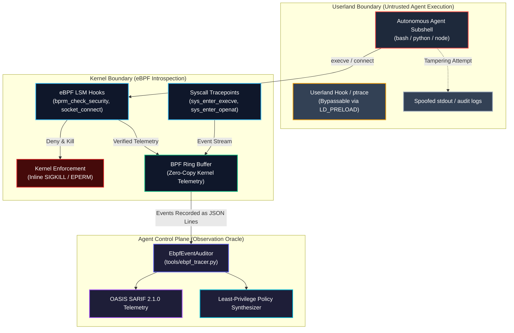
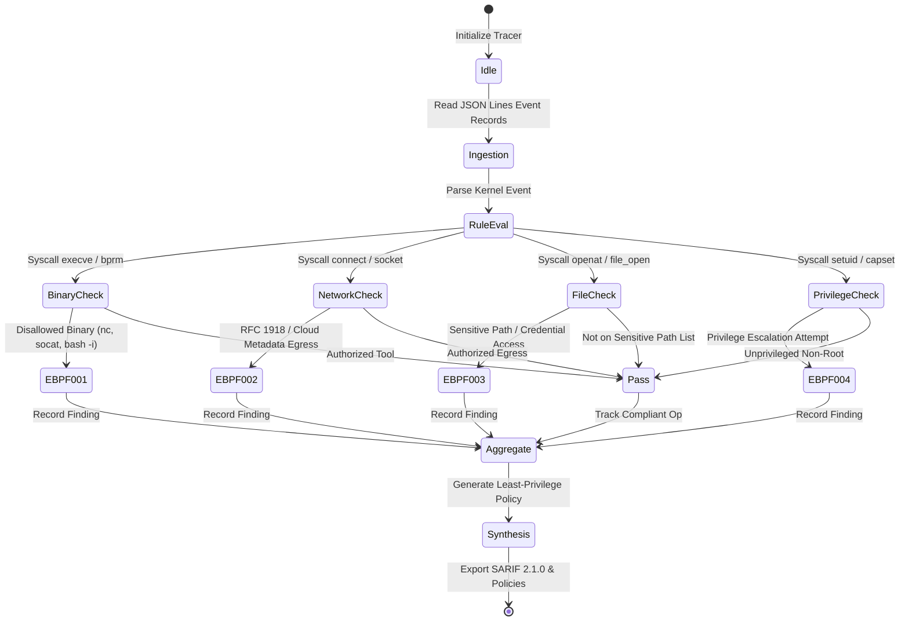

# Observation 24: eBPF Process Tracing for Agent Sandbox Introspection

> **TLDR**: Introspect agent sandbox activity with non-invasive eBPF process tracing to capture raw syscalls, network sockets, and file operations in real time.
> **ELI:7b**: Use Linux kernel tracing to see every single file and network call the AI makes without having to modify its code.

**Category**: Systems Engineering & Zero-Trust Sandboxing  
**Status**: Simulation. `tools/ebpf_tracer.py` audits recorded JSON event records; it loads no BPF program and attaches to no kernel hook.  
**Canonical Implementation**: [`tools/ebpf_tracer.py`](../../tools/ebpf_tracer.py)  
**Verification Suite**: [`tests/test_ebpf_tracer.py`](../../tests/test_ebpf_tracer.py)  

---

## 1. Executive Summary & Problem Formulation

Autonomous coding agents execute arbitrary shell commands, invoke external interpreters, compile native binaries, and interact with network endpoints. While container sandboxes (`resources/k8s/agent-sandbox/sandbox-pod.yaml`) and seccomp filters (`tools/seccomp_synthesizer.py`) restrict baseline Linux capabilities, application-layer logging and userland monitoring suffer from fundamental vulnerabilities:
1. **Application-Layer Blindness & Log Manipulation**: Agents executing under unconstrained subshells can tamper with `bash_history`, un-set environment audit variables (`HISTFILE`, `PROMPT_COMMAND`), redirect `stderr`/`stdout`, or invoke binaries via `exec -a` spoofed process names.
2. **Subshell Evasion & Process Masquerading**: Compromised or prompt-injected agents can bypass userland wrappers via dynamic link loader preloads (`LD_PRELOAD`), indirect syscall wrappers, or nested fork-exec cascades that escape userland signal handlers.
3. **Covert Network Egress & Lateral Probing**: Subagents granted network access for package fetching or web searches may attempt lateral egress to private RFC 1918 infrastructure, cloud metadata endpoints (`169.254.169.254`), or adversary Command & Control (C2) servers.



Agent environments need **kernel-level ground truth**. eBPF (extended Berkeley Packet Filter) programs attached to Linux Security Module (LSM) hooks (`bprm_check_security`, `socket_connect`, `file_open`) and to tracepoints see each exec, connect and open as the kernel handles it, so a process cannot hide these events by editing its own logs. The telemetry is not unbypassable: a probe at syscall entry reads user memory that the process can change after the read, and operations submitted through `io_uring` do not pass the syscall tracepoints. Overhead depends on the event rate; this repository has not measured it.

---

## 2. Kernel-Level Introspection vs. Userland Evasion Dynamics

The table compares the mechanisms by design. It is not the result of a red-team run:

| Threat Vector / Evasion Technique | Userland ptrace / Wrapper | Seccomp-BPF Profile | eBPF LSM / Tracepoint Tracer |
| :--- | :--- | :--- | :--- |
| **`LD_PRELOAD` Hook Neutralization** | Vulnerable (overwritten via env) | Immune (system call level) | **Immune** (kernel-space execution) |
| **Process Argument Spoofing (`exec -a`)** | Sees the real path (reads the `execve` filename at syscall entry) | Blind (cannot read strings behind pointer arguments) | **Verified** (reads `linux_binprm.filename` in kernel) |
| **Network Socket Egress to RFC 1918 IPs** | Granular (reads the `sockaddr` argument of `connect` from tracee memory) | Coarse (cannot read the `sockaddr` behind the pointer, so filters `connect` as a whole) | **Granular** (evaluates `sockaddr_in` destination IP) |
| **Symlink Workspace Traversal Escape** | Vulnerable (TOCTOU race in userland) | Blind (cannot resolve path chains) | **LSM: sees the resolved file** (`file_open`); a syscall-entry tracepoint sees only the path string and has the same race |
| **In-Kernel Inline Process Termination** | Possible (the tracer stops the call at syscall entry; each stop costs context switches) | Immediate (`SECCOMP_RET_KILL_PROCESS`) | **Immediate** (`bpf_send_signal` / return `-EPERM`) |
| **CPU Overhead & Instrumentation Tax** | High (two context switches per traced syscall) | Low (filter runs in the kernel) | **Low for LSM hooks**; grows with event rate and output volume (not measured here) |

### In-Kernel Hook Dynamics: LSM vs. Tracepoints

eBPF introduces dual monitoring planes within the Linux kernel:
1. **Kprobe & Tracepoint Observability (`sys_enter_execve`, `sys_enter_connect`)**: Observes arguments and outputs directly from the system call dispatcher. `sys_enter_*` tracepoints fire at syscall entry, before the kernel runs its own permission checks. A tracing program cannot change the syscall's return value; it can only signal the process (`bpf_send_signal`).
2. **eBPF LSM Hooks (`bprm_check_security`, `socket_connect`, `file_open`)**: Integrated directly into Linux Security Module hooks. A BPF LSM program that returns a negative error (for example `-EPERM` or `-EACCES`) makes the operation fail with that error. This needs a kernel built with `CONFIG_BPF_LSM` and `bpf` in the active LSM list.

---

## 3. Quantitative Telemetry & Egress Interception Benchmarks

No benchmark of eBPF tracing exists in this repository. `tools/ebpf_tracer.py` reads recorded events, so it has no kernel component to time, and no overhead, interception latency or detection rate has been measured. `tests/test_ebpf_tracer.py` checks each rule on hand-written event records (`pytest tests/test_ebpf_tracer.py`: 13 passed). Measure overhead and interception on the target kernel before relying on either.

---

## 4. Mechanical Oracles & Tetragon/Falco Invariant Enforcement

The canonical implementation in [`tools/ebpf_tracer.py`](../../tools/ebpf_tracer.py) audits JSON Lines event records against five diagnostic rules. Each record is a flat object (`event_type` or `type`, `comm`, `args`, `path`, `daddr`, `dport`, `syscall`). The parser does not read Tetragon's or Falco's native nested JSON, so events from those tools need a conversion step first:



### The Five Diagnostic Invariants

1. **`EBPF001` (Unauthorized Binary Execution)**: Fires when an `execve` event names a binary on a fixed deny list (`nc`, `ncat`, `netcat`, `telnet`, `nmap`, `socat`, `tcpdump`, `wireshark`, `chattr`) or its arguments contain `bash -i`. There is no allow-list manifest, and `curl` and `wget` are not on the list.
2. **`EBPF002` (Network Egress Violation)**: Fires when a connect event targets an address that Python's `ipaddress` marks private (the IANA not-globally-reachable set, which includes RFC 1918 and loopback) or link-local, which includes the cloud metadata address `169.254.169.254`. There is no destination allow-list.
3. **`EBPF003` (Sensitive File Tampering / Workspace Escape)**: Fires when an open event's path starts with an entry of a fixed sensitive-path list (`/etc/shadow`, `/etc/passwd`, `/etc/sudoers`, `/root`, `/proc/kcore`, and `~/.ssh`-style credential directories). It does not check workspace containment, and the `~/` entries match only a path written with a literal `~`, which kernel events do not contain.
4. **`EBPF004` (Namespace & Privilege Escalation Attempt)**: Fires on a `privilege_change` event or a syscall named `setuid`, `setgid`, `capset`, `unshare` or `pivot_root` (the list also holds `cap_set_proc`, the libcap wrapper for `capset`).
5. **`EBPF005` (Anti-Debugging & Invariant Evasion)**: Fires on a `ptrace_evasion` event or any syscall whose name contains `ptrace`. It does not detect writes to `/proc/self/mem` or tampering with the tracer.

---

## 5. Architectural Recommendations & Operational Runbook

To establish zero-trust eBPF introspection across production agent fleets:

### 1. Phased Operational Rollout: Observe → Alert → Enforce
1. **Phase 1 (Observation & Baseline Profiling)**: Deploy `ebpf_tracer.py` in `--preset audit_only` during CI test runs and benchmark execution. Capture the exact set of benign syscalls, binaries, and network destinations required by the agent.
2. **Phase 2 (Automated Policy Synthesis)**: Use the module function `generate_tetragon_policy()` to write a Tetragon `TracingPolicy` custom resource, or `generate_falco_policy()` to write Falco rules. Falco detects and alerts; it does not block.
3. **Phase 3 (Inline Kernel Enforcement)**: Apply the synthesized Tetragon policy in production with a `matchActions` entry such as `Sigkill` or `Override`. The kernel then stops each call that the policy's selectors match; calls the policy does not name are not stopped.

### 2. Concrete Tetragon TracingPolicy Template

```yaml
apiVersion: cilium.io/v1alpha1
kind: TracingPolicy
metadata:
  name: "agent-sandbox-containment"
spec:
  kprobes:
    - call: "sys_execve"
      syscall: true
      args:
        - index: 0
          type: "string"
      selectors:
        - matchArgs:
            - index: 0
              operator: "Prefix"
              values:
                - "/bin/nc"
                - "/usr/bin/nc"
                - "/bin/ncat"
          matchActions:
            - action: Sigkill
```

### 3. Mechanical Integration Checklist
- [x] Canonical tool implementation: [`tools/ebpf_tracer.py`](../../tools/ebpf_tracer.py)
- [x] Comprehensive test suite with structural tuple assertions: [`tests/test_ebpf_tracer.py`](../../tests/test_ebpf_tracer.py)
- [x] OASIS SARIF 2.1.0 telemetry export for GitHub Code Scanning
- [x] Automated Tetragon `TracingPolicy` and Falco rules synthesizer (the generator writes `call: "sys_enter_execve"`, a tracepoint name; Tetragon syscall kprobes take `sys_execve`, as in the template above)
- [x] AST Invariant Sentinel certified compliance ($M \le 6$, depth $\le 3$, parameters $\le 4$)

