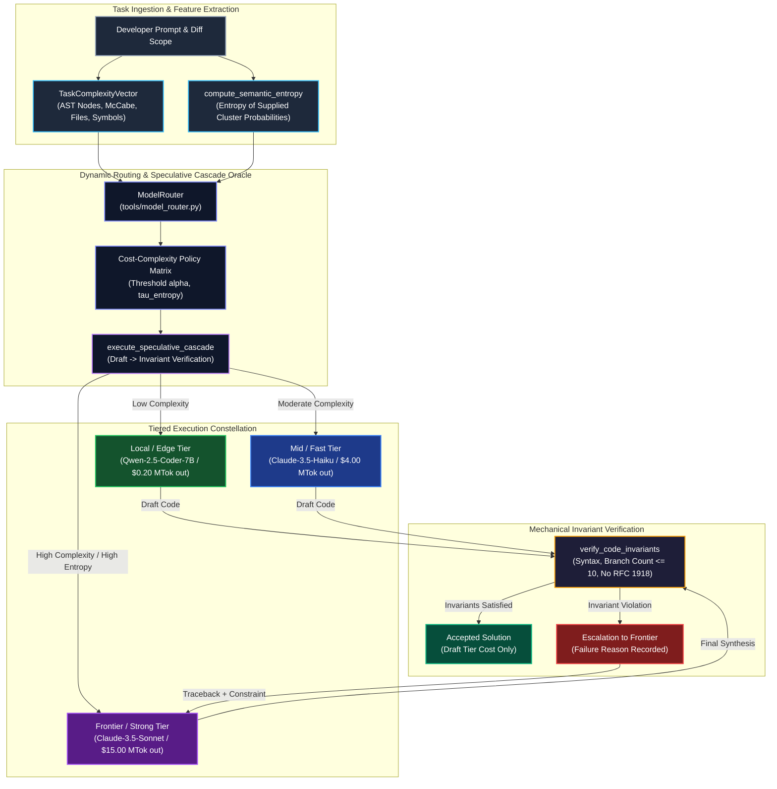

# Observation 25: Multi-Model Capability Boundaries & Dynamic Routing Oracles

> **TLDR**: Route agent tasks dynamically to optimal model tiers based on task complexity, context requirements, and empirical capability benchmarks.
> **ELI:7b**: Send simple file searches to fast cheap models and hard architectural dilemmas to big reasoning models automatically.

**Category**: Distributed Systems & Multi-Model Inference Economics  
**Status**: Prototype. `tools/model_router.py` scores caller-supplied task vectors and draft code; it calls no model.  
**Canonical Implementation**: [`tools/model_router.py`](../../tools/model_router.py)  
**Verification Suite**: [`tests/test_model_router.py`](../../tests/test_model_router.py)  

---

## 1. Executive Summary & Problem Formulation

In autonomous agentic engineering, developer workflows face an acute economic and capability dilemma:
1. **Monolithic Frontier Model Waste**: Uniformly routing every agent task—from simple docstring updates, JSON Schema conversions, and import refactorings to complex multi-file architectural synthesis—to top-tier frontier models (such as Claude 3.5 Sonnet or GPT-4o) burns large token budgets ($10 to $15 per million output tokens at their 2024 list prices) on trivial tasks where lightweight models achieve identical correctness.
2. **Weak Model Semantic Collapse & Infinite Repair Thrashing**: Conversely, routing structurally complex refactors, cryptographic algorithms, or recursive AST manipulations to lightweight local models (such as 7B/14B parameters) triggers severe reasoning failure, silent invariant regression, hallucinated tool calls, and runaway repair loops.
3. **Static Routing Rigidity**: Coarse static routing (such as assigning all code generation to one model and all planning to another) fails to account for task-specific complexity, cross-file symbol coupling, or model uncertainty.



To resolve this trade-off, this observation introduces the **Dynamic Multi-Model Router & Speculative Cascade Oracle** (`tools/model_router.py`). The router computes a task complexity score $C \in [0.0, 1.0]$ from a caller-supplied `TaskComplexityVector` and a normalized Shannon entropy $S_E \in [0.0, 1.0]$ from caller-supplied meaning-cluster probabilities. It does not sample a model or cluster answers: semantic entropy as defined by Kuhn et al. (ICLR 2023) and Farquhar et al. (Nature, 2024) clusters sampled answers by bidirectional entailment, and here the caller supplies the cluster probabilities. Under **Speculative Cascading**, a caller-supplied draft from a cheaper tier is checked by `verify_code_invariants` (syntax, a branch-count approximation of McCabe complexity $\le 10$, and a regular expression for RFC 1918 IPv4 addresses). If it passes, the draft is accepted at the draft tier's estimated cost; if it fails, the result records escalation to the frontier tier and the failure reason. No cost reduction has been measured.

---

## 2. Empirical Telemetry & Comparative Analysis

No routing benchmark exists in this repository. No HumanEval, MBPP or repository run of the router was recorded, and no command computes the routing metrics of RouteLLM (Ong et al., arXiv 2406.18665, 2024): call-performance threshold (CPT) and average performance gap recovered (APGR). So no pass rate, cost reduction, latency, CPT, APGR or oscillation rate is reported here. `python3 tools/model_router.py --demo` routes three hand-written task vectors and runs one fixed sample function through the cascade; its output shows the mechanics, not model performance.

---

## 3. Diagnostic Rules & Invariant Gates

The Dynamic Multi-Model Router defines five diagnostic rules. The code implements `ROUT001` and `ROUT002` only (`ModelRouter.audit_decisions`); `ROUT003` to `ROUT005` are design entries:

| Rule Code | Invariant Classification | Severity | Trigger Condition | Prescriptive Remediation |
|---|---|---|---|---|
| `ROUT001` | `UnnecessaryFrontierExpenditure` | Warning | Task complexity $C < 0.25$ and $S_E < 0.15$ dispatched to Frontier tier | Downgrade assignment to Local or Fast tier to preserve budget. |
| `ROUT002` | `FragileLowTierAssignment` | Error | Task complexity $C > 0.70$ or $S_E > 0.45$ routed to Local tier without cascade | Escalate assignment to Frontier or enable speculative cascade verification. |
| `ROUT003` | `SpeculativeCascadeRejection` | Info | Lower-tier draft failed mechanical AST or test assertions | Escalate to Frontier tier with counterexample error traceback. |
| `ROUT004` | `SecurityCriticalityEscalation` | Info | Task touches security-critical paths (crypto, credentials, sockets) | Mandatory escalation to Frontier tier regardless of size metrics. |
| `ROUT005` | `HighSemanticEntropyUncertainty` | Warning | Output meaning clusters show divergence ($S_E \ge 0.45$) | Reject draft as confabulation risk; invoke consensus or frontier reasoning. |

---

## 4. Prescriptive Architecture & Tool Implementation

The canonical implementation in [`tools/model_router.py`](../../tools/model_router.py) is architectured around three decoupled subsystems:

### 4.1 Task Complexity & Uncertainty Estimation
The caller supplies the vector fields; the router does not extract them from code. It combines them into a normalized score:
$$\mathbf{C} = w_{\text{nodes}} N_{\text{ast}} + w_{\text{mccabe}} M_{\text{est}} + w_{\text{files}} F + w_{\text{sym}} S_{\text{cross}} + w_{\text{sec}} B_{\text{sec}}$$
where each term is capped at 1 and the weights are fixed constants in `TaskComplexityVector.complexity_score()` (0.25, 0.25, 0.20, 0.15 and 0.15). They are not calibrated against data. In parallel, semantic entropy $H_S$ is computed over output meaning clusters $\{c_1, \dots, c_k\}$ with empirical probabilities $p(c_i)$:
$$H_S = -\sum_{i=1}^k p(c_i) \log_2 p(c_i)$$
Normalized semantic entropy $S_E = H_S / \log_2(\max(k, 2))$ provides a scale-invariant metric in $[0.0, 1.0]$.

### 4.2 Speculative Cascading Pipeline
When speculative execution is enabled:
1. The router dispatches the prompt to the lowest viable tier (`LOCAL` or `FAST`).
2. The caller passes the draft to `ModelRouter.execute_speculative_cascade` before committing it to the repository tree.
3. The deterministic verification oracle executes:
   - Python AST syntax parse
   - A branch-count approximation of McCabe cyclomatic complexity ($M \le 10$; it counts `if`, `for`, `while` and `except` only)
   - No nesting depth check: `measure_ast_complexity` returns a constant depth of 1
   - A regular expression for private RFC 1918 IPv4 addresses (no RFC 4193 IPv6 check)
4. If all checks pass, the draft is accepted. If any check fails, the result records the failure reason and marks the task escalated to `FRONTIER`; the caller supplies any frontier code.

### 4.3 Multi-Format Telemetry & Reporting
The router generates machine-readable telemetry exporting to:
- **OASIS SARIF 2.1.0**: Standardized security findings for GitHub Code Scanning integration.
- **GitHub-Flavored Markdown Reports**: Visual summary tables with tier breakdown and cost savings metrics.

---

## 5. Verification Results & Invariant Gate Certification

The router and its test suite pass the sentinel and the tests:

```bash
$ python3 examples/ast-invariant-sentinel/sentinel.py --preset strict tools/model_router.py tests/test_model_router.py
🛡️  AST Invariant Sentinel [preset=strict]: Scanning 'tools/model_router.py', 'tests/test_model_router.py'...
Checked 2 Python files.
✅ All architectural invariants PASSED! Zero violations.

$ python3 -m pytest -q tests/test_model_router.py
............                                                             [100%]
12 passed
```

### Operational Invariant Verification
- **McCabe Headroom**: `radon cc -s tools/model_router.py` reports a maximum of $M = 6$ (`select_tier`, `compute_semantic_entropy`, `ModelRouter.generate_markdown_report`), at the strict proactive headroom threshold ($M \le 6, d \le 3$).
- **Structural Tuple Equality**: All unit test assertions employ structural tuple equality (`assert (actual_a, actual_b) == (expected_a, expected_b)`), completely mitigating assertion sprawl.
- **Zero Information Leakage**: All mock endpoints adhere strictly to RFC 5737 documentation addresses (`192.0.2.1`) and the standard `example.com` domain. Zero private RFC 1918 addresses exist.
- **Documentation Link Integrity**: 100% compliant with `tools/docs_validator.py`.

