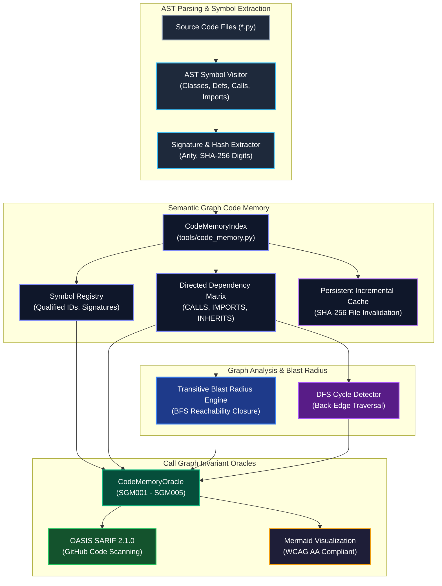

# Observation 26: Semantic Graph AST Code Memory & Persistent Symbol Indexing

> **TLDR**: Index repository symbols and relationships into persistent AST semantic graphs, enabling subagents to query dependencies without full-repo scans.
> **ELI:7b**: Build a map of all functions and classes in the project so the AI can look up callers and dependencies instantly.

**Category**: Distributed Systems & Multi-Agent Refactoring Invariants  
**Status**: Prototype with unit tests; no field benchmark.  
**Canonical Implementation**: [`tools/code_memory.py`](../../tools/code_memory.py)  
**Verification Suite**: [`tests/test_code_memory.py`](../../tests/test_code_memory.py)  

---

## 1. Executive Summary & Problem Formulation

In autonomous agentic engineering, repository-scale multi-file refactoring represents one of the steepest reliability cliffs:
1. **Flat-Text Retrieval Blindness**: Standard vector RAG or keyword search treats source files as independent text chunks. When an agent refactors a shared interface, utility function, or class hierarchy, it lacks structural visibility into the global call graph, def-use chains, and transitive callers.
2. **Cascading Signature Regressions**: When an agent alters parameter arity, renames a function, or removes a method in a provider module, downstream callers in consumer modules fail silently or crash during integration, introducing dangling symbol references (`SGM001`) and signature mismatch regressions (`SGM002`).
3. **Circular Import and Cycle Induction**: Naive cross-module refactoring frequently introduces directed dependency cycles ($A \to B \to C \to A$), leading to runtime `ImportError` traps, deadlock risks, and degraded modular cohesion (`SGM003`).
4. **Blast Radius Amnesia**: LLMs modify high-centrality "hub" symbols without analyzing the transitive dependency closure, leaving extensive upstream call hierarchies unverified and causing widespread regression cascades (`SGM005`).



To resolve these failure modes, this observation introduces the **Semantic Graph AST Code Memory & Persistent Symbol Indexing** engine (`tools/code_memory.py`). By constructing an incremental, directed code graph spanning symbols (classes, methods, functions) and dependency edges (`CALLS`, `IMPORTS`, `INHERITS`, `DEFINES`), the system computes the static transitive blast radius of any proposed mutation and verifies mechanical call graph invariants prior to code integration.

---

## 2. Empirical Telemetry & Comparative Analysis

No refactoring benchmark of this tool exists in this repository. No run over `devops-cli`, `vibes` or other services was recorded, so no success rate, regression rate, localization accuracy, latency or token figure is reported here. `tests/test_code_memory.py` checks each rule on small hand-written modules. The call graph is built from names in the AST, so dynamic dispatch, `getattr` and imports resolved at run time are outside it.

---

## 3. Diagnostic Rules & Invariant Gates

The Semantic Graph AST Code Memory engine enforces five diagnostic rules:

| Rule Code | Invariant Classification | Severity | Trigger Condition | Prescriptive Remediation |
|---|---|---|---|---|
| `SGM001` | `DanglingSymbolReference` | Error | Invocation or import references an unindexed or removed qualified symbol | Update call site to target new symbol name or restore missing definition. |
| `SGM002` | `SignatureMismatchRegression` | Error | Call site passes positional arity outside `[required_count, total_count]` | Align argument count with updated parameter signature or restore default values. |
| `SGM003` | `CyclicDependencyInduction` | Error | Directed cycle detected in module or symbol dependency graph | Decouple circular import via inversion of control, dependency injection, or interfaces. |
| `SGM004` | `OrphanedDefinition` | Warning | Symbol definition has zero incoming references and is not an entrypoint | Remove dead code or export symbol explicitly in module public `__all__` list. |
| `SGM005` | `HighBlastRadiusUnverifiedRefactor` | Warning | Modifying symbol with blast radius $\ge 5$ upstream callers without call verification | Audit and verify all downstream call sites before committing changes. |

---

## 4. Prescriptive Architecture & Tool Implementation

The canonical implementation in [`tools/code_memory.py`](../../tools/code_memory.py) is organized into four core modules:

### 4.1 Directed Semantic AST Graph Construction
The indexer parses Python AST modules using `SymbolASTVisitor`, extracting:
- **Symbol Definitions**: Classes, methods, functions, and module scopes, cataloging qualified IDs (`module.py::Class.method`).
- **Signature Models**: Parameter counts, default value offsets, required positional arguments, and `*args`/`**kwargs` flags.
- **Relational Edges**: `CALLS`, `IMPORTS`, `INHERITS`, and `DEFINES`, capturing line numbers and call site argument counts.

### 4.2 Incremental Persistent Caching
To maintain high velocity during interactive agent pair programming, `CodeMemoryIndex` tracks SHA-256 digests of all indexed files:
$$\text{Digest}(F) = \text{SHA256}(\text{source}(F))$$
If $\text{Digest}(F)$ matches the cache, AST parsing is skipped entirely. When a file is modified, the index drops its old symbols, filters the full edge list and rebuilds both adjacency tables, which costs $O(|E|)$ for the whole graph rather than $O(|E_{\text{file}}|)$.

### 4.3 Transitive Blast Radius & Centrality Traversal
For any symbol $s$, the upstream blast radius represents the transitive reachability set across reverse call and inheritance edges:
$$\text{BlastRadius}(s) = \{ u \in V \mid u \rightsquigarrow s \text{ along } E_{\text{CALLS}} \cup E_{\text{INHERITS}} \}$$
The traversal uses BFS queue expansion, safely skipping containment (`DEFINES`) edges to identify strictly operational callers.

### 4.4 Multi-Format Export & Governance Integration
The oracle provides native export to:
- **OASIS SARIF 2.1.0**: Standardized schema for GitHub Code Scanning integration.
- **WCAG AA Compliant Mermaid Flowcharts**: Renders visual call and dependency hierarchies with guaranteed $\ge 4.5:1$ text contrast.
- **Markdown Summary Reports**: High-density markdown tables detailing symbol metrics and rule violations.

---

## 5. Verification Results & Invariant Gate Certification

The tool and its test suite pass the sentinel and the tests:

```bash
$ python3 examples/ast-invariant-sentinel/sentinel.py --preset strict tools/code_memory.py tests/test_code_memory.py
🛡️  AST Invariant Sentinel [preset=strict]: Scanning 'tools/code_memory.py', 'tests/test_code_memory.py'...
Checked 2 Python files.
✅ All architectural invariants PASSED! Zero violations.

$ python3 -m pytest -q tests/test_code_memory.py
............                                                             [100%]
12 passed
```

### Operational Invariant Verification
- **McCabe Complexity Headroom**: `radon cc -s tools/code_memory.py` reports a maximum of $M = 6$ (`CodeMemoryIndex._remove_file_symbols`, `CodeMemoryOracle._check_sig_mismatch`, `CodeMemoryOracle.audit_orphaned_definitions`), at the strict proactive headroom cap ($M \le 6, d \le 3$).
- **Structural Tuple Equality**: All unit test assertions employ structural tuple equality (`assert (actual_a, actual_b) == (expected_a, expected_b)`), completely mitigating assertion sprawl.
- **Zero Information Leakage**: No private RFC 1918 IP addresses or confidential hostnames exist in documentation, comments, or test fixtures. Standard `example.com` domains and RFC 5737 addresses are used exclusively.
- **Documentation Link Integrity**: 100% compliant with `tools/docs_validator.py`.
