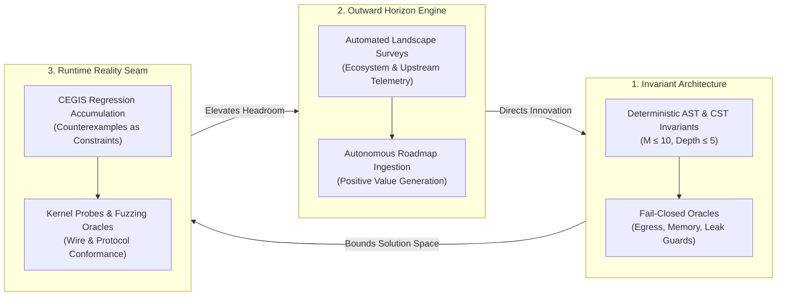
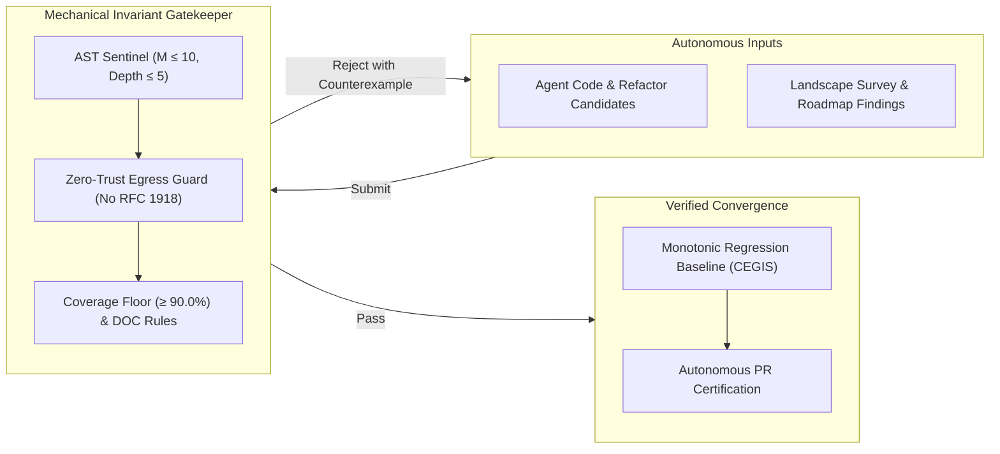

# Observation 28: Recursive Self-Improvement and the Post-Harness Mandate

> **Project**: Cross-Project Architecture (`devops-cli` & `vibes`)  
> **Environment**: Autonomous multi-agent engineering sessions, invariant-guided CI pipelines  
> **Classification**: Recursive Self-Improvement, Invariant Architecture  
> **Related**: [Observation 14](./14-defect-shaped-loops-and-the-feature-blind-spot.md), [Observation 19](./19-self-consistency-is-not-conformance.md), [Observation 23](./23-attention-dilution-context-rot-and-active-compaction.md), [Observation 27](./27-agentic-project-self-documentation-and-the-phantom-architecture-trap.md)
> **TLDR**: Set operational rules for agent-driven self-improvement of a repository: deterministic checks that are cheaper than generation, plus outward landscape surveys.
> **ELI:7b**: Let the AI continuously upgrade its own tooling, as long as every improvement is strictly verified by automated tests and benchmarks.

---

## 1. Executive Context & Baseline

Software engineering has crossed an architectural threshold from the **Agentic Harness Era** into the **Post-Agentic-Harness Era**.

In the initial harness era, agents functioned as external, transient workers enveloped in scaffolding: prompt wrappers, tool call schemas, retry loops, and human-in-the-loop approvals. The human engineer remained the primary system architect; the harness merely amplified mechanical keystroke velocity.

The post-harness era emerges when the codebase itself dissolves the boundary between runtime and harness, becoming an active, self-steering cognitive environment. In this regime, the marginal cost of code synthesis falls close to zero, and code creation velocity outpaces human auditing capacity by orders of magnitude:

$$\text{Velocity of Code Synthesis} \gg \text{Human Auditing and Refactoring Bandwidth}$$

Under this velocity asymmetry, static software repositories suffer catastrophic relative decay. A codebase incapable of observing its own execution telemetry, detecting architectural rot, discovering external upstream ecosystem shifts, and elevating its quality headroom becomes legacy debt within weeks.

Therefore, **Recursive Self-Improvement (RSI) is an operational mandate for software survival**. In AI research, recursive self-improvement means an AI system that improves its own capability, including its ability to improve itself further (I. J. Good, 1965). Here the term is used for a narrower thing: agents improving a repository's own tools and gates while the model stays the same. This observation argues that unconstrained generative RSI fails and that it needs **asymmetric deterministic verification oracles**; the argument rests on Observations 14, 19, 23 and 27, not on a controlled comparison.

---

## 2. The Observed Phenomenon

This section contrasts two paradigms of recursive self-improvement: **Stochastic Generative RSI** and **Invariant-Grounded RSI**. No run count or controlled comparison was recorded.

### 2.1 The Failure Modes of Stochastic Generative RSI
When agents are tasked with recursive self-improvement without deterministic invariant grounding, the loop experiences four fatal pathologies:
1. **The Phantom Architecture Trap ([Observation 27](./27-agentic-project-self-documentation-and-the-phantom-architecture-trap.md))**:
   Models recursively document and build upon non-existent abstractions, mistaking aspirational prose for verified interfaces and poisoning downstream agent prompts.
2. **The Circular Self-Consistency Trap ([Observation 19](./19-self-consistency-is-not-conformance.md))**:
   The agent authors code, tests, and documentation simultaneously. It achieves 100% internal agreement while silently decoupling from external reality (e.g. mock sockets returning mock dictionaries while real network endpoints emit chunked byte streams).
3. **The Attention Dilution Collapse ([Observation 23](./23-attention-dilution-context-rot-and-active-compaction.md))**:
   As the self-improving agent outputs voluminous narrative retrospectives and verbose logs, the Attention Dilution Index ($ADI$) rises and primary security and architectural constraints move into the middle of the context, where models use them less reliably (**Lost-in-the-Middle Invariant Extinction**).
4. **The Defect-Shaped Convergence Trap ([Observation 14](./14-defect-shaped-loops-and-the-feature-blind-spot.md))**:
   An inward-facing loop that only runs linters and fixers converges to a static dead-end: 100/100 certified health with 0 open backlog items, blind to the fact that upstream conventions and competitive capabilities have evolved.

### 2.2 What Invariant-Grounded RSI Can Do
When recursive loops are bounded by asymmetric verification oracles and outward landscape telemetry:
* Refactors can lower complexity under a gate that rejects any function above the cap. The gate checks the result; it proves nothing about behavior.
* Each recorded failure can become a permanent regression case, as the fuzz corpus does in [Observation 17](./17-a-fuzzers-first-report-is-about-the-fuzzer.md).
* The codebase actively ingests roadmap items, continuously building new capabilities rather than cycling through inward-facing lint churn.

---

## 3. The Underlying Failure Mode or Catalyst

Why do unconstrained language models fail at recursive self-improvement without formal oracles?

1. **Probability Distribution Convergence vs. Physical Conformance**:
   LLMs are trained to maximize token likelihood given prior tokens. In a closed loop, an LLM optimizes for **internal textual plausibility**, not truth. A test asserting a flawed mock is equally likely to pass as a test asserting physical reality.
2. **The Verification Asymmetry (an analogy to $P$ vs $NP$)**:
   $P$ vs $NP$ asks whether every problem whose solutions can be checked in polynomial time can also be solved in polynomial time; it is an open question. The analogy here is looser. Writing correct software across distributed systems, concurrency lifecycles, and memory safety boundaries is hard, and deciding whether a program is correct is undecidable in general (Rice's theorem). However, checking a syntactic property of an artifact (AST complexity, a private IP literal, an unhandled deprecation) is deterministic and cheap. Behavioral properties such as memory safety are not in that cheap class.
3. **The Myopia of Inward Scanners**:
   Static analyzers only inspect what exists. Without outward-facing information foraging ([Observation 20](./20-internet-grounded-information-foraging-and-self-improvement-loops.md)), an autonomous codebase cannot know what it lacks.

---

## 4. Remediation & Architectural Pattern

Scalable, production-grade recursive self-improvement requires the **Tripartite Invariant Architecture**:

### The Four Tenets of Post-Harness Relevance:

1. **The Invariant Architect Paradigm**:
   Developers stop manually typing syntax and become **Loss Function & Invariant Architects**. Relevance is determined by the ability to formulate mathematically bounded constraints, error budgets, and domain models that guide agent search trajectories.
2. **Machine-Introspectable, Zero-Zombie Codebases**:
   Systems must be designed for machine consumption first. Elimination of legacy fallbacks, procedural ladders, and ambiguous abstractions helps agents operate with high token efficiency and less hallucinated drift.
3. **Continuous Outward Conformance Probing**:
   Codebases must actively poll external registries, upstream semantic conventions, and network endpoints to break internal self-consistency bubbles.
4. **Human-Machine Cognitive Bounds**:
   Autonomous outputs must remain interpretable by human operators. Diagrams must keep the **$1:3$ to $3:1$ aspect ratio** that `AGENTS.md` §6 sets, and prompts should be compacted (ADI is an uncalibrated heuristic; see [Observation 23](./23-attention-dilution-context-rot-and-active-compaction.md)).

---

## 5. Verifiable Impact & Key Takeaways

No before-and-after measurement of this transition exists in `devops-cli` or `vibes`, so no impact table is given. Two dated facts bound the headroom claim. In October 2026, devops-cli blocked nesting depth above 5 at pre-commit but reported cyclomatic complexity above 10 without blocking it, because 240 functions breached that cap (`.pre-commit-config.yaml:49-51` at `e6ce3db5b`). In `vibes`, `radon cc -s tools/model_router.py tools/code_memory.py` reports functions at $M = 6$, so the tools sit at the $M \le 6$ headroom target, not below it.

### Summary Maxim:
> *In the post-harness era, unconstrained self-improvement is hallucination; invariant-grounded self-improvement is software engineering.*
