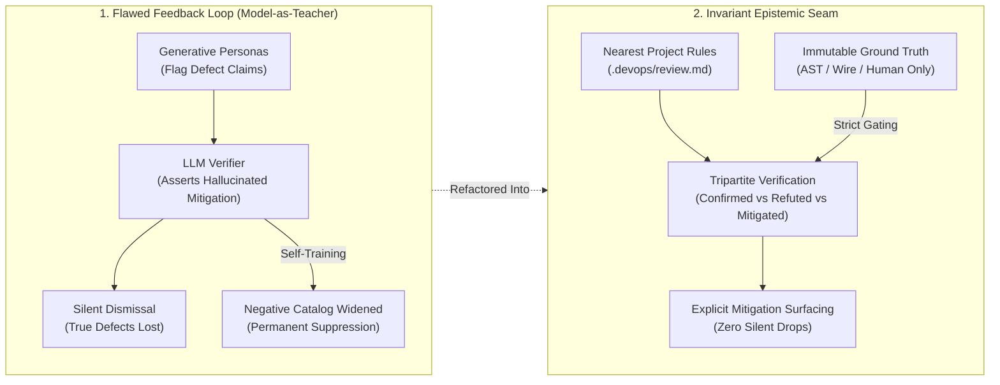
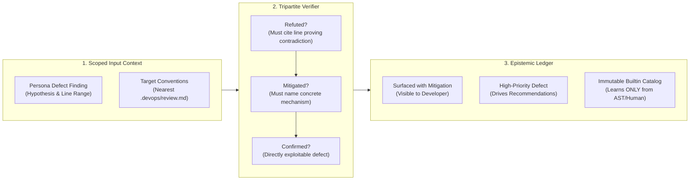

# Observation 29: Epistemic Drift and the Unreliable Teacher in Autonomous Verification

> **Project**: Multi-Agent Review Pipelines (`devops-cli` & `vibes`)
> **Environment**: Autonomous persona review pipelines, deterministic verification oracles, continuous learning catalogs
> **Classification**: Epistemic Drift, Verification Oracles, Multi-Agent Alignment, Defect Suppression
> **Related**: [Observation 14](./14-defect-shaped-loops-and-the-feature-blind-spot.md), [Observation 19](./19-self-consistency-is-not-conformance.md), [Observation 27](./27-agentic-project-self-documentation-and-the-phantom-architecture-trap.md), [Observation 28](./28-recursive-self-improvement-and-the-post-harness-mandate.md)
> **TLDR**: Resolve mitigation-refutation conflation and catalog contamination in autonomous verification via tripartite epistemic separation.
> **ELI:7b**: Keep the reviewer, the tester, and the fixer completely separate so the AI never mistakes a temporary workaround for a real bug fix.

---

## 1. Executive Context & Baseline

In autonomous software development, multi-agent review and verification harnesses serve as the primary defensive barrier against synthetically generated regressions. In this architecture, generator personas (e.g., Security, Architecture, Performance, QA) identify potential defects, while an independent downstream verifier persona or deterministic engine validates the findings prior to human escalation or automated remediation.

The stability of this verification seam relies on an axiomatic assumption:

$$\text{Verifier Feedback} \to \text{Strict Epistemic Convergence towards Ground Truth}$$

The `devops-cli` audit of its review pipeline (#509) and its fixes (#514, #515, #523, #524, #525), run against a synthetic corpus with 10 injected defects (#415), showed that this assumption collapses under three compounding failure modes:
1. **Mitigation-Refutation Conflation**: The verifier confirms a real defect, invents or asserts a mitigation rationale, and classifies the verdict as "Refuted" — silently deleting genuine defects from developer visibility.
2. **Evaluator Parochialism (Convention Infiltration)**: The verifier evaluates heterogeneous external repositories against the host tool's own parochial conventions (e.g., Python 3.14 runtime requirements, strict typing flags, internal console exemptions), manufacturing false negatives and noisy invalidations.
3. **The Unreliable Teacher Trap**: The anti-hallucination catalog — designed to filter recurring model false positives — learned from LLM invalidations and weak deterministic checks, and never forgot an entry. The model under test taught the filter catalog, so real defects could be suppressed on later runs.

---

## 2. The Observed Phenomenon

During the #509 audit of the orchestrated multi-agent review pipeline, run against the #415 synthetic corpus (10 injected defects):

### 2.1 The Invisible Suppression of Verified Defects
In one run the verifier invalidated 39 findings. After the verifier was made to separate refutation from mitigation, invalidations fell to 16 and 16 findings were reported as mitigated with the reason shown (devops-cli #525). The dismissals included **defects that the verifier confirmed and then dismissed**:
- In a path traversal finding, the verifier confirmed that target paths were not bounded after `resolve()`, but dismissed the finding with the verdict: *"Refuted: symlink rejection already blocks directory escape."* In reality, symlink rejection does not impede relative `../` directory climbing.
- In a recursion depth vulnerability, the verifier confirmed unbound recursion, but dismissed it with: *"Refuted: `load_policy` includes a depth check using the `_depth` parameter."* In reality, the `_depth` check was the exact check the corpus had removed.

Because the verification engine only admitted binary states (`Confirmed` vs `Refuted`), any defect possessing a plausible mitigation was marked `Refuted` and stripped from the report.

### 2.2 Negative Catalog Self-Contamination
To reduce token spend and duplicate reviews, the system maintained a persistent common hallucinations catalog. The catalog was wired to record LLM invalidations, and evaluation replays from `prompt_eval`, as new suppression entries (devops-cli #514).
- A builtin CWE-400 entry (uncontrolled resource consumption via oversized file reads), together with weak ground truth, invalidated a real attacker-controlled `read_text` out of the box.
- Findings that matched catalog entries were filtered at the deterministic pre-pass layer before any human or persona could inspect them.
- An invalidation that scored 0.5 or more against a builtin entry added up to 30 of the finding's words to that entry's keywords and persisted a copy that shadowed the shipped entry.

### 2.3 Parochial Convention Infiltration
The verifier was hardcoded with `devops-cli` specific rules:
- Assuming `mypy --strict` compliance across untyped third-party libraries.
- Disallowing RFC 1918 IP addresses in markdown documentation across repositories that specifically documented private network topologies.
- Applying a Python 3.14 syntax rule to all code, whatever Python version the project targets.

---

## 3. The Underlying Failure Mode or Catalyst

The root cause of this breakdown is **epistemic circularity in multi-agent governance**:

1. **Conflating Invalidation with Mitigation**:
   - **Refutation** is an ontological claim: *The reported defect does not exist in the code* (the cited lines contradict the defect hypothesis).
   - **Mitigation** is an operational claim: *The defect exists, but contextual constraints reduce its exploitability or impact*.
   - When a verifier conflates these concepts, it converts speculative context into proof of absence.
2. **The Unreliable Teacher Phenomenon**:
   - A model cannot reliably act as its own ground-truth oracle without an external, deterministic verification baseline.
   - Allowing stochastic model verdicts to mutate negative filtering catalogs creates a self-reinforcing (positive) feedback loop that adds false negatives over time.
3. **Parochial Context Bleed**:
   - Review engines that do not decouple host application standards from target project specifications suffer evaluation bias, measuring foreign architectures against irrelevant internal invariants.

---

## 4. Remediation & Architectural Pattern

The fixes in devops-cli #523, #524 and #525 establish the **Tripartite Verification and Epistemic Seam Pattern**:

### Core Invariants:

1. **The Tripartite Verdict Architecture**:
   - `Confirmed`: The defect is present and actionable. Drives triage priority.
   - `Refuted`: The cited code directly contradicts the claim. Requires an explicit contradicting line citation; absent citations leave the finding `Unverified`.
   - `Mitigated`: The defect exists, but a named mechanism constrains its severity. **Mitigated findings are never dropped**; they are surfaced in the final report with the mitigation explicitly detailed.
2. **The Epistemic Seam (Immutable Builtin Catalogs)**:
   - Builtin false-positive catalogs are read-only and immutable at runtime.
   - Autonomous learning from LLM verdicts is strictly forbidden. The catalog may only record new entries through deterministic AST invariants or explicit human verification (`devops review verify`).
   - Replay test fixtures (`prompt_eval`) execute with catalog learning disabled.
3. **Nearest-Root Convention Scoping**:
   - Universal evaluators contain zero host-specific house rules.
   - Project conventions are resolved hierarchically from the target file upward to the repository root (`.devops/review.md`).

---

## 5. Verifiable Impact & Key Takeaways

The live checks recorded in devops-cli #524 and #525 (one run each on the #415 corpus) show these changes:

| Metric | Before | After |
|---|---|---|
| **Verifier invalidations** | 39 | 16 (#525) |
| **Findings reported as mitigated, with the reason shown** | 0 | 16 (#525) |
| **Injected defects still reported** | 6 of 10 | 6 of 10 (#524, #525) |
| **Builtin catalog entries changed at runtime** | Yes: widened and shadowed | No; ledger copies of builtin ids are ignored at load (#523) |
| **Project rules in shared prompts** | devops-cli house rules applied to every target | Moved to `.devops/review.md`, read from the nearest one (#524, #525) |

A wrong mitigation is now visible rather than caught: the `_depth` example above is reported as mitigated with its false reason shown.

### Summary Maxim:
> *A verifier that drops mitigated defects is an engine for burying risk. True verification refutes with citations, mitigates with mechanisms, and learns only from ground truth.*

