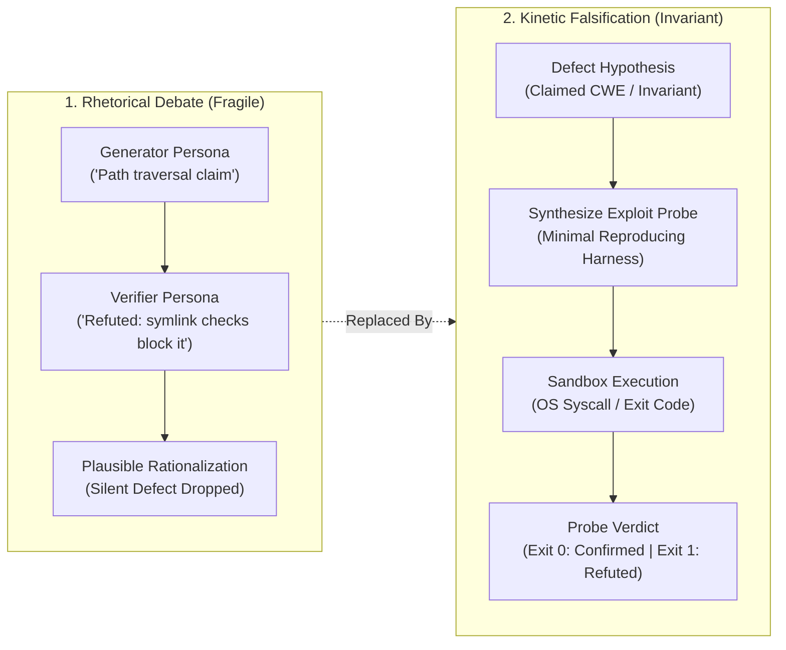
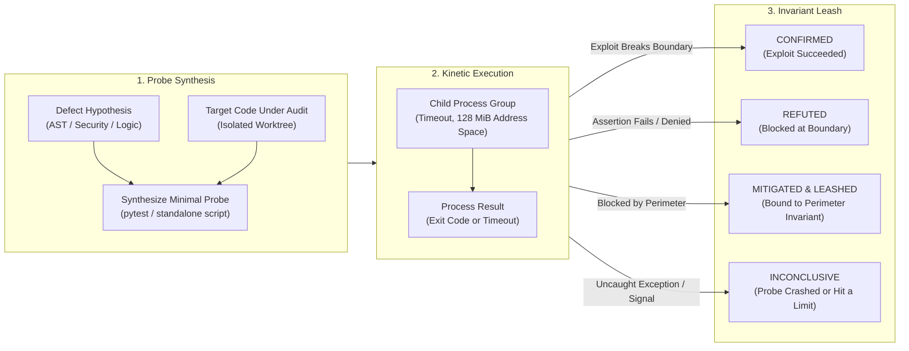

# Observation 30: Kinetic Falsification and the Ephemeral Exploit Harness

> **Project**: Multi-Agent Review Pipelines (`devops-cli` & `vibes`)
> **Environment**: Autonomous persona review pipelines, sandboxed execution harnesses, counterexample oracles
> **Classification**: Kinetic Verification, Counterexample Synthesis, Invariant Leashing, Epistemic Falsification
> **Related**: [Observation 13](./13-verify-the-finding-before-you-fix-it.md), [Observation 22](./22-self-correction-loops-vs-cegis-constraint-accumulation.md), [Observation 28](./28-recursive-self-improvement-and-the-post-harness-mandate.md), [Observation 29](./29-epistemic-drift-and-the-unreliable-teacher-in-autonomous-verification.md)
> **TLDR**: Replace rhetorical code review debate with minimal executable reproducing probes, and read each probe's exit code as evidence that is only as good as the probe.
> **ELI:7b**: Don't argue in pull request comments about whether a bug exists. Run a tiny test script; in this tool, exit code 0 means the exploit worked.

---

## 1. Executive Context & Baseline

In autonomous software development, multi-agent code review harnesses often pit generator personas (e.g., Security, QA, Performance) against downstream verifiers in an unconstrained dialectical debate. In this classical setup, verification occurs through natural language arguments: Persona A claims a flaw exists, Persona B argues that context or wrappers mitigate it, and Persona C synthesizes an executive summary.

The devops-cli review audit showed how this fails: a verifier confirmed a path traversal and then dismissed it on an asserted mitigation ("symlink rejection already blocks escape"), which does not stop `../` (devops-cli #524, #525). Such debate has an asymmetry. It is an informal argument, not a measured or proved result:

$$\text{Effort of a Safety Argument} \gg \text{Effort of a Minimal Exploit}$$

While proving program safety across unbounded input domains is generally undecidable (Rice's Theorem), demonstrating vulnerability requires only a minimal counterexample: an input $x$ such that program execution fails an invariant boundary ($\text{eval}(P, x) \to \bot$).

When verifiers operate purely through conversational prose, they are trapped in semantic plausibility. Models generate sophisticated rationalizations—hallucinating non-existent parameters, assuming distant wrappers sanitize inputs, and confusing the vocabulary of security with mechanical enforcement.

To achieve non-synthetic convergence, autonomous review must transition from **rhetorical debate** to **kinetic falsification**: requiring defect claims to synthesize an ephemeral exploit harness that executes against an isolated sandbox. "Kinetic falsification" is this repository's name, not a term of art; the usual terms are dynamic verification and a proof-of-concept (PoC) exploit or reproducer, a small program that triggers the defect.

---

## 2. The Observed Phenomenon

The scenario below is illustrative. It extends the real devops-cli path traversal case above; its token counts, timings and incidents were not recorded:

### 2.1 The Rhetorical Stall & Token Exhaustion
When analyzing potential vulnerabilities with high context complexity (e.g., path traversal across symlink boundaries or memory exhaustion via recursive JSON structures):
- Auditor and verifier personas can exchange thousands of tokens on one disputed finding in discursive debate.
- The verifier's refutation can rest on semantic inferences (*"the caller's process isolation prevents memory leaks"* or *"the path is normalized before resolution"*).
- Despite extensive reasoning, the verifier cannot settle in prose whether `pathlib.Path.resolve()` keeps a path inside the workspace when relative symlinks and `../` are present.

### 2.2 Resolution via Minimal Probe
When the harness demands an executable test probe:
1. The auditor synthesizes a short reproducing script (`test_exploit.py`) that creates an ephemeral symlink and asserts directory escape.
2. The harness executes the probe in a child process.
3. The probe returns `Exit Code 0` (exploit succeeded: escaped the workspace root).
4. The debate ends. The verifier's prose defense is falsified by a run, not by rhetoric, provided the probe tests what it claims to test.

### 2.3 The Fragile Mitigation Decay
In findings classified as `Mitigated` (e.g., an internal parser has an unbound buffer, but the public API gateway enforces a 10MB request ceiling):
- A later PR touching the gateway layer refactors routing logic and introduces a streaming upload endpoint that bypasses the 10MB buffer check.
- Because the original finding was filed as a closed or mitigated issue, no existing gate detects that the protective perimeter has been breached.
- The latent vulnerability reaches production unnoticed.

---

## 3. The Underlying Failure Mode or Catalyst

The root cause of this breakdown is **the Language Game Trap in verification**:

1. **Semantic Plausibility vs. Kinetic Truth**:
   - Natural language is high-entropy and forgiving. Words like *"sanitized,"* *"bounded,"* and *"checked"* evoke the appearance of safety without enforcing boundary constraints.
   - An LLM verifier rewards good intentions and architectural boilerplate rather than verifying state transitions.
2. **The High Cost of Proof vs. The Low Cost of Exploits**:
   - Attempting to prove program correctness via static LLM analysis requires reasoning across all possible control-flow paths.
   - Synthesizing a concrete input that trips an assertion requires finding only **one** violating trace. That search can still be hard; guided generation narrows it.
3. **The Unanchored Perimeter (Decoupled Mitigations)**:
   - Mitigations exist as distributed invariants across space and time. A mitigation in module $B$ protecting module $A$ is an unindexed coupling. Without continuous kinetic probes, the mitigation suffers inevitable temporal decay.

---

## 4. Remediation & Architectural Pattern

The pattern below addresses this failure: the **Kinetic Exploit Probe and Invariant Leashing Pattern**:

### Core Invariants:

1. **The Kinetic Falsification Mandate**:
   - No security or logical defect claim may be classified as `Confirmed` or `Refuted` without an accompanying executable probe script.
   - The probe must be self-contained, minimal, and execute within a timeout (default $5.0$ s). `tools/kinetic_probe.py` sets `RLIMIT_AS` in the child to cap its address space at 128 MiB (`DEFAULT_MEMORY_LIMIT_BYTES`). The cap counts virtual memory, not resident memory, so a probe that starts threads or maps large files can reach it early.
2. **Ground-Truth Execution Oracles**:
   - `tools/kinetic_probe.py` runs the probe as a child Python process in the workspace root, with the caller's environment. The child starts a new POSIX process group, and a timeout kills that whole group. A process that starts its own session leaves the group, and the timeout does not kill it. The timeout and the address-space cap are the only limits. The tool uses no namespace, container, seccomp filter, or file or network restriction, so it is not a sandbox: run untrusted probes inside one (for example `examples/ephemeral-container-sandbox/`).
   - Verdicts are mapped directly from exit status:
     - `Exit 0` (Exploit Assertion Tripped / Invariant Breached): **Confirmed Defect**.
     - `Exit 1` (Input Rejected with Expected ValidationError / PermissionError): **Kinetically Refuted**. The probe must catch the expected rejection and exit with 1 itself.
     - Any other exit: **Inconclusive**. This includes an uncaught exception (for example an `ImportError`, or a `MemoryError` at the address-space cap), which the tool reports as exit 70, and a kill by a signal. A broken probe refutes nothing.
     - `Timeout` (Resource Exhaustion / Infinite Loop): reported as **resource exhaustion**. A slow probe also lands here, so a timeout alone does not confirm a CWE-400 defect.
3. **Invariant Leashing for Mitigated Findings**:
   - When a defect is mitigated by a perimeter wrapper, the probe is synthesized against the **integrated perimeter** and asserted to pass (blocked).
   - This probe is registered as an **Invariant Leash**.
   - If a future commit modifies files participating in the mitigating perimeter, `InvariantLeashRegistry.get_invalidated_defects()` lists the defects whose perimeter changed. Re-running their probes, and promoting a finding whose perimeter no longer blocks the payload, is left to the caller.

---

## 5. Verifiable Impact & Key Takeaways

No measurement of this pattern on review corpora exists in this repository, so no token, latency or acceptance figures are reported here. `tests/test_kinetic_probe.py` checks the exit-code mapping, the address-space cap, the process-group kill on timeout and the leash registry on hand-written probes (`pytest tests/test_kinetic_probe.py`: 12 passed). An exit code is only as good as the probe that produced it: a model-written probe that tests the wrong thing gives a confident wrong verdict.

### Summary Maxim:
> *Rhetoric is the refuge of hallucinated safety. In autonomous engineering, truth is not negotiated in natural language—truth is an exit code from a kinetic probe.*
